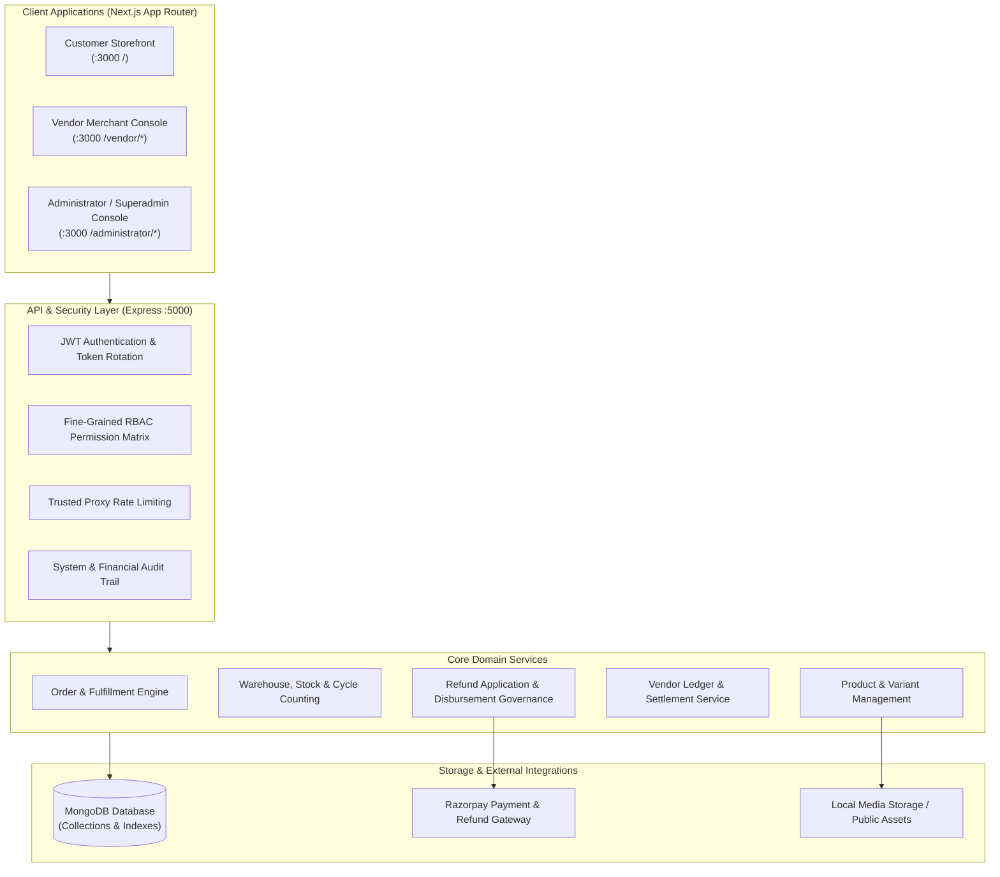

# Buybox E-Commerce — Multi-Vendor Marketplace Platform

A production-grade, full-stack multi-vendor e-commerce platform built on the MERN stack with Next.js App Router, Express, and MongoDB. Buybox features an enterprise-grade multi-tenant architecture with separate interfaces for customers, vendor merchants, and platform administrators, underpinned by authoritative financial ledger accounting, rigorous role-based access control (RBAC), and physical warehouse inventory reconciliation.

---

## Architecture & System Overview



---

## Key Marketplace Capabilities

### 1. Customer Storefront
- **Modern Responsive Experience:** High-performance catalog browsing, category filtering, search, and dynamic product landing pages.
- **Cart & Wishlist Lifecycle:** Real-time stock reservation, basket persistence, discount coupon redemption, and multi-vendor checkout.
- **Order Management & Returns:** Self-service order tracking, delivery timelines, and customer return request (RMA) filing with reason capture.
- **Account Governance:** Secure authentication (Email OTP, Google OAuth), profile management, saved addresses, and permanent account deletion lifecycle.

### 2. Vendor Merchant Console
- **Product & Catalog Management:** Physical and digital product publishing, variant matrix (SKUs, sizes, colors), attributes, and media gallery.
- **Warehouse & Inventory Operations:**
  - Multi-warehouse fulfillment center details and tenant-isolated stock allocation.
  - Controlled goods receiving, damaged/expired inventory segregation, and stock adjustment ledgers.
  - Inter-warehouse stock transfers with in-transit verification.
  - Physical cycle counting, blind stock auditing, and movement-aware discrepancy reconciliation.
- **Warehouse Analytics & Stock Intelligence:** Inventory turnover velocity, stock aging analysis, low-stock reorder thresholds, and product performance aggregation.
- **Merchant Order Fulfillment & Returns:** Pick-pack-ship workflows, return inspection, RMA verification, and merchant refund application filing.
- **Financial Ledger & Settlements:** Real-time wallet balance, settlement statements, commission breakdowns, and bank account registration.

### 3. Administrator & Superadmin Console
- **Fine-Grained RBAC & Governance:** Dynamic permission registry, job roles, granular permission matrices, and admin account security controls.
- **Refund Authority Separation:** Complete operational separation between merchant return inspection and administrative refund disbursement.
- **Gateway Reconciliation:** Dual-phase Razorpay payment verification, webhook ingestion, refund pool accounting, and duplicate disbursement prevention.
- **Financial Compliance & Settlement Oversight:** Platform commission management, withdrawal approvals, ledger variance audits, and compliance tracking.
- **Merchant & Customer Administration:** Vendor onboarding verification, KYC compliance, customer support ticketing, and platform settings.

---

## Technical Stack

| Layer | Technologies |
|---|---|
| **Frontend Framework** | [Next.js](https://nextjs.org/) (App Router, React 19, Turbopack / Webpack) |
| **Styling & UI** | [Tailwind CSS](https://tailwindcss.com/), Lucide React Icons, Custom Component System |
| **State Management** | [Zustand](https://github.com/pmndrs/zustand) (Client stores, auth session, cart state) |
| **Backend Runtime** | [Node.js](https://nodejs.org/) (v18+ LTS, v20+) |
| **Backend Framework** | [Express](https://expressjs.com/) (RESTful APIs, modular router architecture) |
| **Database** | [MongoDB](https://www.mongodb.com/) (Mongoose ODM, replica-set transaction support) |
| **Payment Gateway** | [Razorpay](https://razorpay.com/) (Orders, payments, webhooks, refund API) |
| **Authentication** | JSON Web Tokens (Access + Refresh tokens with HttpOnly cookies), Google OAuth 2.0 |
| **Testing** | [Jest](https://jestjs.io/), Supertest, React Testing Library |

---

## Repository Directory Layout

```text
Buybox-Ecommerce/
├── backend/                  # Express REST API application
│   ├── src/
│   │   ├── config/           # Database, environment, and payment config
│   │   ├── constants/        # System constants and RBAC permissions
│   │   ├── controllers/      # Route controllers (Admin, Vendor, Customer)
│   │   ├── middlewares/      # Auth, RBAC gate, validation, rate limiting
│   │   ├── models/           # Mongoose schemas and models
│   │   ├── repositories/     # Data access and aggregation layer
│   │   ├── routes/           # Express route definitions
│   │   ├── services/         # Business logic and domain services
│   │   └── validators/       # Request payload validation schemas
│   ├── tests/                # Jest integration and unit test suites
│   ├── storage/              # Local uploaded assets and media
│   └── package.json          # Backend dependencies and scripts
│
├── frontend/                 # Next.js App Router application
│   ├── src/
│   │   ├── app/              # Next.js App Router pages and route handlers
│   │   │   ├── (storefront)/ # Customer storefront routes
│   │   │   ├── administrator/# Admin and Superadmin console pages
│   │   │   └── vendor/       # Vendor merchant console pages
│   │   ├── components/       # Reusable UI component library
│   │   ├── constants/        # Frontend permissions and config
│   │   ├── hooks/            # Custom React hooks (auth, permissions)
│   │   ├── lib/              # Client utilities, Axios instance, helpers
│   │   ├── services/         # Frontend API service wrappers
│   │   └── stores/           # Zustand client stores
│   ├── tests/                # Frontend Jest unit test suites
│   └── package.json          # Frontend dependencies and scripts
│
├── docs/                     # Authoritative platform documentation
│   ├── architecture/         # System design, UI/UX design standards
│   ├── api/                  # Authoritative backend API contracts
│   ├── operations/           # Production deployment & rollback runbooks
│   ├── security/             # Authorization matrix & authentication flows
│   ├── database/             # Migration specifications & data models
│   └── archive/              # Categorized historical phase reports & audits
│       ├── phase-reports/    # Domain-specific historical reports
│       └── repository-cleanup-01/ # Cleanup specifications and inventory
│
└── package.json              # Root project configuration
```

---

## Getting Started & Local Development

### 1. Prerequisites
- **Node.js:** v18.17.0 or higher (v20+ recommended)
- **MongoDB:** v6.0 or higher running locally (or MongoDB Atlas connection string)
- **Git:** Installed and configured

### 2. Clone the Repository
```bash
git clone https://github.com/pritammondal-dev/Buybox-Ecommerce.git
cd Buybox-Ecommerce
```

### 3. Backend Setup
```bash
cd backend
npm install
```

Create a `.env` file in `backend/` (refer to `.env.example` if available, or configure as below):
```ini
PORT=5000
NODE_ENV=development
MONGODB_URI=mongodb://localhost:27017/buybox
JWT_SECRET=your_jwt_secret_key_here
JWT_EXPIRES_IN=1d
REFRESH_TOKEN_SECRET=your_refresh_token_secret_here
REFRESH_TOKEN_EXPIRES_IN=7d
CLIENT_URL=http://localhost:3000
RAZORPAY_KEY_ID=your_razorpay_key_id
RAZORPAY_KEY_SECRET=your_razorpay_key_secret
RAZORPAY_WEBHOOK_SECRET=your_razorpay_webhook_secret
```

Start the backend development server:
```bash
npm run dev
# Server will listen on http://localhost:5000
```

### 4. Frontend Setup
```bash
cd ../frontend
npm install
```

Create a `.env.local` file in `frontend/`:
```ini
NEXT_PUBLIC_API_URL=http://localhost:5000/api/v1
NEXT_PUBLIC_SOCKET_URL=http://localhost:5000
```

Start the frontend development server:
```bash
npm run dev
# Frontend will be accessible at http://localhost:3000
```

---

## Testing & Verification

### Backend Tests
The backend test suite covers authentication, RBAC authorization, refund governance, inventory movements, and customer management:
```bash
# Run specific integration test suite
npm --prefix backend test -- tests/phase-customer-account-delete-01.test.js --runInBand

# Run all backend tests
npm --prefix backend test
```

### Frontend Tests
The frontend unit test suite covers component behavior, RBAC permission gates, and page rendering:
```bash
# Run frontend unit tests
npm --prefix frontend test -- --watchAll=false
```

### Production Build Verification
To ensure all pages compile cleanly without TypeScript or Webpack errors:
```bash
npm --prefix frontend run build
```

---

## Authoritative Documentation Directory

Explore the dedicated technical documentation located under `docs/`:

- [**System Architecture & Standards**](docs/architecture/): Frontend API architecture and vendor dashboard design standards.
- [**API Contracts**](docs/api/): Authoritative backend endpoint specifications, request payloads, and response envelopes.
- [**Operations & Deployment**](docs/operations/): Production runbooks, environment setup, and emergency rollback procedures.
- [**Security & RBAC Matrix**](docs/security/): Route authorization tables, role mappings, and authentication lifecycles.
- [**Database & Migrations**](docs/database/): Schema migration specifications, indexing strategies, and inventory transitions.
- [**Historical Phase Archives**](docs/archive/): Comprehensive record of completed development phases, forensic audits, and test reports.

---

## License

This project is proprietary software developed for Buybox E-Commerce. All rights reserved.
