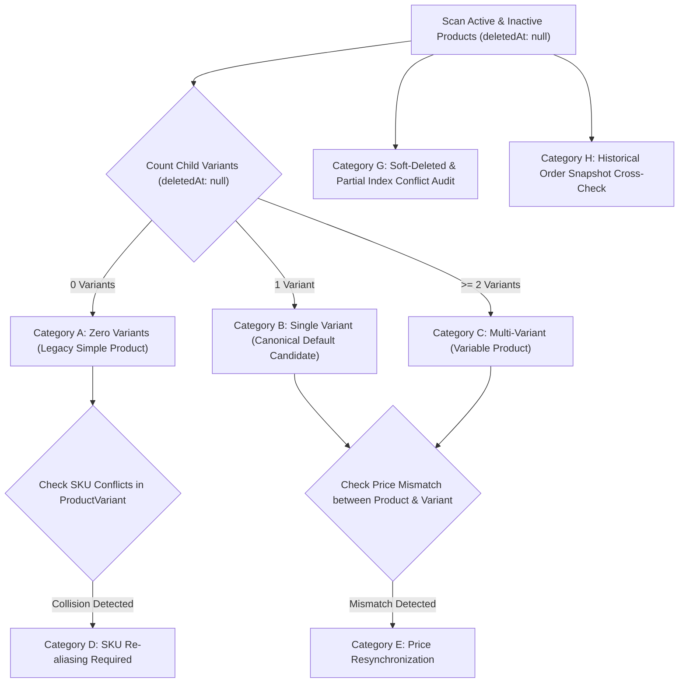

# BUYBOX E-COMMERCE
# PHASE 2A: CATALOG DATA MIGRATION & BACKFILL SPECIFICATION
## Idempotent Dry-Run Architecture, Legacy Reconciliation, and Rollback Procedures

---

## 1. Executive Summary & Forensic Context

During Phase 1 forensic auditing, 11 system defects were confirmed across the Buybox catalog, variant, cart, and order pipeline. The most critical defect (**DEF-01**) caused `Product.create()` to persist documents solely in the `products` collection without provisioning corresponding records in the `product_variants` collection. Consequently, legacy simple products could not be added to cart, quoted for checkout, allocated inventory, or fulfilled without throwing `400 NO_PURCHASABLE_VARIANT`.

Phase 2A established the canonical product/variant contract:
1. Every purchasable product has an authoritative variant representation in `product_variants`.
2. **Simple Products** possess exactly one active canonical default variant (`isDefault: true`), inheriting SKU, price, dimensions, and shipping class from the parent product.
3. **Variable Products** (`productType: "variable"`) possess one or more explicit purchasable variants (`isDefault: false`), with parent `Product.price` reflecting the minimum active variant price for storefront display and sorting.
4. **Authoritative Checkout**: All transactions, cart line items, and order line snapshots reference `ProductVariant._id` and `ProductVariant.price`.

This document specifies the data migration and reconciliation procedure required to backfill existing catalog records. **In compliance with Phase 2A constraints, no live or destructive database migration is executed in this phase.**

---

## 2. Legacy Catalog Segmentation & Classification Heuristics

The catalog backfill partitions existing MongoDB documents into 8 deterministic categories:



### Classification Heuristics

| Category | Description | Heuristic / Query Filter | Target Migration Action |
| :--- | :--- | :--- | :--- |
| **Category A** | Legacy products with 0 variants | `Product.find({ deletedAt: null })` where `ProductVariant.countDocuments({ productId: p._id }) === 0` | Set `productType: "simple"`. Provision canonical default variant with `isDefault: true`, `sku: p.sku`, `price: p.price`, `stockQuantity: 0`, and warehouse inventory record. |
| **Category B** | Products with exactly 1 variant | `ProductVariant.countDocuments({ productId: p._id, deletedAt: null }) === 1` | Set `productType: "simple"`. Ensure child variant has `isDefault: true`. If variant SKU differs from parent, set variant SKU as canonical and parent SKU as alias. |
| **Category C** | Products with 2+ variants | `ProductVariant.countDocuments({ productId: p._id, deletedAt: null }) > 1` | Set `productType: "variable"`. Ensure all child variants have `isDefault: false`. Recalculate parent `Product.price = min(variant.price)`. |
| **Category D** | SKU collisions across collections | `Product.sku === Existing ProductVariant.sku` (where `variant.productId !== product._id`) | Suffix conflicting variant or product SKU with `-RECONCILED-<hex>`, maintaining immutable reference on historical order line items. |
| **Category E** | Price mismatches | For Simple: `Product.price !== Variant.price`. For Variable: `Product.price !== min(variants.price)`. | For simple products, align default variant price to parent authorized price. For variable products, update parent price to `min(activeVariants.price)`. |
| **Category F** | Missing inventory records | `ProductVariant` records with zero documents in `inventories` collection. | Provision opening inventory in primary default warehouse (`onHand: variant.stockQuantity || 0`, `reserved: 0`). |
| **Category G** | Soft-deleted records with index conflicts | Records with `deletedAt !== null` holding SKUs matching active records. | Covered by Phase 2A partial unique index `{ unique: true, partialFilterExpression: { deletedAt: null } }`. Verify legacy indexes are dropped and replaced. |
| **Category H** | Historical orders referencing variants | `Order.items.productVariantId` | Strictly immutable. Verify that no ID re-assignment touches IDs referenced in historical order documents. |

---

## 3. Idempotent Dry-Run Design (Non-Destructive)

A standalone inspection script (`backend/scripts/catalog-dryrun-audit.js`) will be provided to produce a non-destructive JSON and Markdown report.

### Dry-Run Report Schema
```json
{
  "dryRunTimestamp": "2026-10-10T12:00:00.000Z",
  "database": "buybox",
  "totalProductsAudited": 1250,
  "summary": {
    "zeroVariantProducts": 420,
    "singleVariantProducts": 680,
    "multiVariantProducts": 150,
    "skuCollisionsDetected": 3,
    "priceMismatchesDetected": 45,
    "missingInventoryRecords": 420
  },
  "actionPlan": [
    {
      "productId": "6640abc...",
      "sku": "PROD-100",
      "action": "PROVISION_DEFAULT_VARIANT",
      "proposedVariantSku": "PROD-100",
      "proposedPrice": "499.00",
      "proposedStock": 0
    }
  ]
}
```

---

## 4. Execution Plan (Scheduled for Phase 2B Post-Approval)

1. **Database Snapshot**: Execute `mongodump` of `products`, `product_variants`, and `inventories` before running any write operations.
2. **Transaction Batches**: Process records in batches of 100 documents within MongoDB ACID sessions (`withTransaction`).
3. **Idempotency Guard**:
   - Every provisioned default variant includes a migration metadata marker:
     ```js
     migrationMeta: {
       backfilledAt: new Date(),
       phase: "2A",
       originalProductId: product._id
     }
     ```
   - If rerun, the backfill identifies existing `migrationMeta` and skips already processed products without creating duplicate records.
4. **Logging & Auditing**: Record `governance.service` audit log entries for each batch completed.

---

## 5. Rollback & Disaster Recovery Procedures

If unexpected data discrepancies occur during backfill execution in Phase 2B:
1. **Targeted Rollback Script**:
   ```js
   // Remove only auto-provisioned default variants created by the migration
   await ProductVariant.deleteMany({ "migrationMeta.phase": "2A" });
   // Revert productType to legacy unset state
   await Product.updateMany({ "migrationMeta.phase": "2A" }, { $unset: { productType: "" } });
   ```
2. **Full Collection Restore**:
   ```bash
   mongorestore --drop --db buybox --collection products ./dump/products.bson
   mongorestore --drop --db buybox --collection product_variants ./dump/product_variants.bson
   mongorestore --drop --db buybox --collection inventories ./dump/inventories.bson
   ```
3. **Historical Order Guarantee**: No backfill or rollback operation touches the `orders`, `order_items`, `payments`, or `settlements` collections.

---

## 6. Verification & Reconciliation Checksum Matrix

Following the migration, the following automated invariants must evaluate to `0`:

| Invariant Check | Query Condition | Acceptable Post-Migration Count |
| :--- | :--- | :--- |
| **Unrepresented Products** | Active products with 0 variants | `0` |
| **Simple Products without Default Variant** | `productType: "simple"` with 0 `isDefault: true` variants | `0` |
| **Simple Products with Multiple Default Variants** | Simple products with > 1 `isDefault: true` variants | `0` |
| **SKU Collisions (Cross-collection)** | Non-deleted Product.sku matching non-child ProductVariant.sku | `0` |
| **Orphaned Cart Line Items** | Active carts referencing non-existent variants | `0` |
| **Modified Order Snapshots** | Order item unit price diff against historical payment | `0` |

---
**Status**: SPECIFICATION COMPLETE — Awaiting Phase 2B Gate Approval before execution.
