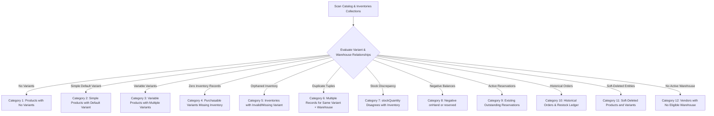

# BUYBOX E-COMMERCE
# PHASE 2B: WAREHOUSE INVENTORY MIGRATION & RECONCILIATION SPECIFICATION
## Authoritative Inventory Alignment, Discrepancy Auditing, Idempotent Backfill Architecture, and Rollback Procedures

---

## 1. Executive Summary & Forensic Context

Phase 2A established the canonical product/variant model across the Buybox-Ecommerce catalog (`productType: simple | variable`, canonical default variants for simple products, explicit purchasable variants for variable products).

However, forensic analysis of the inventory pipeline revealed deep structural discrepancies between legacy product/variant representations and warehouse-level inventory:
1. **Competing Sources of Truth**: `ProductVariant.stockQuantity` historically competed with `Inventory.onHand` and `Inventory.reserved`, leading to desynchronization where cart validation or catalog listings read stale integer fields while physical warehouses held different or zero balances.
2. **Missing Inventory Records**: Newly provisioned or legacy variants frequently lacked corresponding records in the `inventories` collection (`productVariantId + warehouseId`), causing checkout or reservation failures.
3. **Unassigned or Ineligible Warehouses**: Legacy variants existed without valid warehouse associations, or vendors lacked active fulfillment centers.
4. **Duplicate Inventory Records & Orphaned References**: Prior unconstrained writes occasionally produced multiple inventory rows for identical variant/warehouse tuples or pointed to deleted/non-existent variants.
5. **Divergent Stock Balances**: Variants had positive `stockQuantity` but zero or divergent `Inventory.onHand`, or possessed negative `onHand`/`reserved` counts from un-guarded cancellations or manual overrides.

### Phase 2B Authoritative Contract
Under Phase 2B:
- The `inventories` collection (`productVariantId + warehouseId`) is the **sole authoritative record** for physical stock availability (`availableQuantity = onHand - reserved`).
- `ProductVariant.stockQuantity` is strictly a read-only compatibility mirror derived from active, eligible warehouse inventory and must never be mutated independently or trusted for reservation decisions.
- Cart availability, checkout, order reservation, cancellation, expiry, and restocking read and mutate warehouse `Inventory` exclusively.

**In compliance with Phase 2B constraints, this document specifies the forensic reconciliation and backfill architecture. NO LIVE OR DESTRUCTIVE DATABASE MIGRATION IS EXECUTED IN THIS PHASE.**

---

## 2. Legacy Inventory Segmentation & Forensic Categories

The inventory reconciliation pipeline classifies all catalog and inventory records into 12 deterministic categories:



### Detailed Category Matrix & Reconciliation Heuristics

| Category | Description | Query Condition / Detection Rule | Authoritative Reconciliation Policy |
| :--- | :--- | :--- | :--- |
| **Category 1** | Products with no variants | `Product.find({ deletedAt: null })` where `ProductVariant.countDocuments({ productId: p._id }) === 0` | Prerequisite: Resolve via Phase 2A catalog backfill by creating canonical default variant (`isDefault: true`). Then provision initial `Inventory` record (`onHand: 0, reserved: 0`) in vendor's active primary warehouse. |
| **Category 2** | Simple products with default variant | `Product.find({ productType: "simple" })` with child variant `isDefault: true` | Ensure child default variant has exactly one active inventory record per eligible warehouse. If zero inventory records exist, provision opening record in primary warehouse. |
| **Category 3** | Variable products with multiple variants | `Product.find({ productType: "variable" })` with multiple child variants | For each active purchasable variant (`isDefault: false`), ensure inventory records exist across assigned fulfillment warehouses. |
| **Category 4** | Variants with no inventory records | `ProductVariant.find({ deletedAt: null })` where `Inventory.countDocuments({ productVariantId: v._id }) === 0` | Resolve vendor primary active warehouse. Provision new `Inventory` record with `onHand: 0, reserved: 0`. **Do not blindly copy legacy `stockQuantity` into live inventory**; log for explicit operator review (see Section 3.2). |
| **Category 5** | Inventory records with invalid/missing variant | `Inventory.find()` where `productVariantId` does not match any document in `ProductVariant` | Mark as orphaned. Record in audit ledger. Move to quarantine collection `inventories_quarantine` or soft-delete. Under no circumstances may orphaned records contribute to live catalog availability. |
| **Category 6** | Multiple inventory records for same variant + warehouse | `Inventory.aggregate()` grouping by `[productVariantId, warehouseId]` with `count > 1` | Identify the canonical record (latest updated or highest onHand). Consolidate `onHand = sum(onHand)` and `reserved = sum(reserved)` into canonical record within an ACID transaction. Archive duplicate record to `inventories_dedup_archive`. |
| **Category 7** | Legacy `stockQuantity` diverges from warehouse inventory | `ProductVariant.stockQuantity !== sum(Inventory.onHand - Inventory.reserved)` | **Inventory is authoritative.** Set `ProductVariant.stockQuantity = max(0, sum(eligible Inventory.availableQuantity))` and align `ProductVariant.stockStatus`. Never overwrite physical warehouse inventory based on legacy variant integers. |
| **Category 8** | Negative or inconsistent quantities | `Inventory.find({ $or: [{ onHand: { $lt: 0 } }, { reserved: { $lt: 0 } }, { reserved: { $gt: "$onHand" } }] })` | Flag as CRITICAL discrepancy. Clamp `reserved = max(0, reserved)` if no active order holds reservation. If `onHand < 0`, reset to `0` and write an audit correction transaction (`type: "adjustment"`, reason: `"MIGRATION_CLAMP_NEGATIVE"`). |
| **Category 9** | Existing active reservations | `Inventory.find({ reserved: { $gt: 0 } })` | Verify against active orders (`status: "PENDING_PAYMENT"` within 15-minute TTL). If reservation is orphaned (no pending order found or order expired > 15m), release reservation atomically back to `availableQuantity`. |
| **Category 10** | Historical orders and returns | Completed, cancelled, or returned orders in `orders` collection | Strictly immutable. Historical line snapshots (`order.items.productVariantId`, `price`, `warehouseId`) are preserved. Return restock events only credit inventory if verified un-restocked via `InventoryTransaction`. |
| **Category 11** | Soft-deleted products and variants | `ProductVariant.find({ deletedAt: { $ne: null } })` | Soft-deleted variants with `reserved > 0` cannot be purged until reservations expire or are released. Zero out `availableQuantity` for soft-deleted variants to prevent accidental storefront indexing. |
| **Category 12** | Vendors with no eligible warehouse | Active products/variants whose vendor has no warehouse with `isActive: true, deletedAt: null` | Flag as `WAREHOUSE_NOT_CONFIGURED`. Do not fabricate arbitrary warehouse entities. Require vendor/admin onboarding before provisioning physical stock. |

---

## 3. Discrepancy Reconciliation Heuristics & Rules of Engagement

### 3.1 Prohibition on Double-Counting
> [!CAUTION]
> **CRITICAL RULE**: The migration script must NEVER automatically execute `Inventory.onHand = Inventory.onHand + ProductVariant.stockQuantity`.
> If an inventory record already has `onHand: 5` and the variant has legacy `stockQuantity: 5`, summing them would fabricate 10 physical units, resulting in physical overselling and warehouse stockouts.

### 3.2 Conflict Resolution Heuristics for Divergent Balances
When `ProductVariant.stockQuantity` and `Inventory.onHand` disagree:
1. **Rule 1 (Warehouse Exists with Physical Stock)**: If `Inventory.onHand > 0`, warehouse inventory is treated as ground physical truth. `ProductVariant.stockQuantity` is updated to reflect warehouse `availableQuantity`.
2. **Rule 2 (Zero Inventory Record, Legacy Stock > 0)**: If `Inventory.onHand === 0` but `ProductVariant.stockQuantity > 0`:
   - If `dryRun` mode: Flagged as `AMBIGUOUS_UNPROVISIONED_STOCK`.
   - In live migration: Default to safe conservative zero (`onHand: 0`). Require explicit operator flag `--accept-legacy-variant-stock` to populate `onHand = variant.stockQuantity` accompanied by a mandatory `InventoryTransaction` audit record (`reason: "LEGACY_STOCK_MIGRATION_CONVERSION"`).
3. **Rule 3 (Multiple Warehouses)**: Total variant available stock is the sum of `(onHand - reserved)` strictly across active, non-deleted warehouses assigned to the vendor.

---

## 4. Idempotent Dry-Run Architecture

A dedicated migration CLI script (`backend/scripts/inventory-migration-audit.js`) provides read-only analysis and discrepancy reporting.

### Command Syntax
```bash
# Dry-run audit (read-only, produces JSON + Markdown report)
node backend/scripts/inventory-migration-audit.js --mode=dry-run --db=mongodb://127.0.0.1:27017/buybox

# Target specific vendor or product range
node backend/scripts/inventory-migration-audit.js --mode=dry-run --vendorId=6640...

# Live migration (requires explicit approval flag and backup confirmation)
node backend/scripts/inventory-migration-audit.js --mode=execute --confirm-backup=s3://buybox-backups/2026-10-10
```

### Dry-Run Output Schema (`reports/inventory-audit-report-<timestamp>.json`)
```json
{
  "auditTimestamp": "2026-10-10T20:00:00.000Z",
  "environment": "production-preflight",
  "database": "buybox",
  "summary": {
    "totalVariantsAudited": 4520,
    "totalInventoriesAudited": 4210,
    "variantsWithZeroInventory": 310,
    "orphanedInventoryRecords": 4,
    "duplicateInventoryTuples": 2,
    "stockDivergencesDetected": 185,
    "negativeStockDetected": 1,
    "orphanedReservationsDetected": 6,
    "vendorsMissingWarehouse": 3
  },
  "actionPlan": [
    {
      "category": "Category 4",
      "action": "PROVISION_OPENING_INVENTORY",
      "variantId": "6640abc12345678901234567",
      "sku": "TSHIRT-BLK-M",
      "warehouseId": "6640wh123456789012345678",
      "proposedOnHand": 0,
      "proposedReserved": 0,
      "legacyVariantStockQuantity": 25,
      "flag": "AMBIGUOUS_UNPROVISIONED_STOCK"
    },
    {
      "category": "Category 6",
      "action": "DEDUPLICATE_INVENTORY_TUPLE",
      "variantId": "6640def12345678901234568",
      "warehouseId": "6640wh123456789012345678",
      "records": [
        { "inventoryId": "6640inv1", "onHand": 10, "reserved": 2 },
        { "inventoryId": "6640inv2", "onHand": 5, "reserved": 0 }
      ],
      "consolidatedOnHand": 15,
      "consolidatedReserved": 2
    }
  ]
}
```

---

## 5. Execution Plan & Operator Safeguards

### 5.1 Pre-Execution Prerequisites
1. **Full Database Snapshot**: Verify active `mongodump` of `inventories`, `inventory_transactions`, `products`, `product_variants`, and `warehouses`.
2. **Maintenance Mode / Read-Only Window**: Pause active cart checkouts or schedule during off-peak window to prevent in-flight reservation race conditions.
3. **Primary Replica Set Verification**: Ensure MongoDB transaction support is verified on primary node.

### 5.2 Transactional Batch Execution
- Records are processed in deterministic batches of 50 variants within MongoDB ACID sessions (`session.withTransaction()`).
- Each provisioned or reconciled inventory document is stamped with migration idempotency markers:
  ```js
  migrationMeta: {
    backfilledAt: new Date(),
    phase: "2B",
    originalOnHand: previousOnHand,
    originalReserved: previousReserved,
    reconciliationRule: "AUTHORITATIVE_INVENTORY_ALIGNMENT"
  }
  ```
- Rerunning the migration will detect `migrationMeta.phase === "2B"` and safely skip already-reconciled records.

### 5.3 Audit Logging
Every modified inventory record emits a formal `InventoryTransaction` document:
```js
{
  inventoryId: inventory._id,
  type: "adjustment",
  quantity: deltaOnHand,
  previousOnHand: previousOnHand,
  newOnHand: targetOnHand,
  reason: "PHASE_2B_MIGRATION_RECONCILIATION",
  referenceType: "migration",
  referenceId: migrationExecutionId,
  createdBy: operatorUserId,
  createdAt: new Date()
}
```

---

## 6. Rollback & Disaster Recovery Procedures

In the event of an unpredicted discrepancy or operational rollback command:

### 6.1 Targeted Compensating Rollback Script
```javascript
// 1. Restore archived duplicate inventory records
const archived = await db.collection("inventories_dedup_archive").find({ "migrationMeta.phase": "2B" }).toArray();
for (const item of archived) {
  const { _id, ...cleanDoc } = item;
  await db.collection("inventories").insertOne(cleanDoc);
}

// 2. Revert inventory onHand/reserved using migrationMeta original snapshots
const modifiedInventories = await db.collection("inventories").find({ "migrationMeta.phase": "2B" }).toArray();
for (const inv of modifiedInventories) {
  await db.collection("inventories").updateOne(
    { _id: inv._id },
    {
      $set: {
        onHand: inv.migrationMeta.originalOnHand,
        reserved: inv.migrationMeta.originalReserved
      },
      $unset: { migrationMeta: "" }
    }
  );
}

// 3. Purge opening inventory records created exclusively by Phase 2B
await db.collection("inventories").deleteMany({
  "migrationMeta.phase": "2B",
  "migrationMeta.reconciliationRule": "OPENING_INVENTORY_PROVISIONED"
});
```

### 6.2 Full Collection Point-In-Time Restore
```bash
mongorestore --drop --db buybox --collection inventories ./dump/buybox/inventories.bson
mongorestore --drop --db buybox --collection inventory_transactions ./dump/buybox/inventory_transactions.bson
mongorestore --drop --db buybox --collection product_variants ./dump/buybox/product_variants.bson
```

---

## 7. Post-Migration Verification & Reconciliation Checksum Matrix

Following migration execution, the verification query suite must confirm that the following discrepancies evaluate strictly to `0`:

| Checkpoint Identifier | Description | Invariant Query Filter | Expected Post-Migration Count |
| :--- | :--- | :--- | :--- |
| **CHK-INV-01** | Active Purchasable Variants Missing Inventory | `ProductVariant.find({ deletedAt: null })` without active `Inventory` | `0` |
| **CHK-INV-02** | Duplicate Inventory Tuples | `Inventory` grouped by `[productVariantId, warehouseId]` with count > 1 | `0` |
| **CHK-INV-03** | Orphaned Inventory Records | `Inventory` referencing non-existent `productVariantId` | `0` |
| **CHK-INV-04** | Inconsistent Negative Balances | `Inventory.find({ $or: [{ onHand: { $lt: 0 } }, { reserved: { $lt: 0 } }] })` | `0` |
| **CHK-INV-05** | Oversold Negative Available Stock | `Inventory.find({ $expr: { $gt: ["$reserved", "$onHand"] } })` | `0` |
| **CHK-INV-06** | Orphaned Reservations | `Inventory.find({ reserved: { $gt: 0 } })` with no matching pending order | `0` |
| **CHK-INV-07** | Stale Variant Stock Mirror | `ProductVariant` where `stockQuantity !== sum(active eligible inventory available)` | `0` |

---

## 8. Current Implementation Status & Phase Gate

- **Specification State**: COMPLETE & APPROVED FOR PREFLIGHT AUDITING.
- **Production Execution**: **NOT EXECUTED.** No live database records or indexes have been mutated.
- **Next Steps**: Awaiting Phase 2B review and formal operator sign-off before running dry-run preflight audits against production replica sets.
