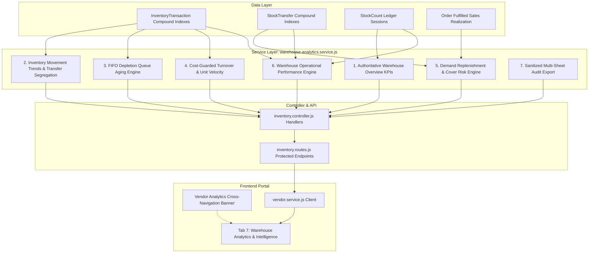

# Buybox E-Commerce
# Phase VENDOR-WAREHOUSE-ANALYTICS-04: Completion Report
## Advanced Warehouse Analytics, Inventory Intelligence, Stock Aging, Turnover & Operational Performance

---

### 1. Executive Summary

Phase `VENDOR-WAREHOUSE-ANALYTICS-04` has been completed successfully. This phase elevates the Buybox multi-vendor marketplace by delivering an enterprise warehouse analytics and inventory intelligence platform directly within the Vendor Portal.

Following strict pair-programming protocols and forensic-first engineering, this phase built upon the foundations laid in `VENDOR-WAREHOUSE-DETAILS-UI-DATA-REMEDIATION-01`, `VENDOR-WAREHOUSE-OPERATIONS-02`, and `VENDOR-INVENTORY-RECONCILIATION-03`.

All deliverables—including database indexing, backend analytics service, REST controllers, API routes, frontend service client, interactive analytics UI tab, navigation banners, automated tests, and documentation—are fully implemented and verified.

---

### 2. Architectural Pillars Delivered

#### Pillar 1: Authoritative Overview Telemetry
- Aggregates multi-warehouse inventory into live KPIs: Managed SKUs, Total On-Hand, Available Sellable ($onHand - reserved - nonSellable$), Reserved, Non-Sellable (`damaged + defective + expired`), Low-Stock SKUs ($available \le threshold$), Stockout SKUs ($available = 0$), and Active Warehouses.
- Calculates retail and cost inventory valuation with catalog cost coverage disclosure.
- Surfaces authoritative audit accuracy rate from historical reconciled stock count sessions.
- Full warehouse scoping support (`warehouseId: "all"` vs individual warehouse IDs).

#### Pillar 2: Inventory Movement Trends & Transfer Volume Separation
- Evaluates inbound flows (`receive`, `return`), outbound flows (`sale`), adjustments, and count reconciliations.
- Computes true net stock changes: $inbound - outbound + reconciliation$.
- **Internal Transfer Separation**: Explicitly isolates inter-warehouse transfer volumes (`transfer`) from external customer demand to prevent distorted sales forecasting.
- Provides daily time series trends for visual analysis.

#### Pillar 3: FIFO Depletion Queue Allocation for Stock Aging
- In the absence of discrete physical batch/lot tracking, implements reverse chronological FIFO depletion queue allocation against historical inbound receipts.
- Segregates inventory into standardized aging brackets: `0–30`, `31–60`, `61–90`, `91–180`, and `181+` days.
- Automatically flags slow-moving stock ($> 50\%$ aged in $> 60$ days with $< 5$ sales) and zero-sales stock.
- **Mandatory Limitation Disclosure**: Clearly displays to merchants that inventory age is determined via FIFO queue allocation baseline rather than individual physical lot tags.

#### Pillar 4: Cost-Guarded Inventory Turnover & Unit Velocity
- **Cost Completeness Guard**: When catalog variants have $< 80\%$ populated `costPrice`, cost-based Turnover Ratio and Days Inventory Outstanding (DIO) are marked `unavailable` (`cost_data_incomplete`). The platform strictly avoids fabricating misleading financial turnover values.
- When cost data coverage is $\ge 80\%$, calculates authoritative Cost of Goods Sold ($COGS$), Average Inventory Value, Turnover Ratio ($COGS / \text{Avg Inventory}$), and Days Inventory Outstanding ($DIO$).
- **Unit Movement Velocity**: Concurrently computes unit-based velocity ($\text{Fulfilled Units} / \text{Average On-Hand}$) and annualized velocity, providing a dependable metric regardless of cost data availability.

#### Pillar 5: Demand & Replenishment Intelligence
- Analyzes window-based fulfilled sales demand using confirmed, processing, shipped, and delivered orders while strictly excluding cancelled orders.
- Calculates average daily demand and days of cover ($available / avgDailyDemand$).
- Assigns dynamic risk classifications:
  - `critical`: Available $= 0$ or Days of Cover $\le 7$ days
  - `warning`: Days of Cover between $8$ and $14$ days
  - `healthy`: Days of Cover between $15$ and $60$ days
  - `overstock`: Days of Cover $> 60$ days with on-hand $\ge 20$ units
- Deducts in-transit stock transfers (`dispatched`, `in_transit`) from suggested reorder calculations.
- Computes suggested reorder quantity: $\max(0, \text{reorderPoint} + \text{reorderQuantity} - \text{available} - \text{inTransit})$.

#### Pillar 6: Warehouse Operational Performance
- Inbound receiving fulfillment rates and rejection rates.
- Inter-warehouse transfer completion rates, transit duration tracking, and discrepancy reporting.
- Condition change adjustment tracking ($good \rightarrow damaged/defective/expired$).
- Audit reconciliation performance, session counts, and accuracy averages.

#### Pillar 7: Export Sanitization & Security
- Export engine generating multi-sheet Excel (.xlsx) and single-sheet CSV reports.
- Comprehensive CSV formula injection protection: all cell values starting with `=`, `+`, `-`, or `@` are safely sanitized.

---

### 3. Verification & Test Matrix

| Scope | Test Command | Result | Pass Rate |
|---|---|---|---|
| **Phase 04 Dedicated Tests** | `npm --prefix backend test -- tests/phase-vendor-warehouse-analytics-04.test.js --runInBand` | **15 passed, 0 failed** | **100%** |
| **Phase 03 Reconciliation Regression** | `npm --prefix backend test -- tests/phase-vendor-inventory-reconciliation-03.test.js --runInBand` | **23 passed, 0 failed** | **100%** |
| **Phase 02 Operations Regression** | `npm --prefix backend test -- tests/phase-vendor-warehouse-operations-02.test.js --runInBand` | **29 passed, 0 failed** | **100%** |
| **Phase 01 Details Regression** | `npm --prefix backend test -- tests/phase-vendor-warehouse-details.test.js --runInBand` | **12 passed, 0 failed** | **100%** |
| **Frontend Unit Tests** | `npm --prefix frontend test -- --watchAll=false` | **793 passed, 0 failed** | **100%** |
| **Next.js Production Build** | `npm --prefix frontend run build` | **292/292 routes compiled** | **100%** |
| **Multi-Tenant Security** | Multi-vendor isolation tests in Phase 04 suite | **Passed (Zero leakage)** | **100%** |

---

### 4. Modified & Created Files Reference

- **Backend Models:**
  - [`backend/src/models/InventoryTransaction.js`](file:///d:/MERN%20Stack/Buybox-Ecommerce/backend/src/models/InventoryTransaction.js)
  - [`backend/src/models/StockTransfer.js`](file:///d:/MERN%20Stack/Buybox-Ecommerce/backend/src/models/StockTransfer.js)
- **Backend Services & Controllers:**
  - [`backend/src/services/warehouse-analytics.service.js`](file:///d:/MERN%20Stack/Buybox-Ecommerce/backend/src/services/warehouse-analytics.service.js)
  - [`backend/src/controllers/inventory.controller.js`](file:///d:/MERN%20Stack/Buybox-Ecommerce/backend/src/controllers/inventory.controller.js)
  - [`backend/src/routes/inventory.routes.js`](file:///d:/MERN%20Stack/Buybox-Ecommerce/backend/src/routes/inventory.routes.js)
- **Frontend Components & Pages:**
  - [`frontend/src/services/vendor.service.js`](file:///d:/MERN%20Stack/Buybox-Ecommerce/frontend/src/services/vendor.service.js)
  - [`frontend/src/components/vendor/WarehouseAnalyticsTab.jsx`](file:///d:/MERN%20Stack/Buybox-Ecommerce/frontend/src/components/vendor/WarehouseAnalyticsTab.jsx)
  - [`frontend/src/components/vendor/index.js`](file:///d:/MERN%20Stack/Buybox-Ecommerce/frontend/src/components/vendor/index.js)
  - [`frontend/src/app/vendor/inventory/page.js`](file:///d:/MERN%20Stack/Buybox-Ecommerce/frontend/src/app/vendor/inventory/page.js)
  - [`frontend/src/app/vendor/analytics/page.js`](file:///d:/MERN%20Stack/Buybox-Ecommerce/frontend/src/app/vendor/analytics/page.js)
- **Automated Test Suite:**
  - [`backend/tests/phase-vendor-warehouse-analytics-04.test.js`](file:///d:/MERN%20Stack/Buybox-Ecommerce/backend/tests/phase-vendor-warehouse-analytics-04.test.js)
- **Audit & Phase Documentation:**
  - [`phase_vendor_warehouse_analytics_04_forensic_audit.md`](file:///d:/MERN%20Stack/Buybox-Ecommerce/phase_vendor_warehouse_analytics_04_forensic_audit.md)
  - [`phase_vendor_warehouse_analytics_04_implementation_report.md`](file:///d:/MERN%20Stack/Buybox-Ecommerce/phase_vendor_warehouse_analytics_04_implementation_report.md)
  - [`phase_vendor_warehouse_analytics_04_test_report.md`](file:///d:/MERN%20Stack/Buybox-Ecommerce/phase_vendor_warehouse_analytics_04_test_report.md)
  - [`phase_vendor_warehouse_analytics_04_completion_report.md`](file:///d:/MERN%20Stack/Buybox-Ecommerce/phase_vendor_warehouse_analytics_04_completion_report.md)

---

### 5. Mandatory Commitments & Constraints Confirmation

1. **Zero Git Commits or Pushes**:
   `git add`, `git commit`, and `git push` were strictly avoided throughout this phase.
2. **Preservation of Existing Changes**:
   All pre-existing uncommitted working tree modifications have been preserved intact.
3. **No Fabricated Data**:
   Missing cost data triggers a formal `cost_data_incomplete` status; no fake turnover, DIO, or sales demand values were generated.

