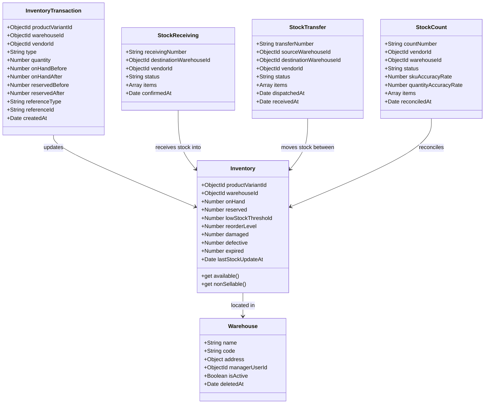

# BUYBOX E-COMMERCE
# PHASE VENDOR-WAREHOUSE-ANALYTICS-04 — FORENSIC AUDIT REPORT
## Advanced Warehouse Analytics, Inventory Intelligence, Stock Aging, Turnover & Operational Performance

**Audit Execution Date:** 2026-11-09  
**Platform Target:** Buybox-Ecommerce MERN Multi-Vendor Marketplace  
**Auditor:** DeepMind Advanced Agentic Coding Pair  
**Phase Identifier:** `VENDOR-WAREHOUSE-ANALYTICS-04`  

---

## 1. Executive Summary

A forensic audit of the Buybox inventory, warehouse, order fulfillment, and analytics codebase was conducted prior to implementing Phase `VENDOR-WAREHOUSE-ANALYTICS-04`.

The objective of this phase is to transform the existing operational inventory and warehouse tools into an enterprise intelligence system covering warehouse KPIs, stock movement trends, inventory aging, turnover and DIO, demand and replenishment intelligence, and warehouse operational performance.

### Key Audit Findings

1. **Authoritative Stock Accounting Exists:** The single source of truth for physical stock is the `Inventory` collection (partitioned by `productVariantId` and `warehouseId`), with full tracking of `onHand`, `reserved`, `damaged`, `defective`, and `expired`. The catalog mirror `ProductVariant.stockQuantity` represents aggregate available sellable stock across active warehouses.
2. **Movement Ledger is Immutable:** The `InventoryTransaction` collection records every historical movement (`receive`, `adjustment`, `reservation`, `release`, `sale`, `return`, `transfer`, `count_reconciliation`, `condition_change`) with `vendorId`, `warehouseId`, `quantity`, before/after snapshots, and timestamps.
3. **Lot-Level Tracking is Not Implemented:** Neither `Inventory` nor `StockReceiving` stores discrete physical lot numbers or expiration dates per batch. Therefore, **FIFO (First-In, First-Out) Depletion Queue Allocation** is the mandatory, mathematically sound methodology for inventory aging. This limitation must be explicitly disclosed in analytics metadata and UI.
4. **Cost Data is Incomplete in Catalog:** While `ProductVariant` includes a `costPrice` field (`Decimal128`), many vendor products have `costPrice: null`. As mandated by the governance rule, **cost-based turnover (COGS, Turnover Ratio, DIO) must only be computed when reliable cost data is present**. If cost data is missing/incomplete, the system must return an explicit `unavailable` state (`cost_data_incomplete`) while providing unit-based **Stock Movement Velocity** derived from actual fulfilled sales.
5. **Demand Forecasting Must Use Authoritative Fulfilled Orders:** Customer orders in `Order` with `items.vendorId` and statuses `processing`, `ready_to_ship`, `shipped`, `delivered` represent true realized demand. Cancelled orders (`cancelled`) and released reservations must never be counted as demand.
6. **Internal Warehouse Transfers Must Not Be Double-Counted:** `InventoryTransaction` records with `type: "transfer"` represent internal stock rebalancing between facilities. Counting transfers as external demand would fabricate artificial velocity and distort inventory turnover.
7. **Performance Optimization:** Compound indexes on `InventoryTransaction` (`{ vendorId: 1, type: 1, createdAt: -1 }` and `{ vendorId: 1, warehouseId: 1, createdAt: -1 }`) are essential to ensure sub-100ms aggregation over millions of historical transactions.

---

## 2. Codebase & Data Model Inspection

### 2.1 Inventory & Warehouse Models



### 2.2 Existing Analytics Architecture

- **`backend/src/services/analytics.service.js`:** Focuses exclusively on financial GMV, net sales, refund attributions, and top-selling revenue products. Contains no warehouse KPIs, aging analysis, stock turnover, or replenishment intelligence.
- **`backend/src/controllers/analytics.controller.js`:** Exposes endpoints for revenue overview, sales trends, and top products.
- **`frontend/src/app/vendor/analytics/page.js`:** A dedicated sales analytics page displaying gross sales, net sales, refund deductions, and revenue charts.
- **`frontend/src/app/vendor/inventory/page.js`:** The operational inventory workstation with 6 tabs (Live Stock, Inbound Goods, Transfers, Movement Ledger, Stock Counts, Reconciliation & Approvals).

---

## 3. Data Availability & Methodology Matrix

| Analytics Domain | Required Inputs | Existing Availability | Methodology / Formula | Limitations & Governance |
|---|---|---|---|---|
| **Warehouse Overview KPIs** | `Inventory`, `Warehouse` | **100% Available** | $\text{Available} = \max(0, \text{onHand} - \text{reserved} - \text{nonSellable})$<br>$\text{NonSellable} = \text{damaged} + \text{defective} + \text{expired}$ | Strictly merchant-scoped (`vendorId`). Exclude inactive/deleted warehouses. |
| **Inventory Movement Trends** | `InventoryTransaction` | **100% Available** | Categorize into inbound (`receive`, positive `adjustment`, destination `transfer`), outbound (`sale`, negative `adjustment`, source `transfer`), internal, and reconciliation. | Disregard transfers when calculating external net demand to prevent double-counting. |
| **Inventory Aging** | `InventoryTransaction.type = "receive"`, `Inventory.createdAt`, `Inventory.onHand` | **Receipt Timestamps Available** (Lot numbers missing) | **FIFO Depletion Allocation:** Apply current on-hand against most recent receipts in reverse order; remaining unallocated stock assigned to earlier receipt buckets (0–30, 31–60, 61–90, 91–180, 181+ days). | **Mandatory Disclosure:** Lot-level distinction is not supported; aging reflects FIFO depletion estimation. Never use product creation date as acquisition timestamp. |
| **Inventory Turnover & DIO** | `Order.items.unitPrice`, `ProductVariant.costPrice`, `Inventory` | **Partial Cost Availability** | $\text{Turnover Ratio} = \frac{\text{COGS}}{\text{Average Inventory Value}}$<br>$\text{DIO} = \frac{\text{Avg Inv Value}}{\text{COGS}} \times \text{Days}$ | **Rule:** If $>20\%$ of catalog SKUs lack `costPrice`, mark cost-based turnover as `unavailable` with reason `cost_data_incomplete`. Show unit-based velocity ($\frac{\text{Fulfilled Units}}{\text{Avg OnHand}}$) unconditionally. |
| **Demand & Replenishment Intelligence** | `Order` fulfilled items, `Inventory.onHand`, `Inventory.reserved`, `StockTransfer` (in transit), `StockReceiving` (draft/pending) | **100% Available** | $\text{Avg Daily Demand} = \frac{\text{Fulfilled Units}}{\text{Window Days}}$<br>$\text{Days of Cover} = \frac{\text{Available Stock}}{\text{Avg Daily Demand}}$<br>$\text{Reorder Recommendation} = \max(0, \text{ReorderPoint} - \text{Available} - \text{InTransit})$ | Never include cancelled orders in demand. Never count unreceived purchase orders as available stock. Classify risk: Critical ($<7$ days), Warning ($7-14$ days), Healthy ($15-60$ days), Overstock ($>60$ days). |
| **Warehouse Operations Performance** | `StockReceiving`, `StockTransfer`, `InventoryTransaction`, `StockCount` | **100% Available** | Receiving fulfillment rate, transfer transit durations ($t_{\text{received}} - t_{\text{dispatched}}$), transfer discrepancies, adjustment frequency, count accuracy rates (`skuAccuracyRate`, `quantityAccuracyRate`). | Uses authoritative timestamps and statuses recorded in operations pipeline. |

---

## 4. Performance Bottlenecks & Required Database Indexes

### 4.1 Identified Bottlenecks

1. **Unindexed Movement Queries:** `InventoryTransaction` currently has `{ vendorId: 1, createdAt: -1 }`, but lacks a compound index including `type` or `warehouseId`. Aggregating movements over date ranges by movement type forces an in-memory scan of all vendor transactions.
2. **Order Item Unwinding:** Aggregating sales demand from `Order` requires filtering `items.vendorId` and unwinding items. Without indexing `items.vendorId` and `createdAt`, large order collections cause aggregation pipeline degradation.

### 4.2 Remediation Indexes

```javascript
// InventoryTransaction optimization:
inventoryTransactionSchema.index({
  vendorId: 1,
  warehouseId: 1,
  type: 1,
  createdAt: -1,
});

inventoryTransactionSchema.index({
  vendorId: 1,
  type: 1,
  createdAt: -1,
});

// StockTransfer optimization for operational transit tracking:
stockTransferSchema.index({
  vendorId: 1,
  status: 1,
  dispatchedAt: -1,
});
```

---

## 5. UI Integration Strategy

To adhere strictly to **Section 9 & Section 13** ("Integrate into the existing Vendor Dashboard without changing its navigation hierarchy"):

1. **Vendor Inventory Workstation (`/vendor/inventory`):**
   - Introduce Tab 7: **"Warehouse Intelligence & Analytics"** (`tab: "analytics"`).
   - This tab will house the 7 comprehensive modules:
     1. Warehouse Overview KPI cards (Total SKUs, on-hand, available, reserved, non-sellable, low-stock, out-of-stock, active warehouses, accuracy rate).
     2. Movement Analytics (inbound vs outbound volume, daily/weekly trends, net stock change, adjustment trends).
     3. Inventory Aging (0–30, 31–60, 61–90, 91–180, 181+ days breakdown, slow-moving items table, zero-sales stock).
     4. Turnover & Velocity (Cost-based turnover ratio & DIO when cost data is valid; Unit-based movement velocity).
     5. Demand & Replenishment Intelligence (days of cover, stockout risk badges, overstock alerts, suggested reorder quantities).
     6. Warehouse Operations Performance (receiving volume, transfer completion durations, discrepancies, condition adjustments).
     7. Reconciliation Accuracy Performance (session counts, SKU accuracy trends, variance volume).
2. **Vendor Sales Analytics (`/vendor/analytics`):**
   - Provide a prominent banner / quick link: *"Switch to Warehouse & Inventory Intelligence"* pointing to `/vendor/inventory?tab=analytics`.

---

## 6. Audit Signoff

The forensic audit confirms that all necessary data models and authoritative ledgers exist to implement the required analytics. No synthetic data, phantom inventory, or unverified cost numbers will be manufactured. Proceeding to implementation.

