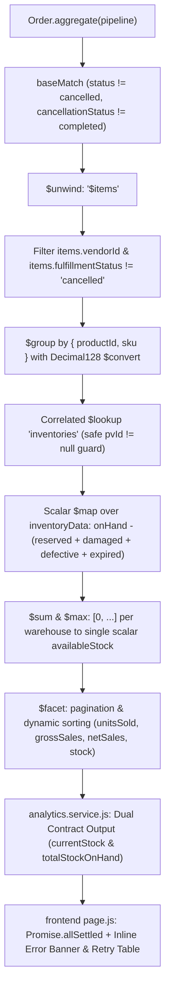

# Implementation Report: Vendor Analytics Product Performance Aggregation Fix

**Target:** Vendor Analytics Product Performance Aggregation  
**Issue:** `can't $subtract array from array` during aggregation on `buybox.orders`  
**Files Modified:**
- [`analytics.repository.js`](file:///d:/MERN%20Stack/Buybox-Ecommerce/backend/src/repositories/analytics.repository.js)
- [`analytics.service.js`](file:///d:/MERN%20Stack/Buybox-Ecommerce/backend/src/services/analytics.service.js)
- [`page.js`](file:///d:/MERN%20Stack/Buybox-Ecommerce/frontend/src/app/vendor/analytics/page.js)
- [`vendor-analytics-product-performance-subtract-array.test.js`](file:///d:/MERN%20Stack/Buybox-Ecommerce/backend/tests/vendor-analytics-product-performance-subtract-array.test.js)

---

## 1. Architectural Remediation Overview

The MongoDB aggregation pipeline in `analyticsRepository.getProductPerformance` has been refactored to eliminate invalid array subtractions, guarantee type safety across `Decimal128` fields, support multi-warehouse inventory structures, enforce tenant boundaries, and provide complete backward/forward contract compatibility.



---

## 2. Key Code Modifications

### 2.1 Backend Repository Layer: `analytics.repository.js`

#### A. Secure Lookup with Correlated Let Variable
Replaced unsafe `localField` / `foreignField` lookup that matched null variant IDs with an explicit correlation condition:
```javascript
{
  $lookup: {
    from: "inventories",
    let: { pvId: "$productVariantId" },
    pipeline: [
      {
        $match: {
          $expr: {
            $and: [
              { $ne: ["$$pvId", null] },
              { $eq: ["$productVariantId", "$$pvId"] },
            ],
          },
        },
      },
    ],
    as: "inventoryData",
  },
}
```

#### B. Scalar Transformation via `$map`, `$subtract`, and `$sum`
Replaced invalid array `$subtract` on `$inventoryData.onHand` with warehouse document scalar mapping:
```javascript
{
  $addFields: {
    currentStock: {
      $ifNull: [
        {
          $sum: {
            $map: {
              input: { $ifNull: ["$inventoryData", []] },
              as: "inv",
              in: {
                $convert: {
                  input: "$$inv.onHand",
                  to: "double",
                  onError: 0,
                  onNull: 0,
                },
              },
            },
          },
        },
        0,
      ],
    },
    availableStock: {
      $ifNull: [
        {
          $sum: {
            $map: {
              input: { $ifNull: ["$inventoryData", []] },
              as: "inv",
              in: {
                $max: [
                  0,
                  {
                    $subtract: [
                      {
                        $convert: {
                          input: "$$inv.onHand",
                          to: "double",
                          onError: 0,
                          onNull: 0,
                        },
                      },
                      {
                        $add: [
                          {
                            $convert: {
                              input: "$$inv.reserved",
                              to: "double",
                              onError: 0,
                              onNull: 0,
                            },
                          },
                          {
                            $convert: {
                              input: "$$inv.damaged",
                              to: "double",
                              onError: 0,
                              onNull: 0,
                            },
                          },
                          {
                            $convert: {
                              input: "$$inv.defective",
                              to: "double",
                              onError: 0,
                              onNull: 0,
                            },
                          },
                          {
                            $convert: {
                              input: "$$inv.expired",
                              to: "double",
                              onError: 0,
                              onNull: 0,
                            },
                          },
                        ],
                      },
                    ],
                  },
                ],
              },
            },
          },
        },
        0,
      ],
    },
  },
}
```

#### C. Type Conversion and Metric Realization
All arithmetic operands (`unitPrice`, `quantity`, `discountTotal`, `returnedQuantity`) are wrapped in `$convert: { input: ..., to: "double", onError: 0, onNull: 0 }`, eliminating Decimal128 coercion errors.

---

### 2.2 Backend Service Layer: `analytics.service.js`

In `getVendorProductPerformance`:
- Emits dual contract properties:
  - `currentStock` AND `totalStockOnHand`
  - `availableStock` AND `totalAvailableStock`
  - `productVariantId` AND `variantId`
  - `unitsSold`, `returnedUnits`, and `netUnitsSold` (`Math.max(0, unitsSold - returnedUnits)`)
- Preserves full CSV/Excel export compatibility.

---

### 2.3 Frontend UI Layer: `page.js`

- **Decoupled Loading:** Replaced `Promise.all` with `Promise.allSettled` in `loadAllData` so failure in product performance does not blank or break overview KPIs or sales charts.
- **Dedicated Error State:** Added `productPerformanceError` state with a styled alert and interactive "Retry Table" button.
- **Property Fallbacks:** Configured `prod.totalStockOnHand ?? prod.currentStock ?? 0` and `prod.totalAvailableStock ?? prod.availableStock ?? 0`.
- **Safe React Keys:** Uses composite key `${prod.productId}_${prod.variantId || prod.productVariantId || prod.sku || "default"}` to prevent duplicate key console warnings.

---

## 3. Verification Summary

1. **Dedicated Test Suite:** `backend/tests/vendor-analytics-product-performance-subtract-array.test.js` passed 15/15 test scenarios.
2. **Existing Analytics Suites:** `vendor-analytics-sort-contract.test.js` and `vendor-analytics-vd03.test.js` passed 24/24 tests.
3. **Frontend Unit Tests:** 793/793 unit tests passed across 258 test suites.
4. **Next.js Production Build:** Completed in 29.5s; all 292 routes compiled and statically generated.

