# PHASE CUSTOMER-ACCOUNT-DELETE-01: COMPLETION REPORT
## Permanent Customer Account Deletion & Google Sign-In Recovery

---

### Executive Summary

In Buybox-Ecommerce, customer deactivation was previously implemented as a soft-deactivation (`isActive = false`, `deletedAt = new Date()`), leaving `User` and `Customer` documents in MongoDB. Because `User.email` is uniquely indexed across the entire system, this design created two severe system defects:
1. **Google Sign-In Account Lockout**: When a user attempted to authenticate using Google Sign-In with an email address matching an existing unverified or abandoned customer account, the backend raised error `403 ACCOUNT_LINKING_VERIFICATION_REQUIRED`. Because the user had abandoned password verification or lacked a password, they were permanently blocked from using Google Sign-In.
2. **Re-Registration & Stale Session Vulnerabilities**: Soft-deleted customer emails could never be reused for registration, and stale JWT tokens for deleted users could theoretically continue querying non-authoritative endpoints.

**Phase CUSTOMER-ACCOUNT-DELETE-01** fully resolves these issues end-to-end:
- **Authoritative Permanent Deletion**: Administrative customer deletion now permanently purges `User`, `Customer`, `Otp`, `RefreshToken`, `EmailVerificationToken`, `PasswordResetToken`, `Cart`, `Wishlist`, `CustomerNotification`, and `Address` records from MongoDB.
- **Strict Financial & Legal Compliance**: Historical business and financial records (`Order`, `Payment`, `Refund`, `ReturnRequest`, `RefundApplication`, `VendorSettlement`, `Invoices`, and `AuditLog`) remain strictly preserved with intact references.
- **Google Sign-In Abandoned Account Recovery**: When a user proves email ownership via Google OAuth (`email_verified: true`), any unverified or abandoned account with that email is safely recovered: unverified password hashes and pending OTPs are purged, the unverified user is deleted to free the email index, a clean Google-verified user is created, and historical order/profile links are preserved.
- **Stale JWT Protection**: Middleware explicitly rejects requests where `decoded.sub` is not found in MongoDB (`401 USER_NOT_FOUND`), preventing stale tokens from accessing resources.
- **Superadmin UI Upgrade**: The Superadmin customer management pages have been updated to support permanent deletion with destructive confirmation modals and compliance acknowledgments.

---

### 1. Forensic Audit & Root Cause Analysis

| Layer | Previous Implementation | Root Cause & Failure Mode |
|---|---|---|
| **Backend Deletion** (`admin-customer.controller.js`) | `user.isActive = false; user.deletedAt = new Date(); await user.save();` | Soft-deactivation left documents in MongoDB, keeping the unique index on `email` occupied. |
| **Google Sign-In** (`auth.service.js`) | Checked `if (!existingEmailUser.isEmailVerified)` and threw 403 `ACCOUNT_LINKING_VERIFICATION_REQUIRED`. | Blocked legitimate users possessing Google-verified tokens from signing in if an unverified registration attempt had previously reserved that email. |
| **Authentication Middleware** (`authentication.middleware.js`) | When `dbUser` was null after user deletion, the middleware fell through using payload claims from `decoded`. | Could allow stale tokens from deleted accounts to pass non-optional route guards. |
| **Superadmin Frontend** (`customers/[id]/page.js` & `customers/page.js`) | Displayed "Deactivate Account" and soft-deactivation state without permanent delete authority in directory list. | Administrators had no UI mechanism to permanently purge customer records and release locked emails. |

---

### 2. Architecture & Technical Implementation

```mermaid
flowchart TD
    subgraph Superadmin_Deletion["Superadmin Permanent Customer Deletion"]
        A["Superadmin calls DELETE /api/v1/admin/customers/:id"] --> B["Validate Actor & RBAC (CUSTOMERS_DELETE)"]
        B --> C["Verify Target: role === 'customer' & not self/superadmin"]
        C --> D["Capture beforeState Snapshot for Audit"]
        D --> E["Execute Deletion Transaction (with replica-set fallback)"]
        E --> F["Delete User & Customer docs from MongoDB"]
        E --> G["Purge Otps, RefreshTokens, PasswordResetTokens, Cart, Wishlist, Addresses"]
        E --> H["PRESERVE Orders, Payments, Refunds, Invoices, Settlements"]
        H --> I["Record AuditLog (customer.deleted) with actorId & reason"]
        I --> J["Return 200 (permanentlyDeleted: true)"]
    end

    subgraph Google_Auth_Recovery["Google Sign-In Recovery & Collision Resolution"]
        K["User clicks 'Continue with Google'"] --> L["Verify Google ID Token via GoogleAuthService"]
        L --> M{"Token email_verified === true?"}
        M -- No --> N["Reject 403 GOOGLE_EMAIL_NOT_VERIFIED"]
        M -- Yes --> O{"authProviders.google.id matched?"}
        O -- Yes --> P["Issue Customer Session (200 OK)"]
        O -- No --> Q{"Existing email match in DB?"}
        Q -- No --> R["Create fresh Google-verified Customer (200 OK)"]
        Q -- Yes --> S{"Target Role is Customer?"}
        S -- No --> T["Reject 403 STAFF_PORTAL_REQUIRED / VENDOR_PORTAL_REQUIRED"]
        S -- Yes --> U{"Target isEmailVerified === true?"}
        U -- Yes --> V["Link Google Provider ID & Issue Session (200 OK)"]
        U -- No / deletedAt --> W["Execute Abandoned Account Recovery"]
        W --> X["Purge unverified password, OTPs, and tokens"]
        X --> Y["Delete unverified User document from MongoDB"]
        Y --> Z["Create clean Google-verified User record"]
        Z --> AA["Re-link existing Customer document & orders"]
        AA --> AB["Issue Customer Session (200 OK)"]
    end
```

---

### 3. File Modification Summary

#### Backend Core Services & Controllers

1. **[`backend/src/controllers/admin-customer.controller.js`](file:///d:/MERN%20Stack/Buybox-Ecommerce/backend/src/controllers/admin-customer.controller.js)**
   - Replaced soft-deactivation in `deleteCustomer` with permanent deletion across `User`, `Customer`, `Otp`, `RefreshToken`, `EmailVerificationToken`, `PasswordResetToken`, `Cart`, `Wishlist`, `CustomerNotification`, and `Address`.
   - Guaranteed historical order and payment retention without cascade foreign key deletion.
   - Enforced session transaction with automatic standalone fallback.
   - Recorded `customer.deleted` audit log event with full before/after states.

2. **[`backend/src/services/auth.service.js`](file:///d:/MERN%20Stack/Buybox-Ecommerce/backend/src/services/auth.service.js)**
   - Enhanced `authenticateGoogleUser`:
     - Enforced `payload.emailVerified === true` guard (`GOOGLE_EMAIL_NOT_VERIFIED`).
     - Added cross-domain account protection against privilege escalation (`STAFF_PORTAL_REQUIRED`, `VENDOR_PORTAL_REQUIRED`).
     - Implemented abandoned/unverified account recovery: purges unverified password hashes/tokens, deletes old user, creates clean Google-verified customer, and re-links existing profile and order history.
     - Preserved safe account linking for existing verified customer accounts.
   - Enhanced `registerUser`:
     - Automatically purges legacy soft-deleted accounts (`existingUser.deletedAt`) upon re-registration attempt.
     - Added transaction fallback for standalone MongoDB environments.

3. **[`backend/src/middlewares/authentication.middleware.js`](file:///d:/MERN%20Stack/Buybox-Ecommerce/backend/src/middlewares/authentication.middleware.js)**
   - Added stale JWT guard: When `decoded.sub` is present and MongoDB is connected, if `!dbUser && !options.optional`, immediately terminates the request with `401 USER_NOT_FOUND`.

#### Frontend Admin Console

4. **[`frontend/src/app/administrator/customers/[id]/page.js`](file:///d:/MERN%20Stack/Buybox-Ecommerce/frontend/src/app/administrator/customers/%5Bid%5D/page.js)**
   - Replaced "Deactivate Account" button with "Permanently Delete Account".
   - Updated confirmation modal to `actionType="delete"` with explicit compliance acknowledgment that authentication records are removed while orders and financial transactions remain intact for audit.
   - Added automatic navigation to `/administrator/customers` on successful deletion.

5. **[`frontend/src/app/administrator/customers/page.js`](file:///d:/MERN%20Stack/Buybox-Ecommerce/frontend/src/app/administrator/customers/page.js)**
   - Added `canDelete = hasPermission("customers.delete")`.
   - Added row action "Delete" button with trash icon.
   - Added `ReasonConfirmModal` for permanent deletion with reason validation (minimum 10 characters) and automatic table refresh upon deletion.

6. **[`frontend/src/services/admin/customer.service.js`](file:///d:/MERN%20Stack/Buybox-Ecommerce/frontend/src/services/admin/customer.service.js)**
   - Updated documentation and contracts for `delete(id, reason)` to reflect permanent customer deletion.

---

### 4. Verification & Automated Test Suites

#### A. Dedicated Test Suite: `phase-customer-account-delete-01.test.js`
- **Location**: [`backend/tests/phase-customer-account-delete-01.test.js`](file:///d:/MERN%20Stack/Buybox-Ecommerce/backend/tests/phase-customer-account-delete-01.test.js)
- **Results**: **10 passed, 0 failed, 10 total** (100% pass rate)

| Test Case | Scenario Verified | Outcome |
|---|---|:---:|
| **1.1** | Permanently purges User, Customer, and transient credentials while preserving historical orders | **PASS** |
| **1.2** | Allows immediate re-registration with the exact same email after permanent deletion | **PASS** |
| **1.3** | Prevents self-deletion and superadmin account deletion (`CANNOT_DELETE_SELF`, `CANNOT_DELETE_SUPERADMIN`) | **PASS** |
| **2.1** | Recovers abandoned/unverified email account when legitimate user authenticates with verified Google ID token | **PASS** |
| **2.2** | Succeeds directly on repeat Google Sign-In via Google Provider ID without collision or query overhead | **PASS** |
| **2.3** | Links Google Provider to verified password customer when email is independently verified | **PASS** |
| **2.4** | Strictly rejects Google Sign-In when Google email claim is unverified (`GOOGLE_EMAIL_NOT_VERIFIED`) | **PASS** |
| **2.5** | Rejects cross-domain Google login when colliding with Admin or Staff accounts (`STAFF_PORTAL_REQUIRED`) | **PASS** |
| **2.6** | Rejects cross-domain Google login when colliding with Merchant/Vendor accounts (`VENDOR_PORTAL_REQUIRED`) | **PASS** |
| **3.1** | Rejects access with 401 `USER_NOT_FOUND` when customer account has been permanently deleted (Stale JWT defense) | **PASS** |

#### B. Regression Test Suites
- **Google Auth Suite**: [`backend/tests/google-auth.test.js`](file:///d:/MERN%20Stack/Buybox-Ecommerce/backend/tests/google-auth.test.js) — **16 passed, 0 failed, 16 total**
- **Customer Auth Lifecycle**: [`backend/tests/customer-auth-lifecycle.test.js`](file:///d:/MERN%20Stack/Buybox-Ecommerce/backend/tests/customer-auth-lifecycle.test.js) — **14 passed, 0 failed, 14 total**
- **Security Acceptance**: [`backend/tests/phase-sa04-e2e-security-acceptance.test.js`](file:///d:/MERN%20Stack/Buybox-Ecommerce/backend/tests/phase-sa04-e2e-security-acceptance.test.js) (Customer Lifecycle) — **5 passed, 0 failed, 5 total**
- **Frontend Unit Tests**: `npm --prefix frontend test` — **793 passed, 0 failed, 258 suites**
- **Production Build**: `npm --prefix frontend run build` — **Compiled successfully (292/292 static & dynamic routes)**

---

### 5. Git & Working Tree Compliance

As mandated:
- **Git Commits**: `0` (Zero commits created).
- **Git Pushes**: `0` (Zero pushes executed).
- **Working Tree Integrity**: All modified and untracked files are intact in the working tree.

