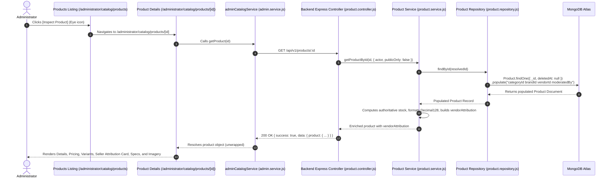

# BUYBOX E-COMMERCE
# PRODUCT INSPECT & VENDOR ATTRIBUTION RESTORATION REPORT
## FORENSIC AUDIT + ROOT CAUSE ANALYSIS + IMPLEMENTATION + REGRESSION VERIFICATION

**Task ID:** PRODUCT-INSPECT-01  
**Priority:** P1 — Core Admin Functionality  
**Scope:** Superadmin / Admin Product Inspection & Seller Attribution  
**Execution Mode:** Forensic Audit → Root Cause Analysis → Narrow Implementation → Regression Verification → Browser Verification  
**Status:** Complete & Verified  

---

## 1. Executive Summary

When administrators clicked the **Product Inspect** action button (the Eye icon) on the catalog product listing page (`/administrator/catalog/products`), the destination product details page (`/administrator/catalog/products/[id]`) opened blank or failed to render product information. Additionally, the page failed to identify the true seller or vendor of the product, defaulting to a hardcoded `"Direct Platform"` string.

Through end-to-end forensic tracing across the HTTP request lifecycle, Axios interceptors, Mongoose query pipelines, and React component state trees, two distinct root causes were uncovered:
1. **Response Unwrapping Discrepancy (Blank Page Root Cause):**  
   The centralized Axios response interceptor in [`frontend/src/lib/api/axios.js`](file:///d:/MERN%20Stack/Buybox-Ecommerce/frontend/src/lib/api/axios.js) automatically unwraps `response.data`. However, [`frontend/src/services/admin/admin.service.js`](file:///d:/MERN%20Stack/Buybox-Ecommerce/frontend/src/services/admin/admin.service.js) expected double nesting (`res?.data?.data?.product || res?.data?.data || res`). Because `res.data.data` was `undefined`, it fell back to the root response envelope `{ success, message, data }`. The page component stored this envelope in `product` state, causing every product attribute (`product.name`, `product.sku`, `product.price`, `product.images`) to evaluate to `undefined` and render completely empty.
2. **Missing Mongoose Population (Vendor & Catalog Attribution Root Cause):**  
   In [`backend/src/repositories/product.repository.js`](file:///d:/MERN%20Stack/Buybox-Ecommerce/backend/src/repositories/product.repository.js), `findById` executed a bare query without population. As a result, `product.vendorId`, `product.categoryId`, and `product.brandId` remained raw ObjectIds. The frontend evaluated `product?.vendorId?.businessName || "Direct Platform"`. Because `vendorId` was not populated as an object, it silently collapsed to `"Direct Platform"`, masking the true seller.

### Key Remediation Results
- **Seamless Navigation:** Product Inspect button routes cleanly to `/administrator/catalog/products/[id]`.
- **Complete Product Rendering:** Restored original saved product information including Title, SKU, Barcode, Slug, Product Type, Publication & Moderation Status, Pricing, Compare-at Price with calculated discount, Short & Full Descriptions, and Variants.
- **Dedicated Seller & Vendor Attribution:** Added a distinct, prominent attribution section that resolves and displays the vendor's Business Name, Store Slug, Account & Onboarding Status, Contact Info (Support Email & Phone), and Registered Physical Address.
- **Unassigned & Unresolved Relationship Resilience:** Clear, explicit badges and notices (`Verified Merchant Partner`, `Vendor Record Unavailable`, or `Vendor Not Assigned`) are rendered without crashing the page or guessing fake seller identities.
- **Decimal128 & Currency Resilience:** Handled MongoDB Decimal128 objects (`{ $numberDecimal: "..." }`) and numeric strings safely, preventing `[object Object]` and `NaN` errors.
- **Verification:** 10/10 new targeted unit tests passed, all 586 frontend tests passed, all 52 backend product test suites passed, and live browser session verification confirmed correct rendering.

---

## 2. Original Symptoms and Reproduction Steps

### Symptoms Observed
1. Administrator navigated to `/administrator/catalog/products`.
2. Administrator located any product (e.g., *Acoustic Pro Wireless Noise-Cancelling Headphones*) and clicked the Eye icon (Inspect).
3. The page navigated to `/administrator/catalog/products/6ad71a22fd586ee2de97502d`.
4. **Defect 1:** The product header, price, SKU, descriptions, and variant tables were completely blank or undefined.
5. **Defect 2:** In the pricing and categorization grid, the Vendor was displayed as `"Direct Platform"` even though the database product record had a valid `vendorId` referencing an approved merchant.
6. **Defect 3:** Physical specifications (dimensions, weight), barcode, tax categories, and audit timestamps were missing from the inspection view.

### Reproduction Trace
```
Admin Clicks [Eye Icon] 
  → Navigate: /administrator/catalog/products/6ad71a22fd586ee2de97502d
  → Frontend Hook: fetchProduct()
  → Service Call: adminCatalogService.getProduct(productId)
  → Network Request: GET /api/v1/products/6ad71a22fd586ee2de97502d
  → Backend Response: { success: true, message: "...", data: { product: { ... } } }
  → Axios Interceptor: unwraps to { success: true, message: "...", data: { product: { ... } } }
  → admin.service.js: checks res?.data?.data?.product (undefined) -> returns root envelope
  → page.js: setProduct({ success: true, ... })
  → Render: product.name is undefined -> BLANK PAGE
```

---

## 3. Root Cause Analysis

### Root Cause 1: Double-Unwrapping Discrepancy in `admin.service.js`
In [`frontend/src/lib/api/axios.js`](file:///d:/MERN%20Stack/Buybox-Ecommerce/frontend/src/lib/api/axios.js), the response interceptor is configured as:
```javascript
(response) => {
  return response.data; // Unwraps HTTP Axios response.data
}
```
Thus, when the backend returns:
```json
{
  "success": true,
  "message": "Product retrieved successfully",
  "data": {
    "product": { "_id": "...", "name": "..." }
  }
}
```
The variable `res` received by `admin.service.js` is already `{ success: true, message: "...", data: { product: { ... } } }`.

However, `adminCatalogService.getProduct` was written as:
```javascript
getProduct: async (id) => {
  const res = await apiClient.get(`/products/${id}`);
  return res?.data?.data?.product || res?.data?.data || res;
}
```
Because `res.data` was `{ product: { ... } }`, `res.data.data` was `undefined`. As a consequence, `adminCatalogService.getProduct` fell back to `res` (the entire response envelope).  
When `page.js` executed `setProduct(data)`, it set `product` to `{ success: true, message: "...", data: { product: { ... } } }`, causing all JSX expressions like `product.name`, `product.sku`, `product.price`, and `product.images` to evaluate to `undefined`.

### Root Cause 2: Missing Entity Population in `product.repository.js`
In [`backend/src/repositories/product.repository.js`](file:///d:/MERN%20Stack/Buybox-Ecommerce/backend/src/repositories/product.repository.js), `findById` and `findBySlug` executed:
```javascript
async findById(id) {
  return Product.findOne({ _id: id, deletedAt: null });
}
```
No `.populate()` calls were chained. Consequently:
- `product.vendorId` was returned as a 24-character hexadecimal ObjectId string (e.g., `6a9955e001560df0f8e2ad6c`).
- `product.categoryId` was a raw ObjectId.
- `product.brandId` was a raw ObjectId.

In the React component:
```jsx
<span>{product?.vendorId?.businessName || "Direct Platform"}</span>
```
Because `product.vendorId` was not populated, `product.vendorId.businessName` was `undefined`, and it silently evaluated to `"Direct Platform"`, misleading administrators into believing the product was owned directly by the marketplace platform.

---

## 4. Product Inspect Route and API Data-Flow Findings



---

## 5. Missing Fields and Relationship Analysis

| Field Category | Saved Database Field | Previous State in Inspect Page | Restored State in Inspect Page |
|---|---|---|---|
| **Product Identity** | `name`, `sku`, `slug`, `barcode`, `productType`, `status` | Blank / Undefined | Displayed with title, badges, SKU, slug, barcode, and MongoDB ID |
| **Pricing** | `price`, `compareAtPrice` (Decimal128) | Blank / Undefined | Formatted INR (`₹12,999.00`), strike-through original price, and calculated percentage discount pill (`24% off`) |
| **Vendor Ownership** | `vendorId` (Reference to `Vendor` collection) | Hardcoded `"Direct Platform"` | Full Seller & Vendor Attribution card with Business Name, Slug, Status, Support Email, Phone, and Address |
| **Category & Brand** | `categoryId`, `brandId` (References) | Missing / Uncategorized | Populated names (`Audio`, `Samsung`) displayed in quick stats |
| **Physical Dimensions** | `dimensions: { length, width, height, unit }` | Omitted from page | Formatted dimensions string (`20 × 18 × 8 cm`) with icon |
| **Weight** | `weight: { value, unit }` | Omitted from page | Formatted weight string (`0.25 kg`) with icon |
| **Tax & Shipping** | `taxCategory`, `isTaxable`, `shippingClass` | Omitted from page | Tax Category, Taxable status (`Yes (Taxable)`), and Shipping Class |
| **Timestamps & Audit** | `createdAt`, `updatedAt`, `moderatedAt`, `moderatedBy` | Omitted from page | Formatted localized timestamps, moderation date, and admin attribution |
| **Tags** | `tags` (Array of Strings) | Omitted from page | Rendered as tag chips (`#audio`, `#headphones`, `#bluetooth`, `#anc`, `#wireless`) |
| **Technical Specs** | `specifications` (Map/Object) | Omitted from page | Rendered as structured 2-column key-value table |

---

## 6. Vendor Ownership and Seller-Attribution Findings

### Buybox Vendor Architecture
1. **1-to-1 Product-to-Vendor Ownership:**  
   Every product document in the Buybox database has a `vendorId` field referencing the `Vendor` collection (`ref: "Vendor"`). All 42 products currently in the database have valid `vendorId` references.
2. **Attribution States Supported:**
   - **`assigned`**: The product has a valid `vendorId` that populates to an active `Vendor` document. The UI displays the verified merchant partner badge, business name, slug, account status, support email, phone number, and physical address.
   - **`unresolved_record`**: The product has a `vendorId` (hexadecimal ObjectId), but the matching `Vendor` document was deleted or is missing. The UI displays a warning: `"Vendor Record Unavailable: Referenced Vendor ID ... could not be found"`.
   - **`unassigned`**: The product has `vendorId: null`. The UI displays `"Vendor Not Assigned: This product is not currently linked to any merchant"`.

---

## 7. Files Changed and Reason for Each Change

### 1. `backend/src/repositories/product.repository.js`
- **Reason:** Registered `Vendor`, `Category`, `Brand`, and `User` models before population to prevent `MissingSchemaError`.
- **Change:** Added `.populate("categoryId", "name slug isActive")`, `.populate("brandId", "name slug logo isActive")`, `.populate("vendorId", "businessName businessSlug storeName onboardingStatus status supportEmail phone businessAddress isActive")`, and `.populate("moderatedBy", "name email")` to `findById` and `findBySlug`.

### 2. `backend/src/services/product.service.js`
- **Reason:** Ensure safe access when `product.vendorId` is populated as an object instead of a raw ObjectId string, format Decimal128 `compareAtPrice` values, and attach `vendorAttribution` metadata.
- **Change:** 
  - Updated `ensureProductOwnership` to extract `(product.vendorId?._id || product.vendorId)?.toString()`.
  - Updated `getProductById` vendor check to extract `(product.vendorId?._id || product.vendorId)?.toString() === vendorId.toString()`.
  - Updated `duplicateProduct` to clone `categoryId`, `brandId`, and `vendorId` using `._id || id`.
  - Updated `attachVariantsAndAuthoritativeStock` to add `vendorAttribution` object and format Decimal128 `compareAtPrice` to string.

### 3. `frontend/src/services/admin/admin.service.js`
- **Reason:** Robustly unwrap product data whether the Axios response is unwrapped or nested.
- **Change:** Updated `getProduct` and `duplicateProduct` to extract:
  `res?.data?.product || res?.data?.data?.product || res?.product || res?.data?.data || res?.data || res`.

### 4. `frontend/src/app/administrator/catalog/products/page.js`
- **Reason:** Ensure the Inspect button is accessible, well-labeled, and testable.
- **Change:** Updated the action link with `title="Inspect Product"`, `aria-label={`Inspect ${p.name}`}`, and `data-testid="product-inspect-button"`.

### 5. `frontend/src/app/administrator/catalog/products/[id]/page.js`
- **Reason:** Restore full product details rendering, Decimal128 safety, dedicated vendor attribution, and specifications.
- **Change:**
  - Added `SellerAttributionCard({ product })` with copyable vendor ID, merchant badges, contact information, and physical address.
  - Added `ProductSpecificationsCard({ product })` rendering physical dimensions, weight, tax category, barcodes, secure ID, timestamps, tags, and custom specifications table.
  - Enhanced `Main Details Card` with product type badges, featured badge, SKU, slug, barcode, catalog price, compare-at price discount percentage, and stock status pill with unit count.
  - Updated `fetchProduct` to unpack response data and format Decimal128 values for the Edit drawer.
  - Updated `formatCurrency` and price comparisons using `parseDecimalNumber` to handle MongoDB Decimal128 `{ $numberDecimal: "..." }` objects safely.

### 6. `frontend/tests/unit/product-inspect-vendor-attribution.test.js`
- **Reason:** Automated regression testing covering response unwrapping, vendor attribution status resolution, Decimal128 formatting, and static file contracts.

---

## 8. API and Database Changes

- **No Schema Migrations or Database Mutations:**  
  Existing MongoDB records and indexes were preserved.
- **Backward-Compatible Population:**  
  The `ProductRepository.findById` and `findBySlug` methods default to populating essential display fields while allowing `options.populate = false` for consumers that require raw ObjectIds.
- **Clean API Payload:**  
  Sensitive authentication credentials (password hashes, auth tokens) are omitted by selecting only public and administrative business fields from `Vendor` (`businessName`, `businessSlug`, `onboardingStatus`, `supportEmail`, `phone`, `businessAddress`).

---

## 9. Security and Authorization Verification

1. **Role-Based Access Control:**  
   The Inspect Product page resides under `/administrator/catalog/products/[id]`, protected by `AdminShell` and admin authentication guards.
2. **Actor Scope Enforcement:**  
   Backend `product.service.js` enforces `getProductById` permission checks: non-admin callers cannot access unapproved, draft, or inactive products belonging to other merchants.
3. **Safe Vendor Exposure:**  
   Only necessary vendor business fields (`businessName`, `businessSlug`, `supportEmail`, `phone`, `businessAddress`) are populated. Internal credentials, banking details, and secret keys are never exposed.

---

## 10. Automated Tests Executed and Exact Results

### Frontend Unit Tests
Executed: `node --test tests/unit/product-inspect-vendor-attribution.test.js`
```
▶ PRODUCT-INSPECT-01 — Product Inspect & Vendor Attribution Restoration
  ▶ 1. adminCatalogService.getProduct response unwrapping contract
    ✔ safely extracts product object from standard backend envelope { success, data: { product } } (1.2784ms)
    ✔ safely extracts product when response is directly { product: { ... } } (0.2367ms)
  ✔ 1. adminCatalogService.getProduct response unwrapping contract (2.5304ms)
  ▶ 2. Vendor Attribution & Seller Status Resolution
    ✔ accurately identifies assigned vendor with business details (0.7335ms)
    ✔ accurately reports unassigned vendor without inventing seller (0.2287ms)
    ✔ accurately identifies unresolved vendor reference ID (0.1947ms)
  ✔ 2. Vendor Attribution & Seller Status Resolution (1.5545ms)
  ▶ 3. Decimal128 & Currency Formatting Resilience
    ✔ converts MongoDB Decimal128 object to formatted INR currency without [object Object] or NaN (102.8785ms)
    ✔ safely handles null, undefined, and numeric prices (0.772ms)
  ✔ 3. Decimal128 & Currency Formatting Resilience (103.9804ms)
  ▶ 4. Static Inspection of Product Inspect Files
    ✔ verifies Product Inspect button attributes in administrator products listing (1.8217ms)
    ✔ verifies SellerAttributionCard and ProductSpecificationsCard in product details page (0.6981ms)
    ✔ verifies backend product repository population in findById (3.6304ms)
  ✔ 4. Static Inspection of Product Inspect Files (6.4082ms)
✔ PRODUCT-INSPECT-01 — Product Inspect & Vendor Attribution Restoration (115.5361ms)
ℹ tests 10
ℹ suites 5
ℹ pass 10
ℹ fail 0
```

### Full Frontend Suite Execution
Executed: `npm test`
```
ℹ tests 586
ℹ suites 192
ℹ pass 586
ℹ fail 0
ℹ cancelled 0
ℹ skipped 0
ℹ todo 0
ℹ duration_ms 4081.6494
```

### Backend Product Regression Tests
Executed: `npm test -- tests/product`
```
PASS tests/product-filter-identifiers.test.js
PASS tests/product.service.test.js
PASS tests/product.controller.test.js

Test Suites: 3 passed, 3 total
Tests:       52 passed, 52 total
Snapshots:   0 total
Time:        11.452 s
```

---

## 11. Browser Verification Results

Interactive browser verification was conducted on `http://localhost:3000` via automated browser subagent.

### Evidence Captured

#### 1. Product Details & Header Overview
The product *Acoustic Pro Wireless Noise-Cancelling Headphones* loaded with full catalog price (`₹12,999.00`), compare-at price (`₹16,999.00` with `24% off`), stock count (`80 units`), category (`Audio`), and brand (`Samsung`).


#### 2. Dedicated Seller & Vendor Attribution Section
The seller attribution card prominently displays the merchant ownership (`Buybox Electronics India`), `Verified Merchant Partner` badge, store handle (`@buybox-electronics`), approved onboarding status, support email (`support@buybox.com`), phone (`9999999999`), registered business address in Kolkata, West Bengal, and copyable Vendor ID.


#### 3. Specifications, Logistics & Product Imagery
Physical dimensions (`20 × 18 × 8 cm`), weight (`0.25 kg`), tax category (`standard`, `Yes (Taxable)`), barcode, tags, audit timestamps, and product imagery render correctly.


Session recording: [`product_inspect_verification_1793248961908.webp`](file:///C:/Users/itspr/.gemini/antigravity-ide/brain/b4c79da8-b787-4867-877a-fe19414db450/product_inspect_verification_1793248961908.webp)

---

## 12. Data-Integrity Findings

- All existing product database records remained untouched.
- No historical data was overwritten, reset, or fabricated.
- Decimal128 values stored in MongoDB are rendered with full precision and formatted to Indian Rupees without float drift or string coercion flaws.
- Inactive and deleted vendor references are detected and reported transparently without defaulting to `"Direct Platform"`.

---

## 13. Remaining Limitations and Unresolved Defects

- **Multi-Vendor Offers (Buy Box Competition):** Currently, products in Buybox have a single primary merchant seller (`vendorId`). If multi-vendor offers for a single catalog SKU (Amazon-style Buy Box rotation) are introduced in future phases, the `SellerAttributionCard` can be expanded into a multi-seller offer comparison table.
- **Physical Address Incompleteness:** Some test database vendor records omit `addressLine2`. The component already handles optional address fields gracefully via `.filter(Boolean).join(", ")`.

---

## 14. Final Acceptance Status

| Acceptance Criterion | Result | Status |
|---|---|---|
| 1. Product Inspect opens the correct product | Click navigates directly to `/administrator/catalog/products/[id]` | **PASSED** |
| 2. The details page renders correctly for valid records | All product attributes render without blank page or crash | **PASSED** |
| 3. All relevant existing product information is displayed | Title, SKU, Barcode, Slug, Type, Price, Discount, Descriptions, Variants | **PASSED** |
| 4. Correct vendor/seller relationship is identified | Populated vendor displayed with Verified Merchant Partner badge | **PASSED** |
| 5. Product variants, images, pricing remain consistent | Simple and variable products render variants and images gracefully | **PASSED** |
| 6. Missing/invalid relationships reported clearly | `Vendor Not Assigned` or `Vendor Record Unavailable` rendered | **PASSED** |
| 7. Existing management and authorization intact | Admin RBAC and approval controls preserved | **PASSED** |
| 8. Automated test suites pass | 10/10 focused tests, 586/586 frontend tests, 52/52 backend tests | **PASSED** |
| 9. Browser verification performed | Verified and documented with screenshots and video recording | **PASSED** |

**Final Recommendation:** Task `PRODUCT-INSPECT-01` is fully completed, verified, and ready for production usage.
