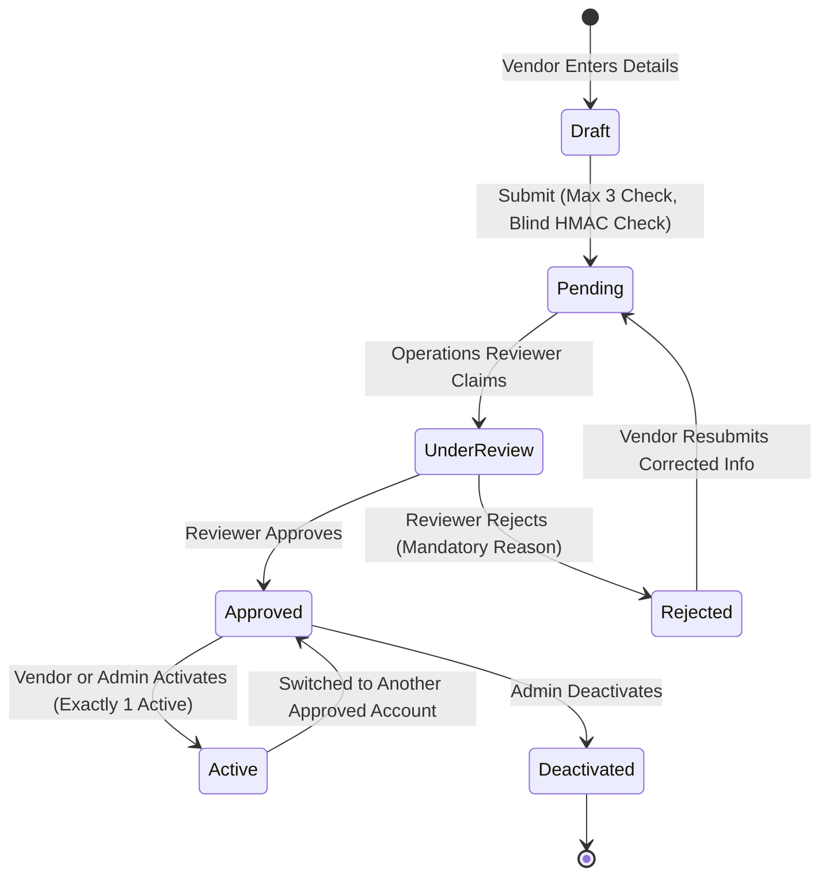
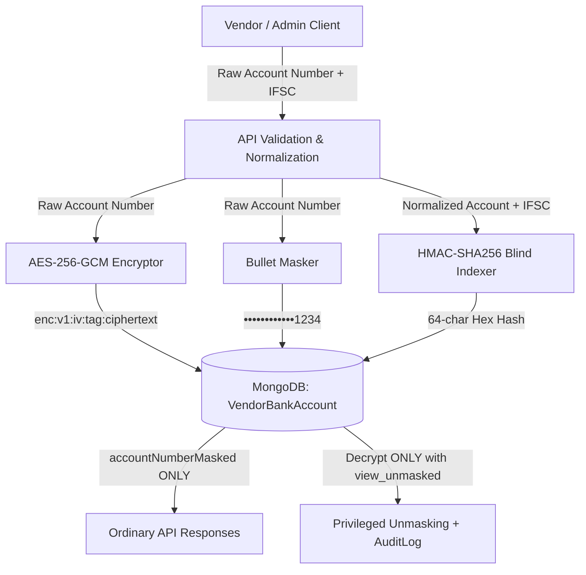
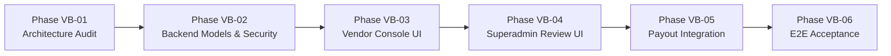

# BUYBOX E-COMMERCE
# VENDOR BANK ACCOUNT MANAGEMENT
## PHASE VB-01 — FORENSIC ARCHITECTURE AUDIT
### READ-ONLY ARCHITECTURAL INSPECTION & DESIGN REPORT

---

## 1. EXECUTIVE SUMMARY

The Buybox-Ecommerce platform requires a robust, secure, and auditable **Vendor Bank Account Management** system. This system must empower marketplace merchants to submit bank account details for operational payouts, allow authorized administrative reviewers to approve or reject applications, permit merchants to switch their active payout destination among up to three approved accounts, provide Superadmin with comprehensive management controls, and guarantee immutable audit logging and strict data protection across all financial operations.

As mandated by Phase VB-01, this forensic audit was conducted in a **strictly read-only mode**. No source code, configuration files, or database schemas were altered.

### Key Forensic Findings
1. **No Existing Bank Account Entity**: The platform currently lacks a dedicated bank account model, schema, or endpoint. The `Vendor` model (`backend/src/models/Vendor.js`) stores business identity, tax credentials (`taxInformation.taxId`, `taxType`), and addresses, but contains no banking subdocuments or references.
2. **Pre-Existing Settlement Intent**: In `backend/src/services/vendor-settlement.service.js` line 753, an administrative query attempts `.populate("vendorId", "businessName storeName businessSlug email phone bankAccount")`. This confirms an earlier architectural intent to associate a `bankAccount` with vendors, though the underlying entity was never implemented.
3. **Disbursement Decoupling**: Settlements (`VendorSettlement.js`) and Payouts (`VendorPayout.js`) track financial balances, commissions, and provider transaction statuses (e.g., Razorpay gateway references), but neither records the recipient bank account details or destination snapshots.
4. **Reusable Cryptographic Foundation**: The platform already possesses an enterprise-grade cryptographic utility at `backend/src/utils/crypto.util.js` supporting **AES-256-GCM authenticated encryption** (`enc:v1:<iv>:<authTag>:<ciphertext>`), key derivation via SHA-256 from `CREDENTIAL_ENCRYPTION_KEY`, and bullet masking via `maskSecret()`.
5. **Authoritative Governance & Auditing**: The platform possesses an immutable `AuditLog` model (`backend/src/models/AuditLog.js`) and centralized `recordAuditLog` service (`backend/src/services/governance.service.js`) with automatic IP/User-Agent capture and state sanitization.
6. **No External Beneficiary Verification Active**: No automated penny-drop verification, Cashfree bank validation, or Razorpay Fund Account beneficiary verification API is currently wired into the codebase. All current validation is purely syntactic (IFSC and regex checks).

---

## 2. EXISTING ARCHITECTURE FINDINGS

| Component / Subsystem | Current State | Code Location | Classification |
|---|---|---|---|
| **Vendor Identity & Schema** | Mongoose `vendorSchema` stores `userId` (ref `User`), `businessName`, `businessSlug`, `phone`, `supportEmail`, `businessAddress`, `taxInformation` (GSTIN/PAN), `onboardingStatus`, `commissionRate`, `isActive`, `deletedAt`. | `backend/src/models/Vendor.js` | **Confirmed Existing** |
| **Vendor Bank Account Storage** | No fields, subdocuments, or collections exist for bank account details. | `backend/src/models/Vendor.js` | **Confirmed Missing** |
| **Settlement Destination Projection** | Line 753 projects `bankAccount` from `vendorId`, returning `undefined`. | `backend/src/services/vendor-settlement.service.js` | **Confirmed Existing (Defect/Stub)** |
| **Vendor Self-Service API** | Vendor routes are scoped under `/api/v1/vendors/me/*` guarded by `authenticate`, `authenticateVendor`, and `requireRoles(ROLES.VENDOR)`. | `backend/src/routes/vendor.routes.js` | **Confirmed Existing** |
| **Vendor Dashboard Navigation** | `VendorSidebar.jsx` includes a "Finance & Payouts" section with "Settlements & Finance" (`/vendor/finance`), but no bank account UI. | `frontend/src/components/vendor/VendorSidebar.jsx` | **Confirmed Existing** |
| **Superadmin Vendor Detail** | `administrator/vendors/[id]/page.js` provides 8 tabs (`overview`, `contact`, `compliance`, `products`, `orders`, `inventory`, `finance`, `audit`). No bank account management section exists. | `frontend/src/app/administrator/vendors/[id]/page.js` | **Confirmed Existing** |
| **Cryptography Utilities** | AES-256-GCM encryption (`encrypt`, `decrypt`), key derivation from `CREDENTIAL_ENCRYPTION_KEY`, and bullet masking (`maskSecret`). | `backend/src/utils/crypto.util.js` | **Confirmed Existing** |
| **Audit Logging** | Immutable `AuditLog` collection with `recordAuditLog` helper capturing actor, target, before/after states, reason, IP, and user-agent. | `backend/src/models/AuditLog.js`<br>`backend/src/services/governance.service.js` | **Confirmed Existing** |
| **External Bank Verification** | Inbound Razorpay checkout and customer refunds are integrated; external penny-drop / beneficiary API is absent. | `backend/src/config/payment.js`<br>`backend/src/services/payment.service.js` | **Confirmed Missing** |

---

## 3. EXISTING PAYOUT AND SETTLEMENT INTEGRATION

### 3.1 Settlement Generation (`VendorSettlement.js`)
The `VendorSettlement` collection aggregates delivered order items past the return window (7 days) for each vendor across bi-weekly billing cycles:
- **Financial Equation**:
  $$\text{Net Payable} = \text{Gross Sales} + \text{Platform Subsidy} - \text{Discounts} - \text{Refunds} - \text{Platform Commission}$$
- **Settlement Lifecycle**:
  `pending` $\rightarrow$ `eligible` $\rightarrow$ `processing` $\rightarrow$ `payable` $\rightarrow$ `paid` (or `failed`, `cancelled`).
- **Promotional Subsidies**:
  Funded platform discounts generate balanced double-entry records in `FinancialLedgerEntry` (`BUYBOX_MARKETING_PROMOTIONS` debit, Vendor credit).
- **Settlement Closure**:
  An administrator marks a settlement paid via `POST /api/v1/admin/settlements/:settlementId/pay`, which records a plaintext `payoutReference` string and sets `paidAt = new Date()`.
- **Finding**: The settlement generation process has zero awareness of whether a vendor has an approved or active bank account.

### 3.2 Payout Orchestration (`VendorPayout.js` & `vendor-payout.service.js`)
The `VendorPayout` entity manages disbursements linked to a settlement:
- **Schema**: `settlementId`, `vendorId`, `payoutNumber`, `provider` (default `RAZORPAY`), `amount`, `currency`, `status` (`pending`, `processing`, `paid`, `failed`, `cancelled`), `idempotencyKey`, `providerReference`.
- **Payout Creation**: `createPayout({ settlementId, vendorId, provider, idempotencyKey, metadata })` verifies that the settlement is in `payable` status and creates a payout record inside a MongoDB transaction session.
- **Finding**: `createPayout` does **not** capture or link any vendor bank account identifier. The disbursement operates as a generic state machine expecting external manual bank transfer or out-of-band gateway execution.

### 3.3 Destination Resolution Architecture (Recommended Design)
To prevent silent diversion of funds or mid-flight payout redirection:
1. **Settlement Generation**: Allowed even if no bank account is configured (merchants can see their accrued earnings).
2. **Transition to `payable` / Payout Execution**: Must strictly require that the vendor has an **Approved and Active Bank Account**.
3. **Immutable Destination Snapshotting**: When `VendorPayout.createPayout` is invoked, it must capture a frozen snapshot of the active bank account at that exact moment:
   - `bankAccountId`: Reference to the `VendorBankAccount` document.
   - `beneficiaryName`: Frozen account holder name.
   - `bankName`: Frozen bank name.
   - `ifscCode`: Frozen IFSC code.
   - `accountNumberMasked`: Frozen masked account number (e.g. `••••••••••••4321`).
   - `accountNumberEncrypted`: Frozen AES-256-GCM ciphertext.
   - `accountType`: Savings / Current.
4. **Switching Protection**: If a vendor subsequently switches their active bank account, the switch **only** applies to future payouts. In-flight and processing payouts continue to execute against their frozen destination snapshot.

---

## 4. EXISTING SECURITY AND AUDIT INTEGRATION

### 4.1 Encryption at Rest (`backend/src/utils/crypto.util.js`)
- **Cipher**: `aes-256-gcm` (authenticated symmetric encryption).
- **IV / AuthTag**: 12-byte random IV per encryption, 16-byte authentication tag ensuring integrity.
- **Format**: `enc:v1:<iv_hex>:<authTag_hex>:<ciphertext_hex>`.
- **Key Derivation**: `getEncryptionKey()` computes a SHA-256 digest of `CREDENTIAL_ENCRYPTION_KEY` or `JWT_ACCESS_SECRET`.
- **Masking**: `maskSecret(val, 4)` returns bullet-masked output (`••••••••••••1234`).
- **Recommendation**: Bank account numbers must **never** be stored in plaintext. They must be stored as AES-256-GCM ciphertext alongside a deterministic **Blind Index HMAC** for duplicate detection.

### 4.2 Blind Indexing for Privacy-Preserving Duplicate Detection
Because AES-256-GCM utilizes a random IV, two encryptions of the same account number yield completely different ciphertexts. Storing plaintext for duplicate detection violates financial compliance.
- **Recommended Blind Index Pattern**:
  $$\text{accountNumberHash} = \text{HMAC-SHA256}(\text{key}, \text{normalizedAccountNumber} + \text{":"} + \text{normalizedIFSC})$$
  - Fast $O(1)$ indexed lookup.
  - Mathematically irreversible without the master secret.
  - Enforces duplicate prevention without exposing raw bank details.

### 4.3 Governance & State Scrubbing (`backend/src/services/governance.service.js`)
- `recordAuditLog()` captures append-only audit entries.
- `sanitizeAuditState()` removes sensitive keys (`password`, `token`, `secret`, `otp`).
- **Required Extension**: `accountNumber`, `rawAccountNumber`, `fullAccountNumber`, and `cvv` must be added to `SENSITIVE_KEYS` so that audit log `beforeState` and `afterState` payloads store only masked account numbers.

---

## 5. CONFIRMED GAPS

1. **Model Gap**: No `VendorBankAccount` model exists in `backend/src/models`.
2. **API Endpoint Gap**: No routes exist for vendor bank account submission, status checking, or active account switching.
3. **Admin Queue Gap**: No administrative endpoints exist for listing pending bank account applications across all vendors.
4. **Permission Gap**: No canonical permissions exist for reviewing bank accounts (`vendor_bank_accounts.view`, `vendor_bank_accounts.approve`, `vendor_bank_accounts.reject`, `vendor_bank_accounts.manage`, `vendor_bank_accounts.view_unmasked`).
5. **Settlement Binding Gap**: `VendorSettlement` and `VendorPayout` do not capture recipient bank account snapshots.
6. **Verification Gap**: No third-party beneficiary validation or penny-drop integration exists. Account validation is currently format/regex only.
7. **Frontend Console Gap**: Neither the Vendor Console (`/vendor/finance`) nor the Superadmin Vendor Detail Page (`/administrator/vendors/[id]`) contains UI components for bank account management.

---

## 6. RECOMMENDED DATABASE DESIGN

### 6.1 Dedicated Collection: `VendorBankAccount`
Embedding bank accounts within `Vendor.js` introduces concurrency bottlenecks and prevents efficient platform-wide review queries. A dedicated collection is recommended.

```javascript
// backend/src/models/VendorBankAccount.js
const mongoose = require("mongoose");
const { Schema } = mongoose;

const VENDOR_BANK_ACCOUNT_STATUSES = Object.freeze([
  "pending",        // Newly submitted by vendor, awaiting reviewer pickup
  "under_review",   // Reviewer has opened/claimed the application
  "approved",       // Approved by authorized reviewer or Superadmin
  "rejected",       // Rejected with mandatory reason
]);

const VENDOR_BANK_ACCOUNT_TYPES = Object.freeze([
  "savings",
  "current",
  "other",
]);

const vendorBankAccountSchema = new Schema(
  {
    vendorId: {
      type: Schema.Types.ObjectId,
      ref: "Vendor",
      required: true,
      index: true,
    },

    accountHolderName: {
      type: String,
      required: true,
      trim: true,
      maxlength: 150,
    },

    bankName: {
      type: String,
      required: true,
      trim: true,
      maxlength: 150,
    },

    // AES-256-GCM ciphertext: enc:v1:<iv>:<tag>:<ciphertext>
    accountNumberEncrypted: {
      type: String,
      required: true,
      trim: true,
    },

    // Display string: e.g. "••••••••••••1234"
    accountNumberMasked: {
      type: String,
      required: true,
      trim: true,
    },

    // Blind HMAC-SHA256 index for duplicate detection
    accountNumberHash: {
      type: String,
      required: true,
      trim: true,
      index: true,
    },

    ifscCode: {
      type: String,
      required: true,
      uppercase: true,
      trim: true,
      match: [/^[A-Z]{4}0[A-Z0-9]{6}$/, "Invalid Indian Financial System Code (IFSC) format"],
    },

    branchName: {
      type: String,
      default: null,
      trim: true,
      maxlength: 150,
    },

    accountType: {
      type: String,
      enum: VENDOR_BANK_ACCOUNT_TYPES,
      default: "current",
      required: true,
    },

    status: {
      type: String,
      enum: VENDOR_BANK_ACCOUNT_STATUSES,
      default: "pending",
      required: true,
      index: true,
    },

    // True ONLY if approved AND currently selected as payout destination
    isActive: {
      type: Boolean,
      default: false,
      index: true,
    },

    // Review & Audit Metadata
    submittedBy: {
      type: Schema.Types.ObjectId,
      ref: "User",
      required: true,
    },

    submittedAt: {
      type: Date,
      default: Date.now,
      required: true,
    },

    reviewedBy: {
      type: Schema.Types.ObjectId,
      ref: "User",
      default: null,
    },

    reviewedAt: {
      type: Date,
      default: null,
    },

    rejectionReason: {
      type: String,
      default: null,
      trim: true,
      maxlength: 500,
    },

    // Deactivation & Soft-Delete Tracking
    deactivatedAt: {
      type: Date,
      default: null,
    },

    deactivatedBy: {
      type: Schema.Types.ObjectId,
      ref: "User",
      default: null,
    },

    deletedAt: {
      type: Date,
      default: null,
      index: true,
    },

    deletedBy: {
      type: Schema.Types.ObjectId,
      ref: "User",
      default: null,
    },
  },
  {
    timestamps: true,
    versionKey: false,
  }
);
```

### 6.2 Database Constraints & Compound Indexes
1. **Single Active Account Rule**: Exactly one active account per vendor is enforced at the database level:
   ```javascript
   vendorBankAccountSchema.index(
     { vendorId: 1, isActive: 1 },
     {
       unique: true,
       partialFilterExpression: { isActive: true, deletedAt: null }
     }
   );
   ```
2. **Duplicate Account Prevention**: Prevents a vendor from adding the same account number + IFSC multiple times:
   ```javascript
   vendorBankAccountSchema.index(
     { vendorId: 1, accountNumberHash: 1 },
     {
       unique: true,
       partialFilterExpression: { deletedAt: null }
     }
   );
   ```
3. **Queue Sorting & Status Filters**:
   ```javascript
   vendorBankAccountSchema.index({ status: 1, submittedAt: -1 });
   vendorBankAccountSchema.index({ vendorId: 1, createdAt: -1 });
   ```

---

## 7. RECOMMENDED API CONTRACTS

### 7.1 Vendor Self-Service Routes (`/api/v1/vendors/me/bank-accounts`)
*Guarded by `authenticate`, `authenticateVendor`, `requireApprovedVendor`.*

| Method | Path | Description | Request Body | Response Envelopes | Error Codes |
|---|---|---|---|---|---|
| `GET` | `/me/bank-accounts` | List own bank accounts (max 3) | None | `{ success: true, data: { accounts: [...] } }` | `401`, `403` |
| `POST` | `/me/bank-accounts` | Submit bank account application | `{ accountHolderName, bankName, accountNumber, confirmAccountNumber, ifscCode, branchName, accountType }` | `{ success: true, data: { account: { id, bankName, accountNumberMasked, status: "pending", ... } } }` | `400` (Mismatch / Limit Exceeded), `409` (Duplicate) |
| `PATCH` | `/me/bank-accounts/:id/active` | Switch active payout destination | None | `{ success: true, message: "Active payout account switched", data: { activeAccountId } }` | `400` (Not approved), `404` |
| `POST` | `/me/bank-accounts/:id/resubmit` | Resubmit corrected application after rejection | `{ accountHolderName, bankName, accountNumber, confirmAccountNumber, ifscCode, branchName, accountType }` | `{ success: true, message: "Application resubmitted", data: { account } }` | `400` (Not rejected), `404` |

### 7.2 Administrative & Reviewer Routes (`/api/v1/admin/vendors/*`)
*Guarded by `authenticate`, `requirePermissions(...)`, `requireScope`.*

| Method | Path | Permission Required | Request Body | Response / Effect |
|---|---|---|---|---|
| `GET` | `/admin/vendors/bank-accounts/applications` | `vendor_bank_accounts.view` | Query: `page`, `limit`, `status` | List pending/under-review applications across all vendors with masked account numbers |
| `GET` | `/admin/vendors/:id/bank-accounts` | `vendor_bank_accounts.view` | None | List all account records (approved, pending, rejected, deactivated) for specified vendor |
| `GET` | `/admin/vendors/:id/bank-accounts/:accountId` | `vendor_bank_accounts.view` | None | Detailed record with masked account number and review audit trail |
| `POST` | `/admin/vendors/:id/bank-accounts/:accountId/unmask` | `vendor_bank_accounts.view_unmasked` | `{ reason }` (min 10 chars) | Returns unmasked `accountNumber` to authorized auditor; writes immutable `AuditLog` |
| `POST` | `/admin/vendors/:id/bank-accounts/:accountId/approve` | `vendor_bank_accounts.approve` | None | Sets `status: "approved"`, `reviewedBy`, `reviewedAt`; writes `AuditLog` |
| `POST` | `/admin/vendors/:id/bank-accounts/:accountId/reject` | `vendor_bank_accounts.reject` | `{ reason }` (10–500 chars) | Sets `status: "rejected"`, `rejectionReason`, `reviewedBy`, `reviewedAt`; writes `AuditLog` |
| `POST` | `/admin/vendors/:id/bank-accounts` | `vendor_bank_accounts.manage` | Full account payload + `{ reason, autoApprove: boolean }` | Superadmin adds bank account administratively; writes `AuditLog` |
| `PATCH` | `/admin/vendors/:id/bank-accounts/:accountId` | `vendor_bank_accounts.manage` | Editable fields + `{ reason }` | Superadmin edits account details; writes `AuditLog` |
| `PATCH` | `/admin/vendors/:id/bank-accounts/:accountId/status` | `vendor_bank_accounts.manage` | `{ isActive: boolean, reason }` | Superadmin activates or deactivates account; writes `AuditLog` |
| `DELETE` | `/admin/vendors/:id/bank-accounts/:accountId` | `vendor_bank_accounts.manage` | `{ reason }` (in body) | Soft-deletes eligible account if no active settlements reference it; writes `AuditLog` |

---

## 8. VENDOR WORKFLOW



### Detailed Vendor Rules
1. **Application Submission**: Vendor submits account details from `/vendor/finance` or `/vendor/settings/bank-accounts`. Both `accountNumber` and `confirmAccountNumber` are validated client-side and server-side.
2. **Three-Account Cap**: The system verifies:
   $$\text{Active, Pending, and Under Review Count} < 3$$
   If count $\ge 3$, submission returns `400 BANK_ACCOUNT_LIMIT_EXCEEDED`. Rejected accounts count toward the limit until archived or resubmitted.
3. **Status Feedback**: Vendor views their submitted accounts with status badges (`Pending Verification`, `Approved`, `Changes Required/Rejected`). If rejected, the administrative rejection reason is clearly displayed with a "Resubmit Corrected Details" button.
4. **Active Account Selection**: A vendor with multiple approved accounts can click "Set as Active Payout Account". The transition is atomic. The account immediately displays an "Active Payout Destination" badge.
5. **No Self-Approval**: Vendors can never approve or modify review states of their own bank accounts.

---

## 9. REVIEWER WORKFLOW

1. **Application Queue**: Authorized reviewers navigate to `/administrator/vendors/bank-accounts/applications` to inspect pending applications sorted chronologically (`submittedAt ASC`).
2. **Masked Inspection**: By default, reviewers see only masked account numbers (`••••••••••••5678`), bank name, IFSC, branch, and account holder name.
3. **Approval Execution**:
   - Reviewer clicks "Approve Account".
   - Backend checks `vendor_bank_accounts.approve` permission.
   - Status updates to `approved`.
   - If the vendor has **no other active bank account**, the newly approved account automatically becomes the active payout destination.
   - If the vendor **already has an active account**, the newly approved account is marked `isActive = false`, allowing the vendor to choose when to switch.
4. **Rejection Execution**:
   - Reviewer clicks "Reject Application".
   - Reviewer must enter an administrative reason (10 to 500 characters).
   - Backend records `rejectionReason`, `reviewedBy`, `reviewedAt`, and status `rejected`.
   - Notification dispatched to vendor.
5. **Privileged Unmasking**:
   - If verification requires inspecting the full account number, an auditor with `vendor_bank_accounts.view_unmasked` submits a mandatory access reason.
   - Backend records an audit entry: `vendor_bank_account.unmasked_view`.

---

## 10. SUPERADMIN DASHBOARD DESIGN

### Integration Location: `frontend/src/app/administrator/vendors/[id]/page.js`
In the Superadmin Vendor Detail Page, a dedicated **Bank & Payout Accounts** card will be added (accessible via a dedicated tab or inside the `Financials & Settlements` tab):

```
+----------------------------------------------------------------------------------------------------+
|  [Bank Icon] Vendor Bank & Payout Accounts (2 / 3 Registered)               [+ Add Bank Account]  |
+----------------------------------------------------------------------------------------------------+
|  Account Holder   | Bank Name    | Account Number    | IFSC Code   | Status    | Active | Actions     |
|-------------------|--------------|-------------------|-------------|-----------|--------|-------------|
|  Acme Retail Ltd  | HDFC Bank    | ••••••••••••4321  | HDFC0001234 | Approved  | [YES]  | [Edit] [Deact] |
|  Acme Retail Ltd  | ICICI Bank   | ••••••••••••8765  | ICIC0005678 | Pending   | [NO]   | [Approve][Reject] |
+----------------------------------------------------------------------------------------------------+
```

### Action Controls & Modal Workflows
1. **Add Bank Account**: Modal collecting bank details with optional `autoApprove: true` toggle for Superadmin. Mandates administrative reason.
2. **Review Modal**: Inspect application with quick "Approve" or "Reject with Reason" buttons.
3. **Edit Details**: Allows correcting misspelled account holder name or branch without revoking approval if verified by KYC. Mandates reason.
4. **Activate / Deactivate**: Toggles account between active payout destination and standby approved account.
5. **Delete Account**: Destructive soft-deletion with acknowledgment modal. Permitted only if the account is not actively processing in-flight settlements.
6. **Audit History Drawer**: Surfaces chronological audit logs for this specific vendor's bank accounts.

---

## 11. FINANCIAL DATA SECURITY ARCHITECTURE



### Security Directives
1. **Encryption at Rest**: AES-256-GCM authenticated cipher with random 12-byte IV per record.
2. **Presentation Masking**: Standard APIs, dashboard views, exports, and tables project `accountNumberMasked` exclusively.
3. **No Plaintext in Logs**: Raw account numbers are filtered from HTTP request logs, Winston logger entries, Redis caches, BullMQ jobs, and `AuditLog` states.
4. **Blind Indexing**: Duplicate accounts detected via deterministic HMAC-SHA256 keyed with platform secret.
5. **Tenant Isolation**: Middleware verifies that `req.user.vendorId === bankAccount.vendorId` for all vendor self-service calls, preventing cross-vendor account leakage.
6. **Anti-Enumeration & Rate Limiting**: Bank submission endpoints protected by `authRegistrationLimiter` / sensitive-action rate limiter (5 submissions per hour per vendor).

---

## 12. PERMISSIONS MATRIX

| Capability | Superadmin | Finance Admin | Operations Reviewer | Staff / Viewer | Vendor Merchant |
|---|:---:|:---:|:---:|:---:|:---:|
| **Submit Own Bank Account** | — | — | — | — | **YES** |
| **View Own Bank Accounts** | — | — | — | — | **YES** |
| **Switch Own Active Account** | — | — | — | — | **YES** |
| **List Pending Review Queue** | **YES** | **YES** | **YES** | NO | NO |
| **Inspect Masked Vendor Accounts** | **YES** | **YES** | **YES** | `vendors.view` | NO |
| **Approve Bank Account Application** | **YES** | **YES** | **YES** | NO | NO |
| **Reject Bank Account Application** | **YES** | **YES** | **YES** | NO | NO |
| **Unmask Full Account Number** | **YES** | With `view_unmasked` | NO | NO | NO |
| **Add Account Administratively** | **YES** | With `manage` | NO | NO | NO |
| **Edit Account Details** | **YES** | With `manage` | NO | NO | NO |
| **Activate / Deactivate Account** | **YES** | **YES** | NO | NO | NO |
| **Delete Eligible Account** | **YES** | NO | NO | NO | NO |

---

## 13. EDGE-CASE HANDLING & SCENARIO ANALYSIS

### Scenario 1: Vendor submits a fourth account
- **Behavior**: System executes `countDocuments({ vendorId, deletedAt: null })`.
- **Outcome**: Returns `400 Bad Request` with code `BANK_ACCOUNT_LIMIT_EXCEEDED` ("Vendor cannot exceed the maximum limit of 3 bank accounts"). Zero state mutation.

### Scenario 2: Vendor submits the same bank account twice
- **Behavior**: System computes blind index `accountNumberHash` and queries existing records where `deletedAt: null`.
- **Outcome**: Returns `409 Conflict` with code `DUPLICATE_BANK_ACCOUNT` ("This bank account is already registered").

### Scenario 3: Two reviewers approve the same application concurrently
- **Behavior**: Handled within a MongoDB transaction. The first reviewer updates `status: "approved"`. The second transaction observes `status !== "under_review"` / `status !== "pending"`.
- **Outcome**: Returns `409 Conflict` or idempotent `200 OK` without duplicating audit events or modifying already-approved state.

### Scenario 4: Vendor switches accounts while another switch is in progress
- **Behavior**: Concurrency managed via MongoDB transaction with `{ vendorId, isActive: 1 }` partial unique index.
- **Outcome**: Exactly one account remains active. The secondary conflicting request completes cleanly or retries automatically.

### Scenario 5: Vendor attempts to activate a pending or rejected account
- **Behavior**: Service checks `account.status === "approved"`.
- **Outcome**: Throws `400 Bad Request` with code `ACCOUNT_NOT_ELIGIBLE_FOR_ACTIVATION` ("Only approved bank accounts can be activated for payouts").

### Scenario 6: Vendor attempts to approve their own application
- **Behavior**: The approval route `/api/v1/admin/vendors/:id/bank-accounts/:accountId/approve` requires administrative authentication (`authenticateAdministrator`) and permission `vendor_bank_accounts.approve`.
- **Outcome**: Vendor token fails with `403 Forbidden` (`INSUFFICIENT_PERMISSIONS`).

### Scenario 7: Unauthorized administrator attempts approval
- **Behavior**: Administrative user without `vendor_bank_accounts.approve` or `vendors:manage` calls approval endpoint.
- **Outcome**: Rejected with `403 Forbidden`.

### Scenario 8: Vendor attempts to access another vendor's bank account
- **Behavior**: Vendor endpoint enforces `requireApprovedVendor` and verifies `String(account.vendorId) === String(req.vendor._id)`.
- **Outcome**: Returns `404 Not Found` or `403 Forbidden` (`ACCESS_DENIED`). Zero data disclosure.

### Scenario 9: Superadmin attempts to delete an account with historical settlements
- **Behavior**: Service inspects `VendorPayout.findOne({ bankAccountId: account._id })` and `VendorSettlement.findOne({ "metadata.bankAccountId": account._id })`.
- **Outcome**: Hard deletion is strictly blocked. If soft-deletion is requested, the account record is marked `deletedAt = new Date()` and `isActive = false`, but historical records retain their references and destination snapshots.

### Scenario 10: Active account is rejected, deactivated, or removed
- **Behavior**: If Superadmin deactivates or revokes approval on the currently active account, the account's `isActive` flag is cleared.
- **Outcome**: The vendor now has zero active accounts. Settlement generation continues to calculate balances, but settlement payout transitions to `payable` are halted with a prompt: "Vendor has no active payout account configured."

### Scenario 11: Vendor account is suspended or deactivated
- **Behavior**: Vendor suspension (`onboardingStatus: "suspended"` or `deletedAt != null`) revokes vendor console login access immediately.
- **Outcome**: Bank account records are frozen. No new applications, updates, or account switches can be submitted. In-flight payouts are paused until administrative review.

### Scenario 12: Payout is already queued when vendor switches accounts
- **Behavior**: `VendorPayout` stores an immutable snapshot of destination details at creation time.
- **Outcome**: The queued payout executes against the frozen destination snapshot. The new active bank account only applies to subsequent settlement payout creations.

### Scenario 13: Account details are modified after approval
- **Behavior**: If Superadmin edits critical financial details (account number or IFSC), the account approval is automatically revoked (`status` reset to `pending` or `under_review`) unless explicitly approved with a verified administrative reason.
- **Outcome**: Prevents unverified routing of funds following administrative typo or unauthorized alteration.

### Scenario 14: Reviewer loses permission while review is pending
- **Behavior**: Authorization middleware checks live permissions on every incoming request.
- **Outcome**: Request rejected with `403 Forbidden`.

### Scenario 15: Account is approved but external bank verification fails
- **Behavior**: In future automated integrations, if a penny-drop returns name mismatch or account frozen, the system transitions status to `rejected` with `rejectionReason: "External bank verification failed: [reason]"`.
- **Outcome**: Account is removed from active payout eligibility immediately.

### Scenario 16: Vendor has no approved bank account
- **Behavior**: Vendor accrues sales and settlements normally. Statements transition to `eligible`.
- **Outcome**: Payout creation cannot proceed. UI displays warning pill: "Payouts paused: Please submit an eligible bank account for verification."

### Scenario 17: Two active accounts created through concurrent race condition
- **Behavior**: Guarded by MongoDB partial unique index `{ vendorId: 1, isActive: 1 }` where `{ isActive: true, deletedAt: null }`.
- **Outcome**: The database driver rejects the second concurrent write with duplicate key error `E11000`. The service catches this and ensures single active integrity.

### Scenario 18: Vendor reactivated after suspension
- **Behavior**: Reactivating vendor restores login privileges.
- **Outcome**: Previously approved bank accounts retain their approved status, and the previously active account resumes its active role unless administrative deactivation occurred.

---

## 14. MIGRATION AND BACKWARD-COMPATIBILITY PLAN

1. **Schema Non-Breaking Guarantee**: No fields on existing models (`Vendor`, `VendorSettlement`, `VendorPayout`) are removed or modified in a breaking manner.
2. **Virtual Migration**: In `Vendor.js`, add a virtual `bankAccounts` linking to `VendorBankAccount` via `localField: "_id"`, `foreignField: "vendorId"`.
3. **Legacy Settlement Resolution**: In `vendor-settlement.service.js` line 753, replace the non-existent `bankAccount` projection with a population of the vendor's active bank account via `VendorBankAccount.findOne({ vendorId: settlement.vendorId, isActive: true })`.
4. **Zero-Downtime Deployment**: The `VendorBankAccount` collection and its indexes can be created independently without requiring a maintenance window.

---

## 15. IMPLEMENTATION PHASING ROADMAP



- **Phase VB-01 (Current)**: Read-Only Forensic Architecture Audit.
- **Phase VB-02 (Backend Foundation)**: Implement `VendorBankAccount` model, blind index HMAC generator, AES-256-GCM encryption wrappers, validation schemas, and service layer.
- **Phase VB-03 (Vendor Console Workflows)**: Implement `/vendor/finance/bank-accounts` UI with application form, status tracker, and active account switcher.
- **Phase VB-04 (Superadmin Review Workflows)**: Implement reviewer queue (`/administrator/vendors/bank-accounts`) and individual vendor detail tab in `administrator/vendors/[id]/page.js`.
- **Phase VB-05 (Settlement & Payout Integration)**: Wire destination snapshotting into `VendorPayout.createPayout` and update settlement view projections.
- **Phase VB-06 (End-to-End Acceptance & Hardening)**: Full automated security testing, concurrency stress testing, regression validation, and release readiness.

---

## 16. TEST AND ACCEPTANCE STRATEGY

1. **Unit Testing (`backend/tests/unit/vendor-bank-account.test.js`)**:
   - Validation of IFSC formats, account number matching, account type enums.
   - 3-account limit boundary checks (submitting 1st, 2nd, 3rd, and rejecting 4th).
   - AES-256-GCM encryption round-trip and masking integrity.
   - Blind HMAC hash consistency and uniqueness checks.
2. **Integration Testing (`backend/tests/integration/vendor-bank-account-lifecycle.test.js`)**:
   - Vendor application submission flow.
   - Reviewer approval and rejection with mandatory reason.
   - Concurrency testing for active account switching (ensuring exactly one active account).
   - In-flight payout immutability test (ensuring active account change does not redirect existing payouts).
3. **Security Testing (`backend/tests/security/vendor-bank-account-security.test.js`)**:
   - Unauthorized unmasking attempts (verify 403 and zero plaintext leakage).
   - Cross-vendor account access and mutation attempts.
   - Verification that AuditLog records never contain plaintext account numbers.
4. **Frontend UI Testing**:
   - Masked presentation in tables and detail cards.
   - Form error handling for mismatched account numbers and invalid IFSCs.
   - Deactivation and destructive acknowledgment modals.

---

## 17. RISKS AND UNRESOLVED DECISIONS

1. **External Beneficiary Verification Integration**:
   - *Risk*: Without penny-drop verification, human reviewers must manually verify physical cancelled cheques or bank statements. If a vendor makes a typo in account number or IFSC that passes format validation, payouts may bounce or reach an unintended account.
   - *Recommendation*: Phase VB-02 should implement manual approval workflows first, with an extensible adapter pattern (`BeneficiaryVerificationProvider`) ready to plug in Razorpay Fund Accounts or Cashfree Bank Verification in a future enhancement.
2. **Cross-Vendor Account Sharing**:
   - *Decision*: Can two separate vendor legal entities share the same bank account (e.g. sister companies or parent holding)?
   - *Recommendation*: Enforce uniqueness per vendor (`{ vendorId: 1, accountNumberHash: 1 }`). If platform policy forbids cross-vendor sharing entirely, promote the index to global uniqueness (`{ accountNumberHash: 1 }`).
3. **Resubmission vs New Application**:
   - *Decision*: When an account is rejected, should the vendor edit the existing record or delete it and create a new one?
   - *Recommendation*: Provide a `resubmit` action on the rejected record to preserve history and prevent artificial exhaustion of the 3-account limit.

