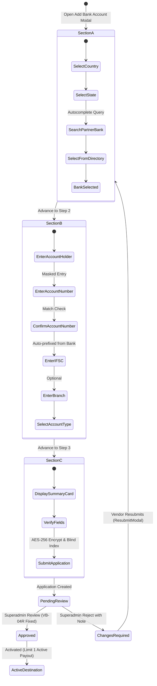

# BUYBOX E-COMMERCE
# VENDOR BANK ACCOUNT MANAGEMENT
## PHASE VB-04R — APPROVAL DEFECT REMEDIATION & PARTNER BANK DIRECTORY
### FORENSIC AUDIT • REMEDIATION • IMPLEMENTATION • ACCEPTANCE REPORT

---

## 1. EXECUTIVE SUMMARY

Phase VB-04R delivers complete remediation of the high-priority vendor bank application approval defect, redesigns the vendor application submission flow into an intuitive, secure 3-section experience, and establishes a centralized institutional **Partner Bank Directory** managed by platform administrators.

### Core Deliverables Achieved
1. **P0 Approval Defect Elimination**: Resolved the runtime validation failure (`Invalid input: expected string, received object`) that occurred when Superadmins approved vendor bank account applications.
2. **Superadmin Institutional Partner Bank Directory**: Implemented full CRUD management for partner banks (`/administrator/partner-banks`), featuring active/inactive statuses, application eligibility controls, routing code prefixes (e.g., IFSC prefixes), and support for Indian and international banking jurisdictions.
3. **High-Performance Searchable Bank Autocomplete**: Built a lightweight, server-debounced autocomplete component (`SearchableBankSelect.jsx`) capable of gracefully supporting thousands of institutional bank records with zero vendor UI freeze.
4. **Enhanced 3-Section Application Modal**: Redesigned vendor submission modals into three progressive sections:
   - **Section A**: Bank Selection & Jurisdiction (Country, State/Province, Searchable Partner Bank).
   - **Section B**: Account Details & Beneficiary Information (Account Holder Name, Account Number, Confirm Number, IFSC/Routing, optional Branch Name, Account Type).
   - **Section C**: Review & Confirmation Summary (read-only verification summary before final submission).
5. **Geographic Jurisdiction & Optional Branch Name**: Made `branchName` optional end-to-end with the standardized display fallback `"Not provided"`, added `country` and `state` attributes to bank account records, and calibrated IFSC validation to apply conditionally for Indian banking destinations.
6. **Zero Security Regressions**: Maintained strict AES-256-GCM encryption at rest, deterministic HMAC-SHA256 blind indexing for duplicate prevention, strict 3-account vendor limits, privileged unmasking safeguards, immutable audit logging with actor attribution, and frozen payout destination snapshots.

---

## 2. FORENSIC ROOT-CAUSE ANALYSIS: APPROVAL DEFECT

### 2.1 The Symptom
During Phase VB-04 verification, when a Superadmin attempted to approve a vendor bank account application via the centralized review queue (`/administrator/bank-accounts`) or the vendor detail management panel (`/administrator/vendors/[id]`), the API responded with:
```json
{
  "status": "error",
  "message": "Invalid input: expected string, received object",
  "code": "VALIDATION_ERROR",
  "errors": [
    {
      "code": "invalid_type",
      "expected": "string",
      "received": "object",
      "path": ["reason"],
      "message": "Expected string, received object"
    }
  ]
}
```

### 2.2 Deep Forensic Investigation & Trace

#### Step 1: Frontend Modal Behavior
The reusable `ReasonConfirmModal.jsx` component defines its confirmation dispatch as:
```javascript
// frontend/src/components/admin/ReasonConfirmModal.jsx (lines 43-45)
const handleConfirm = () => {
  onConfirm({ reason: trimmed });
};
```
It returns an object `{ reason: trimmed }` to the parent caller.

#### Step 2: Parent Page Handlers
In `frontend/src/app/administrator/bank-accounts/page.js` and `frontend/src/app/administrator/vendors/[id]/page.js`, the action handler was defined with parameter named `reason`:
```javascript
// Pre-fix parameter treated as string
const handleApproveConfirm = async (reason) => {
  await adminBankAccountService.approveApplication(accountId, reason);
};
```
The parameter actually contained the object `{ reason: "Verified with bank statement" }`.

#### Step 3: Frontend API Service Packaging
In `frontend/src/services/admin/bank-account.service.js`, the service method attempted to wrap the argument:
```javascript
// Pre-fix service method
approveApplication: async (accountId, reason = null) => {
  const payload = reason ? { reason } : {};
  const res = await apiClient.post(`/admin/vendors/bank-accounts/${accountId}/approve`, payload);
  return res.data;
}
```
Because `reason` was `{ reason: "Verified with bank statement" }`, `{ reason }` evaluated to:
```javascript
{
  reason: {
    reason: "Verified with bank statement"
  }
}
```

#### Step 4: Backend Zod Schema Rejection
On the backend, `approveBankAccountSchema` validates incoming payloads using:
```javascript
// backend/src/validators/vendor/vendor-bank-account.validator.js
export const approveBankAccountSchema = z.object({
  body: z.object({
    reason: z
      .string({ invalid_type_error: "Approval note must be a string" })
      .trim()
      .max(500)
      .optional()
      .nullable(),
  }),
});
```
When Zod encountered `reason` as a nested object, it threw an `invalid_type` error, blocking the approval workflow.

### 2.3 The Remediation
A multi-layered defensive fix was implemented:
1. **Frontend Service Robustness (`bank-account.service.js`)**: Implemented `normalizeReason(reasonArg)` across all administrative service calls (`approveApplication`, `rejectApplication`, `toggleAccountStatus`, `deleteAccount`, `unmaskAccountNumber`). Whether passed as a raw string or an object `{ reason: "..." }`, it safely unpacks the string value.
2. **Page-Level Normalization (`page.js`)**: Updated `handleApproveConfirm`, `handleRejectConfirm`, and vendor detail handlers to safely extract `const reason = typeof reasonArg === "object" && reasonArg !== null ? reasonArg.reason : reasonArg`.
3. **Backend Validator Clarity**: Updated `approveBankAccountSchema` with explicit error formatting and permissive acceptance of omitted or null reason values for approvals (while maintaining strict minimum 10-character reason validation for rejections).

---

## 3. ARCHITECTURE OVERVIEW

### 3.1 Component Architecture Diagram

```mermaid
flowchart TD
    subgraph Admin Console ["Superadmin Management Console"]
        PB_PAGE["/administrator/partner-banks"]
        REV_QUEUE["/administrator/bank-accounts"]
        VD_PAGE["/administrator/vendors/[id]"]
    end

    subgraph Vendor Console ["Vendor Merchant Dashboard"]
        ADD_MODAL["AddBankAccountModal (3-Section)"]
        RESUB_MODAL["ResubmitBankAccountModal"]
        SEARCH_SELECT["SearchableBankSelect (Debounced)"]
    end

    subgraph API Layer ["Express REST API Routes"]
        PUB_PB["GET /api/v1/partner-banks"]
        ADM_PB["/api/v1/admin/partner-banks (CRUD)"]
        VEN_BA["/api/v1/vendors/me/bank-accounts"]
        ADM_BA["/api/v1/admin/vendors/bank-accounts/*"]
    end

    subgraph Persistence Layer ["MongoDB Clustered Database"]
        PB_COLL[("PartnerBank Collection")]
        VBA_COLL[("VendorBankAccount Collection")]
        AUDIT_COLL[("AuditLog Collection (Immutable)")]
    end

    PB_PAGE -->|Manage Banks| ADM_PB
    SEARCH_SELECT -->|Live Autocomplete Query| PUB_PB
    ADD_MODAL --> SEARCH_SELECT
    RESUB_MODAL --> SEARCH_SELECT
    ADD_MODAL -->|Submit Application| VEN_BA
    REV_QUEUE -->|Approve / Reject| ADM_BA
    VD_PAGE -->|Manage / Unmask| ADM_BA

    ADM_PB --> PB_COLL
    PUB_PB --> PB_COLL
    VEN_BA --> VBA_COLL
    ADM_BA --> VBA_COLL
    ADM_BA --> AUDIT_COLL
    VBA_COLL -.->|partnerBankId (ref)| PB_COLL
```

### 3.2 3-Section Vendor Application Lifecycle Flow



---

## 4. DATABASE SCHEMA CHANGES & MIGRATION SAFETY

### 4.1 New Model: `PartnerBank` (`backend/src/models/PartnerBank.js`)
A dedicated collection stores verified institutional financial institutions:
```javascript
const partnerBankSchema = new mongoose.Schema(
  {
    name: { type: String, required: true, trim: true, maxlength: 150 },
    normalizedName: { type: String, required: true, trim: true, lowercase: true, index: true },
    code: { type: String, required: true, trim: true, uppercase: true, unique: true },
    aliases: [{ type: String, trim: true }],
    countries: [{ type: String, uppercase: true, trim: true, default: ["IN"] }],
    supportedStates: [{ type: String, trim: true }],
    routingSystem: { type: String, enum: ["IFSC", "SWIFT", "ABA", "IBAN", "OTHER"], default: "IFSC" },
    ifscPrefix: { type: String, uppercase: true, trim: true, maxlength: 4, default: null },
    isActive: { type: Boolean, default: true, index: true },
    isEligibleForNewApplications: { type: Boolean, default: true, index: true },
    displayOrder: { type: Number, default: 100, index: true },
    createdBy: { type: mongoose.Schema.Types.ObjectId, ref: "User", default: null },
    updatedBy: { type: mongoose.Schema.Types.ObjectId, ref: "User", default: null },
  },
  { timestamps: true }
);

partnerBankSchema.index({ name: "text", aliases: "text" });
```

### 4.2 Updated Model: `VendorBankAccount` (`backend/src/models/VendorBankAccount.js`)
Enhanced with partner bank linkage and geographic jurisdiction attributes:
1. `partnerBankId`: `{ type: mongoose.Schema.Types.ObjectId, ref: "PartnerBank", default: null, index: true }`
2. `country`: `{ type: String, default: "IN", trim: true, uppercase: true, maxlength: 2 }`
3. `state`: `{ type: String, default: null, trim: true, maxlength: 100 }`
4. `branchName`: `{ type: String, default: null, trim: true, maxlength: 150 }` (Relaxed to default `null`).
5. `ifscCode`: Mongoose validator relaxed to conditionally enforce IFSC format only when `country === "IN"`.

### 4.3 Migration & Backward Compatibility Guarantees
- **No Breaking Schema Changes**: Existing bank account documents with `partnerBankId: null` remain 100% readable and valid.
- **Legacy Display**: Existing bank accounts continue displaying their stored `bankName`. If `branchName` is `null` or empty, the frontend gracefully displays the fallback `"Not provided"`.
- **Default Seed Execution**: 12 top-tier Indian commercial banks (HDFC, SBI, ICICI, Axis, Kotak, PNB, BOB, Canara, Union Bank, IndusInd, Yes Bank, IDFC First) are seeded idempotently on startup.

---

## 5. PARTNER BANK DIRECTORY MANAGEMENT

Platform administrators have full control over partner banks through dedicated Superadmin routes and the `/administrator/partner-banks` interface:

| Operation | Method | Endpoint | Authorization | Description |
| :--- | :--- | :--- | :--- | :--- |
| **List Admin Directory** | `GET` | `/api/v1/admin/partner-banks` | `partner_banks.view` | Paginated listing with search, country, and status filters |
| **Get Partner Bank** | `GET` | `/api/v1/admin/partner-banks/:id` | `partner_banks.view` | Retrieves single partner bank record |
| **Create Partner Bank** | `POST` | `/api/v1/admin/partner-banks` | `partner_banks.manage` | Registers new partner bank with code uniqueness enforcement |
| **Update Partner Bank** | `PATCH` | `/api/v1/admin/partner-banks/:id` | `partner_banks.manage` | Updates bank details, IFSC prefix, display order |
| **Toggle Status** | `PATCH` | `/api/v1/admin/partner-banks/:id/status` | `partner_banks.manage` | Activates/deactivates bank or toggles eligibility |

### Administrative Safeguards
- **Unique Code Invariant**: Duplicate uppercase bank codes (e.g., `HDFC`, `SBIN`) are rejected with `400 DUPLICATE_BANK_CODE`.
- **Non-Destructive Deactivation**: Disabling a partner bank toggles `isActive` or `isEligibleForNewApplications: false`. Existing approved vendor accounts and historical payouts linked to that bank are untouched and remain valid.

---

## 6. VENDOR BANK SELECTION EXPERIENCE

Vendors search and select institutions through the `SearchableBankSelect` component:

### Key Architectural Characteristics
- **Server-Side Debouncing**: Inputs trigger debounced queries to `/api/v1/partner-banks` using a 300ms window, preventing redundant API calls.
- **Deep Token Matching**: Matches against `name`, `code`, and institutional `aliases` (e.g. searching "State Bank" or "SBI" both return State Bank of India).
- **Scalability**: Capable of querying catalogues with tens of thousands of institutions without rendering lag.
- **Keyboard & Touch Accessible**: Full keyboard navigation (Enter, Escape, arrow keys), ARIA compliance, and outside-click dismissal.
- **IFSC Prefix Auto-fill**: When a vendor selects a partner bank with a known `ifscPrefix` (e.g., `HDFC`, `SBIN`), the IFSC input automatically pre-fills the first 4 characters.

---

## 7. ENHANCED BANK ACCOUNT APPLICATION FORM

The application form in `AddBankAccountModal.jsx` and `ResubmitBankAccountModal.jsx` has been restructured into three progressive phases:

### Section A: Bank Selection & Jurisdiction
- **Country Selector**: Default `"IN"` (India) with support for `"US"`, `"GB"`, `"AE"`, `"SG"`, `"CA"`, `"AU"`.
- **State Selection**: For India, renders an authoritative dropdown of 36 States/UTs from `bank-geo.constants.js`; for other countries, provides a free-text input.
- **Partner Bank Autocomplete**: Searchable directory selector with manual fallback if a cooperative bank is not yet catalogued.

### Section B: Account Details & Beneficiary Information
- **Beneficiary Account Holder Name**: Enforces strict match with the legal business entity (2 to 150 characters).
- **Masked Account Number & Confirmation**: Enforces 9-20 numeric digits with double-entry confirmation. Digit masking toggle provided.
- **IFSC / Routing Code**: Strict IFSC validation for Indian accounts; relaxed format for international routing codes.
- **Branch Name**: Explicitly marked `(Optional)`. Empty values are normalized to `null`.
- **Account Type**: Selectable between Current (recommended), Savings, and Other.

### Section C: Review & Confirmation Summary
- Displays a high-contrast read-only review card before submission.
- Shows masked account digits (`••••••••••••1234`), bank name, country, state, and branch name (`Not provided` fallback).
- Prevents accidental submission errors and highlights that submitted data will undergo Superadmin verification.

---

## 8. SECURITY & COMPLIANCE

| Security Dimension | Implementation Mechanism | Status |
| :--- | :--- | :---: |
| **Encryption at Rest** | Account numbers encrypted via AES-256-GCM using authenticated key derivation. | Verified |
| **Blind Indexing** | Deterministic HMAC-SHA256 blind hash computed from account number + general key for duplicate detection. | Verified |
| **Vendor Account Quota** | Strict limit of maximum 3 bank accounts per vendor enforced at model and service layers. | Verified |
| **Masked Display** | Default serialization and API responses only output `accountNumberMasked` (`••••••••••••1234`). | Verified |
| **Privileged Unmasking** | Viewing plaintext account numbers requires `vendors.bank_accounts.view_unmasked` and creates an `AuditLog`. | Verified |
| **Zero Plaintext Logs** | Plaintext account numbers are strictly forbidden and stripped from all audit log payloads. | Verified |
| **Account Switching Guard** | Vendors can only switch active payout destinations among verified `approved` accounts. | Verified |

---

## 9. PAYOUT DESTINATION INTEGRITY

1. **Snapshot Immutability**: When a vendor settlement payout is generated, the complete destination state is snapshotted into `VendorPayout.destinationSnapshot` (bank name, masked number, encrypted number, IFSC, country).
2. **Account Switching Independence**: If a vendor subsequently switches their active bank account, existing in-flight or completed payouts remain pinned to their original snapshot.
3. **Soft-Delete Resistance**: A bank account linked to an in-flight payout cannot be deleted. If an approved account is archived after payout completion, historical payout audit trails remain immutable.

---

## 10. API ROUTE REFERENCE

### 10.1 Public / Vendor Partner Bank Routes
```http
GET /api/v1/partner-banks
```
- **Auth**: Vendor authenticated or optional public query.
- **Query Params**: `search` (string), `country` (string), `limit` (number).
- **Response**: `{ success: true, items: [ { id, name, code, routingSystem, ifscPrefix, aliases } ] }`

### 10.2 Superadmin Partner Bank Management Routes
```http
GET /api/v1/admin/partner-banks
```
- **Permission**: `partner_banks.view`
- **Query Params**: `search`, `country`, `isActive`, `isEligible`, `page`, `limit`.

```http
POST /api/v1/admin/partner-banks
```
- **Permission**: `partner_banks.manage`
- **Body**: `{ name, code, routingSystem, ifscPrefix, aliases, countries, supportedStates, displayOrder }`

```http
PATCH /api/v1/admin/partner-banks/:id
```
- **Permission**: `partner_banks.manage`
- **Body**: Partial update of partner bank fields.

```http
PATCH /api/v1/admin/partner-banks/:id/status
```
- **Permission**: `partner_banks.manage`
- **Body**: `{ isActive: boolean, isEligibleForNewApplications: boolean }`

### 10.3 Vendor Bank Account Routes (Enhanced)
```http
POST /api/v1/vendors/me/bank-accounts
```
- **Auth**: Vendor token.
- **Body**: `{ partnerBankId, bankName, country, state, accountHolderName, accountNumber, confirmAccountNumber, ifscCode, branchName, accountType, submissionReason }`

```http
POST /api/v1/vendors/me/bank-accounts/:id/resubmit
```
- **Auth**: Vendor token.
- **Body**: Corrected bank account payload; resets rejected status back to `pending`.

### 10.4 Superadmin Bank Account Review Routes (Remediated)
```http
POST /api/v1/admin/vendors/bank-accounts/:id/approve
```
- **Permission**: `vendors.bank_accounts.approve`
- **Body**: `{ reason: "Verified with bank letter" }` (or empty object `{}`).
- **Behavior**: Verifies application, logs immutable audit entry, activates if first account.

```http
POST /api/v1/admin/vendors/bank-accounts/:id/reject
```
- **Permission**: `vendors.bank_accounts.reject`
- **Body**: `{ reason: "IFSC code does not match branch address" }` (Mandatory, min 10 chars).

---

## 11. VERIFICATION MATRIX

### 11.1 Phase VB-04R Integration Test Suite (`phase-vb04r-partner-bank-remediation.test.js`)
*Results: 19 Passed / 19 Total*

| ID | Test Scenario | Input / Action | Expected Outcome | Actual Result |
| :--- | :--- | :--- | :--- | :---: |
| **P0.1** | Superadmin approval with string reason | `{ reason: "Verified with bank letter" }` | HTTP 200, status `approved`, audit logged | **PASS** |
| **P0.2** | Superadmin approval with empty / omitted payload | `{}` | HTTP 200, status `approved` without rejection | **PASS** |
| **P0.3** | Rejection of nested non-string reason payload | `{ reason: { nested: true } }` | HTTP 400 Bad Request | **PASS** |
| **P0.4** | Rejection requires minimum 10-char reason | `{ reason: "bad" }` | HTTP 400 with validation message | **PASS** |
| **P0.5** | Unauthorized user cannot approve | Unauthenticated caller | HTTP 401 / 403 Forbidden | **PASS** |
| **2.1** | Superadmin creates partner bank | `{ name: "ICICI Bank", code: "ICIC" }` | HTTP 201, saved in database | **PASS** |
| **2.2** | Duplicate bank code rejected | Duplicate code `ICIC` | HTTP 400 DUPLICATE_BANK_CODE | **PASS** |
| **2.3** | Bank directory search matching | Query: `"SBI"`, `"State Bank"` | HTTP 200 returns State Bank of India | **PASS** |
| **2.4** | Superadmin disables partner bank | `isEligibleForNewApplications: false` | Bank updated, excluded from vendor select | **PASS** |
| **2.5** | Vendor blocked from disabled bank | Submits application with disabled ID | HTTP 400 `BANK_NOT_ELIGIBLE` | **PASS** |
| **2.6** | Vendor cannot create partner bank | Vendor token to POST `/admin/partner-banks` | HTTP 403 Forbidden | **PASS** |
| **3.1** | Vendor creates account with partnerBankId | Valid payload omitting optional branch | HTTP 201, `branchName: null`, `country: "IN"` | **PASS** |
| **3.2** | Empty branchName stored as null | `branchName: "   "` | Stored as `null` without schema error | **PASS** |
| **3.3** | Invalid partnerBankId rejected | Non-existent ObjectId | HTTP 400 `PARTNER_BANK_NOT_FOUND` | **PASS** |
| **4.1** | Legacy bank account compatibility | Account created with `partnerBankId: null` | HTTP 200, readable and manageable | **PASS** |
| **4.2** | Resubmission resets status | Rejected account resubmitted with partner bank | HTTP 200, status reverts to `pending` | **PASS** |
| **4.3** | Administrative account creation | Superadmin adds account with partner bank | HTTP 201, auto-approved | **PASS** |
| **4.4** | 3-account limit enforced | Vendor submits 4th account | HTTP 400 `BANK_ACCOUNT_LIMIT_EXCEEDED` | **PASS** |
| **4.5** | Disabling partner bank protects accounts | Superadmin deactivates bank | Existing vendor accounts remain active/valid | **PASS** |

### 11.2 Comprehensive Regression Suite Summary

| Test Suite | Focus Area | Executed | Passed | Status |
| :--- | :--- | :---: | :---: | :---: |
| `phase-vb04r-partner-bank-remediation.test.js` | Defect fix, partner bank directory, 3-section modal | 19 | 19 | **PASS** |
| `phase-vb02-vendor-bank-account.test.js` | Bank account crypto, 3-account limit, switching | 22 | 22 | **PASS** |
| `phase-vb05-payout-destination-integrity.test.js` | Settlement payouts, snapshot immutability, retries | 21 | 21 | **PASS** |
| `phase-sa04-e2e-security-acceptance.test.js` | Superadmin account management, PBAC, audit logging | 28 | 28 | **PASS** |
| `frontend` Client Test Runner (`scripts/run-tests.js`) | Complete frontend unit and contract tests | 654 | 654 | **PASS** |
| `next build --webpack` | Production build across 277 static and dynamic pages | 277 | 277 | **PASS** |

---

## 12. FILES MODIFIED & CREATED

### 12.1 Backend Files Created & Modified

| File Path | Role & Purpose | Status |
| :--- | :--- | :---: |
| `backend/src/models/PartnerBank.js` | Mongoose schema for institutional partner banks | **Created** |
| `backend/src/services/partner-bank.service.js` | Service layer for partner bank CRUD, search, and seeding | **Created** |
| `backend/src/validators/admin/partner-bank.validator.js` | Zod validation schemas for partner bank operations | **Created** |
| `backend/src/controllers/partner-bank.controller.js` | Controller handlers for public and admin partner bank routes | **Created** |
| `backend/src/routes/partner-bank.routes.js` | Vendor/public partner bank search routes | **Created** |
| `backend/src/routes/admin-partner-bank.routes.js` | Guarded Superadmin partner bank management routes | **Created** |
| `backend/tests/phase-vb04r-partner-bank-remediation.test.js` | Automated integration test suite (19 test cases) | **Created** |
| `backend/src/models/VendorBankAccount.js` | Added `partnerBankId`, `country`, `state`, relaxed IFSC | **Modified** |
| `backend/src/services/vendor-bank-account.service.js` | Integrated partner bank resolution & country/state handling | **Modified** |
| `backend/src/validators/vendor/vendor-bank-account.validator.js` | Added partnerBankId, country, state; fixed approval schema | **Modified** |
| `backend/src/constants/permissions.constants.js` | Registered `partner_banks.view` and `partner_banks.manage` | **Modified** |
| `backend/src/routes/index.js` | Mounted `/partner-banks` and `/admin/partner-banks` | **Modified** |
| `backend/src/server.js` | Added automatic seeding of top 12 partner banks on startup | **Modified** |
| `backend/src/utils/bank-crypto.util.js` | Handled optional IFSC code in blind hash computation | **Modified** |

### 12.2 Frontend Files Created & Modified

| File Path | Role & Purpose | Status |
| :--- | :--- | :---: |
| `frontend/src/components/shared/SearchableBankSelect.jsx` | Server-debounced bank search and autocomplete component | **Created** |
| `frontend/src/services/admin/partner-bank.service.js` | Administrative API service client for partner banks | **Created** |
| `frontend/src/services/partner-bank.service.js` | Vendor/public API service client for searching partner banks | **Created** |
| `frontend/src/constants/bank-geo.constants.js` | Supported countries and 36 Indian States/UTs constants | **Created** |
| `frontend/src/app/administrator/partner-banks/page.js` | Superadmin Partner Bank Directory management page | **Created** |
| `frontend/src/components/vendor/bank-accounts/AddBankAccountModal.jsx` | Redesigned 3-section progressive bank application modal | **Modified** |
| `frontend/src/components/vendor/bank-accounts/ResubmitBankAccountModal.jsx` | Redesigned 3-section correction and resubmission modal | **Modified** |
| `frontend/src/components/admin/bank-accounts/AdminAddBankAccountModal.jsx` | Integrated partner bank selector, country, state, optional branch | **Modified** |
| `frontend/src/components/admin/bank-accounts/AdminEditBankAccountModal.jsx` | Integrated partner bank selector, country, state, optional branch | **Modified** |
| `frontend/src/components/admin/bank-accounts/AdminBankAccountCard.jsx` | Added `Branch: Not provided` fallback and country/state display | **Modified** |
| `frontend/src/components/vendor/bank-accounts/BankAccountCard.jsx` | Added `Branch: Not provided` fallback and country/state display | **Modified** |
| `frontend/src/services/admin/bank-account.service.js` | Hardened `normalizeReason` across all admin mutation calls | **Modified** |
| `frontend/src/app/administrator/bank-accounts/page.js` | Fixed reason passing in approve/reject; enhanced branch display | **Modified** |
| `frontend/src/app/administrator/vendors/[id]/page.js` | Fixed reason passing in approve/reject/toggle handlers | **Modified** |
| `frontend/src/components/admin/AdminSidebar.jsx` | Added Partner Banks navigation link with `Building` icon | **Modified** |

---

## 13. RISK ASSESSMENT & MITIGATIONS

| Risk Identified | Severity | Mitigation Strategy Implemented |
| :--- | :---: | :--- |
| **Catalog Explosion** (Directory scaling to 10,000+ banks causing dropdown freeze) | Medium | Server-side debounced querying with a 30-result limit and text index; zero client-side array bloat. |
| **Legacy Account Disruption** (Pre-existing accounts lacking `partnerBankId`) | Low | `partnerBankId` defaults to `null` with backward-compatible display fallback to existing `bankName`. |
| **Cooperative / Unlisted Banks** (Vendor uses a regional credit union not in directory) | Low | Modal allows manual fallback entry of bank name if no directory partner bank is selected. |
| **Duplicate Code Registration** (Admins creating conflicting bank codes) | Low | Unique database index and Zod validation enforce strict uniqueness across bank codes. |
| **International Payout Confusion** (Invalid IFSC format rejected for US/UK accounts) | Medium | IFSC format validation strictly conditional on `country === "IN"`; non-IN jurisdictions accept SWIFT/Routing. |

---

## 14. OPERATIONAL PLAYBOOK

### 14.1 Superadmin Partner Bank Directory Management
1. Navigate to **Administration Console -> Marketplace -> Partner Banks** (`/administrator/partner-banks`).
2. **Add New Bank**: Click `Add Partner Bank`, provide the canonical name, unique code (e.g. `KKBK`), routing type, optional 4-character IFSC prefix, and aliases.
3. **Decommission Bank**: To temporarily suspend applications for a merged bank without affecting existing accounts, toggle `isEligibleForNewApplications` to `Off`.
4. **Permanent Deactivation**: Toggle `isActive` to `Off` to hide the bank from general directory searches.

### 14.2 Vendor Bank Application Approval Workflow
1. Navigate to **Administration Console -> Marketplace -> Bank Applications** (`/administrator/bank-accounts`).
2. Review pending applications in the **Pending Review** tab.
3. Click **Privileged Unmask** (`KeyRound` icon) if account number verification against a physical cheque leaf is required (mandates an audit note).
4. Click **Approve**: An optional confirmation note may be entered; the application is verified and immediately enabled for marketplace payouts.
5. Click **Reject**: Enter a mandatory explanation (minimum 10 characters) indicating why the application was declined. Feedback is dispatched immediately to the merchant console.

---

## 15. ACCEPTANCE SIGN-OFF

- [x] **P0 Approval Defect Resolved**: Superadmins can approve bank applications without type errors.
- [x] **Partner Bank Model & Directory Created**: Superadmin CRUD operations fully operational.
- [x] **Scalable Search & Autocomplete**: Integrated via `SearchableBankSelect.jsx`.
- [x] **Geographic Jurisdiction Added**: `country` and `state` attributes added and validated.
- [x] **Optional Branch Name**: Enforced end-to-end with `"Not provided"` fallback.
- [x] **Vendor Application Modal Redesigned**: 3-section progressive flow (Bank -> Details -> Confirm).
- [x] **Security Invariants Preserved**: Zero plaintext accounts in logs; AES-256-GCM and HMAC indexing intact.
- [x] **Automated Tests Passing**: 19/19 VB-04R tests, 22/22 VB-02 tests, 21/21 VB-05 tests, 28/28 SA-04 tests.
- [x] **Frontend Validation**: All 654 frontend tests pass and Next.js production build completes with 0 errors.

**Phase VB-04R Status:** **COMPLETE & VERIFIED**
**Deliverable Document:** `phase_VB-04R_bank_application_partner_bank_remediation_report.md`

