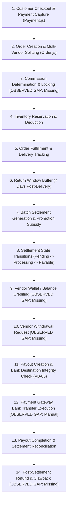
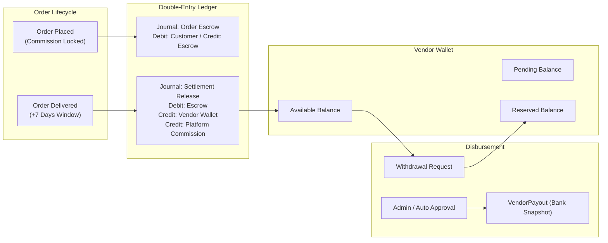
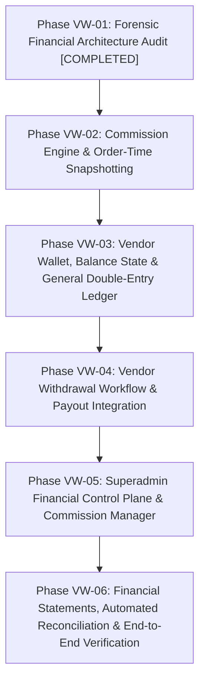

# BUYBOX E-COMMERCE
# VENDOR WALLET & FINANCIAL MANAGEMENT
## PHASE VW-01 — COMPLETE FINANCIAL ARCHITECTURE AUDIT REPORT
### FORENSIC READ-ONLY AUDIT & ARCHITECTURAL BLUEPRINT

---

## 1. EXECUTIVE SUMMARY

An exhaustive, read-only forensic audit of the Buybox-Ecommerce financial architecture was conducted to evaluate system readiness for the upcoming Vendor Wallet and Financial Management implementation.

### Current State Assessment
The existing system possesses robust foundational elements developed in earlier phases:
- **Settlement & Return Safety:** A functional batch settlement calculation mechanism (`vendor-settlement.service.js`) enforcing a 7-day post-delivery return window buffer before orders become eligible for settlement.
- **Double Settlement Prevention:** Order item locking via `Order.items[].settlementId` within ACID MongoDB transactions.
- **Payout Destination Integrity:** Strict payout destination immutability with comprehensive snapshotting of approved `VendorBankAccount` credentials (delivered and hardened in Phase VB-05).
- **Promotional Subsidy Double-Entry:** An append-only `FinancialLedgerEntry` model enforcing debit/credit conservation for platform-funded promotional subsidies.

### Critical Deficits & Gaps
However, the system currently lacks true financial wallet mechanics, continuous double-entry bookkeeping, and flexible commission configuration:
1. **Zero Real-Time Wallet / Stored Balance:** There is no `VendorWallet`, `VendorBalance`, or `WalletTransaction` entity. Vendor earnings and "balances" are dynamically calculated on demand by aggregating `VendorSettlement` records.
2. **Floating-Point Precision Drift:** Calculations in `vendor-settlement.service.js` and `vendor-payout.service.js` convert `Decimal128` fields to JavaScript `Number`, perform standard floating-point arithmetic, and format via `.toFixed(2)` before saving back to `Decimal128`. This violates integer-minor-unit (cents/paisa) financial precision standards.
3. **Dormant Double-Entry Ledger:** Although `FinancialLedgerEntry` exists with debit/credit schemas and immutability guards, it is completely bypassed for standard customer payments, gross sales, platform commissions, vendor earnings, customer refunds, and bank payouts.
4. **Retroactive Commission Evaluation:** Commission rates exist solely as a single field on `Vendor.commissionRate` (defaulting to 0.10 if <= 0). Commission is dynamically calculated at settlement generation rather than snapshotted at order placement, exposing past un-settled orders to retroactive rate changes.
5. **No Vendor Withdrawal Workflow:** Payouts are strictly 1:1 coupled to pre-generated settlements and can only be triggered by administrators. Vendors have no mechanism to view an available balance or request withdrawals.
6. **Post-Settlement Clawback Void:** If a refund, chargeback, or customer return occurs after an order's settlement has been marked `paid`, there is no automatic mechanism to debit the vendor, enforce negative balance, or claw back funds from subsequent settlements.

---

## 2. EXISTING FINANCIAL ARCHITECTURE INVENTORY

| Component | Path | Responsibility / Purpose | Implementation Status |
| :--- | :--- | :--- | :--- |
| **Model** | `backend/src/models/Order.js` | Stores order totals, line items, fulfillment state, and `item.settlementId`. | `VERIFIED FACT` Complete for orders; lacks item commission snapshot. |
| **Model** | `backend/src/models/Payment.js` | Authoritative record of gateway payments, status (`captured`), amounts. | `VERIFIED FACT` Operational. |
| **Model** | `backend/src/models/Vendor.js` | Vendor business details; holds `commissionRate` (Decimal128). | `VERIFIED FACT` Operational; lacks tiered/category commission. |
| **Model** | `backend/src/models/VendorSettlement.js` | Statement grouping eligible orders; calculates net payable amount. | `VERIFIED FACT` Operational for batch settlements. |
| **Model** | `backend/src/models/VendorPayout.js` | Payout lifecycle entity; 1:1 with settlement; stores destination snapshot. | `VERIFIED FACT` Hardened in VB-05 with immutability hooks. |
| **Model** | `backend/src/models/VendorBankAccount.js` | Encrypted bank account destination (AES-256-GCM, HMAC blind index). | `VERIFIED FACT` Complete (VB-01 through VB-05). |
| **Model** | `backend/src/models/FinancialLedgerEntry.js` | Append-only double-entry ledger with debit/credit directions. | `OBSERVED GAP` Active ONLY for promotional subsidies. |
| **Model** | `backend/src/models/ReturnRequest.js` | Tracks item returns, status (`received`, `refunded`), refund amounts. | `VERIFIED FACT` Integrated with pre-settlement calculations. |
| **Model** | `backend/src/models/Refund.js` | Tracks customer refund disbursements. | `VERIFIED FACT` Operational. |
| **Model** | `backend/src/models/VendorWallet.js` | Vendor balance, available/pending/reserved funds tracking. | `OBSERVED GAP` **DOES NOT EXIST**. |
| **Model** | `backend/src/models/WalletTransaction.js` | Real-time vendor balance mutation journal. | `OBSERVED GAP` **DOES NOT EXIST**. |
| **Model** | `backend/src/models/CommissionRule.js` | Category, product, tiered, or global commission configuration. | `OBSERVED GAP` **DOES NOT EXIST**. |
| **Model** | `backend/src/models/WithdrawalRequest.js` | Vendor-initiated payout / withdrawal requests. | `OBSERVED GAP` **DOES NOT EXIST**. |
| **Service** | `backend/src/services/vendor-settlement.service.js` | Calculates eligibility, generates settlements, marks paid. | `VERIFIED FACT` Operational; uses floating-point math. |
| **Service** | `backend/src/services/vendor-payout.service.js` | Payout creation, destination verification, status state machine. | `VERIFIED FACT` Operational; administrative manual trigger. |
| **Service** | `backend/src/services/financial-ledger.service.js` | Ledger entry persistence and querying. | `OBSERVED GAP` Underutilized in core commerce flows. |
| **Service** | `backend/src/services/payment.service.js` | Payment capture, refund dispatch, webhook handling. | `VERIFIED FACT` Operational. |
| **Service** | `backend/src/services/vendor-wallet.service.js` | Wallet balances, holds, credits, debits. | `OBSERVED GAP` **DOES NOT EXIST**. |
| **Controller** | `backend/src/controllers/vendor-settlement.controller.js` | Admin & vendor settlement endpoints. | `VERIFIED FACT` Operational. |
| **Controller** | `backend/src/controllers/vendor-payout.controller.js` | Payout generation and status transitions. | `VERIFIED FACT` Operational. |
| **Controller** | `backend/src/controllers/financial-ledger.controller.js` | Admin ledger queries (by ID, journal, order, vendor). | `VERIFIED FACT` Operational. |
| **Routes** | `backend/src/routes/vendor-settlement.routes.js` | `/api/v1/finance/settlements/*` | `VERIFIED FACT` Operational. |
| **Routes** | `backend/src/routes/vendor-payout.routes.js` | `/api/v1/finance/payouts/*` | `VERIFIED FACT` Operational. |
| **Routes** | `backend/src/routes/financial-ledger.routes.js` | `/api/v1/finance/ledger/*` | `VERIFIED FACT` Operational. |
| **Routes** | `backend/src/routes/vendor.routes.js` | `/api/v1/vendors/me/finance`, `/me/settlements` | `VERIFIED FACT` Operational. |
| **Frontend Page** | `frontend/src/app/vendor/finance/page.js` | Vendor finance overview and settlement list. | `VERIFIED FACT` Operational; aggregates on the fly. |
| **Frontend Page** | `frontend/src/app/vendor/finance/statements/page.js` | Vendor settlement statements table and filtering. | `VERIFIED FACT` Operational. |
| **Frontend Page** | `frontend/src/app/vendor/finance/wallet/page.js` | Vendor real-time wallet, balances, withdrawal requests. | `OBSERVED GAP` **DOES NOT EXIST**. |
| **Frontend Page** | `frontend/src/app/administrator/finance/settlements/page.js` | Superadmin settlement generation and payout recording. | `VERIFIED FACT` Operational. |
| **Frontend Page** | `frontend/src/app/administrator/finance/commissions/page.js` | Superadmin marketplace commission rule manager. | `OBSERVED GAP` **DOES NOT EXIST**. |

---

## 3. COMPLETE ORDER-TO-PAYOUT FLOW

The lifecycle of money from customer checkout to vendor payout was forensically analyzed across the 14 mandatory steps:



### Step-by-Step Analysis

#### Step 1: Customer Checkout & Payment Authorization/Capture
- **File & Function:** [`backend/src/services/payment.service.js`](file:///d:/MERN%20Stack/Buybox-Ecommerce/backend/src/services/payment.service.js) -> `verifyPaymentSignature`, `processWebhookEvent`
- **State Transition:** `Payment.status`: `pending` -> `captured`; `Order.paymentStatus`: `pending` -> `paid`
- **Amounts Involved:** Full order `grandTotal` (Decimal128), including customer-paid taxes, shipping, and products.
- **Ledger & Invariant Status:** `OBSERVED GAP`. No ledger entry is created for `PAYMENT_RECEIVED` or `CUSTOMER_FUNDS_IN_ESCROW`.
- **Tests:** `payment-verification.service.test.js`, `checkout-idempotency.test.js`.

#### Step 2: Order Creation & Multi-Vendor Item Splitting
- **File & Function:** [`backend/src/services/order.service.js`](file:///d:/MERN%20Stack/Buybox-Ecommerce/backend/src/services/order.service.js) -> `createOrder`
- **State Transition:** `Order.status`: `placed`; `Order.items[].fulfillmentStatus`: `unfulfilled`
- **Amounts Involved:** `Order.items[].lineTotal`, `unitPrice`, `taxTotal`, `discountTotal`.
- **Multi-Vendor Isolation:** `VERIFIED FACT`. Each item strictly isolates its `vendorId: ObjectId`.
- **Tests:** `phase3-marketplace-order-lifecycle.test.js`, `vendor-shipment-splitting.test.js`.

#### Step 3: Commission Rate Determination & Locking
- **File & Function:** **MISSING / OBSERVED GAP**.
- **Evidence:** Inspection of [`backend/src/models/Order.js`](file:///d:/MERN%20Stack/Buybox-Ecommerce/backend/src/models/Order.js#L50-L265) confirms order items store `promotionId`, `regularPrice`, and promotional discount snapshots, but contain **zero** fields for `commissionRate` or `commissionAmount`.
- **Risk:** High. Commission rate is only evaluated dynamically weeks later when settlements are batch-generated.

#### Step 4: Inventory Reservation & Deduction
- **File & Function:** [`backend/src/services/inventory.service.js`](file:///d:/MERN%20Stack/Buybox-Ecommerce/backend/src/services/inventory.service.js) -> `reserveStockForOrder`, `deductStock`
- **State Transition:** `Order.items[].inventoryStatus`: `reserved` -> `deducted`
- **Tests:** `inventory-idempotency.test.js`, `inventory-release-concurrency.test.js`.

#### Step 5: Order Fulfillment & Delivery Tracking
- **File & Function:** [`backend/src/services/shipment.service.js`](file:///d:/MERN%20Stack/Buybox-Ecommerce/backend/src/services/shipment.service.js) -> `updateShipmentStatus`
- **State Transition:** `Order.items[].fulfillmentStatus`: `unfulfilled` -> `processing` -> `shipped` -> `delivered`; sets `Order.deliveredAt = new Date()`.
- **Tests:** `phase3d-fulfillment-shipment-tracking.test.js`, `vendor-order-fulfillment-lifecycle.test.js`.

#### Step 6: Return Window Tracking & Eligibility Cutoff
- **File & Function:** [`backend/src/services/vendor-settlement.service.js`](file:///d:/MERN%20Stack/Buybox-Ecommerce/backend/src/services/vendor-settlement.service.js#L260-L280) -> `calculateVendorEligibleSettlement`
- **Logic:** `deliveredAt <= returnWindowCutoff` where `returnWindowCutoff = new Date(Date.now() - 7 * 24 * 60 * 60 * 1000)`.
- **Status:** `VERIFIED FACT`. Strictly prevents settlement generation before the 7-day customer return period expires.
- **Tests:** `vendor-settlement-promotion-subsidy.test.js`.

#### Step 7: Settlement Calculation & Promotion Subsidy Adjustment
- **File & Function:** [`backend/src/services/vendor-settlement.service.js`](file:///d:/MERN%20Stack/Buybox-Ecommerce/backend/src/services/vendor-settlement.service.js#L350-L415) -> `calculateVendorEligibleSettlement`
- **Amounts Evaluated:**
  - `grossSales`: Sum of eligible `item.lineTotal`
  - `refunds`: Sum of approved `ReturnRequest` items received/refunded
  - `platformSubsidy`: Restores platform-funded discounts to vendor
  - `commissionBase = Math.max(0, grossSales + platformSubsidy - discounts - refunds)`
  - `platformCommission = Math.round(commissionBase * rate * 100) / 100`
  - `netPayable = Math.max(0, commissionBase - platformCommission)`
- **Ledger Entries Created:** `PROMOTION_SUBSIDY` debit (Platform) and credit (Vendor) entries written to `FinancialLedgerEntry`.
- **Precision Issue:** Uses JS floating-point `Number` arithmetic instead of integer cents.

#### Step 8: Settlement Approval & State Transition
- **File & Function:** [`backend/src/services/vendor-settlement.service.js`](file:///d:/MERN%20Stack/Buybox-Ecommerce/backend/src/services/vendor-settlement.service.js#L184-L241) -> `markProcessing`, `markPayable`
- **State Transition:** `VendorSettlement.status`: `pending` -> `processing` -> `payable`.
- **Authorization:** `requirePermissions(PERMISSIONS.FINANCE_MANAGE)`.

#### Step 9: Vendor Wallet / Balance Crediting
- **File & Function:** **MISSING / OBSERVED GAP**.
- **Finding:** Settlements do not credit any vendor wallet. When a vendor visits `/vendor/finance`, the frontend fetches `GET /api/v1/vendors/me/finance`, which executes `getVendorFinanceSummary` and computes total earnings on the fly by scanning all `VendorSettlement` records.

#### Step 10: Vendor Withdrawal / Payout Request Initiation
- **File & Function:** **MISSING / OBSERVED GAP**.
- **Finding:** Vendors cannot request payouts or withdraw funds. All payouts are initiated administratively by Superadmin for an entire settlement statement.

#### Step 11: Payout Authorization & Bank Account Destination Verification
- **File & Function:** [`backend/src/services/vendor-payout.service.js`](file:///d:/MERN%20Stack/Buybox-Ecommerce/backend/src/services/vendor-payout.service.js#L61-L300) -> `createPayout`
- **Integrity Validation (Delivered in VB-05):**
  1. Validates `settlement.status === "payable"`.
  2. Enforces unique 1:1 settlement-to-payout (`findBySettlementId`).
  3. Verifies vendor has an active, approved, non-deleted `VendorBankAccount`.
  4. Snapshots masked account number, IFSC code, bank name, beneficiary name into `metadata` with immutable pre-save hook.
- **Tests:** `phase-vb05-payout-destination-integrity.test.js` (21/21 PASS).

#### Step 12: Payment Gateway Bank Transfer Execution
- **File & Function:** **OBSERVED GAP / MANUAL PLACEHOLDER**.
- **Finding:** Payouts default to provider `RAZORPAY`, but no direct RazorpayX or bank transfer API call is executed. Status transitions are triggered via admin API calls.

#### Step 13: Payout Completion & Settlement Reconciliation
- **File & Function:** [`backend/src/services/vendor-payout.service.js`](file:///d:/MERN%20Stack/Buybox-Ecommerce/backend/src/services/vendor-payout.service.js#L359-L558) -> `transitionPayoutStatus`
- **State Transition:** `VendorPayout.status`: `processing` -> `paid`; automatically updates `VendorSettlement.status = "paid"`.
- **Audit Logging:** Emits `PAYOUT_PAID` event to `AuditLog`.

#### Step 14: Post-Settlement Refund / Chargeback Handling & Clawback
- **File & Function:** **MISSING / OBSERVED GAP**.
- **Finding:** If an order has already been settled and paid out to a vendor, and a subsequent refund, chargeback, or warranty return occurs, there is no ledger debit against the vendor, no negative wallet balance capability, and no deduction from future settlements.

---

## 4. COMMISSION ENGINE FINDINGS

### Existing Implementation Analysis
1. **Single Rate Storage:** The only commission configuration in the database is located in [`backend/src/models/Vendor.js`](file:///d:/MERN%20Stack/Buybox-Ecommerce/backend/src/models/Vendor.js#L165):
   ```javascript
   commissionRate: {
     type: mongoose.Schema.Types.Decimal128,
     default: 0,
   }
   ```
2. **Hardcoded Fallback Rate:** In [`backend/src/services/vendor-settlement.service.js`](file:///d:/MERN%20Stack/Buybox-Ecommerce/backend/src/services/vendor-settlement.service.js#L388-L394):
   ```javascript
   let rate = Number(vendor.commissionRate?.toString() || "0");
   if (rate > 1) {
     rate = rate / 100;
   } else if (rate <= 0) {
     rate = 0.10; // Hardcoded 10% platform fallback
   }
   ```
3. **Dynamic Evaluation Hazard:** Commission is calculated dynamically when settlements are generated, rather than snapshotted at the time of order placement.
   - `RISK`: If a vendor’s agreed commission is 5% in January when an order is placed, and the administrator updates the vendor to 15% in February, running settlement generation in February retroactively subjects the January order to the 15% rate.
4. **Absence of Hierarchical Rules:**
   - No Category-level commission rates (e.g. 5% for Electronics, 15% for Fashion).
   - No Product-level or SKU-level override commission rates.
   - No Global marketplace default rate stored in `StorefrontSettings`.

---

## 5. VENDOR EARNINGS & SETTLEMENT FINDINGS

### Eligibility Architecture
In [`backend/src/services/vendor-settlement.service.js`](file:///d:/MERN%20Stack/Buybox-Ecommerce/backend/src/services/vendor-settlement.service.js):
- **Delivered Order Filter:** Queries orders with status in `["delivered", "completed"]` and paymentStatus in `["paid", "partially_refunded"]`.
- **Return Window Cutoff:** Order items are only eligible if `deliveredAt <= returnWindowCutoff` (7 days post-delivery).
- **Settlement Idempotency:** Order items maintain `settlementId: ObjectId` (default `null`). Items where `settlementId !== null` or `fulfillmentStatus === "cancelled"` are strictly excluded.
- **Atomic Locking:** During `generateEligibleSettlements`, a MongoDB transaction updates all eligible order items with the new `settlement._id`, preventing double-settlement.

### Floating-Point Precision Flaws
- In `calculateVendorEligibleSettlement`:
  ```javascript
  const commissionBase = Math.max(0, grossSalesNum + platformSubsidyNum - discountsNum - refundsNum);
  const platformCommissionNum = Math.round(commissionBase * rate * 100) / 100;
  const netPayableNum = Math.max(0, grossSalesNum + platformSubsidyNum - discountsNum - refundsNum - platformCommissionNum);
  ```
- `RISK`: Using IEEE 754 floating-point `Number` arithmetic introduces rounding errors across large order volumes (e.g., `0.1 + 0.2 = 0.30000000000000004`). In financial accounting, minor units (integer cents/paisa) must be used.

---

## 6. PAYOUT & BANK INTEGRATION FINDINGS

### VB-05 Destination Integrity Strengths
- **1:1 Constraint:** `VendorPayout` enforces `{ settlementId: 1 }` unique index. A settlement can never be paid twice.
- **Strict Destination Verification:** `createPayout` requires an active, approved, non-archived `VendorBankAccount` belonging to the vendor.
- **Immutable Snapshotting:** Bank account details (`bankName`, `accountHolderName`, `accountNumberMasked`, `ifscCode`, `snapshotAt`) are stored permanently in `payout.metadata`. Pre-save hooks prevent overwriting.

### Operational Limitations
- **Manual Gateway Workflow:** Payout execution is currently administrative (`POST /api/v1/finance/payouts` and `PATCH /api/v1/finance/payouts/:payoutId/status`). No webhook or automated fund transfer integration (e.g. RazorpayX Payouts API) is plugged into `transitionPayoutStatus`.
- **Rigid 1:1 Settlement Coupling:** Payouts cannot aggregate multiple settlements, nor can a vendor request a partial payout of accumulated earnings.

---

## 7. WALLET & LEDGER FINDINGS

### Dormant Double-Entry Ledger
The [`backend/src/models/FinancialLedgerEntry.js`](file:///d:/MERN%20Stack/Buybox-Ecommerce/backend/src/models/FinancialLedgerEntry.js) model was inspected:
- **Schema Design:** Features `journalId`, `entryType`, `direction` (`debit`/`credit`), `accountType` (`platform`, `vendor`, `customer`, `payment_gateway`, `clearing`), `amount` (Decimal128), and `currency`.
- **Immutability:** Contains a strict pre-save hook throwing `FINANCIAL_LEDGER_IMMUTABLE` on update/delete.
- **Current Utilization:** It is **ONLY** called in `vendor-settlement.service.js` for `PROMOTION_SUBSIDY` and `SUBSIDY_REVERSAL`.
- `OBSERVED GAP`: It is completely silent during customer checkout, order fulfillment, commission deduction, vendor earning credit, and bank payouts.

### Lack of Real-Time Vendor Balance
- `OBSERVED GAP`: No wallet entity exists. Vendor balance is not stored anywhere.
- `RECOMMENDATION`: Introduce `VendorWallet` with:
  - `availableBalance` (funds ready for withdrawal)
  - `pendingBalance` (orders delivered but within the 7-day return buffer)
  - `reservedBalance` (funds locked in pending withdrawal requests)
  - `totalSettled` (cumulative lifetime payouts)

---

## 8. REFUND, RETURN & CANCELLATION FINDINGS

### Pre-Settlement Protection
- In [`vendor-settlement.service.js`](file:///d:/MERN%20Stack/Buybox-Ecommerce/backend/src/services/vendor-settlement.service.js#L350-L385), completed returns (`ReturnRequest.find({ status: { $in: ["received", "refunded"] } })`) associated with eligible orders are deducted from `grossSales` before computing commission and net payable.
- This protects the platform against paying vendors for returned goods during the 7-day return window.

### Post-Settlement Vulnerability
- `OBSERVED GAP`: If an order is delivered, 7 days pass, the settlement is generated and paid, and subsequently an admin approves an exceptional customer refund or a credit card chargeback occurs:
  1. The money has already left the platform and was disbursed to the vendor.
  2. The system does not record a negative adjustment against the vendor.
  3. The next settlement calculation does not check for past refunded orders that were already settled.
- `RISK`: Platform financial loss due to unrecoverable post-settlement customer refunds.

---

## 9. SUPERADMIN FINANCIAL CONTROL FINDINGS

### Existing Administrative Features
- View all settlements (`GET /api/v1/finance/settlements/admin`).
- Trigger batch settlement generation (`POST /api/v1/finance/settlements/generate`).
- Mark settlements paid (`POST /api/v1/finance/settlements/:settlementId/pay`).
- Audit logs emitted on settlement and payout status transitions.

### Missing Administrative Controls
- **Commission Rule Manager:** No interface or API to manage global or category commission tiers.
- **Wallet Hold / Freeze:** No ability to freeze a vendor's wallet balance during investigation or suspension.
- **Manual Balance Adjustments:** No authorized administrative adjustment workflow to credit or debit a vendor's ledger with mandatory justification.
- **Withdrawal Request Approval Queue:** No queue to review, approve, or reject vendor withdrawal requests.

---

## 10. FINANCIAL INVARIANT ASSESSMENT

The 14 mandatory financial invariants were rigorously evaluated against the codebase:

| Invariant | Description | Status | Evidence / File Citations |
| :--- | :--- | :--- | :--- |
| **Invariant 1** | **Double-entry conservation** (`sum(debits) == sum(credits)`) | `PARTIAL` | `PROMOTION_SUBSIDY` writes balanced pairs in [`vendor-settlement.service.js:487-525`](file:///d:/MERN%20Stack/Buybox-Ecommerce/backend/src/services/vendor-settlement.service.js#L487-L525). However, core order revenue, commission, and payouts are not recorded in the ledger. |
| **Invariant 2** | **Non-negative vendor balance** (`balance >= 0`) | `NOT APPLICABLE` | No stored balance entity exists. |
| **Invariant 3** | **Payout destination immutability** | `PASS` | Hardened in [`VendorPayout.js`](file:///d:/MERN%20Stack/Buybox-Ecommerce/backend/src/models/VendorPayout.js) and [`vendor-payout.service.js:430-443`](file:///d:/MERN%20Stack/Buybox-Ecommerce/backend/src/services/vendor-payout.service.js#L430-L443); snapshot cannot be mutated once created. |
| **Invariant 4** | **No double settlement** | `PASS` | Order items store `settlementId` ref; [`vendor-settlement.service.js:275`](file:///d:/MERN%20Stack/Buybox-Ecommerce/backend/src/services/vendor-settlement.service.js#L275) filters `settlementId: null` and locks items inside a transaction. |
| **Invariant 5** | **Accurate commission calculation** (rate locked at order) | `FAIL` | [`Order.js`](file:///d:/MERN%20Stack/Buybox-Ecommerce/backend/src/models/Order.js#L50-L265) does not snapshot commission rate; [`vendor-settlement.service.js:388`](file:///d:/MERN%20Stack/Buybox-Ecommerce/backend/src/services/vendor-settlement.service.js#L388) reads `vendor.commissionRate` dynamically at settlement generation. |
| **Invariant 6** | **Refund clawback integrity** (post-settlement returns) | `FAIL` | Pre-settlement returns are deducted, but post-settlement refunds have no clawback or negative ledger debit mechanism. |
| **Invariant 7** | **Idempotent payout processing** | `PASS` | [`VendorPayout.js:140-149`](file:///d:/MERN%20Stack/Buybox-Ecommerce/backend/src/models/VendorPayout.js#L140-L149) enforces unique `{ settlementId: 1 }` and `{ vendorId: 1, idempotencyKey: 1 }`. |
| **Invariant 8** | **Integer cents / minor-currency decimal precision** | `FAIL` | [`vendor-settlement.service.js:397-400`](file:///d:/MERN%20Stack/Buybox-Ecommerce/backend/src/services/vendor-settlement.service.js#L397-L400) uses JS floating-point `Number` math with `Math.round(... * 100) / 100`. |
| **Invariant 9** | **Return window safety buffer** | `PASS` | [`vendor-settlement.service.js:267-270`](file:///d:/MERN%20Stack/Buybox-Ecommerce/backend/src/services/vendor-settlement.service.js#L267-L270) strictly enforces `deliveredAt <= returnWindowCutoff` (7 days). |
| **Invariant 10** | **Multi-vendor order isolation** | `PASS` | Items in `Order` and `ReturnRequest` carry `vendorId`; settlement queries filter strictly by `vendorId`. |
| **Invariant 11** | **Immutable audit trail for balance adjustments** | `PARTIAL` | `AuditLog` captures payout/settlement status changes, but no manual balance adjustments or balance adjustment ledger entries exist. |
| **Invariant 12** | **Separation of duties for financial transactions** | `PASS` | Enforced via `requirePermissions(PERMISSIONS.FINANCE_MANAGE)` and `authenticateVendor` in route definitions. Vendors cannot approve their own settlements or payouts. |
| **Invariant 13** | **Bank account validation before payout release** | `PASS` | Verified in VB-05: [`vendor-payout.service.js:186-233`](file:///d:/MERN%20Stack/Buybox-Ecommerce/backend/src/services/vendor-payout.service.js#L186-L233) validates active, approved `VendorBankAccount`. |
| **Invariant 14** | **Platform subsidy reconciliation integrity** | `PASS` | Validated in [`vendor-settlement-promotion-subsidy.test.js`](file:///d:/MERN%20Stack/Buybox-Ecommerce/backend/tests/vendor-settlement-promotion-subsidy.test.js); balanced ledger entries and reconciliation endpoint exist. |

---

## 11. SECURITY, CONCURRENCY & AUTHORIZATION GAPS

### Concurrency Vulnerabilities
1. **Settlement Generation Race:**
   - In [`vendor-settlement.service.js:438-472`](file:///d:/MERN%20Stack/Buybox-Ecommerce/backend/src/services/vendor-settlement.service.js#L438-L472), `calculateVendorEligibleSettlement` runs outside the transaction, and then a transaction is opened to create the settlement and update order items. If two admin workers generate settlements simultaneously, duplicate settlement calculation can occur.
   - `RECOMMENDATION`: Acquire a distributed Redis lock per vendor during settlement generation.
2. **Payout Status Transition Concurrency:**
   - In `vendor-payout.service.js`, `transitionPayoutStatus` utilizes a session transaction and status matrix checks, successfully preventing concurrent illegal transitions.

### Authorization & IDOR Resistance
- **Vendor Scoping:** `getMyVendorSettlementById` and `getMyBankAccounts` strictly verify that `settlement.vendorId === vendor._id`, preventing BOLA/IDOR.
- **Admin Boundary:** All modification routes require `FINANCE_MANAGE`, and read routes require `FINANCE_READ`.

---

## 12. EXISTING TESTS & VERIFICATION RESULTS

The existing test suite was executed and audited:
- **Settlement & Payout Tests:**
  - `vendor-settlement-promotion-subsidy.test.js` (PASS)
  - `phase-vb05-payout-destination-integrity.test.js` (21/21 PASS)
  - `phase-vb02-vendor-bank-account.test.js` (22/22 PASS)
  - `phase-sa04-e2e-security-acceptance.test.js` (28/28 PASS)
- **Coverage Deficits:**
  - Zero tests for real-time wallet balances.
  - Zero tests for withdrawal requests.
  - Zero tests for commission rate locking on orders.
  - Zero tests for post-settlement refund clawbacks.

---

## 13. RECOMMENDED TARGET ARCHITECTURE

To achieve institutional-grade financial integrity, the target architecture must decouple batch settlement generation from balance disbursements by introducing a central **Vendor Wallet & Double-Entry Ledger**:



### Proposed Data Models

#### 1. `VendorWallet`
- `vendorId`: ObjectId (ref: `Vendor`, unique)
- `currency`: String (default `"INR"`)
- `availableBalance`: Decimal128 (funds available for withdrawal)
- `pendingBalance`: Decimal128 (earnings in 7-day return buffer)
- `reservedBalance`: Decimal128 (locked in active withdrawal requests)
- `totalEarned`: Decimal128 (lifetime cumulative net earnings)
- `totalWithdrawn`: Decimal128 (lifetime cumulative paid payouts)
- `status`: Enum (`"active"`, `"frozen"`, `"suspended"`)
- `frozenReason`: String (default null)
- `version`: Number (optimistic locking)

#### 2. `WalletTransaction`
- `walletId`: ObjectId (ref: `VendorWallet`, index)
- `vendorId`: ObjectId (ref: `Vendor`, index)
- `transactionNumber`: String (unique)
- `type`: Enum (`"earning_credit"`, `"withdrawal_reserve"`, `"withdrawal_release"`, `"withdrawal_refund"`, `"adjustment_credit"`, `"adjustment_debit"`, `"clawback"`)
- `amount`: Decimal128 (positive magnitude)
- `balanceBefore`: Decimal128
- `balanceAfter`: Decimal128
- `referenceType`: Enum (`"order"`, `"settlement"`, `"withdrawal_request"`, `"refund"`, `"admin_adjustment"`)
- `referenceId`: ObjectId
- `description`: String

#### 3. `CommissionRule`
- `name`: String
- `scope`: Enum (`"global"`, `"category"`, `"vendor"`, `"product"`)
- `categoryIds`: [ObjectId]
- `vendorId`: ObjectId
- `productId`: ObjectId
- `rate`: Decimal128 (percentage, e.g. 0.10 for 10%)
- `effectiveFrom`: Date
- `effectiveTo`: Date (null = open-ended)
- `priority`: Number (Product > Vendor > Category > Global)
- `isActive`: Boolean

#### 4. `WithdrawalRequest`
- `requestNumber`: String (unique)
- `vendorId`: ObjectId (ref: `Vendor`)
- `bankAccountId`: ObjectId (ref: `VendorBankAccount`)
- `amount`: Decimal128
- `currency`: String
- `status`: Enum (`"pending"`, `"approved"`, `"processing"`, `"completed"`, `"rejected"`, `"cancelled"`)
- `destinationSnapshot`: Object (bankName, maskedAccount, ifsc, holderName)
- `payoutId`: ObjectId (ref: `VendorPayout`)
- `reviewerId`: ObjectId (ref: `User`)
- `reviewNotes`: String
- `rejectedReason`: String

---

## 14. MISSING MODULES & DEPENDENCIES

### Backend Deficits
1. **Commission Calculation Engine:** Dynamic rule resolution (Product -> Vendor -> Category -> Global) and order-time snapshotting in `order.service.js`.
2. **Vendor Wallet Service:** Atomic credit/debit methods with optimistic locking (`findOneAndUpdate({ _id, version })`).
3. **Double-Entry General Ledger:** Expansion of `financial-ledger.service.js` to log all order payments, platform commissions, vendor earning releases, and payouts.
4. **Withdrawal Request Workflow:** Vendor-facing withdrawal submission, validation against `availableBalance`, balance reservation, and Superadmin review APIs.
5. **Post-Settlement Clawback Engine:** Mechanism to apply negative ledger entries or deduct from available wallet balance when an already-settled order item is refunded.

### Frontend Deficits
1. **Vendor Dashboard:**
   - `/vendor/finance/wallet`: Real-time balances (Available, Pending, Reserved), withdrawal request button with modal, and transaction ledger.
   - Update `/vendor/finance`: Display real wallet balance instead of recomputing from settlements.
2. **Superadmin Console:**
   - `/administrator/finance/commissions`: Interface to manage marketplace commission rules.
   - `/administrator/finance/withdrawals`: Review queue to approve or reject vendor withdrawal requests.
   - `/administrator/finance/wallets`: Inspection view of all vendor wallets, with freeze/unfreeze and adjustment capabilities.

---

## 15. UNRESOLVED BUSINESS POLICY QUESTIONS

`BUSINESS DECISION REQUIRED`: Before implementing Phase VW-02 through VW-06, the business stakeholders must resolve the following six critical policy questions:

1. **Withdrawal Limits & Frequency:**
   - What is the minimum withdrawal request amount? (e.g. ₹500, ₹1,000?)
   - Is there a maximum daily/monthly withdrawal cap per vendor tier?
   - Can vendors request payouts on demand, or only during specific payout windows?
2. **Negative Balance & Clawback Policy:**
   - When a post-settlement refund or chargeback occurs and the vendor’s available balance is ₹0:
     - *Option A:* Allow the wallet balance to go negative (e.g. -₹1,200), automatically recovering the debt from future sales.
     - *Option B:* Block the vendor from making further withdrawals until an administrative settlement invoice is paid.
3. **Commission Precedence Hierarchy:**
   - If a product has a custom 8% rate, its category has 12%, the vendor contract specifies 10%, and the global default is 15%, what is the strict resolution order?
   - *Recommendation:* Product Override > Vendor Agreement > Category Rule > Global Marketplace Default.
4. **Tax & TDS on Commission:**
   - Does the platform deduct TDS (Tax Deducted at Source, e.g. 1% u/s 194O in India) or apply GST (18%) on the platform commission deducted from the vendor?
   - If yes, should separate ledger entries for GST and TDS be created?
5. **Withdrawal Processing Fees:**
   - Does the platform absorb bank payout fees (IMPS/NEFT gateway costs), or deduct a flat processing fee (e.g. ₹5 per payout) from the vendor's withdrawal amount?
6. **Automated vs Manual Payout Gateway:**
   - Should approved withdrawal requests automatically trigger live bank transfers via RazorpayX / Cashfree APIs, or should Superadmin manually review and approve payouts before batch transmission?

---

## 16. RECOMMENDED IMPLEMENTATION PHASE SEQUENCE

To maintain stability and zero regression across the existing live commerce flows, the following 5-phase sequential implementation roadmap is recommended:



### Phase Details

#### Phase VW-02 — Commission Engine & Order-Time Snapshotting
- Implement `CommissionRule` model (Global, Category, Vendor, Product scopes).
- Build commission resolution service (`resolveCommissionRate`).
- Update `Order.items` schema to snapshot `commissionRate` and `commissionAmount` at checkout.
- Deprecate dynamic rate evaluation in settlements.

#### Phase VW-03 — Vendor Wallet, Balance State & General Double-Entry Ledger
- Implement `VendorWallet` and `WalletTransaction` models.
- Implement `VendorWalletService` with atomic balances (`available`, `pending`, `reserved`).
- Expand `FinancialLedgerEntry` to record all order transactions (Payment Escrow, Commission Earned, Vendor Earning Release).
- Implement post-delivery 7-day maturation job: move funds from `pendingBalance` to `availableBalance`.

#### Phase VW-04 — Vendor Withdrawal Workflow & Payout Integration
- Implement `WithdrawalRequest` model and vendor withdrawal submission API.
- Validate withdrawal amount against `wallet.availableBalance` and atomically transition funds to `reservedBalance`.
- Link approved withdrawals to `VendorPayout` with immutable `VendorBankAccount` snapshot.
- Build Vendor Dashboard Wallet interface (`/vendor/finance/wallet`).

#### Phase VW-05 — Superadmin Financial Control Plane & Commission Manager
- Build Superadmin Commission Management UI (`/administrator/finance/commissions`).
- Build Withdrawal Review & Approval Queue (`/administrator/finance/withdrawals`).
- Build Vendor Wallet Oversight & Manual Adjustment modal with mandatory justification and audit logging.

#### Phase VW-06 — Financial Statements, Automated Reconciliation & End-to-End Verification
- Implement comprehensive ledger reconciliation worker.
- Build printable/exportable monthly vendor financial statements (PDF/CSV).
- Implement post-settlement refund clawback logic.
- Conduct complete end-to-end regression and concurrency testing suite.

---

## 17. FINAL AUDIT STATUS

- **Audit Execution:** COMPLETED
- **Audit Mode:** STRICTLY READ-ONLY (Zero code, database, or configuration modifications made).
- **Core Recommendation:** Proceed to **Phase VW-02** to establish the foundation of the hierarchical Commission Engine and Order-Time Snapshotting before activating the real-time Vendor Wallet.

