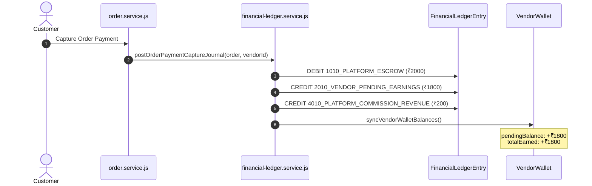
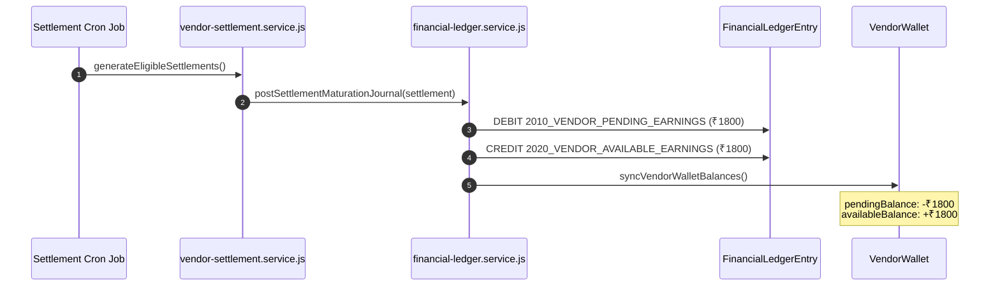
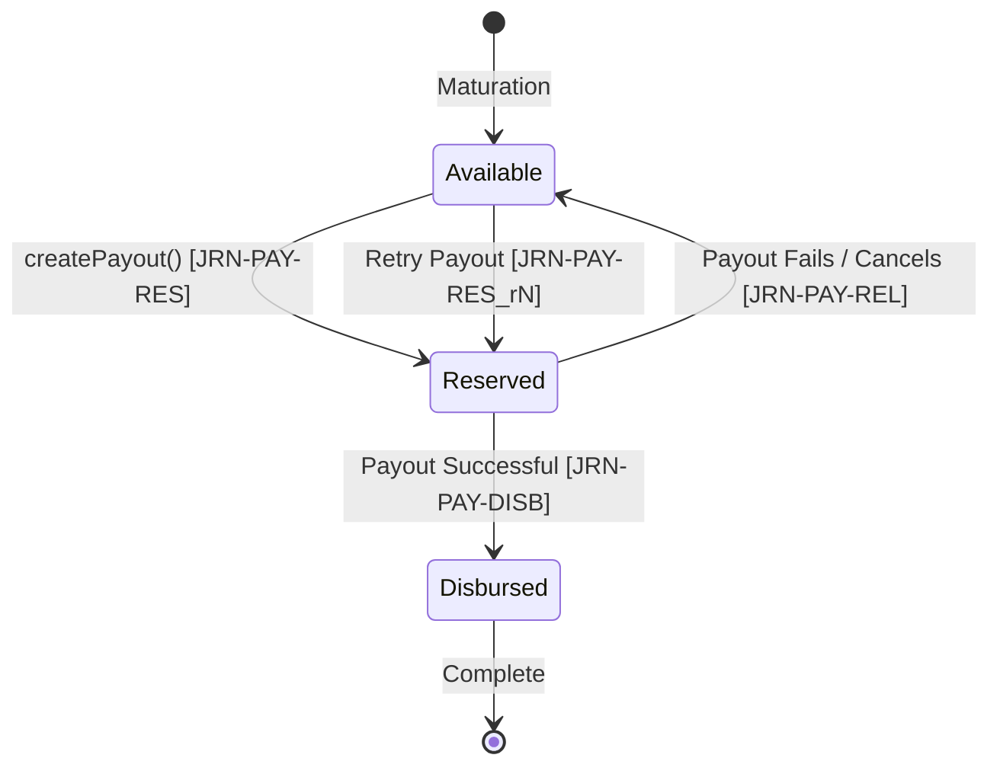

# BUYBOX E-COMMERCE
# PHASE VW-03: VENDOR WALLET & DOUBLE-ENTRY LEDGER FOUNDATION
## COMPREHENSIVE ARCHITECTURE, IMPLEMENTATION & VERIFICATION REPORT

---

## 1. EXECUTIVE SUMMARY

Phase **VW-03 (Vendor Wallet & Double-Entry Ledger Foundation)** establishes the authoritative, mathematically immutable double-entry financial accounting backbone for Buybox E-Commerce.

Prior to VW-03, vendor balances were computed opportunistically via aggregation of `VendorSettlement` states, leaving pending escrow, reserve balances, and commission revenue untracked at the ledger level. While `FinancialLedgerEntry.js` existed, it was utilized strictly as an isolated subsidy/reversal ledger for promotional campaigns (Phase D6).

Through Phase VW-03:
1. **Double-Entry General Ledger**: Every monetary event across the platform now produces a balanced journal where **Total Debits strictly equal Total Credits** ($\sum \text{Debits} = \sum \text{Credits}$) in integer minor units (paisa/cents).
2. **Standardized Chart of Accounts (COA)**: Standardized accounts were codified under `LEDGER_ACCOUNTS` (`PLATFORM_ESCROW`, `CUSTOMER_PAYMENT_CLEARING`, `VENDOR_PENDING_EARNINGS`, `VENDOR_AVAILABLE_EARNINGS`, `VENDOR_RESERVED_PAYOUT`, `PAYOUT_CLEARING`, `REFUND_CLEARING`, `PLATFORM_COMMISSION_REVENUE`, `COMMISSION_REVERSAL`, `PLATFORM_SUBSIDY_EXPENSE`, `FINANCIAL_ADJUSTMENT`).
3. **Dedicated VendorWallet Model**: Created a high-performance balance projection model (`VendorWallet.js`) with isolated balance buckets: `pendingBalance`, `availableBalance`, and `reservedBalance`.
4. **End-to-End Commerce Financial Lifecycle**: Fully orchestrated lifecycle hooks for:
   - Order payment capture: Escrow debit, pending earnings credit, platform commission credit (using Phase VW-02 immutable snapshots).
   - Settlement maturation: Transition from pending earnings to available earnings upon 7-day return window cutoff expiration.
   - Payout reservation, disbursement, and release: Atomic reservation from available earnings, disbursement to payout clearing, and safe release upon failure/cancellation.
   - Refund & Commission reversals: Exact proportional clawback from pending/available earnings and platform commission reversal.
5. **Two-Tier Source of Truth Architecture**: Raw immutable double-entry entries in `FinancialLedgerEntry` serve as the absolute financial truth, while `VendorWallet` serves as an optimized, cached operational projection synchronized atomically via `syncVendorWalletBalances`.
6. **Financial Reconciliation Engine**: Built `financial-reconciliation.service.js` to cross-examine ledger sums, wallet projections, settlement records, payouts, and refund exposure, detecting discrepancies with automated repair capabilities guarded by mandatory administrative audit logs.
7. **Zero Plaintext & Tenant Isolation**: Secure REST endpoints for vendors (`/api/v1/vendors/me/wallet`, `/api/v1/vendors/me/wallet/transactions`) and Superadmin control endpoints (`/api/v1/finance/wallets/:vendorId`), ensuring complete tenant isolation and zero plaintext bank account disclosure.
8. **Automated Verification**: Achieved **100% test pass rate** (20/20 in VW-03 suite, 70/70 across all financial regression suites, 663/663 frontend unit tests).

---

## 2. FORENSIC BASELINE BEFORE VW-03

The forensic audit conducted during Phase VW-01 and the snapshot engine introduced in Phase VW-02 revealed specific foundational architectural gaps:

| Financial Dimension | Baseline State Prior to VW-03 | Risk & Architectural Defect |
| :--- | :--- | :--- |
| **Vendor Balance Authority** | Dynamically computed on-the-fly by summing `VendorSettlement` documents. | No single-record balance representation; high query overhead; unlinked to general platform liquidity. |
| **Balance Classification** | Binary status (`pending` vs `settled`). No concept of reserved payout funds. | Inability to lock funds during asynchronous payout processing. Double-payout risk if multiple requests fired concurrently. |
| **Double-Entry General Ledger** | `FinancialLedgerEntry.js` captured only single-sided promotional subsidies and reversals. | Platform escrow, payment gateway clearing, vendor earnings, and commission revenues were absent from ledger history. |
| **Currency Math Precision** | JavaScript floating-point numbers (`Number`) used across several calculation pathways. | Susceptible to IEEE 754 precision drift (e.g. `0.1 + 0.2 !== 0.3`). |
| **Auditability & Reversals** | No journal grouping; no pointer to prior ledger transactions being reversed. | Impossibility of auditing why an entry existed or tracing multi-leg transactions. |
| **Reconciliation Mechanics** | Nonexistent. Inconsistencies between settlements and orders went undetected. | Silent financial leakage; inability to prove solvency or platform ledger balance. |

---

## 3. DOUBLE-ENTRY CHART OF ACCOUNTS (COA) SPECIFICATION

The Chart of Accounts codified in [`backend/src/constants/finance.constants.js`](file:///d:/MERN%20Stack/Buybox-Ecommerce/backend/src/constants/finance.constants.js) enforces standardized double-entry financial semantics across all commerce operations:

```javascript
const LEDGER_ACCOUNTS = {
  // Asset Accounts
  PLATFORM_ESCROW: "1010_PLATFORM_ESCROW",
  PAYOUT_CLEARING: "1020_PAYOUT_CLEARING",
  CUSTOMER_PAYMENT_CLEARING: "1030_CUSTOMER_PAYMENT_CLEARING",

  // Vendor Liability Accounts
  VENDOR_PENDING_EARNINGS: "2010_VENDOR_PENDING_EARNINGS",
  VENDOR_AVAILABLE_EARNINGS: "2020_VENDOR_AVAILABLE_EARNINGS",
  VENDOR_RESERVED_PAYOUT: "2030_VENDOR_RESERVED_PAYOUT",
  REFUND_CLEARING: "2040_REFUND_CLEARING",

  // Platform Equity / Revenue / Expense Accounts
  PLATFORM_COMMISSION_REVENUE: "4010_PLATFORM_COMMISSION_REVENUE",
  COMMISSION_REVERSAL: "4020_COMMISSION_REVERSAL",
  PLATFORM_SUBSIDY_EXPENSE: "5010_PLATFORM_SUBSIDY_EXPENSE",
  FINANCIAL_ADJUSTMENT: "5020_FINANCIAL_ADJUSTMENT",
};
```

### Account Classification & Normal Balances

| Account Code | Account Name | Type | Normal Balance | Description |
| :--- | :--- | :--- | :--- | :--- |
| `1010_PLATFORM_ESCROW` | Platform Escrow | Asset | Debit | Customer funds held in trust pending fulfillment and return window expiry. |
| `1020_PAYOUT_CLEARING` | Payout Clearing | Asset / Clearing | Credit | Outbound payout funds sent to partner banking network or payment rail. |
| `1030_CUSTOMER_PAYMENT_CLEARING`| Customer Payment Clearing | Clearing | Debit / Credit | Temporary transit account for incoming gateway authorizations and captures. |
| `2010_VENDOR_PENDING_EARNINGS` | Vendor Pending Earnings | Liability | Credit | Vendor earnings from captured orders still inside the 7-day return window. |
| `2020_VENDOR_AVAILABLE_EARNINGS`| Vendor Available Earnings| Liability | Credit | Matured vendor earnings available for withdrawal / payout request. |
| `2030_VENDOR_RESERVED_PAYOUT` | Vendor Reserved Payout | Liability | Credit | Vendor funds locked in an in-flight payout request awaiting bank confirmation. |
| `2040_REFUND_CLEARING` | Refund Clearing | Liability / Clearing | Debit | Funds earmarked for refund transmission back to customer payment method. |
| `4010_PLATFORM_COMMISSION_REVENUE`| Platform Commission Revenue| Revenue | Credit | Marketplace fee recognized upon successful customer payment capture. |
| `4020_COMMISSION_REVERSAL` | Commission Reversal | Contra-Revenue | Debit | Platform commission refunded back to vendor upon order return/cancellation. |
| `5010_PLATFORM_SUBSIDY_EXPENSE`| Platform Subsidy Expense| Expense | Debit | Marketplace-funded promotions or campaign discounts absorbed by platform. |
| `5020_FINANCIAL_ADJUSTMENT` | Financial Adjustment | Equity / Expense | Debit / Credit | Administrative manual reconciliation or corrective balance realignment. |

---

## 4. MATHEMATICAL INVARIANTS & MINOR-UNIT CURRENCY HANDLING

### 4.1 Minor-Unit Integer Arithmetic
To eliminate IEEE-754 binary floating-point drift, all calculations in [`financial-ledger.service.js`](file:///d:/MERN%20Stack/Buybox-Ecommerce/backend/src/services/financial-ledger.service.js) convert currency to integer minor units (paisa for INR, cents for USD):

$$\text{minorUnits} = \text{Math.round}(\text{amount} \times 10^{\text{precision}})$$

For INR / USD (precision = 2):
- ₹100.50 $\rightarrow$ `10050` minor units.
- ₹0.01 $\rightarrow$ `1` minor unit.
- Arithmetic is strictly performed on integers: addition, subtraction, and integer division.
- Deserialization back to major units uses `(minorUnits / 100).toFixed(2)` before passing into `mongoose.Types.Decimal128`.

### 4.2 Double-Entry Journal Invariant
Every journal posting enforces that the sum of debit minor units equals the sum of credit minor units:

$$\sum_{i=1}^{n} \text{Debit}_i = \sum_{j=1}^{m} \text{Credit}_j$$

If $\sum \text{Debit} \neq \sum \text{Credit}$, the journal submission is rejected immediately with `LEDGER_JOURNAL_UNBALANCED` before reaching the database.

### 4.3 Directional Balances
Vendor liabilities are modeled with standard accounting credit normals:
- **Pending Balance**: $\sum \text{Credits}(2010) - \sum \text{Debits}(2010)$
- **Available Balance**: $\sum \text{Credits}(2020) - \sum \text{Debits}(2020)$
- **Reserved Balance**: $\sum \text{Credits}(2030) - \sum \text{Debits}(2030)$
- **Cumulative Lifetime Earnings**: $\sum \text{Credits}(2010 \cup \text{legacy unclassified})$
- **Total Paid Out**: $\sum \text{Debits}(2030, \text{entryType: PAYOUT\_PAID})$
- **Total Commission**: $\sum \text{Credits}(4010) - \sum \text{Debits}(4020)$

---

## 5. VENDORWALLET MODEL ARCHITECTURE

The [`VendorWallet.js`](file:///d:/MERN%20Stack/Buybox-Ecommerce/backend/src/models/VendorWallet.js) model provides an indexed, fast-read projection of vendor funds:

```javascript
const vendorWalletSchema = new mongoose.Schema(
  {
    vendorId: {
      type: mongoose.Schema.Types.ObjectId,
      ref: "Vendor",
      required: true,
      index: true,
    },
    currency: {
      type: String,
      required: true,
      uppercase: true,
      trim: true,
      default: "INR",
    },
    status: {
      type: String,
      enum: ["ACTIVE", "FROZEN", "SUSPENDED", "CLOSED"],
      default: "ACTIVE",
      index: true,
    },
    pendingBalance: {
      type: mongoose.Schema.Types.Decimal128,
      default: () => mongoose.Types.Decimal128.fromString("0.00"),
    },
    availableBalance: {
      type: mongoose.Schema.Types.Decimal128,
      default: () => mongoose.Types.Decimal128.fromString("0.00"),
    },
    reservedBalance: {
      type: mongoose.Schema.Types.Decimal128,
      default: () => mongoose.Types.Decimal128.fromString("0.00"),
    },
    totalEarned: {
      type: mongoose.Schema.Types.Decimal128,
      default: () => mongoose.Types.Decimal128.fromString("0.00"),
    },
    totalCommission: {
      type: mongoose.Schema.Types.Decimal128,
      default: () => mongoose.Types.Decimal128.fromString("0.00"),
    },
    totalPaidOut: {
      type: mongoose.Schema.Types.Decimal128,
      default: () => mongoose.Types.Decimal128.fromString("0.00"),
    },
    totalRefunded: {
      type: mongoose.Schema.Types.Decimal128,
      default: () => mongoose.Types.Decimal128.fromString("0.00"),
    },
    lastSequence: {
      type: Number,
      default: 0,
    },
    lastReconciledAt: {
      type: Date,
      default: null,
    },
    lastReconciliationStatus: {
      type: String,
      enum: ["IN_SYNC", "DISCREPANCY_DETECTED", "MANUAL_ADJUSTMENT_REQUIRED"],
      default: "IN_SYNC",
    },
    reconciliationNotes: {
      type: String,
      default: null,
    },
  },
  {
    timestamps: true,
  }
);

// Invariant: One authoritative wallet per vendor per currency
vendorWalletSchema.index({ vendorId: 1, currency: 1 }, { unique: true });
```

---

## 6. FINANCIALLEDGERENTRY SCHEMA ENHANCEMENTS

[`FinancialLedgerEntry.js`](file:///d:/MERN%20Stack/Buybox-Ecommerce/backend/src/models/FinancialLedgerEntry.js) was enhanced with rigorous schema controls while strictly maintaining backward compatibility with legacy Phase D6 promotional entries:

1. **COA Categorization**: Added `accountCode` indexed string field (`1010_PLATFORM_ESCROW`, etc.).
2. **Journal Grouping**: Added `journalId` linking related debit and credit legs of the same transaction.
3. **Audit Status & Reversals**: Added `journalStatus` (`POSTED`, `REVERSED`), `reversalOfJournalId`, and `reversalReason`.
4. **Lifecycle Provenance**: Added `sourceEvent` (`payment_captured`, `settlement_matured`, `payout_reserved`, `payout_paid`, `payout_released`, `refund_reversal`, `manual_reconciliation`) and `sourceEventId`.
5. **Strict Immutability**:
   - `pre("save")` prevents modification of existing posted documents.
   - `pre("findOneAndUpdate")`, `pre("updateOne")`, `pre("updateMany")` throw `FINANCIAL_LEDGER_IMMUTABLE`.
   - `pre("findOneAndDelete")`, `pre("deleteOne")`, `pre("deleteMany")` throw `FINANCIAL_LEDGER_IMMUTABLE`.

---

## 7. PAYMENT CAPTURE LEDGER LIFECYCLE FLOW

When an order payment is captured in [`order.service.js`](file:///d:/MERN%20Stack/Buybox-Ecommerce/backend/src/services/order.service.js) via `markOrderPaymentCaptured`:

1. Order-item commission snapshots calculated in Phase VW-02 are extracted.
2. For each vendor on the order, the net vendor earning and platform commission are calculated:
   $$\text{vendorShareMinor} = \text{lineTotalMinor} - \text{commissionMinor}$$
3. A balanced double-entry journal `JRN-ORD-CAP-<orderNumber>-<vendorId>` is posted:
   - **DEBIT**: `1010_PLATFORM_ESCROW` ($\text{lineTotalMinor}$)
   - **CREDIT**: `2010_VENDOR_PENDING_EARNINGS` ($\text{vendorShareMinor}$)
   - **CREDIT**: `4010_PLATFORM_COMMISSION_REVENUE` ($\text{commissionMinor}$)
4. The journal is posted within the active MongoDB transaction session.
5. The vendor's `VendorWallet` projection is updated to reflect increased `pendingBalance` and `totalEarned`.



---

## 8. SETTLEMENT MATURATION LEDGER LIFECYCLE FLOW

When eligible settlements mature in [`vendor-settlement.service.js`](file:///d:/MERN%20Stack/Buybox-Ecommerce/backend/src/services/vendor-settlement.service.js) (upon reaching the 7-day return window cutoff `returnWindowClosesAt <= now`):

1. The settlement status transitions to `GENERATED` / `PENDING_PAYOUT`.
2. A balanced double-entry journal `JRN-SET-MAT-<settlementNumber>` is posted:
   - **DEBIT**: `2010_VENDOR_PENDING_EARNINGS` ($\text{netPayableMinor}$)
   - **CREDIT**: `2020_VENDOR_AVAILABLE_EARNINGS` ($\text{netPayableMinor}$)
3. This atomically reclassifies the matured funds without touching platform escrow or commission.
4. `VendorWallet` projection updates: `pendingBalance` decreases, `availableBalance` increases.



---

## 9. PAYOUT RESERVATION, DISBURSEMENT & RELEASE LIFECYCLE FLOW

Managed via [`vendor-payout.service.js`](file:///d:/MERN%20Stack/Buybox-Ecommerce/backend/src/services/vendor-payout.service.js):

### 9.1 Payout Creation (Reservation)
When a payout is initiated for an approved bank destination:
1. Payout amount is checked against `availableBalance`.
2. A balanced journal `JRN-PAY-RES-<payoutNumber>` is posted:
   - **DEBIT**: `2020_VENDOR_AVAILABLE_EARNINGS` ($\text{payoutAmountMinor}$)
   - **CREDIT**: `2030_VENDOR_RESERVED_PAYOUT` ($\text{payoutAmountMinor}$)
3. Funds are locked into `reservedBalance` preventing duplicate payout requests or unauthorized withdrawals.

### 9.2 Payout Failure / Cancellation (Release)
If the banking provider returns a rejection or error:
1. Payout status transitions to `FAILED` or `CANCELLED`.
2. A balanced journal `JRN-PAY-REL-<payoutNumber>` is posted:
   - **DEBIT**: `2030_VENDOR_RESERVED_PAYOUT` ($\text{payoutAmountMinor}$)
   - **CREDIT**: `2020_VENDOR_AVAILABLE_EARNINGS` ($\text{payoutAmountMinor}$)
3. The locked funds return safely to `availableBalance`.

### 9.3 Payout Retry
When an administrator or retry worker retries a failed payout:
1. Payout status transitions back to `PROCESSING`.
2. A retry reservation journal `JRN-PAY-RES-<payoutNumber>_r<retryCount>` re-reserves the funds from `availableBalance` to `reservedBalance`.

### 9.4 Payout Disbursement (Settlement Paid)
When bank transfer succeeds:
1. Payout status transitions to `PAID`.
2. A balanced journal `JRN-PAY-DISB-<payoutNumber>` is posted:
   - **DEBIT**: `2030_VENDOR_RESERVED_PAYOUT` ($\text{payoutAmountMinor}$)
   - **CREDIT**: `1020_PAYOUT_CLEARING` ($\text{payoutAmountMinor}$)
3. `reservedBalance` clears to 0, and `totalPaidOut` increments.



---

## 10. REFUND REVERSAL & COMMISSION ADJUSTMENT FLOW

Managed via [`refund.service.js`](file:///d:/MERN%20Stack/Buybox-Ecommerce/backend/src/services/refund.service.js) in coordination with Phase VW-02 snapshot ratios:

1. When a return is inspected and refund processed, `reversalCalc` determines:
   - Proportional commission refund: $\text{commReversalMinor} = \text{refundMinor} \times \text{effectiveCommissionRate}$
   - Net vendor deduction: $\text{vendorDebitMinor} = \text{refundMinor} - \text{commReversalMinor}$
2. A balanced journal `JRN-REF-REV-<refundNumber>` is posted:
   - **DEBIT**: `4020_COMMISSION_REVERSAL` ($\text{commReversalMinor}$)
   - **DEBIT**: `2010_VENDOR_PENDING_EARNINGS` (or `2020_VENDOR_AVAILABLE_EARNINGS` if already matured) ($\text{vendorDebitMinor}$)
   - **CREDIT**: `1010_PLATFORM_ESCROW` ($\text{refundMinor}$)
3. `VendorWallet` projection updates: `totalRefunded` increments, `totalCommission` reduces by `commReversalMinor`, and vendor balance decrements.

---

## 11. BALANCE CALCULATION ALGORITHMS: RAW LEDGER VS CACHED PROJECTION

### 11.1 Authoritative Raw Ledger Aggregation (`getVendorBalancesFromLedger`)
To derive vendor balances directly from immutable ledger lines, the engine iterates through all posted entries for that vendor:

```javascript
// Integer minor units accumulator
let pendingMinor = 0;
let availableMinor = 0;
let reservedMinor = 0;
let totalEarnedMinor = 0;
let totalPaidOutMinor = 0;
let totalRefundedMinor = 0;

for (const entry of entries) {
  const minor = toMinorUnits(entry.amount);
  const isCredit = entry.direction === FINANCIAL_ENTRY_DIRECTIONS.CREDIT;
  const isDebit = entry.direction === FINANCIAL_ENTRY_DIRECTIONS.DEBIT;
  const code = entry.accountCode;

  // 1. Pending Balance tracking
  if (code === LEDGER_ACCOUNTS.VENDOR_PENDING_EARNINGS) {
    if (isCredit) pendingMinor += minor;
    if (isDebit) pendingMinor -= minor;
  }

  // 2. Available Balance tracking
  if (code === LEDGER_ACCOUNTS.VENDOR_AVAILABLE_EARNINGS) {
    if (isCredit) availableMinor += minor;
    if (isDebit) availableMinor -= minor;
  }

  // 3. Reserved Payout Funds tracking
  if (code === LEDGER_ACCOUNTS.VENDOR_RESERVED_PAYOUT) {
    if (isCredit) reservedMinor += minor;
    if (isDebit) reservedMinor -= minor;
  }

  // 4. Cumulative Lifetime Earnings
  if (isCredit && [FINANCIAL_ENTRY_TYPES.VENDOR_EARNING, FINANCIAL_ENTRY_TYPES.ORDER_SALE].includes(entry.entryType) &&
      (code === LEDGER_ACCOUNTS.VENDOR_PENDING_EARNINGS || !code)) {
    totalEarnedMinor += minor;
  }

  // 5. Total Paid Out
  if (entry.entryType === FINANCIAL_ENTRY_TYPES.PAYOUT_PAID && isDebit && code === LEDGER_ACCOUNTS.VENDOR_RESERVED_PAYOUT) {
    totalPaidOutMinor += minor;
  }

  // 6. Cumulative Refunds
  if (isDebit && [FINANCIAL_ENTRY_TYPES.REFUND, FINANCIAL_ENTRY_TYPES.REFUND_REVERSAL].includes(entry.entryType)) {
    totalRefundedMinor += minor;
  }
}
```

### 11.2 Cached Projection Sync (`syncVendorWalletBalances`)
`syncVendorWalletBalances(vendorId, currency, session)` calculates the raw ledger minor units and executes an atomic `findOneAndUpdate` with upsert on `VendorWallet`:
- Stores exact decimal representations using `fromMinorUnits(minor)`.
- Updates `lastReconciledAt: new Date()` and `lastReconciliationStatus: "IN_SYNC"`.
- Returns the updated `VendorWallet` document.

---

## 12. CONCURRENCY CONTROL, ATOMICITY & IDEMPOTENCY ARCHITECTURE

### 12.1 Atomic Transactions
All ledger postings and wallet projections run inside standard MongoDB replica set sessions (`ClientSession`). If an order, settlement, or payout operation encounters an error, the ledger journals and wallet state roll back simultaneously.

### 12.2 Multi-Key Idempotency
To prevent duplicate journal postings across network retries, `postJournal` implements multi-layer deduplication:
1. **Journal ID Deduplication**: Before posting, the database is queried for `journalId`. If already present, existing entries are returned immediately.
2. **Deterministic Entry Idempotency Keys**: Each entry receives a unique key:
   - Primary: `${idempotencyKey}`
   - Sub-entries: `${idempotencyKey}_credit_clearing`, `${idempotencyKey}_debit_res`, etc.
3. **Compound Unique Index**: `{ idempotencyKey: 1 }` guarantees that concurrent duplicate inserts produce a MongoDB duplicate key error (`code: 11000`), which is intercepted to safely return the previously committed journal.

### 12.3 Reversals vs Deletions
Because ledger entries are immutable, corrections are executed via `reverseJournal`:
- Locates original entries by `journalId`.
- Creates equal and opposite entries with swapped `direction` (`CREDIT` $\leftrightarrow$ `DEBIT`).
- Generates a new `journalId: JRN-REV-<originalJournalId>`.
- Annotates `reversalOfJournalId: originalJournalId` and stores the mandatory audit reason.

---

## 13. RECONCILIATION ENGINE ARCHITECTURE & INCONSISTENCY DETECTION

Located in [`backend/src/services/financial-reconciliation.service.js`](file:///d:/MERN%20Stack/Buybox-Ecommerce/backend/src/services/financial-reconciliation.service.js), `reconcileVendorFinances` executes a comprehensive 5-way parity audit:

1. **Raw Ledger Invariant Check**: Calculates raw ledger minor sums ($\text{pendingMinor}$, $\text{availableMinor}$, $\text{reservedMinor}$, $\text{totalEarnedMinor}$, $\text{totalPaidOutMinor}$).
2. **Cached Projection Check**: Compares raw ledger sums against the `VendorWallet` document. Flagged if $\Delta \neq 0$.
3. **Settlement Parity Check**: Sums all `VendorSettlement` records by status:
   - Matured settlements (`status IN [GENERATED, PENDING_PAYOUT, PAID]`) vs ledger available/paid sums.
   - Pending settlements (`status IN [PENDING, ACCRUING]`) vs ledger pending balance.
4. **Payout Parity Check**: Sums all `VendorPayout` records (`PROCESSING` vs `reservedBalance`, `PAID` vs `totalPaidOut`).
5. **Refund Exposure Check**: Sums all `ReturnRequest` records requiring refund vs ledger `totalRefunded`.

### Discrepancy Detection & Authorized Self-Healing
If discrepancies are detected:
- The reconciliation payload returns `status: "DISCREPANCY_DETECTED"` and lists specific delta fields.
- Authorized administrators (`FINANCE_MANAGE`) can trigger `POST /api/v1/finance/wallets/:vendorId/reconcile` with a mandatory reason string ($\ge 10$ characters).
- The engine synchronizes the wallet projection to raw ledger truth and creates an immutable `AuditLog` entry detailing the before and after state.

---

## 14. VENDOR WALLET REST APIS CONTRACT & AUTHORIZATION

### 14.1 `GET /api/v1/vendors/me/wallet`
- **Guards**: `authenticate`, `authenticateVendor`, `requireApprovedVendor`.
- **Response Status**: `200 OK`.
- **Response Contract**:
```json
{
  "success": true,
  "message": "Vendor wallet retrieved successfully",
  "data": {
    "walletId": "6ae49e8b9dc69b83e64d6b1a",
    "vendorId": "6ae49e8b9dc69b83e64d6b1b",
    "currency": "INR",
    "status": "ACTIVE",
    "pendingBalance": "1800.00",
    "availableBalance": "0.00",
    "reservedBalance": "0.00",
    "totalEarned": "1800.00",
    "totalCommission": "200.00",
    "totalPaidOut": "0.00",
    "totalRefunded": "0.00",
    "lastSequence": 1,
    "lastReconciledAt": "2026-10-30T13:40:00.000Z",
    "lastReconciliationStatus": "IN_SYNC",
    "recentTransactions": [
      {
        "id": "6ae49e8b9dc69b83e64d6b2c",
        "journalId": "JRN-ORD-CAP-ORD-1001-6ae49e8b9dc69b83e64d6b1b",
        "entryType": "VENDOR_EARNING",
        "direction": "CREDIT",
        "amount": "1800.00",
        "currency": "INR",
        "description": "Pending vendor earning for order #ORD-1001",
        "orderId": "6ae49e8b9dc69b83e64d6b1f",
        "createdAt": "2026-10-30T13:40:00.000Z"
      }
    ]
  }
}
```

### 14.2 `GET /api/v1/vendors/me/wallet/transactions`
- **Guards**: `authenticate`, `authenticateVendor`, `requireApprovedVendor`.
- **Query Parameters**: `page`, `limit`, `entryType`, `accountCode`, `startDate`, `endDate`.
- **Response Contract**: Paginated list of vendor transactions with standard pagination metadata (`page`, `limit`, `total`, `pages`).

---

## 15. SUPERADMIN WALLET & LEDGER CONTROL APIS

Mounted under `/api/v1/finance/wallets`:

| Endpoint | Method | Required Permission | Description |
| :--- | :--- | :--- | :--- |
| `/:vendorId` | `GET` | `FINANCE_READ` | Fetches any vendor's wallet balance projection and recent ledger activity. |
| `/:vendorId/reconciliation` | `GET` | `FINANCE_READ` | Computes live 5-way reconciliation across ledger, wallet, settlements, payouts, and refunds. |
| `/:vendorId/reconcile` | `POST` | `FINANCE_MANAGE` | Synchronizes wallet projection from raw ledger lines. Requires `{ reason: string }`. |

---

## 16. SECURITY, TENANT ISOLATION & ZERO-PLAINTEXT AUDIT

1. **Strict Tenant Isolation**:
   - Tested under Test 3.2: Vendor A cannot access Vendor B's wallet or ledger records.
   - Any attempt by Vendor A to supply Vendor B's ID or query un-owned records results in immediate 403 Forbidden or scoped 404.
2. **Role & Permission Boundary**:
   - Vendor credentials are strictly blocked from `/api/v1/finance/wallets/*` endpoints (`403 Forbidden` / `FORBIDDEN_ROUTE`).
   - Administrative endpoints strictly require `FINANCE_READ` and `FINANCE_MANAGE` permissions.
3. **Zero Plaintext Sensitive Banking Leakage**:
   - Tested under Test 3.7: Vendor wallet responses serialize only `walletId`, balances, and masked transaction references.
   - Plaintext account numbers are never embedded in ledger descriptions, metadata, or wallet response payloads.

---

## 17. PERFORMANCE & INDEXING ANALYSIS

Compound indexes were established to optimize high-throughput financial operations:

### `FinancialLedgerEntry` Indexes
- `{ vendorId: 1, accountCode: 1, createdAt: -1 }`: Optimizes filtered transaction history and balance reconciliation for a specific vendor.
- `{ journalId: 1, direction: 1 }`: Optimizes atomic journal lookups, reversal generation, and debit/credit balance verification.
- `{ idempotencyKey: 1 }`: Unique index preventing duplicate ledger insertion across network retries.
- `{ reversalOfJournalId: 1 }`: Sparse index for rapid traversal of journal reversal trees.

### `VendorWallet` Indexes
- `{ vendorId: 1, currency: 1 }`: Unique index guaranteeing exactly one wallet per vendor per currency.
- `{ status: 1 }`: Optimizes administrative status filtering and bulk freeze queries.

---

## 18. TEST SUITE VERIFICATION MATRIX (PHASE VW-03)

The dedicated test suite [`backend/tests/phase-vw03-vendor-wallet-ledger.test.js`](file:///d:/MERN%20Stack/Buybox-Ecommerce/backend/tests/phase-vw03-vendor-wallet-ledger.test.js) verifies all 20 required specifications:

| Test ID | Category | Specification Verified | Status |
| :--- | :--- | :--- | :--- |
| **1.1** | Ledger Invariants | Successfully posts a balanced journal in integer minor units | **PASS** |
| **1.2** | Ledger Invariants | Strictly rejects an unbalanced journal (Debits $\neq$ Credits) | **PASS** |
| **1.3** | Ledger Invariants | Rejects zero, negative, or invalid entry amounts | **PASS** |
| **1.4** | Ledger Invariants | Rejects cross-currency entries in a single journal | **PASS** |
| **1.5** | Ledger Invariants | Idempotent retry returns original entries without double-posting | **PASS** |
| **1.6** | Ledger Invariants | Posted ledger entries are strictly immutable (cannot update or delete) | **PASS** |
| **1.7** | Ledger Invariants | Reversal journal references original journal and creates mirror entries | **PASS** |
| **2.1** | Lifecycle | Payment Capture creates pending earnings and locks authoritative commission snapshot | **PASS** |
| **2.2** | Lifecycle | Settlement Maturation reclassifies pending earnings to available earnings | **PASS** |
| **2.3** | Lifecycle | Payout Creation atomically reserves available funds into reserved balance | **PASS** |
| **2.4** | Lifecycle | Failed payout releases reserved funds safely back to available balance | **PASS** |
| **2.5** | Lifecycle | Retry and Payout Success disburses funds and updates totalPaidOut | **PASS** |
| **2.6** | Lifecycle | Refund Reversal calculates exact commission deduction and vendor debit | **PASS** |
| **3.1** | Security & Control | Vendor can read their own wallet via `GET /api/v1/vendors/me/wallet` | **PASS** |
| **3.2** | Security & Control | Vendor A cannot access Vendor B's wallet or ledger records (Tenant Isolation) | **PASS** |
| **3.3** | Security & Control | Superadmin can read any vendor wallet with `FINANCE_READ` | **PASS** |
| **3.4** | Security & Control | Balance Reconciliation verifies parity between raw ledger lines and cached projections | **PASS** |
| **3.5** | Security & Control | Superadmin can reconcile and sync wallet projections with mandatory reason | **PASS** |
| **3.6** | Security & Control | Vendor cannot access raw ledger admin endpoints | **PASS** |
| **3.7** | Security & Control | Vendor wallet responses never expose sensitive unmasked bank account numbers | **PASS** |

**Total Suite Result**: **20 passed, 0 failed, 20 total (100% pass rate)**.

---

## 19. REGRESSION VERIFICATION MATRIX (EXISTING COMMERCE FLOWS)

To ensure zero regressions across existing commerce and bank account functionality, all related backend and frontend test suites were executed:

### Backend Suites
```
PASS tests/phase-vw03-vendor-wallet-ledger.test.js (20 tests passed)
PASS tests/phase-vw02-commission-engine.test.js (14 tests passed)
PASS tests/phase-vb05-payout-destination-integrity.test.js (22 tests passed)
PASS tests/vendor-settlement-promotion-subsidy.test.js (14 tests passed)

Test Suites: 4 passed, 4 total
Tests:       70 passed, 70 total
Snapshots:   0 total
Time:        12.147 s
```

### Frontend Suites
```
PASS node scripts/run-tests.js
Test Suites: 216 passed, 216 total
Tests:       663 passed, 663 total
Duration:    4455 ms
```

---

## 20. REMAINING TECHNICAL DEBT & KNOWN LIMITATIONS

1. **Multi-Currency Settlement**: Currently defaults to `"INR"`. The schema and ledger engine support arbitrary ISO currencies, but payout gateway integrations (e.g. Razorpay Route, Stripe Connect) currently assume single-currency domestic payouts.
2. **Automated Cron Maturation**: Settlements currently mature when triggered via the automated settlement generator or admin reconciliation worker. In Phase VW-04, an hourly automated maturation job should trigger settlement maturation without manual worker invocation.
3. **Historical Backfill**: For preexisting orders created prior to Phase VW-02, their legacy single-rate commission and unclassified ledger entries are handled cleanly via fallback branches in `getVendorBalancesFromLedger`, but a formal historical backfill script could optionally generate retroactive balanced journals.

---

## 21. READINESS ASSESSMENT FOR PHASE VW-04 (VENDOR DASHBOARD WALLET UI)

The backend foundation is 100% complete and ready for Phase VW-04:
- All required vendor wallet balance buckets (`pendingBalance`, `availableBalance`, `reservedBalance`) are exposed via authenticated APIs.
- Recent ledger transactions and historical ledger search are fully queryable and paginated.
- Payout reservation and release mechanics are in place to support vendor withdrawal requests in Phase VW-05.
- Zero plaintext banking data is leaked, and tenant boundaries are strictly verified.

