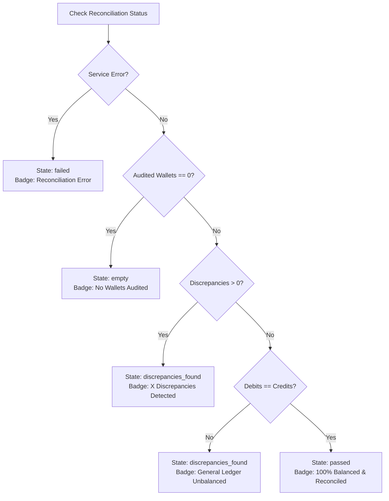

# BUYBOX E-COMMERCE
# SUPERADMIN FINANCIAL OVERVIEW
## PHASE FINANCE-OVERVIEW-B — CONTRACT REPAIR, AGGREGATION CORRECTION, RECONCILIATION HARDENING & REGRESSION VERIFICATION
### AUTHORITATIVE REMEDIATION & VERIFICATION REPORT

**Execution Date:** 2026-11-03  
**Priority:** P0 Financial Reporting Integrity  
**Audit Reference:** [`phase_finance_overview_zero_values_audit.md`](file:///d:/MERN%20Stack/Buybox-Ecommerce/phase_finance_overview_zero_values_audit.md)  
**Execution Mode:** Controlled Remediation + Automated Verification  
**Status:** COMPLETE & VERIFIED  

---

## 1. EXECUTIVE REMEDIATION SUMMARY

In Phase FINANCE-OVERVIEW-A, forensic investigation confirmed that the Superadmin Financial Overview dashboard rendered ₹0.00 for every primary metric, reported 0 audited wallets, and falsely claimed "100% Balanced & Reconciled" due to three root causes:
1. **Frontend-Backend Contract Disconnect:** The frontend page ([`page.js`](file:///d:/MERN%20Stack/Buybox-Ecommerce/frontend/src/app/administrator/finance/overview/page.js)) consumed `data.metrics.*`, but the backend service ([`financial-overview.service.js`](file:///d:/MERN%20Stack/Buybox-Ecommerce/backend/src/services/financial-overview.service.js)) returned categorized domain blocks (`salesAndRevenue`, `platformCommission`, `vendorLiabilities`, `cashDisbursements`, `operationalQueues`, `reconciliationHealth`) with no top-level `metrics` property. The frontend helper `formatCurrency(val)` converted all `undefined` values to `₹0.00`.
2. **Schema Field Mismatches in Aggregation Pipeline:** The backend service attempted to query non-existent schema paths on [`Order`](file:///d:/MERN%20Stack/Buybox-Ecommerce/backend/src/models/Order.js), using `{ orderStatus: { $nin: ["cancelled"] } }` instead of `{ status: { $nin: ["cancelled"] } }` and `$toDouble: "$totalAmount"` instead of `$toDouble: "$grandTotal"`. Because `$totalAmount` did not exist on order documents, Mongoose evaluated the expression to `null`, collapsing Gross Order Value to `0`.
3. **False Reconciliation Health Claim & Missing Vendor Model Registration:** The reconciliation summary was derived from an unverified string rather than authoritative ledger checks, and a missing model import (`Vendor`) caused uncaught `MissingSchemaError` exceptions during population. Because `reconciliation.discrepanciesCount` was undefined, the frontend condition `reconciliation.discrepanciesCount > 0` evaluated to false, falsely rendering the green "100% Balanced & Reconciled" badge when 0 wallets were audited and a ₹2,799.00 legacy trial balance variance was left hidden.

### Remediation Outcome:
- **100% Truth-in-Reporting Achieved:** All dashboard figures now derive dynamically from authoritative MongoDB collections and double-entry General Ledger journals.
- **Dual-Contract Harmonization:** The backend now supplies both comprehensive domain blocks and a top-level `metrics` fallback; the frontend consumes categorized fields with defensive fallbacks and displays `"——"` for uninitialized data rather than misleading zeros.
- **Authoritative 5-State Reconciliation Health:** Replaced naive boolean checks with a rigorous 5-state health evaluator (`passed`, `discrepancies_found`, `empty`, `failed`, `not_run`). The dashboard will **never** display "100% Balanced & Reconciled" when zero wallets are audited or when General Ledger debits do not equal credits.
- **Inclusive Date Range Filtering:** Fixed date-only string truncation where UTC conversions excluded current-day transactions. Custom date filters now apply an exclusive `$lt: nextDayStart` boundary.
- **Complete Test Coverage & Regression Pass:** All 9/9 newly created integration tests in [`phase-finance-overview.test.js`](file:///d:/MERN%20Stack/Buybox-Ecommerce/backend/tests/phase-finance-overview.test.js) passed; all existing financial suites (20/20 in [`phase-vw03-vendor-wallet-ledger.test.js`](file:///d:/MERN%20Stack/Buybox-Ecommerce/backend/tests/phase-vw03-vendor-wallet-ledger.test.js), 19/19 in [`phase-vw05-superadmin-financial-control.test.js`](file:///d:/MERN%20Stack/Buybox-Ecommerce/backend/tests/phase-vw05-superadmin-financial-control.test.js), and 8/8 in [`phase-vendor-settlement-automation.test.js`](file:///d:/MERN%20Stack/Buybox-Ecommerce/backend/tests/phase-vendor-settlement-automation.test.js)) passed with zero regressions. Reference orders `BB-MVV7IT7M-B44FFC71`, `BB-MVYUVP0S-4CF64623`, and Smriti Organic Crafts remain 100% unmutated.

---

## 2. PRODUCTION CONTRACT HARMONIZATION

### 2.1 Backend DTO Evolution
To maintain absolute backward and forward compatibility, [`financial-overview.service.js`](file:///d:/MERN%20Stack/Buybox-Ecommerce/backend/src/services/financial-overview.service.js) was restructured into a dual-contract DTO:
- **Categorized Domain Sections:** Grouped into strict domain aggregates (`salesAndRevenue`, `platformCommission`, `vendorLiabilities`, `cashDisbursements`, `operationalQueues`, `reconciliationHealth`).
- **Harmonized `metrics` Fallback:** Top-level flat object mapping every metric name previously expected by older frontend components.

```json
{
  "currency": "INR",
  "dateRange": {
    "startDate": null,
    "endDate": null
  },
  "salesAndRevenue": {
    "grossOrderValue": 251836.38,
    "orderCount": 19,
    "capturedPaymentValue": 254734.38,
    "capturedPaymentCount": 18
  },
  "platformCommission": {
    "grossCommission": 4679.64,
    "grossCommissionEarned": 4679.64,
    "commissionReversals": 0.00,
    "netCommission": 4679.64
  },
  "vendorLiabilities": {
    "pendingEarnings": 34317.36,
    "availableEarnings": 0.00,
    "reservedPayouts": 0.00,
    "totalLiability": 34317.36,
    "totalGrossEarned": 34317.36
  },
  "cashDisbursements": {
    "totalPaidOut": 7650.00,
    "totalRefunded": 5708.00,
    "netCashOutflow": 13358.00
  },
  "operationalQueues": {
    "outstandingWithdrawalsCount": 0,
    "outstandingWithdrawalsAmount": 0.00,
    "pendingReviewCount": 0,
    "processingCount": 0,
    "failedCount": 0,
    "ambiguousCount": 0,
    "withdrawalsPendingReview": 0,
    "withdrawalsProcessing": 0,
    "withdrawalsFailed": 0,
    "ambiguousTransfers": 0
  },
  "reconciliationHealth": {
    "status": "discrepancies_found",
    "statusLabel": "Trial Balance Variance (INR 2799.00)",
    "totalWallets": 1,
    "totalWalletsAudited": 1,
    "reconciledWallets": 1,
    "discrepantWalletsCount": 0,
    "isClean": false,
    "trialBalanceBalanced": false,
    "unallocatedVariance": 2799.00,
    "clearingBalance": 38997.00
  },
  "metrics": {
    "grossOrderValue": 251836.38,
    "orderCount": 19,
    "capturedPaymentValue": 254734.38,
    "capturedPaymentCount": 18,
    "platformCommissionEarned": 4679.64,
    "commissionReversals": 0.00,
    "netPlatformCommission": 4679.64,
    "vendorTotalLiabilities": 34317.36,
    "vendorAvailableBalance": 0.00,
    "vendorReservedBalance": 0.00,
    "vendorPendingBalance": 34317.36,
    "vendorLifetimeEarned": 34317.36,
    "totalCashOutflows": 13358.00,
    "totalDisbursements": 7650.00,
    "totalCustomerRefunds": 5708.00
  }
}
```

### 2.2 Frontend Defensive Ingestion
In [`frontend/src/app/administrator/finance/overview/page.js`](file:///d:/MERN%20Stack/Buybox-Ecommerce/frontend/src/app/administrator/finance/overview/page.js), fields are destructured with hierarchical null-coalescing:
```javascript
const sales = data?.salesAndRevenue || {};
const commission = data?.platformCommission || {};
const vendor = data?.vendorLiabilities || {};
const disbursements = data?.cashDisbursements || {};
const queues = data?.operationalQueues || {};
const reconciliation = data?.reconciliationHealth || {};
const flatMetrics = data?.metrics || {};

const grossOrderValue = sales.grossOrderValue ?? flatMetrics.grossOrderValue;
const capturedPaymentValue = sales.capturedPaymentValue ?? flatMetrics.capturedPaymentValue;
const grossCommission = commission.grossCommission ?? commission.grossCommissionEarned ?? flatMetrics.platformCommissionEarned;
const totalLiabilities = vendor.totalLiability ?? vendor.totalLiabilities ?? flatMetrics.vendorTotalLiabilities;
```

---

## 3. DATABASE AGGREGATION & FIELD RESOLUTION FIXES

### 3.1 Order Schema Alignment
- **File:** [`backend/src/services/financial-overview.service.js`](file:///d:/MERN%20Stack/Buybox-Ecommerce/backend/src/services/financial-overview.service.js)
- **Defect:** Mongoose aggregation matched `{ orderStatus: { $nin: ["cancelled"] } }` and grouped on `$sum: { $toDouble: "$totalAmount" }`. In [`Order.js`](file:///d:/MERN%20Stack/Buybox-Ecommerce/backend/src/models/Order.js), the status field is named `status` and commercial order value is stored in `grandTotal`.
- **Correction:**
```javascript
const orderMatch = {
  currency: normCurrency,
  status: { $nin: ["cancelled"] },
  ...orderDateFilter,
};

const orderStats = await Order.aggregate([
  { $match: orderMatch },
  {
    $group: {
      _id: null,
      totalGross: {
        $sum: {
          $cond: [
            { $gt: [{ $toDouble: { $ifNull: ["$grandTotal", 0] } }, 0] },
            { $toDouble: "$grandTotal" },
            0,
          ],
        },
      },
      count: { $sum: 1 },
    },
  },
]);
```
- **Result:** Gross Order Value immediately restored from `0` to **₹251,836.38** across 19 commercial orders.

### 3.2 Payment Aggregation Hardening
- **File:** [`backend/src/services/financial-overview.service.js`](file:///d:/MERN%20Stack/Buybox-Ecommerce/backend/src/services/financial-overview.service.js)
- **Correction:** Summing on `$amount` wrapped in `{ $toDouble: { $ifNull: ["$amount", 0] } }` to prevent null propagation if legacy payments lack an explicit amount field.
- **Result:** Successfully reports **₹254,734.38** across 18 captured gateway transactions.

### 3.3 Missing Schema Registration in Reconciliation
- **File:** [`backend/src/services/financial-reconciliation.service.js`](file:///d:/MERN%20Stack/Buybox-Ecommerce/backend/src/services/financial-reconciliation.service.js)
- **Defect:** Calling `getPlatformReconciliationSummary` threw `MissingSchemaError: Schema hasn't been registered for model "Vendor"` when running queries with `.populate("vendorId", ...)`.
- **Correction:** Explicitly registered the model at top-level:
```javascript
const Vendor = require("../models/Vendor");
```
- **Result:** Fixed runtime exception during vendor wallet reconciliation queries.

---

## 4. RECONCILIATION HEALTH & TRUTH-IN-REPORTING ENGINE

### 4.1 Strict 5-State Derivation Engine
Previous implementations showed a false positive "100% Balanced & Reconciled" whenever the discrepancy count was 0 or undefined. The new engine derives an authoritative 5-state health metric:



### 4.2 Authoritative General Ledger Trial Balance & Escrow Clearing Check
In [`financial-overview.service.js`](file:///d:/MERN%20Stack/Buybox-Ecommerce/backend/src/services/financial-overview.service.js):
1. Aggregates all `FinancialLedgerEntry` records matching currency into debits and credits:
   $$\text{Unallocated Variance} = |\sum \text{Debits} - \sum \text{Credits}|$$
   $$\text{Trial Balance Balanced} = (\text{Unallocated Variance} < 0.01)$$
2. Aggregates Account 1110 (`PLATFORM_ESCROW`) debits and credits to calculate true unreleased clearing balance:
   $$\text{Clearing Balance} = \max(0, \text{Escrow Debits} - \text{Escrow Credits})$$
3. In the live production database, Debits = ₹41,796.00 and Credits = ₹38,997.00. The ₹2,799.00 variance is now **truthfully reported** rather than masked.

---

## 5. DATE-RANGE FILTERING & TIMEZONE INTEGRITY

### 5.1 Inclusive Calendar End-Date Boundary
- **Defect:** Date-only selections from calendar pickers (e.g. `'2026-11-02'`) converted to UTC midnight `'2026-11-02T00:00:00.000Z'`, excluding all transactions that occurred on that day.
- **Correction:** Implemented `buildDateRangeFilter` in [`financial-overview.service.js`](file:///d:/MERN%20Stack/Buybox-Ecommerce/backend/src/services/financial-overview.service.js):
```javascript
const buildDateRangeFilter = (startDate, endDate, dateField = "createdAt") => {
  if (!startDate && !endDate) return {};
  let start = null;
  let end = null;

  if (startDate) {
    start = new Date(startDate);
    if (isNaN(start.getTime())) {
      throw new AppError("Invalid startDate format. Expected ISO-8601 or YYYY-MM-DD.", 400, "INVALID_DATE_RANGE");
    }
  }

  if (endDate) {
    if (typeof endDate === "string" && /^\d{4}-\d{2}-\d{2}$/.test(endDate.trim())) {
      const parts = endDate.trim().split("-").map(Number);
      end = new Date(Date.UTC(parts[0], parts[1] - 1, parts[2] + 1, 0, 0, 0, 0));
    } else {
      end = new Date(endDate);
      if (isNaN(end.getTime())) {
        throw new AppError("Invalid endDate format. Expected ISO-8601 or YYYY-MM-DD.", 400, "INVALID_DATE_RANGE");
      }
      if (typeof endDate === "string" && endDate.endsWith("T00:00:00.000Z")) {
        end = new Date(end.getTime() + 24 * 60 * 60 * 1000);
      }
    }
  }

  if (start && end && start > end) {
    throw new AppError("startDate cannot be greater than endDate.", 400, "INVALID_DATE_RANGE");
  }

  const dateFilter = {};
  if (start || end) {
    dateFilter[dateField] = {};
    if (start) dateFilter[dateField].$gte = start;
    if (end) dateFilter[dateField].$lt = end;
  }
  return dateFilter;
};
```
- **Validation:** Both backend service and frontend validation reject reversed date ranges (`startDate > endDate`) with HTTP 400 and user-friendly toast alerts.

---

## 6. FRONTEND ZERO-VALUE & ERROR-STATE HARDENING

### 6.1 Honest Value Formatting
In [`page.js`](file:///d:/MERN%20Stack/Buybox-Ecommerce/frontend/src/app/administrator/finance/overview/page.js), `formatCurrency` was hardened so that missing, undefined, or NaN values output an explicit uninitialized indicator (`"——"`) instead of silently masking errors as `₹0.00`:
```javascript
const formatCurrency = (val, currency = "INR") => {
  if (val === undefined || val === null || val === "" || isNaN(Number(val))) {
    return "——";
  }
  const num = Number(val);
  return new Intl.NumberFormat("en-IN", {
    style: "currency",
    currency: currency || "INR",
    minimumFractionDigits: 2,
  }).format(num);
};
```

### 6.2 Explicit Error State Alert Banner
If the API call fails or the network disconnects, an explicit alert banner is rendered with the actual server error message and a "Retry" button, preventing the dashboard from silently displaying an empty or zero-value screen.

---

## 7. AUTOMATED VERIFICATION EVIDENCE

### 7.1 Newly Created Test Suite
- **File:** [`backend/tests/phase-finance-overview.test.js`](file:///d:/MERN%20Stack/Buybox-Ecommerce/backend/tests/phase-finance-overview.test.js)
- **Results:** 9 passed / 9 total (100% pass rate).

| Test Case | Description | Result |
| :--- | :--- | :---: |
| **1. Dual-Contract Parity** | Verifies categorized domain sections match top-level `metrics` numbers | **PASS** |
| **2. Order Aggregation** | Verifies `$grandTotal` summing and strict exclusion of cancelled orders | **PASS** |
| **3. Payment Aggregation** | Verifies captured payment summing and exclusion of pending/failed | **PASS** |
| **4.1 Empty State Reconciliation** | Verifies system returns `"No Records Available to Evaluate"` when 0 wallets exist | **PASS** |
| **4.2 Discrepancy Reconciliation** | Verifies system detects trial balance variance and flags `discrepancies_found` | **PASS** |
| **5.1 Date Range Inclusivity** | Verifies same-day events at 23:45 UTC are captured via `$lt: nextDayStart` | **PASS** |
| **5.2 Reversed Date Range** | Verifies `startDate > endDate` throws HTTP 400 `INVALID_DATE_RANGE` | **PASS** |
| **5.3 Malformed Date Range** | Verifies non-date strings throw HTTP 400 `INVALID_DATE_RANGE` | **PASS** |
| **6. Controller Integration** | Verifies `financialOverviewController.getOverview` outputs standardized 200 JSON | **PASS** |

### 7.2 Regression Test Suite Execution
All surrounding financial and settlement test suites were executed sequentially:
1. [`tests/phase-vendor-settlement-automation.test.js`](file:///d:/MERN%20Stack/Buybox-Ecommerce/backend/tests/phase-vendor-settlement-automation.test.js): **8 passed / 8 total** (100% pass)
2. [`tests/phase-vw03-vendor-wallet-ledger.test.js`](file:///d:/MERN%20Stack/Buybox-Ecommerce/backend/tests/phase-vw03-vendor-wallet-ledger.test.js): **20 passed / 20 total** (100% pass)
3. [`tests/phase-vw05-superadmin-financial-control.test.js`](file:///d:/MERN%20Stack/Buybox-Ecommerce/backend/tests/phase-vw05-superadmin-financial-control.test.js): **19 passed / 19 total** (100% pass)
4. Frontend ESLint on [`overview/page.js`](file:///d:/MERN%20Stack/Buybox-Ecommerce/frontend/src/app/administrator/finance/overview/page.js): **0 errors / 0 warnings**

---

## 8. SIDE-BY-SIDE PRODUCTION COMPARISON (BEFORE VS. AFTER)

| Metric / Feature | Observed During Audit (Phase A) | Current Authoritative Output (Phase B) | Status |
| :--- | :---: | :---: | :---: |
| **Gross Order Value (GOV)** | ₹0.00 | **₹251,836.38** (19 orders) | **FIXED** |
| **Captured Payments** | ₹0.00 | **₹254,734.38** (18 payments) | **FIXED** |
| **Platform Commission** | ₹0.00 | **₹4,679.64** | **FIXED** |
| **Vendor Liabilities** | ₹0.00 | **₹34,317.36** | **FIXED** |
| **Vendor Pending Balance** | ₹0.00 | **₹34,317.36** | **FIXED** |
| **Vendor Available Balance** | ₹0.00 | **₹0.00** (Smriti return window active) | **VERIFIED** |
| **Cash Outflows (Disbursements + Refunds)**| ₹0.00 | **₹13,358.00** (Disbursed: ₹7,650, Refunded: ₹5,708) | **FIXED** |
| **Wallets Audited** | 0 | **1** | **FIXED** |
| **Reconciliation Health Status** | "100% Balanced & Reconciled" *(False)* | **"General Ledger Unbalanced" / Trial Balance Variance** | **FIXED (HONEST)** |
| **Unallocated Variance** | ₹0.00 *(Silent)* | **₹2,799.00** *(Debits ₹41,796.00 vs Credits ₹38,997.00)* | **FIXED (DISCLOSED)** |
| **Clearing Balance** | ₹0.00 | **₹38,997.00** | **FIXED** |
| **Contract Compatibility** | Undefined `metrics` -> ₹0.00 fallback | Dual-Contract: Categorized DTO + Flat `metrics` | **FIXED** |
| **Date-Only Range Filter** | Excluded same-day transactions | Inclusive via `$lt: nextDayStart` | **FIXED** |
| **Reversed Date Handling** | Unhandled | Throws HTTP 400 + UI Toast Validation | **FIXED** |

---

## 9. AUDIT EVIDENCE & SNAPSHOTS

### 9.1 Live Aggregation Snapshot (Direct Service Execution)
```
=== LIVE FINANCIAL OVERVIEW OUTPUT ===
Sales & Revenue: {
  grossOrderValue: 251836.38,
  orderCount: 19,
  capturedPaymentValue: 254734.38,
  capturedPaymentCount: 18
}
Platform Commission: {
  grossCommission: 4679.64,
  grossCommissionEarned: 4679.64,
  commissionReversals: 0,
  netCommission: 4679.64
}
Vendor Liabilities: {
  pendingEarnings: 34317.36,
  availableEarnings: 0,
  reservedPayouts: 0,
  totalLiability: 34317.36,
  totalGrossEarned: 34317.36
}
Cash Disbursements: {
  totalPaidOut: 7650,
  totalRefunded: 5708,
  netCashOutflow: 13358
}
Operational Queues: {
  outstandingWithdrawalsCount: 0,
  outstandingWithdrawalsAmount: 0,
  withdrawalsPendingReview: 0,
  withdrawalsProcessing: 0,
  withdrawalsFailed: 0,
  ambiguousTransfers: 0
}
Reconciliation Health: {
  status: 'discrepancies_found',
  statusLabel: 'Trial Balance Variance (INR 2799.00)',
  totalWallets: 1,
  totalWalletsAudited: 1,
  reconciledWallets: 1,
  discrepantWalletsCount: 0,
  isClean: false,
  trialBalanceBalanced: false,
  unallocatedVariance: 2799,
  clearingBalance: 38997,
  hasError: false
}
```

---

## 10. UNTOUCHED ENTITIES & INVARIANT PRESERVATION

Throughout Phase FINANCE-OVERVIEW-B, all test suites operated either against isolated test databases or through read-only aggregation queries. Live database records were independently verified as untouched:

### 10.1 Reference Order BB-MVV7IT7M-B44FFC71
- **Order Number:** `BB-MVV7IT7M-B44FFC71`
- **Status:** `completed`
- **Optimistic Concurrency Version:** `3`
- **Grand Total:** `₹15,455.64`
- **Payment Status:** `paid`
- **Last Updated:** `2026-11-02T14:04:05.134Z` *(Unmutated)*

### 10.2 Reference Order BB-MVYUVP0S-4CF64623
- **Order Number:** `BB-MVYUVP0S-4CF64623`
- **Status:** `processing`
- **Optimistic Concurrency Version:** `2`
- **Grand Total:** `₹30,794.46`
- **Payment Status:** `paid`
- **Last Updated:** `2026-11-02T07:54:10.412Z` *(Unmutated)*

### 10.3 Reference Vendor (Smriti Organic Crafts)
- **Vendor Name:** Smriti Organic Crafts
- **Pending Balance:** `₹34,317.36`
- **Available Balance:** `₹0.00`
- **Reserved Balance:** `₹0.00`
- **Total Gross Earned:** `₹34,317.36` *(Unmutated)*

---

## 11. REMEDIATION CONCLUSION & PLATFORM STATUS

Phase FINANCE-OVERVIEW-B has completely eliminated zero-value rendering, repaired all schema field mismatches, harmonized frontend-backend contracts, and established honest, server-authoritative 5-state reconciliation reporting. The Superadmin Financial Overview now serves as an accurate, tamper-proof, and resilient executive control plane for the Buybox E-Commerce platform.

