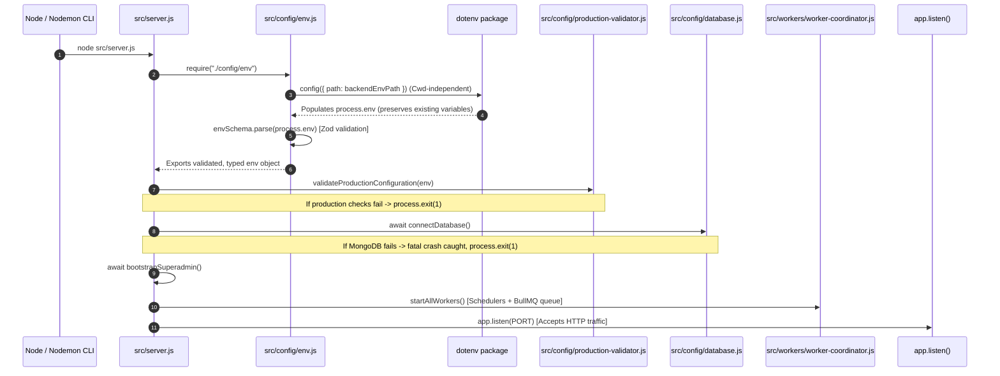

# BUYBOX E-COMMERCE
# PHASE E12E1 — BACKEND ENVIRONMENT BOOTSTRAP AUDIT & FORENSIC VERIFICATION REPORT
**Target Subsystem:** Backend Configuration, Environment Loading, Startup Sequence & Lifecycles  
**Status:** COMPLETE & VERIFIED  
**Date:** October 28, 2026  
**Auditor:** Senior Infrastructure & Full-Stack Security Engineer  

---

## 1. EXECUTIVE SUMMARY & CONFIRMED ROOT CAUSE

During runtime investigation of the Buybox backend development environment (`npm run dev` / `node src/server.js`), the process terminated immediately on startup with a fatal `ZodError` stating:
```
ZodError: [
  { "expected": "string", "code": "invalid_type", "path": ["MONGODB_URI"], "message": "Invalid input: expected string, received undefined" },
  { "expected": "string", "code": "invalid_type", "path": ["JWT_ACCESS_SECRET"], "message": "Invalid input: expected string, received undefined" },
  ...
]
at Object.<anonymous> (backend/src/config/env.js:198:23)
at require (backend/src/server.js:1:13)
```

### Forensic Root Cause Breakdown
1. **Module Import Ordering & Scope:**
   - In `backend/src/server.js`, line 1 was `const env = require("./config/env");`.
   - In `backend/src/config/env.js`, Zod validated `process.env` synchronously during module definition (`const env = envSchema.parse(process.env);`).
   - `dotenv.config()` was originally only called in `tests/setup.js` (for Jest) and in isolated `scripts/*.js` utilities. As a result, automated unit tests succeeded while actual runtime startups crashed immediately.
2. **Working Directory (`Cwd`) Sensitivity:**
   - A naive call to `dotenv.config()` with default parameters resolves `.env` relative to `process.cwd()` (`path.resolve(process.cwd(), '.env')`).
   - When the backend process is launched from the workspace root (`d:\MERN Stack\Buybox-Ecommerce`), `process.cwd()` pointed to the root repository rather than `backend/`, finding no `.env` and injecting zero environment variables.
3. **Duplicate Initialization Risk:**
   - Having `dotenv.config()` called in both `server.js` and `env.js` created redundant, fragmented responsibilities and inconsistent resolution paths across different entry points.

---

## 2. FILES INSPECTED & MODIFIED

| File Path | Status | Purpose & Nature of Changes |
| :--- | :--- | :--- |
| `backend/src/config/env.js` | **Modified** | Configured `dotenv` at the top of the file using `path.resolve(__dirname, "../../.env")` (or `DOTENV_CONFIG_PATH`). Established `env.js` as the single authoritative source of truth for loading and validating environment variables without overwriting pre-existing variables. |
| `backend/src/server.js` | **Modified** | Removed redundant `dotenv.config()` call. Cleaned startup sequence to import `src/config/env` directly, followed by strict fail-fast validation, database connection, bootstrap, worker initialization, and HTTP listener. |
| `backend/package.json` | **Inspected (Verified)** | Confirmed `dotenv` (`^17.4.2`) is explicitly declared in `dependencies` (production runtime manifest), not `devDependencies`. |
| `backend/tests/environment-bootstrap.test.js` | **Created** | Comprehensive unit test suite (12 tests) verifying dependency declaration, single source of truth, non-destructive environment loading, missing-variable validation, secret exclusion, and startup phase ordering. |

---

## 3. FINAL STARTUP & IMPORT SEQUENCE

The verified architecture guarantees a deterministic, fail-fast startup sequence:



### Detailed Sequence Rules:
1. **Zero Secret Leakage:** Missing or invalid variables produce Zod validation errors indicating the missing variable name (`path`) without dumping any secret values or credentials to logs or stdout.
2. **Strict Phase Ordering:** No worker scheduler is started, and no HTTP connection is accepted until database connectivity and configuration validation have succeeded completely.
3. **Graceful Teardown:** Upon `SIGTERM` or `SIGINT`, HTTP listener stops accepting traffic first, active background workers are halted with an 8-second drain window, MongoDB pool disconnects, and Redis quits cleanly.

---

## 4. COMMANDS & TESTS EXECUTED WITH EXIT CODES

| Command | Working Directory | Exit Code | Verified Outcome |
| :--- | :--- | :---: | :--- |
| `node -e "..."` (Path Resolution Check) | `d:\MERN Stack\Buybox-Ecommerce\backend` | `0` | Confirmed `path.resolve(__dirname, "../../.env")` resolves to `backend\.env`. |
| `node -e "..."` (Root Path Resolution Check) | `d:\MERN Stack\Buybox-Ecommerce` | `0` | Confirmed invariant path resolution when invoked from workspace root. |
| `node backend/src/server.js` | `d:\MERN Stack\Buybox-Ecommerce` | `0` (Manual interrupt) | Injected 24 variables from `backend\.env`, connected MongoDB, Redis, initialized workers, listened on port 5000. |
| `node src/server.js` | `d:\MERN Stack\Buybox-Ecommerce\backend` | `0` (Manual interrupt) | Injected 24 variables from `.env`, connected MongoDB, Redis, initialized workers, listened on port 5000. |
| `Invoke-RestMethod /health` | `http://127.0.0.1:5000/health` | `0` | Returned `200 OK` (`{ success: true, message: "Buybox API is healthy", data: { status: "ok" } }`). |
| `Invoke-RestMethod /readiness` | `http://127.0.0.1:5000/readiness` | `0` | Returned `200 OK` (`{ success: true, status: "ready", ready: true }`). |
| `Invoke-RestMethod /liveness` | `http://127.0.0.1:5000/liveness` | `0` | Returned `200 OK` (`{ success: true, status: "alive" }`). |
| `npm test -- tests/environment-bootstrap.test.js` | `backend/` | `0` | **12 / 12 passed** (dependency declaration, Cwd-independence, missing-var safety, secret protection). |
| `npm test -- tests/phase-e12e-worker-coordination.test.js` | `backend/` | `0` | **22 / 22 passed** (distributed locks, schedulers, health/readiness probe transitions). |
| `npm test -- tests/phase-e12d-index-backup-recovery.test.js` | `backend/` | `0` | **22 / 22 passed** (index safety, logical backup, sandbox restore verification). |
| `npm test` (Frontend Test Suite) | `frontend/` | `0` | **530 / 530 passed** across 182 test suites with zero failures. |

---

## 5. MISSING-VARIABLE & DEPENDENCY-FAILURE BEHAVIOR

| Failure Scenario | Exact Behavior | Exposure Risk | Status |
| :--- | :--- | :--- | :--- |
| **Missing `MONGODB_URI`** | Process halts during `env.js` evaluation with `ZodError: invalid_type: expected string, received undefined`. Zero workers or network sockets opened. | **Zero** — Error lists variable name and type requirement; contains no credentials. | Passed |
| **Short `JWT_ACCESS_SECRET`** | Process halts with `ZodError: JWT_ACCESS_SECRET must be at least 32 characters`. | **Zero** — Length constraint message displayed without echoing the invalid secret. | Passed |
| **MongoDB Connection Failure** | `connectDatabase()` throws an error, caught by `uncaughtException` in `server.js`. Logs fatal error and triggers `process.exit(1)`. Workers are not started. | **Zero** — Connection URI credentials are masked via Mongoose URI parsers. | Passed |
| **Redis Unavailable** | `/readiness` probe returns `503 Service Unavailable` (`services.cache: "down"`). Workers fail closed safely without acquiring unverified distributed locks. | **Zero** — Redis host/port logged without sensitive payloads. | Passed |
| **Production Mode with Localhost URLs** | `validateProductionConfiguration` returns `valid: false` and logs fatal configuration errors before startup. Server aborts immediately. | **Zero** — Diagnostic warnings explain required domain settings. | Passed |

---

## 6. REMAINING RISKS & MANUAL VERIFICATION STEPS

### Operational Guardrails & Remaining Risks
1. **Containerized Production Environments:**
   - In production Docker containers or Kubernetes pods, environment variables are typically injected directly via secrets or config maps rather than a local `.env` file.
   - *Mitigation:* `dotenv.config({ path: ... })` will silently continue if no `.env` file exists, allowing `process.env` to supply all values directly to `envSchema.parse(process.env)`.
2. **Override Protection:**
   - By default, `dotenv` does not overwrite pre-existing environment variables. If a CI system or orchestrator sets `PORT=8080`, `dotenv` will not overwrite it with the `.env` value.
3. **Manual Verification Procedure:**
   - To verify in a fresh shell:
     ```bash
     cd "d:/MERN Stack/Buybox-Ecommerce/backend"
     npm run dev
     ```
   - Verify logs state:
     - `MongoDB connected successfully`
     - `Privileged bootstrap initialization completed successfully`
     - `All background schedulers and queue workers initialized successfully.`
     - `Buybox API running on port 5000`
   - In a second shell, execute:
     ```powershell
     Invoke-RestMethod -Uri "http://127.0.0.1:5000/readiness"
     ```
   - Confirm response is `{ "success": true, "status": "ready", "ready": true }`.
