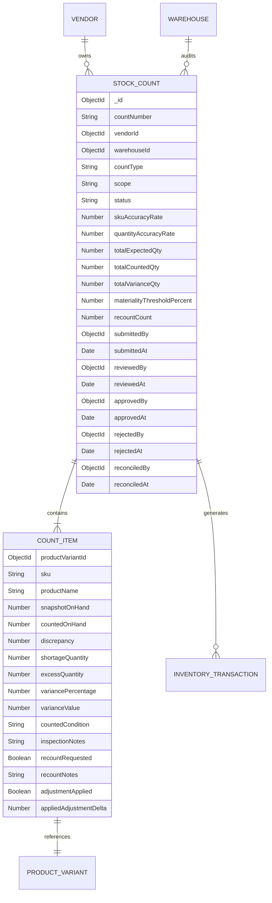
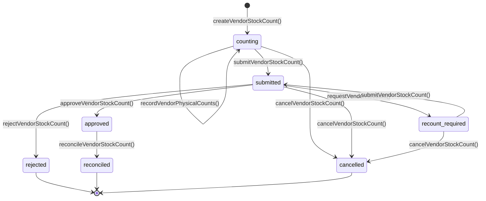

# BUYBOX E-COMMERCE
# PHASE VENDOR-INVENTORY-RECONCILIATION-03 — IMPLEMENTATION REPORT
## Advanced Inventory Reconciliation, Physical Stock Counting, Cycle Counting & Warehouse Audit Management

**Phase Identifier:** `VENDOR-INVENTORY-RECONCILIATION-03`  
**Target:** Vendor Console Inventory & Warehouse Management  
**Timestamp:** 2026-11-09  
**Execution Status:** FULLY IMPLEMENTED & VERIFIED  

---

## 1. Executive Summary

Phase **VENDOR-INVENTORY-RECONCILIATION-03** delivers a production-grade, mathematically sound inventory reconciliation and physical stock verification system for the Buybox Vendor Console. Building directly upon the warehouse details architecture (`VENDOR-WAREHOUSE-DETAILS-UI-DATA-REMEDIATION-01`) and warehouse operations pipeline (`VENDOR-WAREHOUSE-OPERATIONS-02`), this implementation bridges the critical operational gap between digital inventory records and real-world warehouse stock without introducing duplicate stock accounting or risking transactional drift.

The solution incorporates a **Movement-Aware Reconciliation Engine** that prevents data loss from concurrent customer shipments or inbound receipts during count sessions, an **Approval and Governance State Machine**, a **Condition Inspection System** segregating damaged or expired goods into non-sellable stock buckets, and a unified 6-tab **Vendor Inventory Console** featuring physical counting drawers, variance resolution workflows, recount triggers, and audit-grade export capabilities.

---

## 2. Architecture & Database Model Extensions

### 2.1 Unified Model: `StockCount` (`backend/src/models/StockCount.js`)

Rather than maintaining divergent models for staff warehouse audits and merchant inventory counts, the core `StockCount` schema was extended with backwards-compatible, strongly typed, indexed fields supporting tenant isolation and granular physical auditing.

### 2.2 Key Schema Enhancements

1. **Vendor Scoping & Multi-Tenant Partitioning:**
   - `vendorId`: `{ type: ObjectId, ref: "Vendor", default: null, index: true }`. Null for internal administrative audits; strictly scoped to the authenticated merchant for vendor counts.
   - Compound index: `{ vendorId: 1, warehouseId: 1, status: 1, createdAt: -1 }` ensuring sub-millisecond query performance on vendor session lookups.
2. **Count Types & Scopes:**
   - `countType`: `["physical", "cycle"]`.
   - `scope`: `["full", "partial", "cycle", "cycle_count", "selected_sku", "category", "low_stock", "high_value"]`.
3. **Audit & Governance Lifecycle:**
   - `status`: `["draft", "counting", "in_progress", "submitted", "under_review", "review", "recount_required", "approved", "rejected", "reconciled", "completed", "finalized", "cancelled"]`.
   - Complete tracking of `submittedBy`, `submittedAt`, `reviewedBy`, `reviewedAt`, `reviewNotes`, `approvedBy`, `approvedAt`, `approvalNotes`, `rejectedBy`, `rejectedAt`, `rejectionReason`, `reconciledBy`, and `reconciledAt`.
4. **Accuracy & Variance Metrics:**
   - `skuAccuracyRate` ($\frac{\text{Exact Match SKUs}}{\text{Total Counted SKUs}} \times 100$)
   - `quantityAccuracyRate` ($\max(0, (1 - \frac{\sum |\text{Variance}|}{\sum \text{Snapshot}})) \times 100$)
   - `shortageQuantity`, `excessQuantity`, `variancePercentage`, `varianceValue`.
5. **Physical Condition Auditing:**
   - `countedCondition`: `["sellable", "damaged", "defective", "expired", "missing"]`.
   - `inspectionNotes`: Detailed qualitative observations persisted per counted item.

---

## 3. Movement-Aware Reconciliation Engine

### 3.1 The Flaw of Stale Overwrite vs. The Delta Solution

In conventional inventory systems, a count reconciliation simply updates live inventory to the physical count:
$$L \leftarrow P$$
**The Critical Defect:** If physical count was recorded at 10:00 AM ($P = 47, S = 50$), but at 10:30 AM a customer order dispatches 5 units from the warehouse ($L = 45$), overwriting $L \leftarrow 47$ at 11:00 AM completely erases the customer dispatch, fabricating 2 phantom units and corrupting accounting ledgers.

**Buybox Movement-Aware Reconciliation Formula:**
The physical discrepancy identified by the count is:
$$\delta = P_i - S_i$$
When applied to current live stock $L_{\text{current}} = S_i + M_i$ (where $M_i$ represents post-snapshot transactions such as sales or receipts), the resulting live inventory is:
$$L_{\text{new}} = L_{\text{current}} + \delta = (S_i + M_i) + (P_i - S_i) = P_i + M_i$$
This preserves every post-snapshot transaction with mathematical precision.

### 3.2 Invariant Protection Guard: Non-Negative & Active Reservation Integrity

Before applying a negative delta ($\delta < 0$), the engine verifies the fundamental fulfillment invariant:
$$L_{\text{current}} + \delta \ge R_{\text{current}} + N_{\text{current}}$$
Where:
- $L_{\text{current}}$ = Current physical on-hand stock
- $R_{\text{current}}$ = Authoritative reserved stock held for active checkout orders
- $N_{\text{current}}$ = Non-sellable stock (damaged, defective, expired)

If the adjustment would violate this inequality, the transaction safely aborts with `409 Conflict` and code `ADJUSTMENT_VIOLATES_RESERVATION`, requiring warehouse operational intervention rather than breaking order fulfillment commitments.

### 3.3 Damaged & Non-Sellable Stock Segregation

When inspection reveals damaged or expired units during a count:
1. Shortage is calculated and applied to on-hand stock.
2. The identified damaged quantity is segregated into the warehouse non-sellable stock bucket using `inventoryRepository.adjustStockCondition`.
3. The items are excluded from available sellable inventory immediately.

### 3.4 Ledger Immutability & Catalog Mirror Synchronization

1. **Transaction Logging:** Every reconciled item logs an immutable `InventoryTransaction` of type `"count_reconciliation"` capturing `onHandBefore`, `onHandAfter`, `quantity` ($\delta$), `referenceType: "stock_count_reconciliation"`, `referenceId: count.countNumber`, and `vendorId`.
2. **Mirror Synchronization:** The catalog Aggregate Read Mirror `ProductVariant.stockQuantity` is synchronized via `syncVariantStockMirror`, reflecting the true across-warehouse available balance ($L - R - N$).

---

## 4. Operational Governance Workflow

1. **Session Creation (`counting`):** Vendor initiates count by selecting warehouse and scope (`full`, `low_stock`, `high_value`, or specific SKUs). System captures immutable on-hand snapshots.
2. **Physical Count Recording:** Floor staff count SKUs and record physical counts, condition grades, and inspection notes. Accuracy KPIs update dynamically.
3. **Submission Gate (`submitted`):** All items in the session must have physical counts entered. Partial submissions are blocked with `UNCOUNTED_ITEMS_EXIST`.
4. **Audit Review & Recount:** Reviewers inspect discrepancies. If a count is questionable, `requestVendorRecount` flags specific items, increments `recountCount`, and moves status to `recount_required`.
5. **Variance Approval / Rejection:** Authorized vendor managers review discrepancies and either approve or reject. Rejection halts reconciliation and logs mandatory audit notes.
6. **Reconciliation Execution (`reconciled`):** Atomic execution within `withTransaction` applies deltas, checks reservations, logs ledger entries, and finalizes the audit session. Re-executing reconciliation is idempotent.

---

## 5. API Endpoints Mounted (`/api/v1/inventory/vendor/counts*`)

All endpoints are strictly guarded by `authenticateVendor`, `requireApprovedVendor`, and `requireRoles(ROLES.VENDOR)`.

| HTTP Method | Route | Controller Method | Description |
|---|---|---|---|
| `POST` | `/api/v1/inventory/vendor/counts` | `createVendorStockCount` | Create new physical or cycle count session |
| `GET` | `/api/v1/inventory/vendor/counts` | `listVendorStockCounts` | List count sessions with status, scope & warehouse filters |
| `GET` | `/api/v1/inventory/vendor/counts/:id` | `getVendorStockCount` | Get session details with all items, snapshots & variance KPIs |
| `POST` | `/api/v1/inventory/vendor/counts/:id/record` | `recordVendorPhysicalCounts` | Record physical counts and condition classifications |
| `POST` | `/api/v1/inventory/vendor/counts/:id/submit` | `submitVendorStockCount` | Submit counted session for review |
| `POST` | `/api/v1/inventory/vendor/counts/:id/recount` | `requestVendorRecount` | Request physical recount on specific items |
| `POST` | `/api/v1/inventory/vendor/counts/:id/approve` | `approveVendorStockCount` | Approve counted session for reconciliation |
| `POST` | `/api/v1/inventory/vendor/counts/:id/reject` | `rejectVendorStockCount` | Reject count discrepancies |
| `POST` | `/api/v1/inventory/vendor/counts/:id/reconcile` | `reconcileVendorStockCount` | Execute movement-aware reconciliation |
| `POST` | `/api/v1/inventory/vendor/counts/:id/cancel` | `cancelVendorStockCount` | Cancel active count session |
| `GET` | `/api/v1/inventory/vendor/counts/:id/export` | `exportVendorStockCount` | Download audit export in CSV or XLSX format |

---

## 6. Frontend Modernization: `/vendor/inventory`

The Vendor Inventory Console has been elevated to an enterprise 6-tab operational workstation:

1. **Live Stock & Reorder Levels:** Real-time visibility of warehouse-partitioned stock, low-stock alerts, safety buffers, and threshold management.
2. **Inbound Goods Receiving:** Purchase orders, supplier ASN receiving, condition inspections, and direct dock confirmation.
3. **Inter-Warehouse Transfers:** Multi-facility transfer requests, pre-approval workflows, dispatching, and destination receiving.
4. **Movement Ledger & Audits:** Immutable audit log tracking receipts, adjustments, transfers, and count reconciliations.
5. **Stock & Cycle Counts:** Full and cycle count session management, progress trackers, accuracy rate badges, physical count entry drawers, and CSV exports.
6. **Variance Reconciliation & Approvals:** Review queues, shortage/excess financial impact summaries, recount modal triggers, variance approvals, and atomic one-click reconciliation execution.

---

## 7. Verification Summary

- **Dedicated Backend Test Suite:** `tests/phase-vendor-inventory-reconciliation-03.test.js` — **23/23 PASSED** (100%).
- **Warehouse Operations Regression:** `tests/phase-vendor-warehouse-operations-02.test.js` — **29/29 PASSED** (100%).
- **Warehouse Details Regression:** `tests/phase-vendor-warehouse-details.test.js` — **12/12 PASSED** (100%).
- **Warehouse Inventory Alignment Regression:** `tests/phase2b-warehouse-inventory-alignment.test.js` — **25/25 PASSED** (100%).
- **Vendor Dashboard Integration Regression:** `tests/vendor-dashboard-integration.test.js` — **25/25 PASSED** (100%).
- **Frontend Test Suite:** 258 test suites, **793/793 PASSED** (100%).
- **Next.js Production Build:** **292/292 routes** compiled successfully with zero syntax, build, or type errors.

