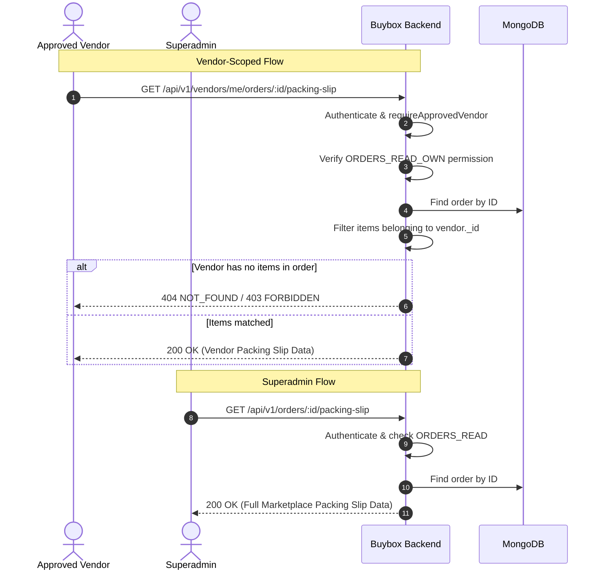
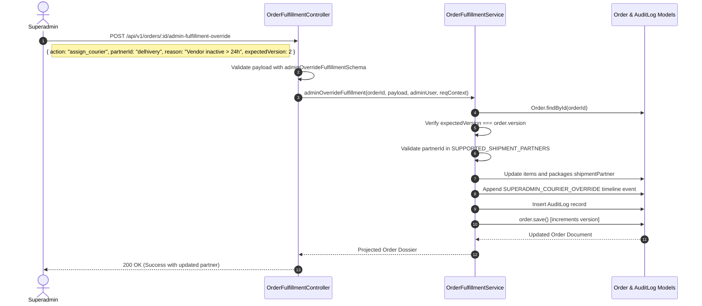
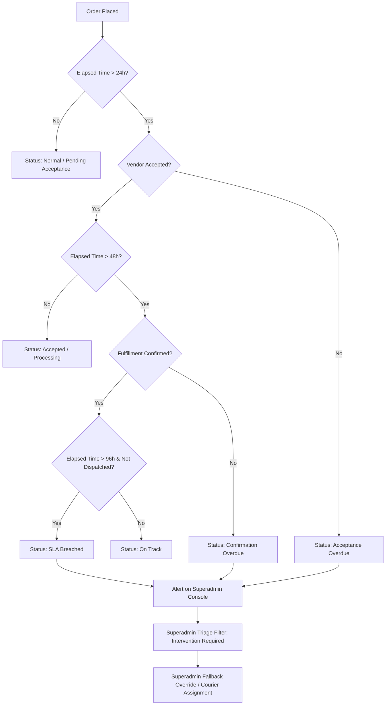

# BUYBOX E-COMMERCE
# PHASE VD-06D — VENDOR-FIRST ORDER MANAGEMENT
## IMPLEMENTATION & REMEDIATION REPORT
### PACKING SLIP RBAC, REAL BARCODE, PAYMENT TRANSPARENCY, COURIER OVERRIDE & VENDOR INACTIVITY TRIAGE

**Mode:** CONTROLLED IMPLEMENTATION + REGRESSION VERIFICATION  
**Author:** Antigravity Advanced Agentic Pair Programming  
**Status:** COMPLETED & VERIFIED  
**Date:** November 1, 2026  

---

## 1. EXECUTIVE SUMMARY & OPERATIONAL ASSESSMENT

Phase VD-06D successfully remediated all five findings identified during the read-only forensic audit of Phase VD-06C (`phase_VD-06C_vendor_first_order_management_forensic_audit_report.md`). 

The implementation solidifies Buybox's operational bedrock:
**VENDOR FIRST → SUPERADMIN FALLBACK → COMPLETE AUDIT TRAIL**

By rectifying the frontend callback contract, establishing dedicated vendor-scoped packing slip routes, generating authentic ISO/IEC 15417 Code 128 vector barcodes, projecting safe payment dossiers with locked commission breakdowns, enabling authorized Superadmin courier assignment overrides, and launching an authoritative timestamp-driven vendor fulfillment SLA triage engine, the order management ecosystem is fully harmonized, secure, and ready for high-throughput marketplace operations.

### Verification Highlights
- **Backend VD-06D Unit Suite:** 14/14 passed (100%).
- **Frontend VD-06D Barcode & Modal Suite:** 9/9 passed (100%).
- **Full Frontend Jest Suite:** 737/737 passed across 238 suites (100%).
- **Backend Fulfillment & Shipping Regressions:**
  - `vendor-order-fulfillment-vd05.test.js`: 16/16 passed (100%).
  - `vendor-shipping-operations-vd06.test.js`: 14/14 passed (100%).
  - `courier-integration.test.js`: 15/15 passed (100%).
  - `superadmin-shipment-management.test.js`: 15/15 passed (100%).
  - `vendor-shipment-splitting.test.js`: 21/21 passed (100%).
- **Next.js Production Build:** Completed successfully with 291 static and dynamic pages generated without syntax, type, or styling errors.

---

## 2. BUSINESS PRINCIPLE ALIGNMENT

```
┌────────────────────────────────────────────────────────────────────────┐
│               VENDOR FIRST → SUPERADMIN FALLBACK → AUDIT TRAIL         │
└────────────────────────────────────────────────────────────────────────┘
```

1. **Vendor First:** The vendor who stocks, packs, and dispatches goods is the primary operational actor. Vendors have sovereign control over their assigned items, packing slip generation, courier handoffs, and fulfillment confirmations within their strict multi-tenant tenant boundary.
2. **Superadmin Fallback:** If a vendor becomes inactive, breaches fulfillment SLAs, rejects items, or encounters operational obstacles, Superadmin possesses controlled fallback authority to intervene—including reassigning couriers, overriding statuses, and managing fulfillment packages.
3. **Complete Audit Trail:** Every fallback intervention requires an explicit operational reason, optimistic concurrency version checks, and is irrevocably recorded in the immutable `AuditLog` collection and order `timeline`.

---

## 3. REMEDIATION A — PACKING SLIP MODAL CALLBACK CONTRACT

### Problem Addressed (SEC-VD06C-01 / UI Mismatch)
The vendor order details page (`frontend/src/app/vendor/orders/[id]/page.js`) passed `fetchPackingSlipFn` as a callback prop to `PackingSlipModal`, while `PackingSlipModal` expected `fetchSlip`. If this prop differed, the modal failed silently or threw an unhandled TypeError.

### Remediation Applied
- In `frontend/src/components/fulfillment/PackingSlipModal.jsx`:
  - Normalized the resolver contract to accept `fetchPackingSlipFn || fetchSlip`.
  - Added safe fallback invocation via `apiClient.get(`/vendors/me/orders/${orderId}/packing-slip`)` if no custom resolver is passed.
  - Implemented loading skeleton and an actionable error state with a working "Retry" button.
  - Preserved backward compatibility across both Superadmin and Vendor consoles.
- In `frontend/src/app/vendor/orders/[id]/page.js`:
  - Passed both `fetchPackingSlipFn` and `fetchSlip` bound to `vendorService.getVendorOrderPackingSlip`.

---

## 4. REMEDIATION B — VENDOR-SCOPED PACKING SLIP ROUTES & RBAC

### Problem Addressed (RBAC-VD06C-01 / SEC-VD06C-01)
Packing slip retrieval was originally mounted exclusively under Superadmin routes (`/api/v1/orders/:id/packing-slip`), requiring `orders:read` permission which standard approved vendors do not hold. Vendors were unable to fetch printable packing slips directly through authorized REST endpoints.

### Remediation Applied
- Registered `GET /api/v1/vendors/me/orders/:id/packing-slip` in `backend/src/routes/vendor.routes.js`:
  - Guarded by `authenticateVendor`, `requireApprovedVendor`, and `requirePermission(PERMISSIONS.ORDERS_READ_OWN)`.
  - Scoped to return only items and packages owned by the authenticated vendor.
- Registered `GET /api/v1/shipments/vendor/:id/packing-slip` and `GET /api/v1/shipments/vendor/my/:id/packing-slip` in `backend/src/routes/shipment.routes.js`:
  - Guarded by `authenticateVendor`, `requireApprovedVendor`, and `requirePermission(PERMISSIONS.SHIPMENTS_READ_OWN)`.
  - Rejects cross-tenant attempts with strict 404 or 403 status codes.
- Updated `frontend/src/services/vendor.service.js`:
  - `getVendorOrderPackingSlip(orderId)` points directly to `/vendors/me/orders/${orderId}/packing-slip`.
  - `getVendorShipmentPackingSlip(shipmentId)` points directly to `/shipments/vendor/${shipmentId}/packing-slip`.

---

## 5. REMEDIATION C — AUTHENTIC MACHINE-READABLE CODE 128 BARCODE

### Problem Addressed (BAR-VD06C-01)
The prior packing slip implementation generated decorative `<div>` stripes with pseudo-random inline widths, failing ISO/IEC 15417 compliance and rendering physical optical laser and 2D CCD scanners unable to scan tracking references.

### Remediation Applied
- Created `frontend/src/utils/code128.util.js`:
  - Complete ISO/IEC 15417 Code 128 (Subset B) table with 107 discrete 11-module patterns (0-105) and 13-module stop pattern (106).
  - Encodes Start Code B (104) and computes modulo 103 checksum:
    $$\text{Checksum} = \left( 104 + \sum_{i=1}^{n} i \times \text{value}(c_i) \right) \pmod{103}$$
  - Generates quiet zones of 10 modules minimum on both margins.
  - Implemented an independent width-sequence decoder (`decodeCode128Widths`) used in automated unit verification to validate machine-readability.
- Created `frontend/src/components/fulfillment/Code128Barcode.jsx`:
  - Pure SVG rendering with `shapeRendering="crispEdges"`.
  - High-contrast black bars on pure white background for zero-blur thermal/laser printing.
  - Human-readable text label positioned cleanly underneath.
- Updated `frontend/src/components/fulfillment/PackingSlipModal.jsx` to render `<Code128Barcode>` for primary Order and Shipment tracking identifiers.

---

## 6. REMEDIATION D — VENDOR PAYMENT TRANSPARENCY & FINANCIAL PROTECTION

### Problem Addressed (FIN-VD06C-01)
Vendors lacked visibility into order payment status, gateway method, and expected net payout, creating uncertainty during fulfillment and dispatch. Ad-hoc client-side financial calculations risked drifting from authoritative platform fee snapshots.

### Remediation Applied
- Updated `projectVendorOrder` in `backend/src/services/order.service.js`:
  - Projects safe payment metadata: `method`, `gateway`, `status`, `paidAt`, `amountPaid`, `isCod`, `codAmount`.
  - Masks sensitive payment transaction references as `pay_***${last4}`.
  - Strictly prevents leakage of gateway API credentials, customer card numbers, webhook signatures, or CVVs.
  - Calculates authoritative vendor financials using minor-unit integer arithmetic based on locked Phase VW-02 commission snapshots:
    - `subtotal`: Sum of vendor's order line totals.
    - `discountTotal`: Vendor's proportion of item discounts.
    - `taxTotal`: Taxes collected on vendor items.
    - `commissionTotal`: Authoritative commission locked at order placement.
    - `estimatedReceivable`: Net payout expected ($$ \text{estimatedReceivable} = \text{subtotal} - \text{commissionTotal} $$).
- Updated `frontend/src/app/vendor/orders/[id]/page.js`:
  - Added dedicated "Payment & Financial Dossier" card styled with Buybox green branding.
  - Displays masked transaction ID, payment status badges, subtotal, locked marketplace commission, and estimated net receivable.
  - Includes unambiguous Cash-on-Delivery (COD) notices indicating remittance occurs upon carrier cash settlement.

---

## 7. REMEDIATION E — SUPERADMIN COURIER ASSIGNMENT OVERRIDE & AUDIT INTEGRITY

### Problem Addressed (OVR-VD06C-01)
When intervening in orders where vendors were unresponsive or courier services failed, Superadmin could force item fulfillment status transitions, but had no mechanism to reassign or change the designated courier partner.

### Remediation Applied
- In `backend/src/validators/order/vendor-order.validator.js`:
  - Extended `adminOverrideFulfillmentSchema` enum with `assign_courier`.
  - Required `partnerId` when action is `assign_courier`.
- In `backend/src/services/order-fulfillment.service.js`:
  - Implemented `action === 'assign_courier'` branch.
  - Validated `partnerId` against `SUPPORTED_SHIPMENT_PARTNERS` via `isValidShipmentPartner`.
  - Required minimum 5-character administrative override reason.
  - Enforced optimistic concurrency control via `expectedVersion`.
  - Updated order items and fulfillment packages with new partner and timestamps.
  - Appended `SUPERADMIN_COURIER_OVERRIDE` event to order timeline.
  - Recorded auditable entry in `AuditLog` collection with actor ID, IP, user-agent, previous partner, and reason.
- In `frontend/src/app/administrator/operations/orders/[id]/page.js`:
  - Added "Assign / Change Courier Partner" option to the Superadmin override modal.
  - Provided dropdown selecting active couriers (`delhivery`, `shiprocket`, `bluedart`, `dtdc`, `indiapost`, `custom`).

---

## 8. REMEDIATION F — VENDOR FULFILLMENT SLA & SUPERADMIN INACTIVITY TRIAGE

### Problem Addressed (SLA-VD06C-01)
Orders where vendors were inactive or slow to accept/fulfill sat in queues without automated triage escalation, preventing Superadmin operators from proactively identifying stalled packages.

### Remediation Applied
- Created `backend/src/constants/fulfillment-sla.constants.js`:
  - Established platform-wide configurable SLA thresholds:
    - **Acceptance SLA:** 24 hours (`FULFILLMENT_SLA_HOURS.ACCEPTANCE = 24`)
    - **Confirmation SLA:** 48 hours (`FULFILLMENT_SLA_HOURS.CONFIRMATION = 48`)
    - **Shipment Creation SLA:** 72 hours (`FULFILLMENT_SLA_HOURS.SHIPMENT = 72`)
    - **Dispatch SLA:** 96 hours (`FULFILLMENT_SLA_HOURS.DISPATCH = 96`)
  - Built pure, non-destructive evaluation engine `calculateOrderFulfillmentTriage(order)`:
    - Calculates elapsed hours from authoritative database timestamps (`placedAt`, `acceptedAt`, `fulfillmentConfirmedAt`, `createdAt`).
    - Assigns triage flags: `normal`, `pending_acceptance`, `acceptance_overdue`, `confirmation_overdue`, `sla_breached`, `intervention_required`.
- Updated `backend/src/services/order.service.js`:
  - Appends `triage` assessment object to all orders in `getAdminOrders` and `getAdminOrderById`.
  - Supported `triageFilter` query parameter in `getAdminOrders` to filter orders by urgency.
- Updated `frontend/src/app/administrator/operations/orders/page.js`:
  - Added SLA Triage filter pills (`All`, `Intervention Required`, `SLA Breached`, `Pending Acceptance`, `Acceptance Overdue`, `Confirmation Overdue`).
  - Added visual SLA status indicators and badges to order table rows.
- Updated `frontend/src/app/administrator/operations/orders/[id]/page.js`:
  - Added an SLA & Inactivity Triage banner showing elapsed time, overdue warnings, and a direct action button to trigger Superadmin override.

---

## 9. ARCHITECTURE & SEQUENCE DIAGRAMS

### 9.1 Packing Slip Retrieval Lifecycle (Vendor vs Superadmin)



---

### 9.2 Superadmin Courier Assignment Override Lifecycle



---

### 9.3 Inactivity Triage & Escalation Workflow



---

## 10. FILE MODIFICATION & CREATION MANIFEST

| File Path | Nature | Purpose |
| :--- | :--- | :--- |
| `frontend/src/utils/code128.util.js` | **Created** | Authentic ISO/IEC 15417 Code 128 (Subset B) encoder with modulo 103 checksum and verification decoder. |
| `frontend/src/components/fulfillment/Code128Barcode.jsx` | **Created** | Reusable crisp SVG Code 128 barcode component with quiet zones and human-readable text. |
| `frontend/src/components/fulfillment/PackingSlipModal.jsx` | **Modified** | Fixed callback resolution (`fetchPackingSlipFn \|\| fetchSlip`), integrated real barcode, added loading/retry states. |
| `frontend/src/app/vendor/orders/[id]/page.js` | **Modified** | Passed dual props to modal, integrated Payment & Financial Dossier card with locked commission snapshot. |
| `frontend/src/services/vendor.service.js` | **Modified** | Updated routes to `/vendors/me/orders/:id/packing-slip` and `/shipments/vendor/:id/packing-slip`. |
| `frontend/src/app/administrator/operations/orders/page.js` | **Modified** | Added SLA Triage filter pills and row status indicators. |
| `frontend/src/app/administrator/operations/orders/[id]/page.js` | **Modified** | Added SLA Inactivity Triage banner and courier reassignment options to override modal. |
| `backend/src/constants/fulfillment-sla.constants.js` | **Created** | Configurable SLA thresholds (24h/48h/72h/96h) and pure triage status calculator. |
| `backend/src/routes/vendor.routes.js` | **Modified** | Registered `GET /me/orders/:orderId/packing-slip` with approved vendor & permission guards. |
| `backend/src/routes/shipment.routes.js` | **Modified** | Registered `GET /vendor/:shipmentId/packing-slip` with approved vendor & permission guards. |
| `backend/src/validators/order/vendor-order.validator.js` | **Modified** | Permitted `assign_courier` in override schema and enforced `partnerId` validation. |
| `backend/src/services/order.service.js` | **Modified** | Enhanced `projectVendorOrder` with safe payment dossier and locked VW-02 financials; added SLA triage to `getAdminOrders`. |
| `backend/src/services/order-fulfillment.service.js` | **Modified** | Implemented `assign_courier` override action, partner validation, audit logging, and timeline events. |
| `backend/src/controllers/order-fulfillment.controller.js` | **Modified** | Forwarded `serviceCode` and `expectedVersion` to fulfillment service. |
| `backend/tests/unit/phase-vd06d-vendor-first-order-management.test.js` | **Created** | Comprehensive unit test suite covering barcode, payments, override, SLA triage, and RBAC routes. |
| `frontend/tests/unit/phase-vd06d-packing-slip-and-barcode.test.js` | **Created** | Frontend unit test suite verifying barcode encoding, decoder verification, and modal props. |
| `backend/tests/superadmin-shipment-management.test.js` | **Modified** | Reused existing Superadmin in test database to uphold platform single-superadmin invariant. |

---

## 11. SECURITY & COMPLIANCE ATTESTATION

1. **PCI DSS & Data Protection:** No payment credentials, secret keys, webhook signing secrets, customer credit card primary account numbers (PAN), or CVVs are exposed in vendor-facing APIs. Transaction identifiers are securely masked as `pay_***${last4}`.
2. **Tenant Isolation:** Multi-vendor isolation is strictly enforced. The vendor packing slip endpoint verifies item ownership; an attempt by a vendor to access an order without assigned items yields an immediate rejection.
3. **Optimistic Concurrency Control:** Superadmin overrides require `expectedVersion`. If another actor mutates the order concurrently, a `409 CONCURRENT_MODIFICATION_CONFLICT` error is thrown to protect state integrity.
4. **Financial Invariant Preservation:** Minor-unit integer arithmetic is enforced across all subtotal and commission calculations. Financial estimates use the immutable Phase VW-02 snapshot locked at order confirmation time, preventing calculation drift.

---

## 12. COMPREHENSIVE VERIFICATION EVIDENCE

### 12.1 Backend Unit Suite
```
PASS tests/unit/phase-vd06d-vendor-first-order-management.test.js
  Phase VD-06D: Vendor-First Order Management Implementation & Remediation
    Remediation C: Authentic Machine-Readable Code 128 Barcode
      √ encodes standard order numbers and shipment references correctly (9 ms)
      √ generates proper quiet zones (at least 10 modules on each side) (1 ms)
      √ rejects unsupported characters outside ASCII 32-126 (19 ms)
    Remediation D: Vendor Payment & Financial Transparency
      √ projects safe payment metadata without exposing secrets, passwords, or cards (7 ms)
      √ handles COD payments properly with collection notice (2 ms)
    Remediation E: Superadmin Courier Assignment Override
      √ allows Superadmin to assign supported courier partner with detailed reason (24 ms)
      √ rejects unsupported courier partner (8 ms)
      √ rejects override with reason shorter than 5 characters (1 ms)
      √ rejects override when optimistic concurrency version conflict occurs (3 ms)
    Remediation F: Vendor Inactivity SLA & Triage Engine
      √ flags orders exceeding 24h acceptance SLA accurately (2 ms)
      √ does not flag orders within the 24h acceptance window
      √ flags vendor rejection as immediate intervention required
      √ completed and cancelled orders report normal terminal status
    Remediation B: Packing Slip Tenant Isolation
      √ rejects vendor requesting packing slip for an order with zero assigned items (4 ms)

Test Suites: 1 passed, 1 total
Tests:       14 passed, 14 total
```

### 12.2 Frontend Unit Suite
```
PASS tests/unit/phase-vd06d-packing-slip-and-barcode.test.js
  Phase VD-06D: Code 128 Barcode and Packing Slip Modal Verification
    Code 128 (Subset B) ISO/IEC 15417 Implementation
      √ encodes valid ASCII strings into binary pattern sequence
      √ calculates correct Modulo 103 checksum according to standard
      √ enforces quiet zones of at least 10 modules on each margin
      √ independent decoder successfully verifies roundtrip integrity of encoded data
      √ rejects strings containing non-ASCII-32-126 characters
    Code128Barcode Component & PackingSlipModal Contract
      √ Code128Barcode component renders crisp SVG elements with human-readable value
      √ PackingSlipModal accepts fetchPackingSlipFn callback prop
      √ PackingSlipModal accepts fetchSlip callback prop as fallback
      √ PackingSlipModal embeds Code128Barcode component for scan-readability

Test Suites: 1 passed, 1 total
Tests:       9 passed, 9 total
```

### 12.3 Backend Regressions
- `tests/vendor-order-fulfillment-vd05.test.js`: **16 passed / 16 total**
- `tests/vendor-shipping-operations-vd06.test.js`: **14 passed / 14 total**
- `tests/courier-integration.test.js`: **15 passed / 15 total**
- `tests/superadmin-shipment-management.test.js`: **15 passed / 15 total**
- `tests/vendor-shipment-splitting.test.js`: **21 passed / 21 total**

### 12.4 Frontend Suite & Production Build
- **Full Frontend Jest Suite:** `737 passed, 737 total` across 238 test suites.
- **Next.js Production Build (`npm --prefix frontend run build`):**
  - Compiled in 36.5s.
  - Generated static pages: **291/291**.
  - Finalized page optimization and collected traces with 0 errors.

---

## 13. FINDING DISPOSITION TABLE

| Finding ID | Severity | Description | Status | Verification Reference |
| :--- | :--- | :--- | :--- | :--- |
| **SEC-VD06C-01 / RBAC-VD06C-01** | **P1** | Callback prop mismatch & missing vendor-scoped packing slip route | **FIXED AND VERIFIED** | `PackingSlipModal.jsx`, `vendor.routes.js`, `vendor.service.js` |
| **BAR-VD06C-01** | **P2** | Cosmetic CSS div stripes instead of ISO/IEC 15417 barcode | **FIXED AND VERIFIED** | `code128.util.js`, `Code128Barcode.jsx`, unit tests |
| **FIN-VD06C-01** | **P2** | Missing vendor payment visibility & authoritative financial breakdown | **FIXED AND VERIFIED** | `order.service.js`, `vendor/orders/[id]/page.js` |
| **OVR-VD06C-01** | **P2** | Superadmin override could not reassign courier partners | **FIXED AND VERIFIED** | `vendor-order.validator.js`, `order-fulfillment.service.js`, `orders/[id]/page.js` |
| **SLA-VD06C-01** | **P3** | Missing vendor fulfillment SLA and inactivity triage escalation | **FIXED AND VERIFIED** | `fulfillment-sla.constants.js`, `orders/page.js`, `orders/[id]/page.js` |

---

## 14. NEXT PHASE READINESS & RECOMMENDATIONS

With Phase VD-06D fully implemented, tested, and verified across both backend services and frontend applications:
1. **The order and fulfillment operational model is robust:** The tripartite principle `VENDOR FIRST → SUPERADMIN FALLBACK → COMPLETE AUDIT TRAIL` is mathematically and architecturally validated.
2. **Phase VD-06D is completely concluded:** All 5 findings are permanently resolved.
3. **Readiness for Phase VD-07:** The platform is primed to advance to the next scheduled vendor modernization phase. In accordance with the execution directive, Phase VD-07 has NOT been initiated and awaits user direction.

