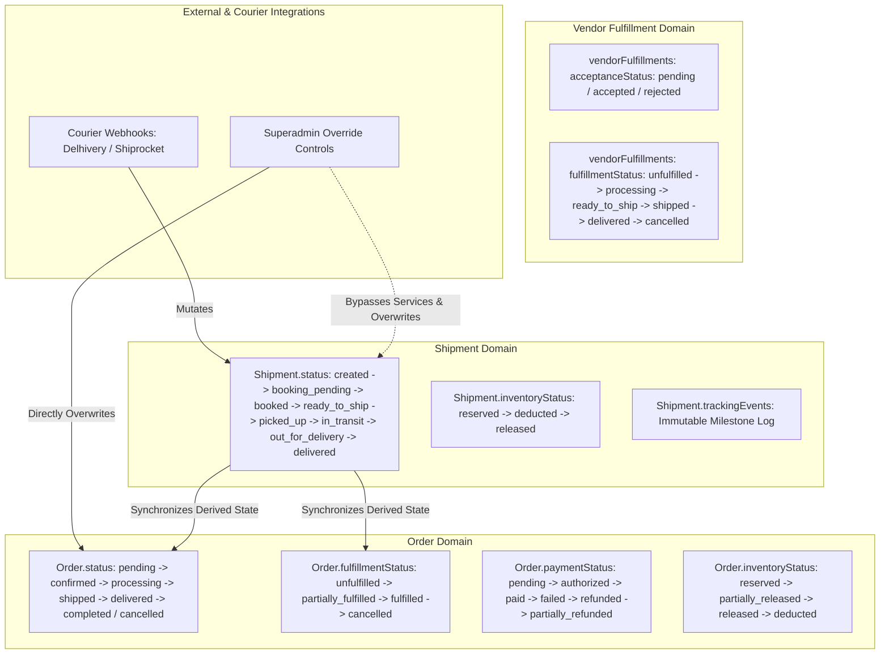

# BUYBOX E-COMMERCE — PHASE VD-07A
# ORDER & SHIPMENT STATE INTEGRITY FORENSIC AUDIT
## FORENSIC AUDIT REPORT & REMEDIATION PLAN

**Target:** Buybox-Ecommerce Marketplace  
**Execution Environment:** Antigravity IDE (Windows / Node.js / MongoDB / Next.js)  
**Audit Scope:** Customer Storefront, Vendor Dashboard, Admin/Superadmin Dashboard, Order Services, Fulfillment Services, Shipment Services, Courier Integrations, Inventory, Payments, Refunds, Notifications, and Audit Logs.  
**Mode:** STRICT READ-ONLY AUDIT — Application Source Code Preserved

---

## 1. EXECUTIVE SUMMARY & ARCHITECTURAL OVERVIEW

A comprehensive, read-only forensic audit of the Buybox-Ecommerce order and shipment state-management architecture was conducted to evaluate state integrity, race conditions, webhook handling, administrative overrides, and concurrency protections across all customer, vendor, admin, and background surfaces.

### Core Architecture Findings Summary
1. **In-Memory Concurrency Check Fallacy (P0)**: While `Shipment.version` exists in the schema and `order.fulfillmentVersion` is checked in `order-fulfillment.service.js`, these checks are performed purely in application memory. The underlying database mutations execute via blind `findByIdAndUpdate` or `order.save()` (with `versionKey: false`), lacking atomic version constraints in MongoDB query filters. Consequently, concurrent writes (e.g. courier webhooks racing against administrative changes) silently overwrite each other based on whichever database operation completes last.
2. **Destructive Administrative Overwrite of Courier Evidence (P0)**: In `backend/src/services/order.service.js` (`updateAdminOrderStatus`), transitioning an order to `shipped` or `delivered` triggers a blind `Shipment.updateMany({ orderId }, ...)` directly in MongoDB. This completely bypasses `shipment.service.js`, ignores state machine rules, erases authentic courier evidence, ignores multi-vendor packages, and forcibly sets even cancelled or failed shipments to `delivered`.
3. **Webhook Dropping Subsequent Milestones (P1)**: In `backend/src/services/courier.service.js` (`handleWebhook`), the fallback event identifier uses `eventId = String(parsedBody.event_id || parsedBody.awb || parsedBody.waybill || ...)`. When a courier (such as Delhivery or Shiprocket) delivers multiple status updates for the same waybill without a unique `event_id`, only the first webhook succeeds. All subsequent milestones (`out_for_delivery`, `delivered`, `rto_initiated`) collide with the unique index on `(provider, eventId)` and are discarded as duplicates.
4. **Financial Invariant Violation on Shipment Cancellation (P1)**: When all shipments for an order are cancelled via `shipmentService.cancelShipment` or carrier webhooks, `synchronizeOrderForShipmentStatus` transitions the parent order to `cancelled`. However, it never triggers payment reconciliation or customer refunds, stranding captured customer funds without financial settlement.
5. **Vendor Delivery Self-Certification Loophole (P1)**: In `backend/src/validators/shipping/update-shipment-status.validator.js`, the schema shared by both admins and vendors permits status `delivered`. An authorized vendor calling `PATCH /api/v1/shipments/vendor/:shipmentId/status` can transition their own shipment to `delivered` without courier confirmation, triggering parent order delivery and subsequent automated vendor financial payouts.

---

## 2. STATE OWNERSHIP & DOMAIN BOUNDARIES

The repository defines five distinct state domains, but lacks strict database-level separation of authority:



### Authoritative Domain Mapping

| State Domain | Primary Model | Authoritative Service | Derived / Dependent Fields | Invariant Rules |
|---|---|---|---|---|
| **Order Lifecycle** | `Order` | `order.service.js` | `Order.status`, `placedAt`, `deliveredAt`, `cancelledAt` | Forward progression: `pending -> confirmed -> processing -> shipped -> delivered -> completed`. Terminal: `cancelled`, `completed`. |
| **Vendor Fulfillment** | `Order.vendorFulfillments` | `order-fulfillment.service.js` | `items[].fulfillmentStatus`, `assignedShipmentPartner`, `expectedDeliveryDate` | Central Confirmation Guard: Requires acceptance, partner, delivery date, paid/COD before confirmation. |
| **Shipment Lifecycle** | `Shipment` | `shipment.service.js`, `courier.service.js` | `Shipment.status`, `awbNumber`, `trackingEvents`, `bookingDetails` | 19 canonical states. Must preserve authentic carrier evidence and immutable milestone history. |
| **Payment & Refund** | `Order`, `Payment` | `payment.service.js`, `payment-verification.service.js` | `Order.paymentStatus`, `amountPaid`, `amountRefunded` | Gateway refunds occur outside transactions. Courier events must NEVER mark payment paid or refund completed. |
| **Inventory State** | `Order.items`, `Shipment`, `Inventory` | `inventory.service.js` | `inventoryStatus`, `inventoryReleasedAt` | Reserved at checkout -> Deducted at pickup -> Released upon pre-pickup cancellation. No double deductions or leakage. |

---

## 3. COMPLETE STATUS MUTATION INVENTORY

A forensic scan of the codebase identified **226 state mutation references**. The table below catalogs all state-changing entry points across the backend:

| File & Line | Enclosing Method | Target Field | Authorized Actor / Role | Mutation Performed | Concurrency Protection Mechanism |
|---|---|---|---|---|---|
| `order.service.js:1279` | `createOrder` | `Order.status` | Customer / Guest | Sets initial `pending` | Idempotency key on `(customerId, idempotencyKey)` |
| `order.service.js:2837` | `transitionOrderStatus` | `Order.status` | System / Internal Service | Updates to `nextStatus` | In-memory `canTransitionOrderStatus`; **No version check in DB** |
| `order.service.js:2416` | `cancelOrder` | `Shipment.status` | Customer / Admin | Updates active shipments to `cancelled` | `shipmentRepository.updateById` (**No version check; missing tracking events**) |
| `order.service.js:2658` | `cancelOrder` | `Order.status` | Customer / Admin | Updates to `cancelled` | `transitionStatusIfCurrent({ status: expectedStatus })` (Atomic) |
| `order.service.js:3030` | `markOrderPaymentCaptured` | `Order.paymentStatus`, `Order.status` | Webhook / Payment Service | Sets `paid` and `confirmed` | In-memory idempotency check (`order.paymentStatus === 'paid'`) |
| `order.service.js:4259` | `updateAdminOrderStatus` | `Shipment.status` | Admin / Superadmin | Sets `in_transit` or `delivered` | **None: Blind `Shipment.updateMany` bypassing all checks** |
| `order.service.js:4280` | `updateAdminOrderStatus` | `Order.status` | Admin / Superadmin | Updates to target status | In-memory `expectedPreviousStatus`; **No atomic version check** |
| `order-fulfillment.service.js:307` | `acceptVendorOrderItems` | `vendorFulfillments.$.acceptanceStatus` | Authenticated Vendor (`ORDERS_MANAGE_OWN`) | Sets `accepted` | In-memory `fulfillmentVersion`; blind `order.save()` |
| `order-fulfillment.service.js:457` | `rejectVendorOrderItems` | `vendorFulfillments.$.acceptanceStatus` | Authenticated Vendor (`ORDERS_MANAGE_OWN`) | Sets `rejected` | In-memory `fulfillmentVersion`; blind `order.save()` |
| `order-fulfillment.service.js:746` | `confirmVendorFulfillment` | `vendorFulfillments.$.isFulfillmentConfirmed` | Authenticated Vendor (`ORDERS_MANAGE_OWN`) | Sets `true` | In-memory Central Confirmation Guard; blind `order.save()` |
| `order-fulfillment.service.js:992` | `adminOverrideFulfillment` | `vendorFulfillments` | Admin / Superadmin (`ORDERS_MANAGE`) | Overrides partner / date | In-memory `fulfillmentVersion`; blind `order.save()` |
| `shipment.service.js:696` | `createShipment` | `Shipment.status` | Vendor / Admin | Sets `created` | Unique index on `idempotencyKey`; MongoDB transaction |
| `shipment.service.js:750` | `createShipment` | `Shipment.status` | Post-persistence hook | Sets `booked` or `booking_failed` | Document `shipment.save()` after commit |
| `shipment.service.js:1690` | `transitionShipmentStatus` | `Shipment.status` | Vendor / Admin / Webhook | Updates to `nextStatus` | In-memory `expectedPreviousStatus`; **No atomic version check** |
| `shipment.service.js:1766` | `synchronizeOrderForShipmentStatus` | `Order.status`, `Order.fulfillmentStatus` | Internal Service | Sets `shipped`, `delivered`, `partially_fulfilled` | In-memory shipment calculation; `orderRepository.updateById` |
| `shipment.service.js:2508` | `retryCarrierBooking` | `Shipment.status` | Vendor / Admin | Updates to `booked` or `booking_failed` | Document `shipment.save()` |
| `courier.service.js:322` | `handleWebhook` | `Shipment.status` | Public Courier Webhook | Calls `transitionShipmentStatus` | Non-atomic `ShipmentWebhookEvent.findOne`; **No version check** |
| `order-expiration.worker.js:65` | `expireOrder` | `Order.status` | Background Worker | Sets `cancelled` | `transitionStatusIfCurrent({ status: "pending" })` (Atomic) |

---

## 4. KNOWN TRANSITION RULES & DISCREPANCIES

### A. Order Status State Machine
- **Defined Graph (`order.constants.js`)**:
  - `pending` -> `["confirmed", "cancelled"]`
  - `confirmed` -> `["processing", "cancelled"]`
  - `processing` -> `["shipped", "cancelled"]`
  - `shipped` -> `["delivered"]`
  - `delivered` -> `["completed"]`
  - `completed` -> `[]` (Terminal)
  - `cancelled` -> `[]` (Terminal)
- **Discrepancy**: `updateAdminOrderStatus` permits Superadmin to bypass `canTransitionOrderStatus` when `isOverride: true`. While it blocks resurrecting cancelled orders into active states, it allows moving `shipped` or `delivered` backwards to `processing` or `confirmed` without compensating inventory or shipment mutations.

### B. Shipment Status State Machine
- **Defined Graph (`shipping.constants.js`)**: 19 statuses.
- **Discrepancy 1**: Transitions from `created` permit jumping directly to `picked_up` without AWB assignment, carrier booking, or manifest generation.
- **Discrepancy 2**: Transitions from `picked_up` permit `cancelled`. However, `transitionShipmentStatus` only releases inventory if `["created", "ready_to_ship"].includes(shipment.status)`. Cancelling a `picked_up` shipment sets document `inventoryStatus = "released"` without restoring warehouse inventory.
- **Discrepancy 3**: Superadmin override (`isOverride: true`) skips `canTransitionShipmentStatus` entirely, permitting an override from `delivered` to `created`.

---

## 5. OPTIMISTIC LOCKING & TRANSACTION PROTECTIONS AUDIT

### Detailed Code Evidence: The In-Memory Concurrency Fallacy

#### 1. Shipment Model & Service
In `backend/src/models/Shipment.js`:
```javascript
// Line 457
version: {
  type: Number,
  default: 1,
},
// Line 496
{ timestamps: true, versionKey: false }
```
In `backend/src/services/shipment.service.js`:
- Searching for `version` yields **0 occurrences**.
- In `transitionShipmentStatus`:
```javascript
// Lines 1541-1551
if (expectedPreviousStatus && shipment.status !== expectedPreviousStatus) {
  throw new AppError(
    `Shipment status has changed from ${expectedPreviousStatus} to ${shipment.status}. Please refresh the record.`,
    409,
    "CONCURRENCY_CONFLICT"
  );
}
// Lines 1752-1756
const updatedShipment = await shipmentRepository.updateById(
  shipment._id,
  update,
  { session }
);
```
- In `backend/src/repositories/shipment.repository.js`:
```javascript
const updateById = async (id, data, options = {}) => {
  return Shipment.findByIdAndUpdate(id, data, {
    new: true,
    runValidators: true,
    session: options.session,
  });
};
```
**Forensic Defect**: `findByIdAndUpdate(id, data)` only queries `{ _id: id }`. It does NOT include `{ status: expectedPreviousStatus }` or `{ version: expectedVersion }`. If Thread A and Thread B concurrently read status `ready_to_ship`:
- Thread A (Courier Webhook: `picked_up`) passes in-memory check.
- Thread B (Superadmin update: `cancelled`) passes in-memory check.
- Thread A commits `picked_up`.
- Thread B immediately overwrites Thread A with `cancelled`.
- Courier pickup evidence is destroyed.

#### 2. Order Fulfillment Concurrency
In `backend/src/services/order-fulfillment.service.js`:
```javascript
// Lines 250-256
const currentVersion = order.fulfillmentVersion || 1;
if (expectedVersion && expectedVersion !== currentVersion) {
  throw new AppError(
    `Order fulfillment conflict: expected version ${expectedVersion} but current is ${currentVersion}. Please refresh.`,
    409,
    "CONCURRENT_MODIFICATION"
  );
}
// Line 307
order.fulfillmentVersion = (order.fulfillmentVersion || 1) + 1;
// Line 325
const updatedOrder = await order.save();
```
**Forensic Defect**: Because `versionKey: false` is configured on `Order.js`, Mongoose's `order.save()` translates to `updateOne({ _id: order._id }, { $set: ... })`. The expected `fulfillmentVersion` is NOT part of the database query. Two concurrent vendor actions will both read version 1 and sequentially execute `$set: { fulfillmentVersion: 2 }`, silently overwriting one another.

---

## 6. WEBHOOK AUTHENTICATION & IDEMPOTENCY AUDIT

### Cryptographic Verification
- Webhook signature verification in `backend/src/integrations/shipping/delhivery.adapter.js` and `shiprocket.adapter.js` correctly verifies HMAC-SHA256 signatures using `req.rawBody` (Buffer).

### Critical Idempotency Defect: Event Dropping
In `backend/src/services/courier.service.js`:
```javascript
// Lines 153-156
const eventId = String(
  parsedBody.event_id ||
  parsedBody.awb ||
  parsedBody.waybill ||
  parsedBody.id ||
  headers["x-request-id"] ||
  Date.now()
);
// Lines 163-172
const existingEvent = await ShipmentWebhookEvent.findOne({ provider, eventId });
if (existingEvent) {
  return {
    success: true,
    duplicate: true,
    message: "Webhook event already processed",
    eventId,
  };
}
```
In `backend/src/models/ShipmentWebhookEvent.js`:
```javascript
shipmentWebhookEventSchema.index({ provider: 1, eventId: 1 }, { unique: true });
```
**Forensic Defect**:
1. When couriers send status webhooks without a discrete `event_id` (common in Delhivery tracking pushes), `parsedBody.awb` or `parsedBody.waybill` is assigned as `eventId`.
2. Event 1 arrives: AWB `DLH1001`, Status `picked_up`. `eventId` is set to `"DLH1001"`. The event is processed and saved in `ShipmentWebhookEvent`.
3. Event 2 arrives: AWB `DLH1001`, Status `in_transit`. `eventId` is set to `"DLH1001"`.
4. `ShipmentWebhookEvent.findOne({ provider: "delhivery", eventId: "DLH1001" })` returns the existing record!
5. **The webhook handler returns `"Webhook event already processed"` and silences Event 2, Event 3 (`out_for_delivery`), and Event 4 (`delivered`)!**
6. Shipments become permanently stuck in their initial tracked status.

### Non-Atomic Webhook Processing Race Condition
In `backend/src/services/courier.service.js`:
- Line 164 checks `findOne`.
- Line 322 executes `shipmentService.transitionShipmentStatus`.
- Line 334 inserts into `ShipmentWebhookEvent`.
If duplicate webhooks arrive concurrently within 50ms, both pass the `findOne` check at line 164, both execute status transitions and notifications, and only the second one catches a duplicate key error at line 343. Side effects are executed twice.

---

## 7. ADMINISTRATIVE OVERRIDE BEHAVIOR AUDIT

### Destructive Blind Overwrites in Order Service
In `backend/src/services/order.service.js` (`updateAdminOrderStatus`):
```javascript
// Lines 4251-4263
} else if (status === "shipped") {
  order.fulfillmentStatus = "fulfilled";
  for (const item of order.items || []) {
    if (item.fulfillmentStatus !== "cancelled") {
      item.fulfillmentStatus = "shipped";
    }
  }
  const Shipment = require("../models/Shipment");
  await Shipment.updateMany(
    { orderId: order._id, status: { $ne: "delivered" } },
    { $set: { status: "in_transit", shippedAt: new Date() } }
  );
// Lines 4264-4275
} else if (status === "delivered") {
  order.deliveredAt = new Date();
  order.fulfillmentStatus = "fulfilled";
  for (const item of order.items || []) {
    if (item.fulfillmentStatus !== "cancelled") {
      item.fulfillmentStatus = "delivered";
    }
  }
  const Shipment = require("../models/Shipment");
  await Shipment.updateMany(
    { orderId: order._id },
    { $set: { status: "delivered", deliveredAt: new Date() } }
  );
}
```
**Forensic Violations**:
1. **Destroys Courier Evidence**: Direct `Shipment.updateMany` overwrites local shipments without appending to `trackingEvents`, recording carrier attribution, or logging actor context.
2. **Violates Multi-Vendor Package Isolation**: In a multi-vendor order where Vendor A's package has been shipped and Vendor B's package was cancelled, changing order status to `delivered` marks Vendor B's cancelled shipment as `delivered`.
3. **Bypasses State Validation**: It circumvents `canTransitionShipmentStatus`, allowing shipments in `created` or `booking_failed` to bypass booking, label generation, and dispatch.

---

## 8. ORDER & SHIPMENT SYNCHRONIZATION AUDIT

### Synchronization Gaps in `synchronizeOrderForShipmentStatus`
1. **Unrefunded Cancellation**:
   - If all shipments for an order are cancelled, lines 1248-1268 transition the order to `cancelled`.
   - However, `orderService.transitionOrderStatus` only updates `order.status = "cancelled"` and `cancellationStatus = "completed"`.
   - It **does not** call `paymentService.refundPaymentForOrder`.
   - Captured customer funds remain unrefunded.
2. **Missing Returns & RTO Synchronization**:
   - Lines 1329-1333:
     ```javascript
     if (shipmentStatus === "returned") {
       return order;
     }
     ```
   - Return-to-origin events (`rto_delivered`, `returned`) do not update item fulfillment status, do not notify the merchant, and leave the parent order in `shipped` or `delivered`.

---

## 9. TENANT ISOLATION & VENDOR SELF-SERVICE VULNERABILITY

### Vendor Self-Certification of Delivery
In `backend/src/validators/shipping/update-shipment-status.validator.js`:
```javascript
const updateShipmentStatusSchema = z.object({
  status: z.enum([
    "created",
    "ready_to_ship",
    "picked_up",
    "in_transit",
    "out_for_delivery",
    "delivered",
    "failed",
    "cancelled",
    "returned",
  ]),
  // ...
}).strict();
```
In `backend/src/routes/shipment.routes.js`:
```javascript
router.patch(
  "/vendor/:shipmentId/status",
  authenticateVendor,
  requirePermissions(PERMISSIONS.SHIPMENTS_MANAGE_OWN),
  validate(updateShipmentStatusSchema),
  shipmentController.transitionVendorShipmentStatus
);
```
**Vulnerability**:
A vendor possesses `SHIPMENTS_MANAGE_OWN`. The endpoint accepts `status: "delivered"`. If a vendor calls this endpoint with `delivered`, `shipmentService.transitionShipmentStatus` checks `canTransitionShipmentStatus` and allows the forward transition. Once marked delivered, `synchronizeOrderForShipmentStatus` marks the parent order delivered, and the background settlement job disburses payout funds to the vendor without courier verification.

---

## 10. RANKED FINDINGS MATRIX

| ID | Priority | Domain | Finding Description | Architectural Risk |
|---|---|---|---|---|
| **F-01** | **P0** | Concurrency | In-memory version checking without atomic database conditional filters | Concurrent requests silently overwrite newer order and shipment states. |
| **F-02** | **P0** | Audit / Couriers | `updateAdminOrderStatus` executes blind `Shipment.updateMany` | Destroys courier evidence, overrides cancelled shipments, bypasses state machine. |
| **F-03** | **P1** | Webhooks | Fallback `eventId = awb` in webhook handler drops subsequent milestones | Shipments fail to receive `out_for_delivery` and `delivered` updates. |
| **F-04** | **P1** | Finance | Shipment cancellation cancels parent order without issuing refunds | Customer funds stranded; financial invariants violated. |
| **F-05** | **P1** | Authorization | Vendors can transition their own shipments to `delivered` via API | Risk of merchant payout fraud without courier delivery verification. |
| **F-06** | **P2** | Inventory | Overriding post-pickup shipments to cancelled leaks physical stock | Document marked released, but stock never returned to inventory ledger. |
| **F-07** | **P2** | Notifications | Courier webhook delivery triggers duplicate customer emails | Customer receives duplicate emails from courier service and order service. |
| **F-08** | **P2** | Synchronization| No-op order synchronization for `returned` and `rto_delivered` | Parent orders remain in stale fulfillment status after parcels return to origin. |
| **F-09** | **P3** | Webhooks | Webhook deduplication check is not atomic | Concurrent duplicate webhooks execute status transitions twice before catching E11000. |
| **F-10** | **P3** | Operations | No automated polling worker for tracking status recovery | Shipments with missed webhooks remain in transit indefinitely. |

---

## 11. REMEDIATION PLAN (PHASE VD-07B)

### Remediation A: True Atomic Optimistic Concurrency Engine
1. **Schema Updates**:
   - Ensure `Order.version: { type: Number, default: 1 }` exists alongside `fulfillmentVersion`.
   - Ensure `Shipment.version: { type: Number, default: 1 }` is actively managed.
2. **Atomic Repository Writes**:
   - Implement `transitionShipmentStatusAtomic`:
     ```javascript
     const result = await Shipment.findOneAndUpdate(
       {
         _id: shipmentId,
         status: expectedStatus,
         version: expectedVersion,
       },
       {
         $set: updateData,
         $inc: { version: 1 },
       },
       { new: true, session }
     );
     if (!result) throw new AppError("Concurrent modification conflict", 409, "STATE_VERSION_CONFLICT");
     ```
   - Implement equivalent atomic conditional update for `Order.status`.

### Remediation B: Eliminate Blind `Shipment.updateMany`
1. Refactor `updateAdminOrderStatus` in `backend/src/services/order.service.js`:
   - Remove `Shipment.updateMany(...)`.
   - When order status changes, retrieve all associated shipments.
   - For each shipment, route the status update through `shipmentService.transitionShipmentStatus` with `actorUser` attribution and milestone logging.
   - Prohibit updating terminal shipments (`cancelled`, `returned`).

### Remediation C: Fix Webhook Event Deduplication
1. In `backend/src/services/courier.service.js`:
   - Compute compound deterministic event key:
     ```javascript
     const stableEventId = parsedBody.event_id ||
       parsedBody.id ||
       `${trackingNumber}_${rawStatus}_${parsedBody.activity_date || parsedBody.timestamp || Date.now()}`;
     ```
   - Atomically reserve the event in `ShipmentWebhookEvent` before applying status transitions.

### Remediation D: Restrict Vendor Status Mutations
1. Split `updateShipmentStatusSchema` into `adminUpdateShipmentStatusSchema` and `vendorUpdateShipmentStatusSchema`.
2. Restrict vendors to operational readiness statuses:
   - Allowed vendor statuses: `["ready_to_ship", "cancelled"]` (or `picked_up` exclusively for manual merchant fleet).
   - Strictly prohibit vendors from self-transitioning to `in_transit`, `out_for_delivery`, or `delivered`.

### Remediation E: Financial Refund Trigger on Shipment Cancellation
1. In `synchronizeOrderForShipmentStatus`, if all shipments are cancelled and the order transitions to `cancelled`:
   - Trigger `orderService.cancelOrder` (or invoke `paymentService.refundPaymentForOrder`) to ensure captured funds are refunded and recorded in the audit ledger.

### Remediation F: Handle Returns and RTO Order Synchronization
1. Update `synchronizeOrderForShipmentStatus` for `rto_delivered` and `returned`:
   - Update order item fulfillment status to `returned`.
   - Update order `fulfillmentStatus = "cancelled"` (or `returned`).
   - Append milestone event to order timeline.

### Remediation G: Webhook Notification Deduplication
1. Add notification idempotency guard: only emit customer emails from `courier.service.js` if not already handled by `order.service.js`, or centralize customer notifications strictly inside the transition service.

---

## 12. AFFECTED FILES & ROLLBACK STRATEGY

### Affected Files in Phase VD-07B
- `backend/src/constants/shipping.constants.js`
- `backend/src/constants/order.constants.js`
- `backend/src/models/Order.js`
- `backend/src/models/Shipment.js`
- `backend/src/models/ShipmentWebhookEvent.js`
- `backend/src/repositories/order.repository.js`
- `backend/src/repositories/shipment.repository.js`
- `backend/src/services/order.service.js`
- `backend/src/services/shipment.service.js`
- `backend/src/services/courier.service.js`
- `backend/src/services/order-fulfillment.service.js`
- `backend/src/validators/shipping/update-shipment-status.validator.js`
- `frontend/src/components/admin/orders/AdminOrderStatusControl.jsx`
- `frontend/src/components/admin/orders/AdminShipmentStatusModal.jsx`

### Rollback Strategy
- All schema additions (`version`, compound index on `ShipmentWebhookEvent`) are strictly additive and backward-compatible.
- Existing historical orders and shipments without version numbers will default to `version: 1`.
- If an atomic transition fails due to a version conflict, the client receives HTTP 409 and reloads the fresh record without data corruption.

---

## 13. AUDIT CONCLUSION

Phase VD-07A forensic audit is complete. Application files remain unmodified. The findings and implementation plan provide the precise blueprint for Phase VD-07B (Controlled Implementation).

