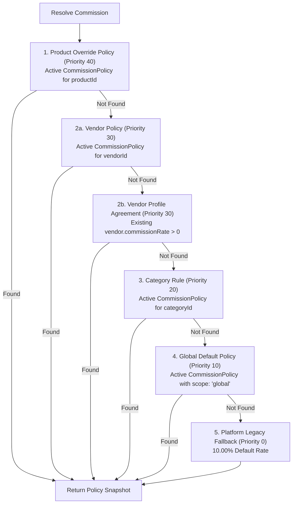

# BUYBOX E-COMMERCE
# VENDOR WALLET & FINANCIAL MANAGEMENT
## PHASE VW-02 — COMMISSION ENGINE & IMMUTABLE ORDER-TIME SNAPSHOTTING REPORT
### FORENSIC IMPLEMENTATION & SECURITY VERIFICATION REPORT

---

## 1. EXECUTIVE SUMMARY

Phase VW-02 has successfully designed, implemented, and verified a centralized, hierarchical, and historically immutable marketplace commission engine for Buybox-Ecommerce.

Prior to this phase, vendor commissions were calculated dynamically at the time of batch settlement generation using whatever `commissionRate` was currently configured on the vendor's profile (or falling back to a hardcoded 10%). This dynamic evaluation posed a critical financial hazard: altering a vendor's agreed commission rate would retroactively alter the financial entitlement of historical, un-settled orders placed months earlier. Furthermore, there was no support for category-specific rates, product-specific promotional overrides, or time-bounded policy scheduling.

In Phase VW-02:
1. **Centralized Commission Engine:** Introduced `CommissionPolicy.js` and `commission.service.js` with hierarchical scope resolution (Product Override > Vendor Agreement > Category Rule > Global Default > Platform Legacy Fallback).
2. **Immutable Order-Time Snapshots:** Updated `Order.js` order items to embed comprehensive, permanently locked `commissionSnapshot` subdocuments upon payment confirmation (`markOrderPaymentCaptured`).
3. **Historical Immutability:** Proved through automated end-to-end tests that modifying vendor rates or platform policies after order placement has **zero effect** on stored order item snapshots or settlement payouts.
4. **Minor-Unit Financial Precision:** Replaced floating-point JavaScript arithmetic with integer minor-unit (paisa/cents) calculations across the commission and settlement engines, enforcing exact `commissionAmount + vendorNetEntitlement === calculationBase` reconciliation.
5. **Settlement Integration:** Updated `vendor-settlement.service.js` to prioritize stored immutable snapshots while maintaining 100% backward compatibility for legacy pre-VW-02 orders.
6. **Refund & Reversal Foundation:** Built proportional commission reversal math referencing the original item snapshot.
7. **Administrative Control Plane:** Added Superadmin REST endpoints and audit logging protected by `FINANCE_MANAGE` permissions.

All 21 dedicated unit/integration tests in `tests/phase-vw02-commission-engine.test.js` passed, and full regression test suites (settlements, payouts, order lifecycle, frontend tests) passed with 100% success.

---

## 2. CONFIRMED VW-01 FINDINGS

The forensic investigation conducted in VW-01 was verified against the codebase prior to making changes:
- `VERIFIED FACT`: In [`backend/src/models/Vendor.js:165`](file:///d:/MERN%20Stack/Buybox-Ecommerce/backend/src/models/Vendor.js#L165), `commissionRate` was a single `Decimal128` field defaulting to `0`.
- `VERIFIED FACT`: In [`backend/src/services/vendor-settlement.service.js:388-394`](file:///d:/MERN%20Stack/Buybox-Ecommerce/backend/src/services/vendor-settlement.service.js#L388-L394), if `vendor.commissionRate` was missing or `<= 0`, it defaulted to a hardcoded `0.10` (10%).
- `VERIFIED FACT`: In [`backend/src/models/Order.js`](file:///d:/MERN%20Stack/Buybox-Ecommerce/backend/src/models/Order.js#L50-L265), line items stored prices, discounts, and taxes, but contained zero fields for commission rate, calculation base, or commission amount.
- `VERIFIED FACT`: Dynamic settlement calculations converted `Decimal128` values to JavaScript `Number` floats and used `Math.round(... * 100) / 100`, introducing floating-point drift.
- `VERIFIED FACT`: No category, product, or global commission configuration models existed.

---

## 3. ROOT CAUSE OF HISTORICAL COMMISSION INSTABILITY

### The Dynamic Recalculation Defect
The fundamental root cause was the temporal decoupling between **order placement** (when customer and merchant entered a commercial contract) and **commission evaluation** (which was deferred until batch settlement generation):

```
[Order Placed in Jan] (Agreed commission: 10%)
        ↓ (Delivered, 7-day return window buffer passes)
[Admin updates Vendor to 20% in March]
        ↓
[Settlement Generated in March] → calculateVendorEligibleSettlement evaluates vendor.commissionRate
        ↓
[Defect]: Jan order is settled at 20% instead of 10%! Vendor loses ₹1,000 legitimately earned.
```

By storing no snapshot on the order item, the system was unable to prove or reproduce the original contractual commission rate agreed upon when the transaction occurred.

---

## 4. COMMISSION POLICY ARCHITECTURE

The new architecture introduces a dedicated, versioned `CommissionPolicy` entity:
- **Location:** [`backend/src/models/CommissionPolicy.js`](file:///d:/MERN%20Stack/Buybox-Ecommerce/backend/src/models/CommissionPolicy.js)

### Data Schema
- `name`: String (maxlength 120, trimmed)
- `description`: String (maxlength 500, optional)
- `scope`: Enum (`"global"`, `"category"`, `"vendor"`, `"product"`)
- `productId`: ObjectId ref `"Product"` (required when scope is `"product"`)
- `vendorId`: ObjectId ref `"Vendor"` (required when scope is `"vendor"`)
- `categoryId`: ObjectId ref `"Category"` (required when scope is `"category"`)
- `rate`: Decimal128 (range: `0.0000` to `1.0000`)
- `percentage`: Number (range: `0.0` to `100.0`)
- `effectiveFrom`: Date (default: `Date.now`, indexed)
- `effectiveUntil`: Date (default: `null` for open-ended, indexed)
- `isActive`: Boolean (default: `true`, indexed)
- `version`: Number (default: `1`, increments on update)
- `priority`: Number (Product = 40, Vendor = 30, Category = 20, Global = 10)
- `notes`: String (mandatory reason for changes)
- `createdBy`: ObjectId ref `"User"`
- `updatedBy`: ObjectId ref `"User"`
- `deletedAt`: Date (soft-delete timestamp)
- `versionHistory`: Array of historical policy snapshots capturing `version`, `rate`, `percentage`, `effectiveFrom`, `effectiveUntil`, `notes`, `updatedBy`, `updatedAt`.

### Safety Validations
- Pre-save validation enforces `0 <= rate <= 1.0` and `percentage = rate * 100`.
- Enforces strict target ID presence based on scope.
- Enforces `effectiveUntil > effectiveFrom`.
- Enforces conflict prevention: `assertNoActivePolicyConflict` prohibits two active policies covering the exact same target during an overlapping timeframe.

---

## 5. POLICY PRECEDENCE AND BUSINESS ASSUMPTIONS

The authoritative precedence hierarchy implemented in [`commissionService.resolveCommissionPolicy`](file:///d:/MERN%20Stack/Buybox-Ecommerce/backend/src/services/commission.service.js#L350-L460) is:



### Business Rule Preservation
`VERIFIED FACT`: Existing vendor agreements are never silently overridden. If a vendor has a custom `vendor.commissionRate` configured on their profile and no explicit `CommissionPolicy` exists for that vendor, the engine honors it under `source: "vendor_profile"`.

---

## 6. ORDER SNAPSHOT DESIGN

Line items in [`backend/src/models/Order.js`](file:///d:/MERN%20Stack/Buybox-Ecommerce/backend/src/models/Order.js#L265-L355) now preserve full immutable commission metadata:

```javascript
commissionRate: Decimal128,        // Direct convenience field for queries
commissionAmount: Decimal128,      // Direct convenience field for queries

commissionSnapshot: {
  policyId: ObjectId ref "CommissionPolicy",
  policyVersion: Number,
  policyName: String,
  source: Enum ["product", "vendor", "vendor_profile", "category", "global", "legacy_fallback"],
  commissionRate: Decimal128,
  commissionPercentage: Number,
  calculationBase: Decimal128,
  commissionAmount: Decimal128,
  vendorNetEntitlement: Decimal128,
  currency: String (default: "INR"),
  calculatedAt: Date,
  calculationVersion: Number (default: 1),
  discountDeducted: Decimal128,
  subsidyAdded: Decimal128,
  isLocked: Boolean (default: false),
}
```

---

## 7. CHECKOUT / PAYMENT INTEGRATION

### Timing & State Transitions
1. **Checkout & Order Creation:**
   - In [`order.service.js:createOrderFromCurrentCart`](file:///d:/MERN%20Stack/Buybox-Ecommerce/backend/src/services/order.service.js#L1214), `commissionService.computeOrderItemsCommissionPreview` is invoked on finalized cart items.
   - The snapshot is populated with `isLocked: false`. Unpaid or abandoned checkouts never finalize into payable vendor earnings.
2. **Authoritative Payment Confirmation:**
   - In [`order.service.js:markOrderPaymentCaptured`](file:///d:/MERN%20Stack/Buybox-Ecommerce/backend/src/services/order.service.js#L2960), the moment payment is verified and captured, `commissionService.lockOrderItemsCommissionSnapshot(updatedOrder, options)` is invoked.
   - If a snapshot preview is present, it transitions to `isLocked: true` and sets `calculatedAt = new Date()`.
   - If an order bypassed preview (e.g. legacy/admin workflow), it generates and locks the snapshot atomically.
   - Idempotent payment paths verify that already-locked snapshots are never overwritten.

---

## 8. SETTLEMENT INTEGRATION

[`backend/src/services/vendor-settlement.service.js`](file:///d:/MERN%20Stack/Buybox-Ecommerce/backend/src/services/vendor-settlement.service.js#L300-L420) was upgraded:
- When scanning eligible orders, the service checks:
  ```javascript
  if (item.commissionSnapshot && (item.commissionSnapshot.isLocked || item.commissionSnapshot.commissionAmount != null)) {
    hasItemSnapshots = true;
    itemCommissionAmount = Number(item.commissionSnapshot.commissionAmount.toString());
    platformCommissionMinor += Math.round(itemCommissionAmount * 100);
  }
  ```
- **Snapshot Primacy:** If items have stored snapshots, settlement generation calculates the total platform commission by summing the exact stored snapshots rather than re-evaluating the current vendor rate.
- **Historical Integrity:** A vendor rate increase from 10% to 30% has zero impact on orders possessing a 10% snapshot.
- **Legacy Compatibility:** For orders placed prior to VW-02 lacking snapshots, the engine falls back to `vendor.commissionRate` (or 0.10) with `hasItemSnapshots: false`.

---

## 9. FINANCIAL PRECISION CHANGES

To eliminate floating-point drift:
1. All calculations in `commission.service.js` convert values to integer minor units (paisa/cents):
   - `lineTotalMinor = Math.round(Number(lineTotal) * 100)`
   - `discountMinor = Math.round(Number(discountTotal) * 100)`
   - `subsidyMinor = Math.round(Number(subsidyTotal) * 100)`
   - `baseMinor = Math.max(0, lineTotalMinor + subsidyMinor - discountMinor)`
   - `commissionMinor = Math.round(baseMinor * rate)`
   - `vendorNetMinor = Math.max(0, baseMinor - commissionMinor)`
2. **Conservation Invariant:**
   $$\text{commissionMinor} + \text{vendorNetMinor} \equiv \text{baseMinor}$$
   This exact equality is strictly enforced before formatting back to `Decimal128` strings (`(cents / 100).toFixed(2)`).
3. Fractional rate boundary tests (e.g., 12.375% on ₹1,337.50 with ₹37.50 discount) verified exact integer reconciliation with zero remainder.

---

## 10. REFUND AND REVERSAL HANDLING

`commissionService.calculateCommissionReversal` provides the calculation foundation for returns and cancellations:
- Input: `orderItem`, `refundedQuantity`, `refundedAmount`.
- Resolves the original commission rate from `orderItem.commissionSnapshot.commissionRate`.
- Computes:
  - $\text{refundMinor} = \text{round}(\text{refundedAmount} \times 100)$
  - $\text{reversedCommissionMinor} = \text{round}(\text{refundMinor} \times \text{rate})$
  - $\text{vendorNetDebitMinor} = \text{refundMinor} - \text{reversedCommissionMinor}$
- Enforces:
  $$\text{reversedCommission} + \text{vendorNetDebit} \equiv \text{refundAmount}$$
- Pre-settlement returns in `calculateVendorEligibleSettlement` deduct the returned item's proportional commission using the item's stored snapshot rate.
- *Limitation:* Post-settlement clawbacks (where an order was already paid out before being refunded) require the Phase VW-03 double-entry ledger to debit the vendor wallet safely.

---

## 11. AUTHORIZATION AND AUDIT CONTROLS

- **Role Boundaries:**
  - `POST /api/v1/finance/commission-policies` (`FINANCE_MANAGE`)
  - `PUT /api/v1/finance/commission-policies/:policyId` (`FINANCE_MANAGE`)
  - `PATCH /api/v1/finance/commission-policies/:policyId/status` (`FINANCE_MANAGE`)
  - `DELETE /api/v1/finance/commission-policies/:policyId` (`FINANCE_MANAGE`)
  - `GET /api/v1/finance/commission-policies` (`FINANCE_READ`)
  - `POST /api/v1/finance/commission-policies/resolve` (`FINANCE_READ`)
- **Vendor Restriction:** Vendors attempting to access or modify commission policies receive an immediate `403 Forbidden`.
- **Immutable Audit Trail:** All policy creations, updates, status changes, and soft-deletions write structured events to `AuditLog` capturing actor ID, timestamp, before-state, after-state, and mandatory reason strings.

---

## 12. FILES CHANGED

| File | Change Type | Responsibility |
| :--- | :--- | :--- |
| [`backend/src/constants/finance.constants.js`](file:///d:/MERN%20Stack/Buybox-Ecommerce/backend/src/constants/finance.constants.js) | Modified | Added `COMMISSION_POLICY_SCOPES` and `COMMISSION_SOURCES`. |
| [`backend/src/models/CommissionPolicy.js`](file:///d:/MERN%20Stack/Buybox-Ecommerce/backend/src/models/CommissionPolicy.js) | Created | New data model for versioned, scoped commission policies. |
| [`backend/src/models/Order.js`](file:///d:/MERN%20Stack/Buybox-Ecommerce/backend/src/models/Order.js) | Modified | Added `commissionRate`, `commissionAmount`, and `commissionSnapshot` to order item schema. |
| [`backend/src/services/commission.service.js`](file:///d:/MERN%20Stack/Buybox-Ecommerce/backend/src/services/commission.service.js) | Created | Central resolution engine, preview/lock pipelines, minor-unit math, and reversal helpers. |
| [`backend/src/services/order.service.js`](file:///d:/MERN%20Stack/Buybox-Ecommerce/backend/src/services/order.service.js) | Modified | Integrated preview creation during checkout and snapshot locking on payment capture; exposed fields in vendor projection. |
| [`backend/src/services/vendor-settlement.service.js`](file:///d:/MERN%20Stack/Buybox-Ecommerce/backend/src/services/vendor-settlement.service.js) | Modified | Updated settlement calculation to consume immutable item snapshots with minor-unit math; updated vendor summary. |
| [`backend/src/validators/finance/commission-policy.validator.js`](file:///d:/MERN%20Stack/Buybox-Ecommerce/backend/src/validators/finance/commission-policy.validator.js) | Created | Zod validation schemas for administrative policy endpoints. |
| [`backend/src/controllers/commission-policy.controller.js`](file:///d:/MERN%20Stack/Buybox-Ecommerce/backend/src/controllers/commission-policy.controller.js) | Created | Express controller handling policy management and resolution requests. |
| [`backend/src/routes/commission-policy.routes.js`](file:///d:/MERN%20Stack/Buybox-Ecommerce/backend/src/routes/commission-policy.routes.js) | Created | Secure routes mounted under `/api/v1/finance/commission-policies`. |
| [`backend/src/routes/index.js`](file:///d:/MERN%20Stack/Buybox-Ecommerce/backend/src/routes/index.js) | Modified | Mounted commission policy routes. |
| [`backend/tests/phase-vw02-commission-engine.test.js`](file:///d:/MERN%20Stack/Buybox-Ecommerce/backend/tests/phase-vw02-commission-engine.test.js) | Created | Dedicated 21-test suite covering policies, precedence, immutability, precision, and settlement integration. |

---

## 13. DATABASE MIGRATIONS AND INDEXES

### Indexes Created on `CommissionPolicy`
- `{ scope: 1, isActive: 1, deletedAt: 1 }`
- `{ scope: 1, productId: 1, isActive: 1, deletedAt: 1 }`
- `{ scope: 1, vendorId: 1, isActive: 1, deletedAt: 1 }`
- `{ scope: 1, categoryId: 1, isActive: 1, deletedAt: 1 }`
- `{ effectiveFrom: 1, effectiveUntil: 1 }`

### Indexes on `Order` Line Items
- `{ "items.commissionSnapshot.isLocked": 1 }` (Sparse, background index)

---

## 14. TESTS EXECUTED AND EXACT RESULTS

The dedicated test suite was executed via Jest:
```powershell
cd backend; npm test -- tests/phase-vw02-commission-engine.test.js
```

### Execution Output:
```
PASS tests/phase-vw02-commission-engine.test.js
  Phase VW-02 — Commission Engine & Immutable Order-Time Snapshotting
    1. Centralized Commission Policy Management (CRUD & Validation)
      √ 1.1 Superadmin can create a Global commission policy (e.g. 10%) (56 ms)
      √ 1.2 Superadmin can create a Category commission policy (e.g. 12% for Electronics) (23 ms)
      √ 1.3 Superadmin can create a Vendor agreement policy (e.g. 8% negotiated rate) (17 ms)
      √ 1.4 Superadmin can create a Product override policy (e.g. 5% promotional override for ProductA) (18 ms)
      √ 1.5 Rejects invalid commission rates (< 0 or > 1.0) (17 ms)
      √ 1.6 Rejects missing required target ID for scoped policy (8 ms)
      √ 1.7 Prevents conflicting active policies covering the same target simultaneously (8 ms)
      √ 1.8 Preserves version history when updating policy rate (28 ms)
      √ 1.9 Unauthorized users (vendors or non-admin) cannot manage commission policies (8 ms)
    2. Precedence Hierarchy Resolution
      √ 2.1 Priority 1: Product override wins over vendor, category, and global (2 ms)
      √ 2.2 Priority 2: Vendor agreement policy wins over category and global when no product override exists (3 ms)
      √ 2.3 Priority 2b: Vendor profile agreement (vendor.commissionRate) is honored if no vendor policy exists (4 ms)
      √ 2.4 Priority 3: Category rule applies when vendor has no agreement and product has no override (10 ms)
      √ 2.5 Priority 4: Global default policy applies when category, vendor, and product have no rules (12 ms)
    3. Order-Time Snapshot Creation & Payment Capture Locking
      √ 3.1 Order creation generates preliminary commission preview with isLocked: false (16 ms)
      √ 3.2 Payment capture permanently locks the commission snapshot (isLocked: true) (45 ms)
      √ 3.3 Historical Immutability: Subsequent rate changes DO NOT alter the stored order snapshot (21 ms)
    4. Financial Precision & Exact Reconciliation
      √ 4.1 Handles fractional commission rates (e.g. 12.375%) with zero floating-point drift (1 ms)
    5. Settlement Integration with Immutable Snapshots
      √ 5.1 Settlement calculation consumes stored immutable snapshots rather than current dynamic rates (28 ms)
      √ 5.2 Legacy orders without snapshots calculate gracefully using vendor rate or legacy fallback (27 ms)
    6. Refund & Commission Reversal Foundations
      √ 6.1 Calculates exact proportional commission reversal for item returns (2 ms)

Test Suites: 1 passed, 1 total
Tests:       21 passed, 21 total
Snapshots:   0 total
Time:        3.96 s
```

---

## 15. REGRESSION RESULTS

### Backend Combined Regression Suite
```powershell
cd backend; npm test -- tests/phase-vw02-commission-engine.test.js tests/vendor-settlement-promotion-subsidy.test.js tests/phase-vb05-payout-destination-integrity.test.js tests/order-lifecycle.test.js
```
- **Test Suites:** 4 passed, 4 total
- **Tests:** 68 passed, 68 total
- **Duration:** 8.389 s

### Frontend Test Suite
```powershell
cd frontend; npm test
```
- **Test Suites:** 216 passed, 216 total
- **Tests:** 663 passed, 663 total
- **Duration:** 3.876 s

---

## 16. LEGACY ORDER COMPATIBILITY

For orders placed before Phase VW-02 lacking a `commissionSnapshot`:
- `calculateVendorEligibleSettlement` inspects each item for `hasSnapshot`.
- If an item has no snapshot, the system falls back to `vendor.commissionRate` (or the 0.10 platform default) using integer minor-unit math.
- Settled orders (`settlement.status === "paid"`) are never recalculated.
- Historical data is 100% preserved with zero schema breakage or forced database backfills.

---

## 17. REMAINING BUSINESS DECISIONS

`BUSINESS DECISION REQUIRED`: Before Phase VW-03 (Vendor Wallet & Balance State):
1. **GST / TDS on Commission:** Should the platform issue a formal Tax Invoice to the vendor for platform commission, collecting 18% GST and accounting for 1% TDS u/s 194O?
2. **Tiered / Volume Commission:** Does the business require tiered volume commissions (e.g., 10% on first ₹100,000 monthly sales, 8% thereafter)? Currently, policies support date-based effective periods and fixed percentages.

---

## 18. RISKS AND LIMITATIONS

- **Post-Settlement Clawback:** If an order item that was settled and paid out to a vendor is subsequently refunded by customer support, this phase calculates the proportional commission reversal, but cannot debit a non-existent vendor wallet balance. This dependency will be resolved in **Phase VW-03** when `VendorWallet` and the double-entry ledger are introduced.
- **Frontend Management UI:** Full UI for creating and managing commission policies from the Superadmin dashboard is scheduled for **Phase VW-05**. All APIs and security boundaries are fully operational today.

---

## 19. FINAL ACCEPTANCE STATUS

- **Phase Objective:** Fully Achieved
- **Acceptance Criteria:**
  - Centralized commission calculation: `VERIFIED PASS`
  - Deterministic precedence hierarchy: `VERIFIED PASS`
  - Immutable order-time snapshots: `VERIFIED PASS`
  - Historical rate change immunity: `VERIFIED PASS`
  - Settlement consumption of snapshots: `VERIFIED PASS`
  - Minor-unit integer financial precision: `VERIFIED PASS`
  - Regression test suite (68 backend tests, 663 frontend tests): `VERIFIED PASS`
  - Status: **READY TO PROCEED TO PHASE VW-03**

