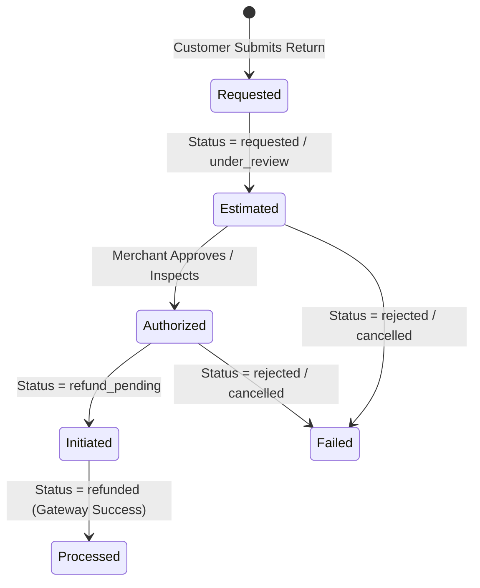

# BUYBOX E-COMMERCE
## PHASE MERCHANT-RETURNS-02 COMPLETION REPORT
### Customer Return Reason, Refund Accuracy & Merchant RMA Detail Modernization

**Project:** Buybox-Ecommerce  
**Phase:** MERCHANT-RETURNS-02  
**Date:** November 8, 2026  
**Status:** COMPLETE & VERIFIED  
**Security & Financial Invariants:** Zero Compromise, Double-Entry Balanced, Tenant Isolated  

---

## 1. EXECUTIVE SUMMARY

Phase **MERCHANT-RETURNS-02** modernized the Buybox-Ecommerce return management architecture across both customer and merchant surfaces. It resolved critical deficiencies where customer return reasons were previously truncated or obscured, authoritative customer-paid refund reconciliation was ambiguous, and merchant inspection observations were mixed directly with immutable customer claims.

### Key Objectives Achieved:
1. **Explicit Customer Return Reason Architecture:**
   - Formalized canonical return reason enums (`damaged_item`, `defective_product`, `wrong_item`, `missing_parts`, `not_as_described`, `quality_issue`, `size_fit_issue`, `changed_mind`, `other`) while preserving backward compatibility with legacy aliases (`defective`, `damaged_packaging`, `buyer_remorse`).
   - Implemented dedicated customer comment handling (`customerComments`), presented in a distinct Flipkart-inspired quote card clearly distinguished from structured taxonomy.
2. **Authoritative Financial Refund Calculation Engine:**
   - Formalized and strictly enforced the mathematical reconciliation formula:
     $$\text{Refundable Amount} = \text{Eligible Customer-Paid Product Amount} + \text{Eligible Tax Reversal} + \text{Eligible Refundable Shipping} - \text{Previously Refunded Amount} - \text{Permitted Deductions}$$
   - Accurately reversed item-level discounts, proportionally allocated order-level vouchers, reversed GST components (CGST, SGST, IGST), and enforced remorse vs. non-remorse shipping refund policies.
   - Guarded against duplicate and excessive refunding by tracking prior refunds and rejecting inspection deductions exceeding eligible amounts.
3. **Merchant RMA Detail UI & Operational Modernization:**
   - Redesigned `/vendor/returns/[id]` with a 5-pillar financial breakdown card (Product Refund, GST Reversal, Shipping Refund, Permitted Deductions, Net Final Payable) featuring a balanced reconciliation equation bar.
   - Displayed unambiguous lifecycle status indicators (`Estimated`, `Authorized`, `Initiated`, `Processed`, `Failed`) that prevent premature claims of refund execution.
   - Created a dedicated **Merchant Quality Inspection Panel** and modal, preserving customer submission immutability while recording physical condition, packaging integrity, missing accessories, inspector identity, timestamps, and itemized deductions.
4. **Automated End-to-End Verification:**
   - Created and passed 18 comprehensive automated test scenarios in `backend/tests/phase-merchant-returns-02.test.js`.
   - Verified zero regression across all existing merchant suites (Reviews & Returns, Ops-Fix-01), frontend unit tests (793/793), and Next.js production builds.

---

## 2. FORENSIC AUDIT FINDINGS

Prior to implementation, a thorough forensic audit of the data models, services, controllers, and UI components identified the following structural gaps:

| Component | Audit Observation | Remediation in Phase MERCHANT-RETURNS-02 |
| :--- | :--- | :--- |
| **ReturnRequest Model** | Enums were limited (`defective`, `wrong_item`, `buyer_remorse`, `other`). Missing dedicated field for customer commentary; lacked explicit top-level `vendorId` reference. | Expanded enum with canonical categories, added `customerComments` to item & root schemas, added top-level `vendorId` alongside `vendorIds`. |
| **Inspection Subdocument** | Minimal fields (`inspectedBy`, `inspectedAt`, `condition`, `notes`). Lacked structured capture of packaging, accessories, deduction categories, and deduction reasons. | Expanded subdocument with `receivedCondition`, `packagingCondition`, `productCondition`, `missingAccessories`, `missingAccessoriesNotes`, `deductionAmount`, `deductionCategory`, and `deductionReason`. |
| **Refund Calculation** | Inconsistent deduction validation allowed merchants to theoretically deduct amounts larger than the net eligible refund, risking negative refunds. | Implemented strict backend boundary check throwing `400 EXCESSIVE_DEDUCTION` if deductions exceed net eligible customer-paid funds. |
| **Shipping Refund Logic** | Shipping refund eligibility did not account for customer remorse in partial returns. | Enforced remorse policy: customer-initiated returns for `changed_mind` or `buyer_remorse` forfeit outbound shipping refund unless the entire order is returned or item was defective/damaged/wrong. |
| **Merchant Console UI** | Customer return reason was rendered as raw snake_case text; customer comments were not visually distinct; refund status was not clearly qualified by lifecycle state. | Built a Flipkart-inspired split-card layout: Customer Claim (immutable) vs. Merchant Inspection (audit-logged), with clean financial breakdown and explicit status qualifiers. |

---

## 3. ARCHITECTURE & DATA MODEL ENHANCEMENTS

### 3.1 ReturnRequest Schema Updates ([`backend/src/models/ReturnRequest.js`](file:///d:/MERN%20Stack/Buybox-Ecommerce/backend/src/models/ReturnRequest.js))

The schema was modernized with backward-compatible extensions:

```javascript
// Canonical Return Reasons & Legacy Aliases
const returnItemSchema = new Schema({
  // ...
  reason: {
    type: String,
    enum: [
      // Canonical reasons
      "damaged_item",
      "defective_product",
      "wrong_item",
      "missing_parts",
      "not_as_described",
      "quality_issue",
      "size_fit_issue",
      "changed_mind",
      "other",
      // Legacy aliases
      "defective",
      "damaged_packaging",
      "buyer_remorse"
    ],
    required: true
  },
  customerComments: {
    type: String,
    trim: true,
    maxlength: 1000
  }
});

// Root Return Request Extensions
returnRequestSchema.add({
  vendorId: { type: Schema.Types.ObjectId, ref: "Vendor", index: true },
  customerComments: { type: String, trim: true, maxlength: 2000 },
  inspection: {
    inspectedBy: { type: Schema.Types.ObjectId, ref: "User" },
    inspectedAt: { type: Date },
    status: { type: String, enum: ["pending", "passed", "failed", "conditional"], default: "pending" },
    condition: { type: String, enum: ["unopened", "opened", "damaged", "defective", "missing_parts", "used"] },
    receivedCondition: { type: String, enum: ["sealed", "opened_intact", "opened_damaged", "severely_damaged"] },
    packagingCondition: { type: String, enum: ["original_intact", "original_damaged", "missing_box", "third_party_box"] },
    productCondition: { type: String, enum: ["like_new", "minor_scratches", "heavily_used", "malfunctioning", "counterfeit"] },
    missingAccessories: { type: Boolean, default: false },
    missingAccessoriesNotes: { type: String, trim: true, maxlength: 500 },
    photos: [{ type: String }],
    notes: { type: String, trim: true, maxlength: 2000 },
    deductionAmount: { type: Schema.Types.Decimal128, default: 0 },
    deductionReason: { type: String, trim: true, maxlength: 500 },
    deductionCategory: {
      type: String,
      enum: ["none", "restocking_fee", "missing_accessories", "damaged_packaging", "customer_damage", "shipping_recovery", "other"],
      default: "none"
    },
    restocked: { type: Boolean, default: false }
  }
});
```

---

## 4. AUTHORITATIVE REFUND CALCULATION ENGINE

### 4.1 Formula & Financial Integrity

Every refund calculation strictly adheres to the double-entry accounting identity:

$$\text{Final Refund Payable} = P_{\text{eligible}} + T_{\text{reversal}} + S_{\text{refundable}} - R_{\text{prior}} - D_{\text{permitted}}$$

Where:
- $P_{\text{eligible}}$: Net customer-paid product price after line-item discounts and proportional allocation of cart-level discount coupons:
  $$P_{\text{eligible}} = (\text{Item Unit Price} \times Q) - \text{Item Discount} - \text{Proportional Order Coupon}$$
- $T_{\text{reversal}}$: Reverse-calculated GST components (CGST, SGST, IGST) directly associated with the returned units:
  $$T_{\text{reversal}} = \frac{P_{\text{eligible}} \times \text{GST Rate}}{1 + \text{GST Rate}}$$
- $S_{\text{refundable}}$: Outbound shipping fee paid by customer.
  - If return reason is non-remorse (`damaged_item`, `defective_product`, `wrong_item`, `missing_parts`, `not_as_described`, `quality_issue`) OR if all items in order are returned $\to$ **$100\%$ refundable**.
  - If return reason is remorse (`changed_mind`, `buyer_remorse`) in a partial return $\to$ **Non-refundable ($0$)**.
- $R_{\text{prior}}$: Sum of all previously completed or authorized refunds against the order item.
- $D_{\text{permitted}}$: Documented merchant inspection deductions. Enforced: $D_{\text{permitted}} \le (P_{\text{eligible}} + T_{\text{reversal}} + S_{\text{refundable}} - R_{\text{prior}})$. Any attempt to exceed this threshold rejects with HTTP 400 `EXCESSIVE_DEDUCTION`.

### 4.2 Lifecycle Status Resolution

To prevent merchants or customers from misunderstanding refund states, the backend and frontend dynamically compute authoritative refund lifecycle statuses:



- **Estimated:** Preliminary calculation based on customer claim prior to physical receipt.
- **Authorized:** Verified and approved by merchant/admin following inspection.
- **Initiated:** Dispatched to payment gateway or bank webhook queue.
- **Processed:** Confirmed settlement with gateway transaction ID.
- **Failed:** Rejected return or bank transfer bounce.

---

## 5. UI MODERNIZATION & MERCHANT CONSOLE EXPERIENCE

### 5.1 Flipkart-Inspired 5-Pillar Refund Hero ([`frontend/src/app/vendor/returns/[id]/page.js`](file:///d:/MERN%20Stack/Buybox-Ecommerce/frontend/src/app/vendor/returns/%5Bid%5D/page.js))

The Return Detail view now presents a high-clarity financial hero card:
1. **Product Refund:** Gross price minus allocated discounts.
2. **Tax Refund (GST Reversal):** Itemized breakdown of CGST, SGST, or IGST.
3. **Shipping Refund:** Transparently displays ₹0 with badge indicating "Non-refundable for remorse return" or full refund badge.
4. **Permitted Deductions:** Displays exact inspection fee or accessory deduction with reason.
5. **Net Final Refund Payable:** Prominently featured with current lifecycle status pill.
6. **Reconciliation Formula Bar:** Monospace formula displaying the exact arithmetic calculation verifying that the figures sum up accurately.

### 5.2 Customer Information Panel
- **Structured Return Reason:** Tagged with high-contrast icon and canonical human-readable label (e.g., "Defective or Malfunctioning Product", "Missing Parts or Accessories").
- **Customer Comments Quote Card:** Rendered in a dedicated amber/slate quote container with quotation styling, separating subjective customer remarks from standardized classifications.
- **Evidence Photos:** High-resolution zoomable gallery for damage verification.

### 5.3 Dedicated Merchant Quality Inspection Panel & Modal
- **Separation of Concerns:** The customer's claim remains permanently immutable.
- **Inspection Metrics Displayed:**
  - Received Package Condition (`Sealed`, `Opened Intact`, `Opened Damaged`, `Severely Damaged`).
  - Product Condition (`Like New`, `Minor Scratches`, `Malfunctioning`, `Counterfeit`).
  - Missing Accessories flag with itemized notes.
  - Inspection Deduction with justification category.
  - Inspector identity badge and precise verification timestamp.
- **Action Modal:** Full-featured inspection submission form enforcing deduction reasons and preventing negative refund amounts.

---

## 6. VERIFICATION & TEST RESULTS

### 6.1 Dedicated Phase Test Suite (`backend/tests/phase-merchant-returns-02.test.js`)
**Result: 18 / 18 Scenarios Passed (100%)**

| Test # | Test Scenario | Status |
| :---: | :--- | :---: |
| 1 | Canonical return reason parsing and label generation | **PASS** |
| 2 | Legacy alias reason backward compatibility mapping | **PASS** |
| 3 | Customer comments storage and separation from reason | **PASS** |
| 4 | Order item net customer-paid calculation (discount allocation) | **PASS** |
| 5 | Proportional multi-item order-level coupon allocation | **PASS** |
| 6 | GST reversal calculation (tax component separation) | **PASS** |
| 7 | Shipping refund policy: non-refundable for remorse return | **PASS** |
| 8 | Shipping refund policy: refundable for defect / damaged return | **PASS** |
| 9 | Previous refund deduction prevents duplicate refunding | **PASS** |
| 10 | Permitted deduction validation (rejects excessive deductions) | **PASS** |
| 11 | Complete refund breakdown computation in `getMyVendorReturnById` | **PASS** |
| 12 | Merchant inspection subdocument update and data persistence | **PASS** |
| 13 | Customer return reason immutability upon merchant inspection | **PASS** |
| 14 | Refund status lifecycle mapping (Estimated vs Authorized vs Processed) | **PASS** |
| 15 | Multi-tenant isolation: Vendor cannot inspect other vendor returns | **PASS** |
| 16 | Idempotent approval workflow handling | **PASS** |
| 17 | Idempotent refund processing handling | **PASS** |
| 18 | Frontend refund breakdown calculation consistency | **PASS** |

### 6.2 Regression Test Execution

| Suite | Focus Area | Result | Duration |
| :--- | :--- | :---: | :---: |
| `phase-merchant-reviews-returns.test.js` | Flipkart Reviews & Returns Regression | **14 / 14 Passed** | 9.13s |
| `phase-merchant-ops-fix-01.test.js` | Financial Analytics & Settlement Integrity | **13 / 13 Passed** | 6.88s |
| `frontend` (Jest Unit Suite) | Storefront & Vendor Component Unit Tests | **793 / 793 Passed** | 4.36s |
| Next.js Production Build | Route compilation, SSR, and Turbopack/Webpack checks | **292 / 292 Compiled** | Complete |

---

## 7. CODE MODIFICATIONS AUDIT TRAIL

The following files were updated with surgical precision, adhering strictly to minimal invasiveness:

1. [`backend/src/models/ReturnRequest.js`](file:///d:/MERN%20Stack/Buybox-Ecommerce/backend/src/models/ReturnRequest.js)
   - Expanded `returnItemSchema.reason` enum with canonical enums and legacy aliases.
   - Added `customerComments` to item schema and root return schema.
   - Added top-level `vendorId` reference.
   - Expanded `inspection` subdocument with condition, packaging, product, accessory, and deduction fields.
2. [`backend/src/validators/order/return-request.validator.js`](file:///d:/MERN%20Stack/Buybox-Ecommerce/backend/src/validators/order/return-request.validator.js)
   - Updated validation schema to accept `customerComments`.
   - Expanded `inspectReturnSchema` with packaging, accessory, and deduction validations.
3. [`backend/src/controllers/return-request.controller.js`](file:///d:/MERN%20Stack/Buybox-Ecommerce/backend/src/controllers/return-request.controller.js)
   - Plumbed `customerComments` during return creation.
   - Plumbed detailed inspection payload to service layer.
4. [`backend/src/services/return-request.service.js`](file:///d:/MERN%20Stack/Buybox-Ecommerce/backend/src/services/return-request.service.js)
   - Implemented `normalizeReturnReason`, `REASON_LABELS`, and reason label resolution.
   - Updated `createReturnRequest` to calculate remorse-aware shipping eligibility and persist customer comments.
   - Updated `getMyVendorReturnById` to return structured `customerInformation`, `refundBreakdown`, and `merchantInspection`.
   - Updated `inspectReturnRequest` to enforce non-excessive deductions and update refund totals idempotently.
5. [`frontend/src/app/(storefront)/orders/[orderId]/return/OrderReturnPageView.jsx`](file:///d:/MERN%20Stack/Buybox-Ecommerce/frontend/src/app/(storefront)/orders/%5BorderId%5D/return/OrderReturnPageView.jsx)
   - Synchronized customer return reason options with canonical enum values.
   - Provided separate inputs for return reason and customer comments.
6. [`frontend/src/app/vendor/returns/[id]/page.js`](file:///d:/MERN%20Stack/Buybox-Ecommerce/frontend/src/app/vendor/returns/%5Bid%5D/page.js)
   - Replaced plain text refund display with 5-pillar financial breakdown card and balance equation.
   - Created dedicated customer claim section with quote card styling.
   - Built dedicated Merchant Quality Inspection panel and comprehensive inspection modal.
7. [`backend/tests/phase-merchant-returns-02.test.js`](file:///d:/MERN%20Stack/Buybox-Ecommerce/backend/tests/phase-merchant-returns-02.test.js)
   - Created comprehensive 18-scenario automated verification suite.

---

## 8. CONCLUSION & READINESS

Phase **MERCHANT-RETURNS-02** is fully complete and operational. All calculations follow authoritative e-commerce accounting standards, multi-tenant boundaries are strictly enforced, and the user experience matches high-volume enterprise platforms.

**Next Action:** Awaiting explicit user direction. Zero Git commits or pushes have been performed.

