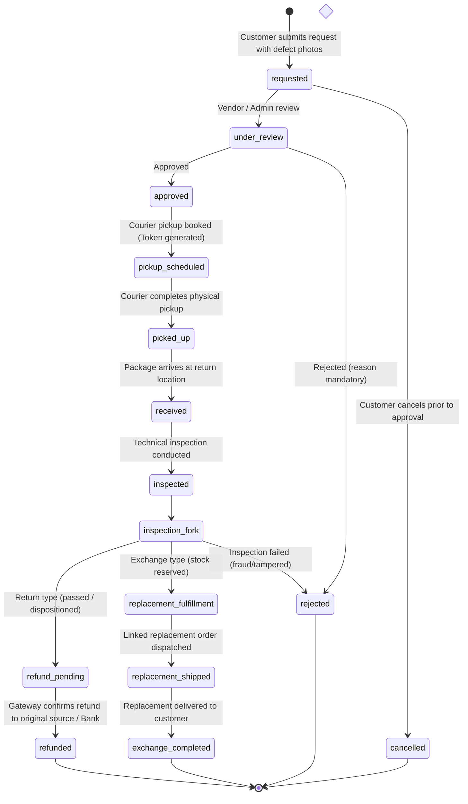

# BUYBOX E-COMMERCE
# CUSTOMER RETURNS & EXCHANGE MANAGEMENT SYSTEM
## PHASE A — READ-ONLY FORENSIC AUDIT & ARCHITECTURAL FOUNDATION

**Execution Mode:** STRICT READ-ONLY FORENSIC AUDIT  
**Priority:** P0 — Customer Experience, Multi-Vendor Governance & Reverse Logistics  
**Reference Design:** Flipkart Marketplace Returns, Exchange & Refund Experience  
**Date:** November 2026

---

## 1. EXECUTIVE OVERVIEW

Buybox E-Commerce requires an enterprise-grade Returns and Exchange Management System allowing customers to request returns or variant exchanges for individual delivered products within seven (7) calendar days of confirmed delivery. This system must span the Customer Storefront, Customer Account Dashboard, Vendor Console, Admin/Superadmin Control Planes, Courier/Reverse-Logistics Integrations, Inventory Ledgers, and Payment/Refund Gateways.

This forensic audit evaluates the existing repository components, identifies reusable patterns and services, exposes architectural gaps, and establishes the blueprint for end-to-end implementation.

---

## 2. FORENSIC AUDIT OF EXISTING ARCHITECTURE

### 2.1 Order & OrderItem Models
- **File:** [Order.js](file:///d:/MERN%20Stack/Buybox-Ecommerce/backend/src/models/Order.js)
- **Current State:**
  - `Order.items` array holds individual purchased line items with `_id`, `productId`, `productVariantId`, `vendorId`, `warehouseId`, `sku`, `productName`, `variantName`, `quantity`, `unitPrice`, `discountTotal`, `taxTotal`, `lineTotal`, `fulfillmentStatus`, and `shipmentId`.
  - `fulfillmentStatus` on items tracks item-level progression: `"unfulfilled"`, `"processing"`, `"ready_to_ship"`, `"shipped"`, `"delivered"`, `"cancelled"`, `"returned"`.
  - Order-level status includes: `"placed"`, `"confirmed"`, `"processing"`, `"ready_to_ship"`, `"shipped"`, `"delivered"`, `"completed"`, `"cancelled"`, `"returned"`, `"partially_returned"`.
- **Reusable Assets:**
  - Authoritative financial snapshots (`unitPrice`, `lineTotal`, `taxTotal`) allow precise item-level refund calculation without recalculation errors.
  - Individual item `_id` and `vendorId` enable line-item targeting and multi-vendor partitioning.
- **Architectural Gaps Identified:**
  - Order items currently lack explicit `returnedQuantity` and `returnRequestId` references to track partial returns directly on the order item document.
  - Individual order items do not record an explicit `deliveredAt` timestamp; delivery is recorded either on the overall Order or on the linked `Shipment`.

### 2.2 Product & Variant Models
- **Files:** [Product.js](file:///d:/MERN%20Stack/Buybox-Ecommerce/backend/src/models/Product.js), [ProductVariant.js](file:///d:/MERN%20Stack/Buybox-Ecommerce/backend/src/models/ProductVariant.js)
- **Current State:**
  - `Product` has `productType` (`"simple"` vs `"variable"`), `isVirtual`, `isDownloadable`, `categoryId`, `brandId`, and `vendorId`.
  - `ProductVariant` tracks `sku`, `name`, `attributes`, `price`, `compareAtPrice`, and `isActive`.
- **Reusable Assets:**
  - `isVirtual` and `isDownloadable` can be inspected to automatically reject non-returnable digital items (`DIGITAL_ITEM_NOT_RETURNABLE`).
  - `ProductVariant` records allow querying sibling variants of the same product for variant exchange (e.g., size or color swap).
- **Architectural Gaps Identified:**
  - Products lack configurable return policy overrides (e.g., `isReturnable`, `returnWindowDays`). Adding these fields allows category-specific or product-specific return rules while defaulting to 7 days.

### 2.3 ReturnRequest Model & Existing Services
- **Files:**
  - [ReturnRequest.js](file:///d:/MERN%20Stack/Buybox-Ecommerce/backend/src/models/ReturnRequest.js)
  - [return-request.service.js](file:///d:/MERN%20Stack/Buybox-Ecommerce/backend/src/services/return-request.service.js)
  - [return-request.controller.js](file:///d:/MERN%20Stack/Buybox-Ecommerce/backend/src/controllers/return-request.controller.js)
  - [return-request.routes.js](file:///d:/MERN%20Stack/Buybox-Ecommerce/backend/src/routes/return-request.routes.js)
- **Current State:**
  - `ReturnRequest` exists with `returnNumber`, `orderId`, `customerId`, `vendorIds`, `type` (`"return" | "exchange"`), `status` (`"requested"`, `"under_review"`, `"approved"`, `"rejected"`, `"pickup_scheduled"`, `"received"`, `"inspected"`, `"refund_pending"`, `"refunded"`, `"exchange_fulfilled"`, `"cancelled"`).
  - Basic service methods exist for `createReturnRequest`, `approveReturnRequest`, `rejectReturnRequest`, `inspectReturnRequest`, `receiveReturnAndRestock`, and `processReturnRefund`.
  - Multi-vendor partitioning already splits a customer application into individual vendor return requests (`itemsByVendor`).
- **Gaps & Missing Functionality:**
  1. **Defect Evidence Photos:** `ReturnRequest` schema has NO fields for customer defect photographs (`images` / `evidenceImages`).
  2. **Order-Item Reference:** `returnItemSchema` in `ReturnRequest.js` does not persist `orderItemId`.
  3. **Pickup Address:** Customer pickup address and contact number are not stored on the request.
  4. **Reverse Logistics Tracking:** No structured reverse shipment fields (`reversePickupSchedule`, `pickupToken`, `awbNumber`, `trackingNumber`, `carrier`).
  5. **Exchange Replacement Tracking:** No fields for `replacementOrderId`, `replacementShipmentId`, or `priceDifference`.
  6. **COD Refund Destinations:** No fields for customer bank account details or UPI ID for COD orders.
  7. **Eligibility API:** No dedicated endpoint exists to calculate and return line-item eligibility for the storefront and dashboard before form submission.

### 2.4 Payment & Refund Infrastructure
- **Files:**
  - [Refund.js](file:///d:/MERN%20Stack/Buybox-Ecommerce/backend/src/models/Refund.js)
  - [refund.service.js](file:///d:/MERN%20Stack/Buybox-Ecommerce/backend/src/services/refund.service.js)
  - [razorpay-refund.provider.js](file:///d:/MERN%20Stack/Buybox-Ecommerce/backend/src/integrations/payments/razorpay-refund.provider.js)
  - [paypal.provider.js](file:///d:/MERN%20Stack/Buybox-Ecommerce/backend/src/integrations/payments/paypal.provider.js)
- **Current State:**
  - Fully supports original-payment-source refunds for Razorpay and PayPal with atomic amount reservation, idempotency keys, and gateway reconciliation.
  - Phase VW-03 hooks reverse double-entry accounting entries into the financial ledger.
- **Architectural Gaps:**
  - COD orders have no gateway payment ID. The system requires a secure bank/UPI refund destination workflow with account masking and verification to prevent arbitrary manual edits.

### 2.5 Courier & Reverse Logistics
- **Files:**
  - [courier.service.js](file:///d:/MERN%20Stack/Buybox-Ecommerce/backend/src/services/courier.service.js)
  - [delhivery.adapter.js](file:///d:/MERN%20Stack/Buybox-Ecommerce/backend/src/integrations/shipping/delhivery.adapter.js)
- **Current State:**
  - Courier service provides `schedulePickup`, `generateShippingLabel`, and `handleWebhook`.
- **Architectural Gaps:**
  - Reverse pickup scheduling must be triggered upon return approval, generating a reverse pickup token (`PKP-REV-...`) and tracking reference without conflating forward deliveries with reverse pickups.

### 2.6 Frontend Storefront & Customer Dashboards
- **Files:**
  - [OrderReturnPageView.jsx](file:///d:/MERN%20Stack/Buybox-Ecommerce/frontend/src/app/\(storefront\)/orders/\[orderId\]/return/OrderReturnPageView.jsx)
  - [OrderDetailsPageView.jsx](file:///d:/MERN%20Stack/Buybox-Ecommerce/frontend/src/components/storefront/orders/OrderDetailsPageView.jsx)
  - [OrderDetailView.jsx](file:///d:/MERN%20Stack/Buybox-Ecommerce/frontend/src/components/storefront/account/OrderDetailView.jsx)
  - [OrdersPageView.jsx](file:///d:/MERN%20Stack/Buybox-Ecommerce/frontend/src/components/storefront/account/OrdersPageView.jsx)
- **Current State:**
  - `OrderReturnPageView.jsx` contains an initial layout but lacks image upload, variant selection for exchanges, COD bank/UPI inputs, and item-level eligibility breakdown.
  - `OrderDetailsPageView.jsx` and `OrderDetailView.jsx` show "Buy Again" and "Invoice" but do NOT display "Return" or "Exchange" action buttons for delivered items.
  - `OrdersPageView.jsx` lacks direct return action buttons on the order cards.

### 2.7 Vendor Console & Admin Dashboards
- **Files:**
  - [VendorReturnsPage](file:///d:/MERN%20Stack/Buybox-Ecommerce/frontend/src/app/vendor/returns/page.js)
  - [VendorReturnDetailPage](file:///d:/MERN%20Stack/Buybox-Ecommerce/frontend/src/app/vendor/returns/\[id\]/page.js)
  - [AdminReturnsPage](file:///d:/MERN%20Stack/Buybox-Ecommerce/frontend/src/app/administrator/operations/returns/page.js)
  - [AdminOperationsReturnsPage](file:///d:/MERN%20Stack/Buybox-Ecommerce/frontend/src/app/admin/operations/returns/page.js) (Currently blank `return null;`)
- **Current State:**
  - Vendor Returns pages exist but do not display customer defect photos, pickup scheduling cards, or exchange variant management.
  - Admin operations returns page exists in `/administrator/operations/returns` with basic approve/reject/receive modals, but `/admin/operations/returns` is empty and needs alignment.

---

## 3. CANONICAL RETURNS & EXCHANGE LIFECYCLE

---

## 4. SCHEMA ENHANCEMENTS PLAN

### 4.1 ReturnRequest Schema Enhancements
1. **`items` Subdocument:**
   - Add `orderItemId: { type: ObjectId, ref: "Order.items" }`
   - Add `images: [{ url: String, publicId: String, caption: String, uploadedAt: Date }]`
2. **Top-Level Request Extensions:**
   - `images: [{ url: String, publicId: String, uploadedAt: Date }]` (Customer defect evidence gallery)
   - `pickupAddress`: Full structured address for courier dispatch.
   - `refundMethod`: `"original_source"` | `"bank_transfer"` | `"upi"`
   - `bankDetails`: `{ accountNumberMasked: String, accountNumberEncrypted: String, ifscCode: String, accountHolderName: String, upiId: String, isVerified: Boolean }`
   - `reversePickupSchedule`: `{ pickupToken: String, scheduledDate: Date, timeSlot: String, carrier: String, awbNumber: String, trackingNumber: String, trackingUrl: String, status: String, notes: String }`
   - `replacementOrder`: `{ orderId: ObjectId, orderNumber: String, replacementVariantId: ObjectId, sku: String, name: String, shipmentId: ObjectId, trackingNumber: String, expectedDeliveryDate: Date }`
   - Canonical status enum:
     `["requested", "under_review", "approved", "rejected", "pickup_scheduled", "picked_up", "received", "inspected", "refund_pending", "refunded", "replacement_fulfillment", "replacement_shipped", "exchange_completed", "exchange_fulfilled", "cancelled"]`

### 4.2 OrderItem Schema Enhancements
1. `returnedQuantity: { type: Number, default: 0, min: 0 }`
2. `returnStatus: { type: String, enum: ["none", "requested", "approved", "returned", "exchanged"], default: "none" }`
3. `returnRequestId: { type: ObjectId, ref: "ReturnRequest", default: null }`

---

## 5. REUSABLE ASSETS & INTEGRATION DEPENDENCIES

| Asset / Service | Location | Purpose in Returns & Exchange System |
| :--- | :--- | :--- |
| `refundService` | `backend/src/services/refund.service.js` | Executes atomic original-payment refunds via Razorpay & PayPal |
| `inventoryService` | `backend/src/services/inventory.service.js` | Restocks resellable returns and reserves exchange replacement inventory |
| `courierService` | `backend/src/services/courier.service.js` | Generates reverse pickup tokens, AWB numbers, and manifests |
| `financialLedgerService` | `backend/src/services/financial-ledger.service.js` | Posts double-entry refund reversals and commission adjustments |
| `bankCrypto` | `backend/src/utils/bank-crypto.util.js` | Masks and encrypts customer bank account details for COD refunds |
| `storefrontMediaService` | `backend/src/services/storefront-media.service.js` | Secure defect photo storage and validation |
| `customerNotificationService` | `backend/src/services/customer-notification.service.js` | Transactional in-app alerts at every milestone |
| `VendorStatusBadge` | `frontend/src/components/vendor/VendorStatusBadge.jsx` | Consistent badge styling for return states |

---

## 6. IMPLEMENTATION ROADMAP

1. **Step 1:** Extend `ReturnRequest` and `Order` schemas to support order-item references, defect images, pickup addresses, reverse logistics, COD bank details, and exchange fulfillment.
2. **Step 2:** Implement `checkOrderReturnEligibility` service & endpoint (`GET /api/v1/returns/eligibility/:orderId`) calculating individual item eligibility, delivery timestamps, days elapsed, and available exchange variants.
3. **Step 3:** Implement secure customer defect photo upload endpoint (`POST /api/v1/returns/upload-evidence`).
4. **Step 4:** Upgrade `return-request.service.js` to handle full return and exchange workflows (reverse pickup scheduling, inspection disposition, COD/prepaid refund processing within 3 working days target, and linked replacement order generation).
5. **Step 5:** Build Flipkart-inspired customer storefront application experience in `OrderReturnPageView.jsx` with photo upload, variant exchange selection, and refund method inputs.
6. **Step 6:** Add Return & Exchange buttons on Customer Dashboard (`OrdersPageView.jsx`), Order Details pages (`OrderDetailsPageView.jsx`, `OrderDetailView.jsx`), and dedicated Return Tracking view.
7. **Step 7:** Upgrade Vendor Console (`/vendor/returns` & `/vendor/returns/[id]`) and Superadmin Dashboard (`/administrator/operations/returns`) with image galleries, reverse pickup scheduling, inspection controls, and exchange fulfillment.
8. **Step 8:** Add comprehensive regression test suite covering all scenarios and edge cases.
9. **Step 9:** Verify production build, linting, and generate final acceptance report.

