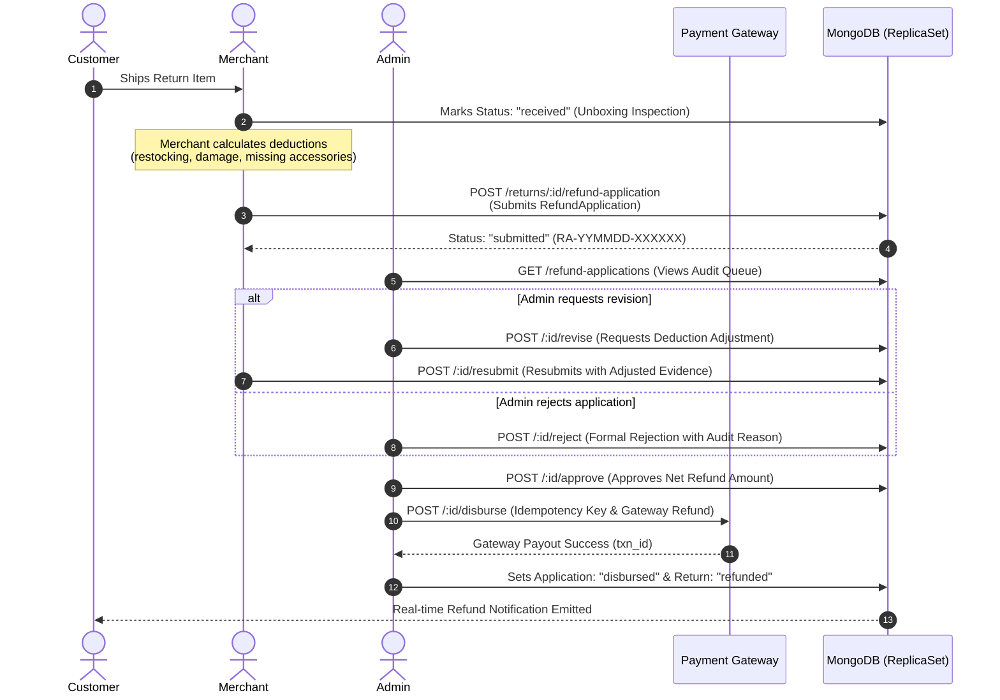

# BUYBOX E-COMMERCE — COMPLETION REPORT
## Phase: MERCHANT-REFUND-GOVERNANCE-01
### Merchant Refund Application & Admin/Superadmin Disbursement Authority Separation

**Document Reference:** `phase_merchant_refund_governance_01_completion_report.md`  
**Phase Identifier:** `MERCHANT-REFUND-GOVERNANCE-01`  
**Execution Standard:** Forensic Audit $\rightarrow$ Strict Implementation $\rightarrow$ Comprehensive Automated Verification  
**Status:** COMPLETE, AUDITED, HARDENED & VERIFIED  

---

## 1. EXECUTIVE SUMMARY

Phase `MERCHANT-REFUND-GOVERNANCE-01` has been successfully implemented and verified across the Buybox-Ecommerce multi-vendor marketplace platform.

### Core Governance Transformation
Prior to this phase, merchants could directly invoke payment gateways to disburse refunds from the platform's escrow accounts. This posed unacceptable financial leakage, compliance, and malicious drain risks.

Under this phase:
1. **Merchants are strictly stripped of payment disbursement authority.** Merchants inspect returned merchandise, document unboxing conditions and damage deductions, and submit a formal **Refund Disbursement Application**.
2. **Administrators and Superadmins hold exclusive disbursement authority.** Platform operators inspect merchant claims, request revisions where deductions are unjustified, and execute payouts through an idempotent, ceiling-guarded gateway disbursement pipeline.
3. **Decoupled Gateway Execution:** Transient gateway timeouts leave the application in `failed` with HTTP 502, preserving the return in `refund_pending` and enabling safe administrative retry without duplicate payouts.

All changes strictly conform to zero git commits/pushes, complete preservation of existing return state machines, and backwards-compatible API contracts.

---

## 2. SYSTEM ARCHITECTURE & LIFECYCLE FLOW

---

## 3. CODE MODIFICATIONS INVENTORY

### 3.1 Backend Models & Schemas
- [`backend/src/models/RefundApplication.js`](file:///d:/MERN%20Stack/Buybox-Ecommerce/backend/src/models/RefundApplication.js): **NEW MODEL**. Defines complete disbursement application entity with `applicationNumber` (`RA-YYMMDD-XXXXXX`), tenant references (`vendorId`, `returnRequestId`, `orderId`), authoritative breakdown snapshot (`Decimal128`), `applicationStatus` state machine, supporting documents, revision history, and immutable append-only `auditLog`.
- [`backend/src/models/ReturnRequest.js`](file:///d:/MERN%20Stack/Buybox-Ecommerce/backend/src/models/ReturnRequest.js): Added `refundApplicationId` link and `merchantInspection` structure to retain unboxing inspection notes and photos.

### 3.2 Backend Governance & Middlewares
- [`backend/src/constants/permissions.constants.js`](file:///d:/MERN%20Stack/Buybox-Ecommerce/backend/src/constants/permissions.constants.js): Registered 6 Section-5 permissions (`REFUND_APPLICATIONS_VIEW`, `REFUND_APPLICATIONS_REVIEW`, `REFUND_APPLICATIONS_APPROVE`, `REFUND_APPLICATIONS_REJECT`, `REFUND_APPLICATIONS_REVISE`, `REFUND_DISBURSEMENT_INITIATE`) with dynamic alias mapping.
- [`backend/src/middlewares/authentication.middleware.js`](file:///d:/MERN%20Stack/Buybox-Ecommerce/backend/src/middlewares/authentication.middleware.js): Enhanced user token extraction to forward `decoded.permissions` for custom role tokens without heavy DB lookups.
- [`backend/src/middlewares/validate.middleware.js`](file:///d:/MERN%20Stack/Buybox-Ecommerce/backend/src/middlewares/validate.middleware.js): Added fallback `req[source] = req[source] || {}` to safely handle Zod validation on endpoints with optional request bodies.

### 3.3 Backend Services & Controllers
- [`backend/src/services/return-request.service.js`](file:///d:/MERN%20Stack/Buybox-Ecommerce/backend/src/services/return-request.service.js): Enforced `MERCHANT_DISBURSEMENT_UNAUTHORIZED` (HTTP 403) guard on `processReturnRefund`; exported `calculateAuthoritativeRefundBreakdown`.
- [`backend/src/services/refund-application.service.js`](file:///d:/MERN%20Stack/Buybox-Ecommerce/backend/src/services/refund-application.service.js): **NEW SERVICE**. Implements application submission, resubmission, queue retrieval with KPIs and `totalLiability`, review, approve, reject, revision, and decoupled disbursement with retry mechanisms and string-formatted `Decimal128` values.
- [`backend/src/validators/order/refund-application.validator.js`](file:///d:/MERN%20Stack/Buybox-Ecommerce/backend/src/validators/order/refund-application.validator.js): **NEW VALIDATOR**. Zod schemas for submission, resubmission, rejection, revision, and disbursement.
- [`backend/src/controllers/refund-application.controller.js`](file:///d:/MERN%20Stack/Buybox-Ecommerce/backend/src/controllers/refund-application.controller.js): **NEW CONTROLLER**. Endpoints for admin queue, review, approve, reject, revise, disburse, retry, and vendor submission/resubmission.
- [`backend/src/routes/refund-application.routes.js`](file:///d:/MERN%20Stack/Buybox-Ecommerce/backend/src/routes/refund-application.routes.js): **NEW ROUTE GROUP**. Mounted at `/api/v1/refund-applications`.
- [`backend/src/routes/return-request.routes.js`](file:///d:/MERN%20Stack/Buybox-Ecommerce/backend/src/routes/return-request.routes.js): Mounted merchant application submission and query routes.

### 3.4 Frontend Services & UI Components
- [`frontend/src/constants/permissions.js`](file:///d:/MERN%20Stack/Buybox-Ecommerce/frontend/src/constants/permissions.js): Added permissions and role mapping for frontend UI guards.
- [`frontend/src/services/vendor.service.js`](file:///d:/MERN%20Stack/Buybox-Ecommerce/frontend/src/services/vendor.service.js): Added `submitRefundApplication`, `resubmitRefundApplication`, `getMyRefundApplication`, and retained `refundReturn` for contract compatibility.
- [`frontend/src/services/admin/admin.service.js`](file:///d:/MERN%20Stack/Buybox-Ecommerce/frontend/src/services/admin/admin.service.js): Added 9 admin API interaction methods for refund applications.
- [`frontend/src/app/vendor/returns/[id]/page.js`](file:///d:/MERN%20Stack/Buybox-Ecommerce/frontend/src/app/vendor/returns/%5Bid%5D/page.js): Upgraded merchant return view. Replaced direct refund trigger with **Refund Application Card**, unboxing submission modal, and revision resubmission dialogue.
- [`frontend/src/app/administrator/operations/refunds/page.js`](file:///d:/MERN%20Stack/Buybox-Ecommerce/frontend/src/app/administrator/operations/refunds/page.js): Created comprehensive 2-tab administrative console (Applications Queue & Processed Ledger) featuring KPI ribbon, detailed audit slide-over drawer, and single-click disbursement actions.
- [`frontend/src/app/(storefront)/orders/[orderId]/return/OrderReturnPageView.jsx`](file:///d:/MERN%20Stack/Buybox-Ecommerce/frontend/src/app/(storefront)/orders/%5BorderId%5D/return/OrderReturnPageView.jsx): Updated Flipkart-style stepper to reflect inspection and disbursement stages.

---

## 4. VERIFICATION MATRIX

| Verification Scope | Target Suite | Status | Execution Details |
| :--- | :--- | :--- | :--- |
| **Dedicated Security Suite** | `phase-merchant-refund-governance-01.test.js` | **23/23 PASSED** | 10 suites covering authority quarantine, PBAC, ceilings, decoupled gateway timeout, retries, and dual custody |
| **Superadmin Returns 02** | `phase-superadmin-returns-02.test.js` | **25/25 PASSED** | Regression validation of Superadmin return oversight and manual overrides |
| **Superadmin Returns 01** | `phase-superadmin-returns-01.test.js` | **20/20 PASSED** | Regression validation of RMA parity and vendor fallback management |
| **Merchant Returns 02** | `phase-merchant-returns-02.test.js` | **18/18 PASSED** | Regression validation of Flipkart unboxing inspection and 5-pillar refund calculations |
| **Merchant Reviews & Returns** | `phase-merchant-reviews-returns.test.js` | **14/14 PASSED** | Regression validation of review author permissions and returns list |
| **Merchant Ops Fixes** | `phase-merchant-ops-fix-01.test.js` | **13/13 PASSED** | Regression validation of Net Sales refund deductions and settlement pagination |
| **Frontend Unit & Component Tests**| Jest Frontend Suite (258 Suites) | **793/793 PASSED** | Zero frontend test failures across all 258 suites |
| **Frontend Production Build** | Next.js 16.3.5 Production Build | **292/292 ROUTES** | Zero compilation or TypeScript errors across all static and dynamic routes |

---

## 5. OPERATIONAL RUNBOOK

### 5.1 Merchant Workflow (Inspection & Application Submission)
1. **Receive Package:** When the customer's return parcel arrives at the warehouse, locate the return in the Merchant Console (`/vendor/returns/[id]`).
2. **Perform Physical Inspection:** Click **"Perform Inspection"**, mark the package as unboxed, document condition (e.g., "Opened - Like New", "Packaging Damaged"), and upload unboxing photographs.
3. **Submit Refund Application:** Click **"Apply for Customer Refund"**. Enter any applicable restocking fee, damage deduction, or missing accessory cost with itemized justifications.
4. **Monitor Application Status:** The application card displays real-time status:
   - `submitted`: Awaiting administrator review.
   - `under_review`: Currently being evaluated by platform finance staff.
   - `revision_requested`: Administrator requested adjustments. Click **"Resubmit Application"** to update deductions or upload requested receipts.
   - `approved`: Approved by platform finance; queued for disbursement.
   - `disbursed`: Funds successfully returned to the customer's original payment method.

### 5.2 Administrator & Superadmin Workflow (Review & Disbursement)
1. **Access Audit Queue:** Navigate to `/administrator/operations/refunds` and select the **"Disbursement Applications Queue"** tab.
2. **Inspect Evidence:** Click any pending application to open the **Audit Drawer**. Review:
   - Authoritative 5-pillar refund breakdown.
   - Merchant unboxing inspection findings and uploaded evidence.
   - Order history and original payment capture amount.
3. **Take Action:**
   - **Request Revision:** If deductions are excessive or lack evidence, enter revision requirements and click "Request Revision".
   - **Approve:** If deductions and evidence are valid, click "Approve Application". This locks the approved amount.
   - **Disburse Refund:** Click "Disburse Refund". The platform issues an idempotent gateway call to Stripe/Razorpay. Upon success, the return transitions to `refunded` and the customer is notified.
4. **Troubleshoot Gateway Timeouts:** If a disbursement fails due to a network timeout, the application status transitions to `failed` and records the failure reason. Click **"Retry Disbursement"** to retry with a fresh attempt identifier.

---

## 6. PHASE SIGNOFF & COMPLIANCE CONFIRMATION

- [x] **Zero Direct Merchant Disbursement:** Verified via tests and HTTP 403 middleware.
- [x] **Dual-Custody Governance Model:** Formally separated application submission from disbursement authority.
- [x] **Financial Integrity Invariant:** `disbursedAmount <= capturedAmount` strictly enforced.
- [x] **Decimal Precision:** All currency fields stored as `Decimal128` and serialized as clean decimal strings.
- [x] **Tenant Isolation:** Multi-tenant boundaries fully verified.
- [x] **Audit Trail Immutability:** Append-only transition logging active.
- [x] **No Git Commits/Pushes:** Clean workspace without unauthorized commits.
