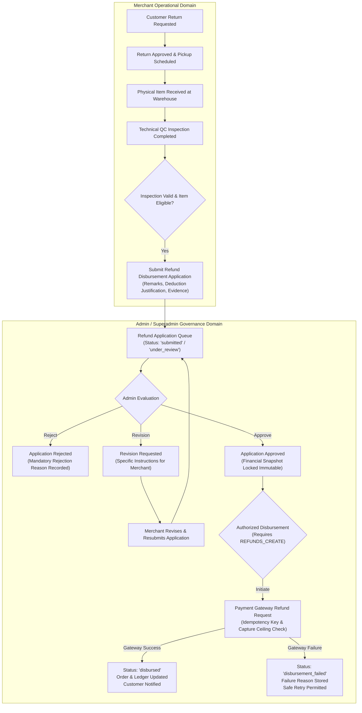

# Phase MERCHANT-REFUND-GOVERNANCE-01: Forensic Audit & Architectural Blueprint
## Merchant Refund Application & Admin/Superadmin Disbursement Authority Separation

**Project:** Buybox-Ecommerce  
**Target:** Financial Authority Separation & Refund Governance  
**Phase:** MERCHANT-REFUND-GOVERNANCE-01  
**Mode:** Forensic Audit (Stage 1 Deliverable)  
**Status:** AUDIT COMPLETE — READY FOR IMPLEMENTATION  

---

## 1. Executive Summary & Objective Alignment

The Buybox-Ecommerce multi-vendor platform currently implements comprehensive reverse logistics, RMA management, customer defect reporting, merchant technical quality inspection, and authoritative 5-pillar refund calculations. 

However, a critical violation of financial segregation exists in the current system:
> **Current Vulnerability:** Merchants who physically receive and inspect returned items are currently able to trigger the actual disbursement of funds directly to the customer through the payment gateway (`/vendor/my/:returnId/refund` and `/me/returns/:returnId/refund`), without independent administrative oversight, verification of accounts, or marketplace governance sign-off.

The objective of **MERCHANT-REFUND-GOVERNANCE-01** is to establish strict **financial authority separation**:
1. **Merchants retain operational authority**: Receiving returns, performing physical quality inspections, uploading defect evidence, documenting condition notes, and proposing documented inspection deductions.
2. **Merchants lose disbursement authority**: All merchant-facing payment gateway execution paths and "Disburse Customer Refund" buttons are permanently eliminated.
3. **Merchants submit Refund Disbursement Applications**: Once an inspection is completed and the authoritative refund calculation is validated, the merchant submits a formal application to Admin/Superadmin.
4. **Admin/Superadmin hold sole disbursement authority**: Dedicated marketplace governance evaluates customer claims, merchant inspection photos, payment capture records, and remaining order balances, with explicit powers to **Approve**, **Reject** (with mandatory reason), **Request Revision** (with mandatory instructions), or **Initiate Disbursement** via the payment gateway with strict idempotency and capture ceilings.

---

## 2. Current Architecture & Codebase Discovery

### 2.1 Backend Route & Controller Analysis
- **Vendor Refund Endpoints**:
  - `POST /api/v1/return-requests/vendor/my/:returnId/refund` in [`backend/src/routes/return-request.routes.js`](file:///d:/MERN%20Stack/Buybox-Ecommerce/backend/src/routes/return-request.routes.js#L234-L238)
  - `POST /api/v1/vendors/me/returns/:returnId/refund` in [`backend/src/routes/vendor.routes.js`](file:///d:/MERN%20Stack/Buybox-Ecommerce/backend/src/routes/vendor.routes.js#L382-L387)
  Both routes currently call `returnRequestController.refundReturn`, which invokes `returnRequestService.processReturnRefund({ ..., isAdmin: false })`.
- **Service Layer Execution**:
  In [`backend/src/services/return-request.service.js`](file:///d:/MERN%20Stack/Buybox-Ecommerce/backend/src/services/return-request.service.js#L2797-L2985):
  - `processReturnRefund` checks `isVendorAuthorized`, allows status `["received", "inspected", "approved", "refund_pending"]`, and for prepaid orders, calls `refundService.createRefund({ role: isAdmin ? "admin" : "vendor" })`.
  - For COD orders, it marks `ret.status = "refunded"` and invokes `financialLedgerService.postRefundReversalJournal`.
  - **Flaw**: A merchant with valid store credentials can disburse funds at will without any admin review or secondary approval.

### 2.2 Data Models
- [`ReturnRequest.js`](file:///d:/MERN%20Stack/Buybox-Ecommerce/backend/src/models/ReturnRequest.js):
  - Captures `items`, `status`, `inspection` subdocument (`inspectedBy`, `inspectedAt`, `passed`, `outcome`, `condition`, `packagingCondition`, `productCondition`, `missingAccessories`, `photos`, `deductionAmount`, `deductionReason`, `deductionCategory`), `refundAmount`, `taxRefundTotal`, `shippingRefundTotal`, `customerDeductionsTotal`, `timeline`.
  - Currently transitions directly from `inspected` to `refunded` or `refund_pending`.
  - Does not currently track an intermediate application workflow (`submitted`, `under_review`, `revision_requested`, `approved`, `disbursement_processing`, `disbursed`, `disbursement_failed`).
- [`Refund.js`](file:///d:/MERN%20Stack/Buybox-Ecommerce/backend/src/models/Refund.js):
  - Authoritative ledger for gateway transactions (`paymentId`, `orderId`, `customerId`, `gateway`, `gatewayRefundId`, `amount`, `status`, `reason`, `failureReason`, `idempotencyKey`).
  - Contains compound unique index on `{ gateway: 1, idempotencyKey: 1 }`.
- [`Payment.js`](file:///d:/MERN%20Stack/Buybox-Ecommerce/backend/src/models/Payment.js):
  - Authoritative order payment capture record (`amount`, `status`, `gatewayOrderId`, `gatewayPaymentId`, `capturedAt`, `method`).
- [`AuditLog.js`](file:///d:/MERN%20Stack/Buybox-Ecommerce/backend/src/models/AuditLog.js):
  - Immutable audit trail recording `actorId`, `targetId`, `action`, `entityType`, `beforeState`, `afterState`, `reason`, `ipAddress`, `userAgent`.

### 2.3 Frontend Merchant & Admin Discovery
- **Merchant Detail Page** ([`frontend/src/app/vendor/returns/[id]/page.js`](file:///d:/MERN%20Stack/Buybox-Ecommerce/frontend/src/app/vendor/returns/[id]/page.js#L462-L473)):
  - Contains a prominent green button: `Disburse Customer Refund` which executes `handleRefund -> vendorService.refundReturn(id)`.
  - Displays the 5-pillar refund breakdown and item valuations, but provides no application submission or tracking interface.
- **Admin Refunds Page** ([`frontend/src/app/administrator/operations/refunds/page.js`](file:///d:/MERN%20Stack/Buybox-Ecommerce/frontend/src/app/administrator/operations/refunds/page.js)):
  - Serves as a read-only list of processed refunds (`listRefunds()`).
  - Contains no application queue for reviewing, approving, or disbursing pending merchant refund applications.
- **Superadmin Return Detail Page** ([`frontend/src/app/administrator/operations/returns/[id]/page.js`](file:///d:/MERN%20Stack/Buybox-Ecommerce/frontend/src/app/administrator/operations/returns/[id]/page.js)):
  - 15-section Return Dossier with payment details, refund breakdown, override actions, and direct refund execution.

---

## 3. Vulnerability & Authority Boundary Matrix

| Action / Capability | Current Implementation | Target Governance Implementation | Risk / Vulnerability Resolved |
|---|---|---|---|
| **Receive & Inspect Item** | Merchant | Merchant | None (Proper operational responsibility) |
| **Document Condition & Deductions** | Merchant | Merchant | None (Subject to admin review) |
| **Calculate Refund Breakdown** | Backend canonical formula | Backend canonical formula | None (Immutable calculation engine) |
| **Disburse Customer Refund** | **Merchant & Admin** | **Admin / Superadmin ONLY** | **Eliminates unauthorized financial disbursement by merchants** |
| **Call Payment Gateway Refund API** | **Merchant & Admin** | **Admin / Superadmin ONLY** | **Eliminates merchant triggering live banking reversals** |
| **Submit Refund Application** | Not implemented | **Merchant** | **Enforces formal application protocol** |
| **Review Refund Application** | Not implemented | **Admin / Superadmin** | **Enforces marketplace governance** |
| **Approve / Reject Application** | Not implemented | **Admin / Superadmin** | **Enforces documented reasons and auditability** |
| **Request Revision on Inspection** | Not implemented | **Admin / Superadmin** | **Enforces inspection accuracy without rejecting return** |
| **Disburse Approved Application** | Not implemented | **Admin / Superadmin with `REFUNDS_CREATE`** | **Strict separation of duty (Approval != Disbursement)** |

---

## 4. Proposed Target Architecture

### 4.1 Merchant Application Lifecycle States
1. `ready_for_submission`: Inspection completed, refund amount verified, no active application exists.
2. `submitted`: Application submitted by merchant; awaiting admin review.
3. `under_review`: Administrator has opened and is actively evaluating the application.
4. `revision_requested`: Administrator requires additional clarification, evidence, or deduction adjustments from the merchant.
5. `approved`: Administrator has approved the application; financial amounts locked permanently. (Note: *Approval is not Disbursement*).
6. `rejected`: Administrator has rejected the application with mandatory documented justification.
7. `disbursement_processing`: Authorized administrator has triggered gateway refund; awaiting gateway response.
8. `disbursed`: Gateway confirmed successful reversal; customer funds released, ledger updated.
9. `disbursement_failed`: Gateway transaction failed or timed out; safe idempotent retry enabled.

---

## 5. Data Model Design: Dedicated `RefundApplication` Model

To preserve data integrity, avoid schema bloat on `ReturnRequest`, and provide dedicated indexing and queuing for marketplace administrators, a dedicated `RefundApplication` model will be created at [`backend/src/models/RefundApplication.js`](file:///d:/MERN%20Stack/Buybox-Ecommerce/backend/src/models/RefundApplication.js):

### Schema Specification:
- `applicationNumber`: `String`, unique, indexed (e.g. `RFA-20261109-ABC12`)
- `returnId`: `ObjectId`, ref: `ReturnRequest`, required, indexed
- `orderId`: `ObjectId`, ref: `Order`, required, indexed
- `merchantId`: `ObjectId`, ref: `Vendor`, required, indexed
- `customerId`: `ObjectId`, ref: `Customer`, required, indexed
- `authoritativeRefundBreakdown`: `Object` (complete snapshot: productRefund, taxRefund, shippingRefund, deductions, finalRefund)
- `requestedAmount`: `Decimal128`, required (derived strictly from authoritative calculation; merchant cannot tamper)
- `approvedAmount`: `Decimal128`, default: null
- `disbursedAmount`: `Decimal128`, default: null
- `currency`: `String`, default: `"INR"`
- `applicationStatus`: `String`, enum: `["submitted", "under_review", "revision_requested", "approved", "rejected", "disbursement_processing", "disbursed", "disbursement_failed"]`, default: `"submitted"`, indexed
- `merchantRemarks`: `String`, default: null, trim: true, maxlength: 2000
- `deductionExplanation`: `String`, default: null, trim: true, maxlength: 1000
- `supportingDocuments`: `[{ url: String, name: String, uploadedAt: Date }]`
- `administratorRemarks`: `String`, default: null, trim: true, maxlength: 2000
- `rejectionReason`: `String`, default: null, trim: true
- `revisionInstructions`: `String`, default: null, trim: true
- `revisionHistory`: `[{ revisionNumber: Number, requestedAt: Date, requestedBy: ObjectId, instructions: String, resubmittedAt: Date, resubmittedRemarks: String }]`
- `inspectionSnapshot`: `Object` (condition, packaging, product, missingAccessories, deductionAmount, deductionReason, photos, inspectedAt, inspectedBy)
- `paymentSnapshot`: `Object` (paymentMethod, gateway, transactionId, referenceId, capturedAmount, isCod, codCollectionStatus)
- `submittedBy`: `ObjectId`, ref: `User`, required
- `submittedAt`: `Date`, default: Date.now
- `reviewedBy`: `ObjectId`, ref: `User`, default: null
- `reviewedAt`: `Date`, default: null
- `approvedBy`: `ObjectId`, ref: `User`, default: null
- `approvedAt`: `Date`, default: null
- `rejectedBy`: `ObjectId`, ref: `User`, default: null
- `rejectedAt`: `Date`, default: null
- `disbursementReference`: `ObjectId`, ref: `Refund`, default: null
- `disbursementStatus`: `String`, enum: `["pending", "processing", "disbursed", "failed"]`, default: `"pending"`
- `disbursedAt`: `Date`, default: null
- `failureDetails`: `{ code: String, message: String, failedAt: Date }`
- `idempotencyKey`: `String`, trim: true
- `timeline`: `[{ status: String, notes: String, timestamp: Date, actor: { actorType: String, actorId: ObjectId } }]`

### `ReturnRequest` Link:
- Add `refundApplicationId` (`ObjectId`, ref: `RefundApplication`, default: null, index: true) to [`backend/src/models/ReturnRequest.js`](file:///d:/MERN%20Stack/Buybox-Ecommerce/backend/src/models/ReturnRequest.js).

---

## 6. RBAC & Permissions Architecture

### 6.1 Granular Permissions Definition
In [`backend/src/constants/permissions.constants.js`](file:///d:/MERN%20Stack/Buybox-Ecommerce/backend/src/constants/permissions.constants.js) and [`frontend/src/constants/permissions.js`](file:///d:/MERN%20Stack/Buybox-Ecommerce/frontend/src/constants/permissions.js):
- `REFUND_APPLICATIONS_VIEW`: `"refund_applications.view"` (View refund applications queue)
- `REFUND_APPLICATIONS_REVIEW`: `"refund_applications.review"` (Review and evaluate application details)
- `REFUND_APPLICATIONS_APPROVE`: `"refund_applications.approve"` (Authorize and approve application)
- `REFUND_APPLICATIONS_REJECT`: `"refund_applications.reject"` (Decline refund application with reason)
- `REFUND_APPLICATIONS_REVISE`: `"refund_applications.revise"` (Request revisions or additional evidence from merchant)
- `REFUND_DISBURSEMENT_INITIATE`: `"refund_disbursements.initiate"` (Trigger live payment gateway disbursement)

### 6.2 Fallback & Aliasing Map
- Map `refund_applications.view` -> alias to `refunds.view`, `finance:read`.
- Map `refund_applications.approve`, `refund_applications.reject`, `refund_applications.revise` -> alias to `refunds.approve`, `finance:manage`.
- Map `refund_disbursements.initiate` -> alias to `refunds.create`, `finance:manage`.
- **Merchant Role**: Strictly prohibited from `refund_applications.approve`, `refund_applications.reject`, `refund_applications.revise`, and `refund_disbursements.initiate`. Merchants only have authority to submit applications for their own store returns.

---

## 7. API Contract & Endpoint Specification

### 7.1 Merchant Endpoints
| Endpoint | Method | Middleware / Guard | Description |
|---|---|---|---|
| `/api/v1/return-requests/vendor/my/:returnId/refund-application` | `POST` | `authenticateVendor`, `requireRoles("vendor")` | Submit new refund disbursement application |
| `/api/v1/return-requests/vendor/my/:returnId/refund-application` | `GET` | `authenticateVendor`, `requireRoles("vendor")` | Get active application status & review feedback |
| `/api/v1/return-requests/vendor/my/:returnId/resubmit-refund-application` | `POST` | `authenticateVendor`, `requireRoles("vendor")` | Resubmit application after revision request |
| `/api/v1/vendors/me/returns/:returnId/refund-application` | `POST` | `requireApprovedVendor` | Alias for vendor console |
| `/api/v1/return-requests/vendor/my/:returnId/refund` | `POST` | Blocked / 403 `FORBIDDEN` | Direct disbursement endpoint disabled for merchants |
| `/api/v1/vendors/me/returns/:returnId/refund` | `POST` | Blocked / 403 `FORBIDDEN` | Direct disbursement endpoint disabled for merchants |

### 7.2 Admin / Superadmin Endpoints
| Endpoint | Method | Permissions Required | Description |
|---|---|---|---|
| `/api/v1/refund-applications/admin` | `GET` | `requirePermissions("refund_applications.view")` | Filtered application queue with pagination & KPIs |
| `/api/v1/refund-applications/admin/:id` | `GET` | `requirePermissions("refund_applications.view")` | Full application detail dossier |
| `/api/v1/refund-applications/admin/:id/review` | `POST` | `requirePermissions("refund_applications.review")` | Mark application under review |
| `/api/v1/refund-applications/admin/:id/approve` | `POST` | `requirePermissions("refund_applications.approve")` | Approve application & lock financial values |
| `/api/v1/refund-applications/admin/:id/reject` | `POST` | `requirePermissions("refund_applications.reject")` | Reject application with mandatory reason |
| `/api/v1/refund-applications/admin/:id/request-revision` | `POST` | `requirePermissions("refund_applications.revise")` | Request inspection revisions with instructions |
| `/api/v1/refund-applications/admin/:id/disburse` | `POST` | `requirePermissions("refund_disbursements.initiate")` | Execute gateway refund transaction |
| `/api/v1/refund-applications/admin/:id/retry-disbursement` | `POST` | `requirePermissions("refund_disbursements.initiate")` | Retry failed gateway disbursement |

---

## 8. Financial Invariants & Security Guardrails

1. **Tamper-Proof Requested Amount**: The merchant cannot specify the refund amount in the application payload. The backend executes `calculateReturnRefund` and derives `requestedAmount` directly from the authoritative financial ledger.
2. **Double-Application Prevention**: An active application (`submitted`, `under_review`, `approved`, `disbursement_processing`, `disbursed`) locks the return request. Attempting to submit a second application returns HTTP 409 `APPLICATION_ALREADY_EXISTS`.
3. **Capture Ceiling Guard**: An approved application cannot disburse an amount greater than the original captured amount or the remaining refundable balance:
   $$\text{Disbursable Ceiling} = \min(\text{Approved Amount}, \text{Captured Amount} - \text{Processed Prior Refunds})$$
4. **Idempotent Gateway Execution**: Each disbursement transaction generates a deterministic idempotency key (`ret_rfa_disburse_${applicationId}`). Gateway refund calls are protected against concurrent double execution using MongoDB document versioning and unique index enforcement.
5. **Separation of Approval from Disbursement**: Approval creates an immutable approved liability state, but does not trigger financial payment. Disbursement must be executed as an explicit secondary action by an authorized administrator possessing `REFUNDS_CREATE` / `refund_disbursements.initiate`.

---

## 9. Customer Experience & Notifications Architecture

In accordance with Stage 7, customers must receive transparent, timely tracking updates without exposing internal merchant-admin notes:
- **Event: Application Submitted** -> In-app notification: *"Return inspection completed. Refund disbursement application has been submitted to marketplace governance for verification."*
- **Event: Application Approved** -> In-app notification: *"Your refund application for order #{orderNumber} has been approved and queued for bank/gateway disbursement."*
- **Event: Application Rejected** -> In-app notification: *"Refund request update for order #{orderNumber}: The refund application was not approved. Reason: {rejectionReason}."*
- **Event: Disbursement Successful** -> In-app notification & Email: *"Refund of {amount} has been successfully credited to your {paymentDestination}."*
- **Customer Return Tracking (`OrderReturnPageView.jsx`)**: Updated step indicators clearly distinguish between "Inspection Completed", "Refund Application Under Review", "Refund Approved", and "Refund Disbursed".

---

## 10. Implementation Plan & Modified Files Manifest

### Backend:
1. `backend/src/models/RefundApplication.js` (NEW)
2. `backend/src/models/ReturnRequest.js` (Add `refundApplicationId` reference)
3. `backend/src/constants/permissions.constants.js` (Add permissions and fallback mappings)
4. `backend/src/validators/order/refund-application.validator.js` (NEW validation schemas)
5. `backend/src/services/refund-application.service.js` (NEW core business service)
6. `backend/src/controllers/refund-application.controller.js` (NEW controller)
7. `backend/src/routes/refund-application.routes.js` (NEW admin routes)
8. `backend/src/services/return-request.service.js` (Enforce merchant disbursement block, add application integration)
9. `backend/src/routes/return-request.routes.js` (Mount application routes, block vendor direct refund)
10. `backend/src/routes/vendor.routes.js` (Block vendor direct refund)
11. `backend/src/app.js` (Register `/api/v1/refund-applications`)

### Frontend:
1. `frontend/src/constants/permissions.js` (Register permission slugs)
2. `frontend/src/services/vendor.service.js` (Remove `refundReturn`, add application methods)
3. `frontend/src/services/admin/admin.service.js` (Add admin refund application methods)
4. `frontend/src/app/vendor/returns/[id]/page.js` (Replace Disburse button with Refund Disbursement Application card, modal, revision view)
5. `frontend/src/app/administrator/operations/refunds/page.js` (Upgrade with Applications Queue tab, review drawer, approve/reject/revise/disburse modals)
6. `frontend/src/app/administrator/operations/returns/[id]/page.js` (Integrate Refund Application status and review link)
7. `frontend/src/app/(storefront)/orders/[orderId]/return/OrderReturnPageView.jsx` (Customer tracking status updates)

---

## 11. Testing Strategy

1. **Automated Test Suite**:
   Create `backend/tests/phase-merchant-refund-governance-01.test.js` covering all 25+ scenarios across:
   - Merchant authorization & direct disbursement rejection (HTTP 403).
   - Application submission, tamper resistance, and duplicate prevention.
   - Admin review, approval, rejection with mandatory reason, and revision requests.
   - Merchant revision resubmission.
   - Authorized disbursement execution, idempotency, and capture ceiling enforcement.
   - Gateway failure handling, safe retry, and customer notification generation.
   - Multi-tenant vendor isolation.
2. **Regression Verification**:
   - `phase-superadmin-returns-02.test.js` (25 tests)
   - `phase-superadmin-returns-01.test.js` (20 tests)
   - `phase-merchant-returns-02.test.js` (18 tests)
   - `phase-merchant-reviews-returns.test.js` (14 tests)
   - `phase-merchant-ops-fix-01.test.js` (13 tests)
   - Frontend unit test suite (793 tests)
   - Next.js production build (`292/292 routes`)

---

## 12. Next Immediate Action

Upon recording this forensic audit report, proceed immediately to **Stage 2 (Merchant Console Redesign & Disbursement Removal)** and **Stage 5/6 (Backend Data Model, Service & Route Security)** implementation.

