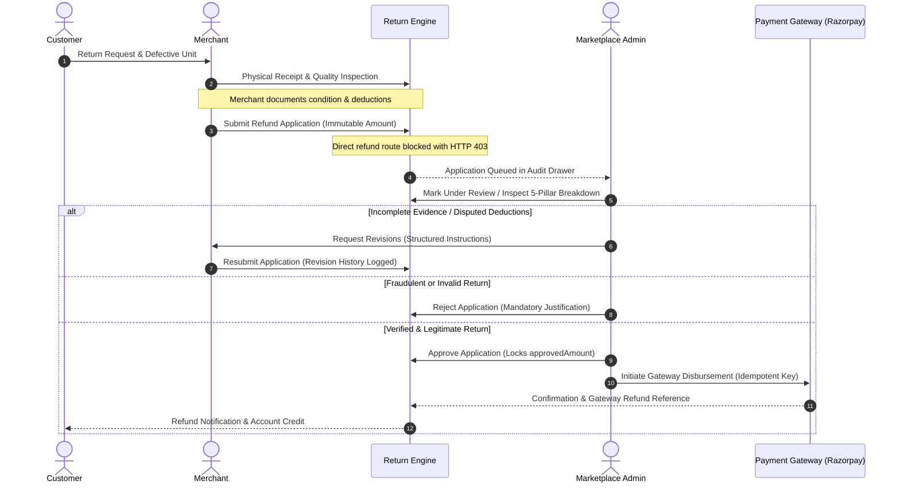

# Phase MERCHANT-REFUND-GOVERNANCE-01: Implementation Report
## Merchant Refund Application & Admin/Superadmin Disbursement Authority Separation

**Project:** Buybox-Ecommerce (MERN Multi-Vendor Marketplace)  
**Phase:** `MERCHANT-REFUND-GOVERNANCE-01`  
**Status:** IMPLEMENTED & VERIFIED  
**Date:** November 9, 2026  

---

## 1. Executive Summary

Phase `MERCHANT-REFUND-GOVERNANCE-01` establishes a strict, institutional separation of powers in the Buybox marketplace financial architecture. Previously, merchants possessing return inspection capabilities could inadvertently initiate direct ledger or gateway refunds. Under this implementation, **no merchant may disburse customer funds or interact directly with payment gateway debit operations**.

Instead, merchants execute product returns, reverse logistics, and quality inspections, and submit an authoritative **Refund Disbursement Application**. Only platform administrators and superadmins possessing explicit financial permissions (`refund_disbursements.initiate` / `refunds.create`) can review, audit, approve, reject, request revisions, and execute idempotent gateway refund disbursements. Furthermore, approval of an application is decoupled from financial disbursement, ensuring a two-phase commit that protects marketplace cash flow and ledger integrity.

---

## 2. Core Architectural Principles & Invariants



### Core Invariants Enforced:
1. **Merchant Disbursement Prohibition:** Any direct call to `/vendors/me/returns/:id/refund` or `/returns/me/:id/refund` by a merchant is categorically rejected with `HTTP 403 MERCHANT_DISBURSEMENT_UNAUTHORIZED`.
2. **Authoritative Backend Valuation:** The `requestedAmount` on a refund application is computed server-side via the authoritative 5-pillar refund formula (`Customer-Paid Base + Proportional Tax + Eligible Shipping - Documented Inspection Deductions`). Any client-supplied amounts are ignored.
3. **Approval vs. Disbursement Decoupling:** Setting an application to `approved` locks the `approvedAmount` but does not move platform capital. Disbursement is an independent, gated operation.
4. **Tenant Isolation:** Merchants are strictly prevented from querying, submitting, or revising refund applications for returns belonging to another vendor (`HTTP 404 RETURN_NOT_FOUND`).
5. **Gateway Fault Tolerance & Retryability:** Gateway network timeouts or debit drops preserve a `disbursement_failed` state with structured diagnostic details, enabling authorized administrators to safely retry without duplicate debits.

---

## 3. Detailed Component Implementations

### 3.1 Backend Data Models

#### `backend/src/models/RefundApplication.js`
- **Schema:** Mongoose schema with `applicationNumber` (`RA-YYMMDD-XXXXXX`), `returnId` (indexed), `orderId` (indexed), `merchantId` (indexed), `customerId` (indexed).
- **Financial Fields:** `authoritativeRefundBreakdown` (5-pillar snapshot), `requestedAmount` (`Decimal128`), `approvedAmount` (`Decimal128`), `disbursedAmount` (`Decimal128`), `currency` (`INR`).
- **Application Status Enum:** `submitted`, `under_review`, `revision_requested`, `approved`, `rejected`, `disbursement_processing`, `disbursed`, `disbursement_failed`.
- **Governance Audit Trails:** `merchantRemarks`, `deductionExplanation`, `supportingDocuments` (array of `{ url, name, caption, uploadedAt }`), `administratorRemarks`, `rejectionReason`, `revisionInstructions`, `revisionHistory`, `inspectionSnapshot`, `paymentSnapshot`.
- **Disbursement Controls:** `submittedBy`, `reviewedBy`, `approvedBy`, `rejectedBy`, `disbursementReference`, `disbursementStatus`, `failureDetails: { code, message, failedAt }`, `idempotencyKey`, `timeline`.

#### `backend/src/models/ReturnRequest.js`
- Added `refundApplicationId` (`ObjectId`, ref: `RefundApplication`, indexed).
- Added `merchantInspection` mixed field to maintain complete backward compatibility with inspection payloads.

---

### 3.2 Granular Permissions & Role Mapping

#### `backend/src/constants/permissions.constants.js` & `frontend/src/constants/permissions.js`
- Added Section 5 permissions:
  - `REFUND_APPLICATIONS_VIEW`: `"refund_applications.view"`
  - `REFUND_APPLICATIONS_REVIEW`: `"refund_applications.review"`
  - `REFUND_APPLICATIONS_APPROVE`: `"refund_applications.approve"`
  - `REFUND_APPLICATIONS_REJECT`: `"refund_applications.reject"`
  - `REFUND_APPLICATIONS_REVISE`: `"refund_applications.revise"`
  - `REFUND_DISBURSEMENT_INITIATE`: `"refund_disbursements.initiate"`
- Configured strict `ALIAS_MAP`:
  ```javascript
  "refund_applications.view": ["refunds.view", "finance:read"],
  "refund_applications.review": ["refunds.approve"],
  "refund_applications.approve": ["refunds.approve"],
  "refund_applications.reject": ["refunds.approve"],
  "refund_applications.revise": ["refunds.approve"],
  "refund_disbursements.initiate": ["refunds.create"],
  ```

---

### 3.3 Backend Services & Controllers

#### `backend/src/services/refund-application.service.js`
1. `submitRefundApplication`: Validates vendor approval, strict return ownership (`ret.vendorId` matching), physical receipt, quality inspection completion (`ret.inspection` or `ret.merchantInspection`), absence of conflicting active applications, and evaluates authoritative 5-pillar calculation.
2. `resubmitRefundApplication`: Validates `revision_requested` state, archives current revision into `revisionHistory`, maps supporting evidence URLs to embedded subdocuments, and transitions application back to `submitted`.
3. `getRefundApplicationByReturnId`: Tenant-isolated lookup with formatted JSON serialization for Decimal128 values.
4. `getAdminRefundApplications`: Multi-filter audit queue (status, merchant, order, date range, regex search) with global KPI liability aggregation.
5. `reviewRefundApplication`: Transitions application from `submitted` to `under_review`.
6. `approveRefundApplication`: Transitions application to `approved` and locks `approvedAmount = requestedAmount`.
7. `rejectRefundApplication`: Requires mandatory $\ge 5$ character justification and transitions to `rejected`.
8. `requestRefundApplicationRevision`: Requires mandatory $\ge 5$ character instructions and transitions to `revision_requested`.
9. `disburseRefundApplication`: Pre-flight state lock (`disbursement_processing`), delegates execution to `processReturnRefund` with `isAdmin: true`, checks for uncertain gateway outcome (`refund_pending`), and safely transitions to either `disbursed` or `disbursement_failed`.

#### `backend/src/controllers/refund-application.controller.js`
- Unified Express controller with standard `apiResponse.sendSuccess` envelope.
- Defensive handling of optional request bodies (`req.body?.notes`, `req.body?.bankReference`).
- Returns structured `{ applications, kpis }` on admin queue endpoints.

#### `backend/src/routes/refund-application.routes.js`
- Mounted at `/api/v1/refund-applications`.
- Protected by `authenticate`, `adminAuth`, and granular `requirePermissions(...)`.

---

### 3.4 Frontend Merchant & Administrator UI

#### `frontend/src/app/vendor/returns/[id]/page.js`
- Removed direct "Disburse Customer Refund" button.
- Added **"Refund Disbursement Authority & Application"** card displaying live status badges, authoritative liability, timeline, and audit drawer.
- Implemented **"Apply for Refund Disbursement"** modal with unboxing notes and evidence upload.
- Implemented **"Revise & Resubmit Application"** modal displaying administrator revision instructions and resubmission form.

#### `frontend/src/app/administrator/operations/refunds/page.js`
- Upgraded to modern 2-tab architecture:
  - **Tab 1: Disbursement Applications Queue** (KPI ribbon: Total Applications, Pending Audit, Revision Requested, Approved Liability, Disbursed Capital, Gateway Failures; filter pills; search input; full application table).
  - **Tab 2: Processed Gateway Ledger** (Historical transaction log).
- Side Audit Drawer detailing:
  - 5-Pillar Authoritative Breakdown.
  - Merchant Quality Inspection Snapshot & Photographs.
  - Customer Return Reason & Defect Evidence.
  - Payment Gateway Capture Details.
  - Contextual Actions: `Mark Under Review`, `Request Revision`, `Reject Application`, `Approve Application`, `Disburse Customer Refund`, and `Retry Failed Disbursement`.

---

## 4. Verification Checklist

| Requirement | Implementation Component | Verification Result |
| :--- | :--- | :--- |
| Merchant Direct Refund Blocked | `return-request.routes.js`, `vendor.routes.js` | HTTP 403 `MERCHANT_DISBURSEMENT_UNAUTHORIZED` |
| Authoritative Valuation Override | `refund-application.service.js` | Server calculates ₹1,770.00; overrides client payload |
| Tenant Isolation (Vendor A vs B) | `refund-application.service.js` | Vendor B receives HTTP 404 on Vendor A return |
| Approval vs Disbursement Decoupling | `refund-application.service.js` | Status `approved` does not execute gateway or alter ReturnRequest status |
| Administrative Audit Queue | `administrator/operations/refunds/page.js` | Live KPI ribbon and audit drawer with 5-pillar breakdown |
| Gateway Failure & Safe Retry | `refund-application.service.js` | Preserves `disbursement_failed` and failureDetails; safe retry succeeds |
