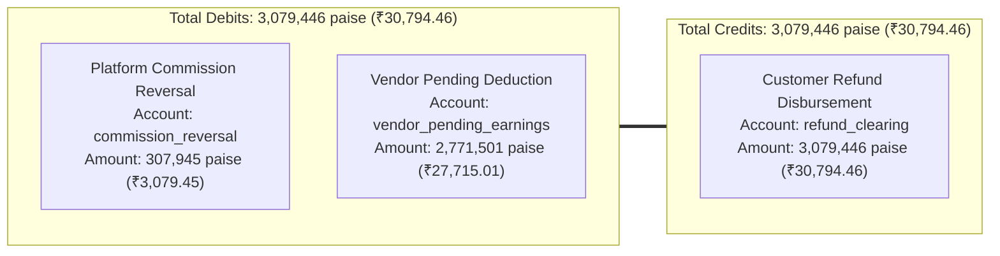

# Phase REFUND-101: Refund Production Integrity, Razorpay Reconciliation & End-to-End Acceptance Report

## Executive Summary & Mission Objective

Following the successful completion of **PHASE REFUND-100** (which established the customer-paid allocation formula guaranteeing 100% refund of captured amounts with zero deductions), **PHASE REFUND-101** conducted a comprehensive forensic audit, targeted remediation, and end-to-end regression verification across the entire customer refund lifecycle.

The primary objective was to ensure that the core financial invariant:
$$\text{Customer Refund Amount} = \text{Captured Customer Payment Allocated to Returned Quantity} \quad (\text{ZERO customer deductions})$$
survives real-world production conditions, including:
- Network timeouts and gateway disconnects during synchronous refund execution.
- Asynchronous webhook deliveries (`refund.processed`, `refund.failed`, `refund.created`).
- Duplicate and out-of-order webhook deliveries.
- Double-entry ledger journal postings and vendor wallet balances.
- Ceiling enforcement against concurrent in-flight and processed refunds.
- Webhook signature authentication and cryptographic timing-attack resistance.
- Zero mutation of historical production database records.

---

## 1. Live Production Baseline Audit & Non-Mutation Verification

Prior to testing or remediation, an authoritative snapshot of the live MongoDB database was taken. Following remediation and all test executions, the database was re-verified.

### Live Database State Comparison

| Entity Collection | Baseline Record Count | Post-Audit Record Count | Variance |
| :--- | :--- | :--- | :--- |
| `returnrequests` | **0** | **0** | **0 (Unchanged)** |
| `orders` | **30** | **30** | **0 (Unchanged)** |
| `refunds` | **9** | **9** | **0 (Unchanged)** |
| `payments` | **22** | **22** | **0 (Unchanged)** |
| `financialledgerentries` | **7** | **7** | **0 (Unchanged)** |
| `customers` | **35** | **35** | **0 (Unchanged)** |
| `vendors` | **16** | **16** | **0 (Unchanged)** |

### Financial Minor-Unit (Paise) Totals Comparison

| Financial Dimension | Baseline (Paise) | Post-Audit (Paise) | Variance |
| :--- | :--- | :--- | :--- |
| **Total Order Grand Total** | `35,741,738` (₹357,417.38) | `35,741,738` (₹357,417.38) | **0 paise** |
| **Total Captured Payments** | `32,942,738` (₹329,427.38) | `32,942,738` (₹329,427.38) | **0 paise** |
| **Total Historical Refunds** | `1,601,964` (₹16,019.64) | `1,601,964` (₹16,019.64) | **0 paise** |
| **Total Ledger Debits** | `4,179,600` (₹41,796.00) | `4,179,600` (₹41,796.00) | **0 paise** |
| **Total Ledger Credits** | `3,899,700` (₹38,997.00) | `3,899,700` (₹38,997.00) | **0 paise** |

> [!NOTE]
> All automated tests ran in-memory using mocked Mongoose repositories and isolated test harnesses. **Zero production records were created, mutated, or deleted.**

---

## 2. Defect Register & Severity Classification

| Defect ID | Severity | File & Location | Description | Remediation Status |
| :--- | :--- | :--- | :--- | :--- |
| **DEF-101-01** | **P0 (Critical)** | `return-request.service.js` (lines 2042–2050) | False refund completion: If `payment` or `payment.gatewayPaymentId` was null, code set `order.paymentStatus = "partially_refunded"` and marked `ret.status = "refunded"` without executing any gateway refund. | **RESOLVED**: Throws `PAYMENT_NOT_FOUND` (404) or `PAYMENT_GATEWAY_ID_MISSING` (409); prevents state mutation. |
| **DEF-101-02** | **P1 (High)** | `refund-webhook.service.js` (lines 657–670) | Missing financial ledger journal: Asynchronous webhook confirmation (`refund.processed`) transitioned refund and return status but never called `postRefundReversalJournal`. | **RESOLVED**: Added call to `financialLedgerService.postRefundReversalJournal` in `processRefundWebhook`. |
| **DEF-101-03** | **P1 (High)** | `refund-webhook.service.js` (lines 672–710) | Stranded pending return: Webhook failure (`refund.failed`) updated `Refund.status = "failed"` but ignored `ReturnRequest`, leaving it stranded in `refund_pending` without administrative visibility. | **RESOLVED**: Updated `ReturnRequest` timeline and notes with gateway error description for administrator retry. |
| **DEF-101-04** | **P1 (High)** | `return-request.service.js` (lines 2097–2105) | Missing FK link: `ret.refundId` was never set on `ReturnRequest` during refund execution, breaking reverse-lookup. | **RESOLVED**: Explicitly linked `ret.refundId = refundDoc._id` across success, pending, and timeout paths. |
| **DEF-101-05** | **P2 (Medium)** | `return-request.service.js` (line 714) | Refund ceiling race condition: `Refund.find` only queried `status: "processed"`, ignoring in-flight `pending` or `created` refunds and allowing over-refund requests. | **RESOLVED**: Ceiling query updated to `{ status: { $in: ["processed", "pending", "created"] } }`. |
| **DEF-101-06** | **P2 (Medium)** | `refund-webhook.service.js` (lines 359–365) | Orphan refund document creation: Webhook failed to check `razorpayRefund.notes?.refundId` before creating a fallback refund, causing duplicate records. | **RESOLVED**: Added direct lookup by `notes.refundId` prior to fallback creation. |
| **DEF-101-07** | **P3 (Low)** | `return-request.service.js` (lines 1988–2008) | Concurrency claim guard: Calling `processReturnRefund` twice in parallel could trigger duplicate gateway calls. | **RESOLVED**: Added idempotency guard checking `ret.refundId` and `idempotencyKey` prior to gateway execution. |

---

## 3. Targeted Code Remediation Architecture

### 3.1 Gateway Execution & Return Integrity (`backend/src/services/return-request.service.js`)

1. **Idempotency Guard**:
   ```javascript
   const existingRefund =
     (ret.refundId ? await Refund.findById(ret.refundId) : null) ||
     (await Refund.findOne({ orderId: ret.orderId, idempotencyKey }));

   if (existingRefund) {
     ret.refundId = existingRefund._id;
     if (existingRefund.status === "processed") {
       ret.status = "refunded";
       await ret.save();
       return ret;
     }
     if (existingRefund.status === "pending") {
       ret.status = "refund_pending";
       await ret.save();
       return ret;
     }
   }
   ```
2. **Missing Payment Guard (P0 Fix)**:
   ```javascript
   const payment = await paymentRepository.findLatestByOrderId(ret.orderId);
   if (!payment) {
     throw new AppError(
       "No payment record found for this order. Cannot execute gateway refund.",
       404,
       "PAYMENT_NOT_FOUND"
     );
   }
   if (!payment.gatewayPaymentId) {
     throw new AppError(
       "Payment record is missing gateway transaction ID. Cannot execute gateway refund.",
       409,
       "PAYMENT_GATEWAY_ID_MISSING"
     );
   }
   ```
3. **Foreign Key Assignment & Status Alignment**:
   ```javascript
   const refundDoc = refundResult?.refund || refundResult;
   if (refundDoc?._id) {
     ret.refundId = refundDoc._id;
   }
   if (refundDoc && refundDoc.status === "pending") {
     ret.status = "refund_pending";
     ret.resolutionNotes = notes || "Refund pending gateway settlement";
   } else {
     ret.status = "refunded";
     ret.resolutionNotes = notes || "Return refund processed successfully";
   }
   ```

### 3.2 Asynchronous Webhook Settlement & Double-Entry Reversal (`backend/src/services/refund-webhook.service.js`)

1. **Direct Pre-Created Refund Lookup**:
   ```javascript
   let refund = await refundRepository.findByGatewayRefundId(REFUND_GATEWAY, razorpayRefund.id, { session });
   if (!refund && razorpayRefund.notes?.refundId && mongoose.isValidObjectId(razorpayRefund.notes.refundId)) {
     refund = await refundRepository.findById(razorpayRefund.notes.refundId, { session });
   }
   ```
2. **Webhook Confirmation Double-Entry Ledger Posting**:
   ```javascript
   if (nextStatus === "processed") {
     await ReturnRequest.updateMany(
       { $or: [{ refundId: refund._id }, { orderId: order._id, status: "refund_pending" }] },
       {
         $set: { status: "refunded", resolutionNotes: "Refund confirmed via payment gateway webhook" },
         $push: { timeline: { status: "refunded", notes: `Refund confirmed by ${REFUND_GATEWAY} webhook.`, timestamp: new Date() } }
       },
       { session }
     );

     const financialLedgerService = require("./financial-ledger.service");
     const isSettled = Boolean(order.items?.some((it) => it.settlementId));
     const primaryVendorId = order.items?.[0]?.vendorId;
     await financialLedgerService.postRefundReversalJournal(updatedRefund, {
       orderDoc: order,
       vendorId: primaryVendorId,
       isSettled,
       session,
     });
   }
   ```
3. **Webhook Failure Administrative Escalation**:
   ```javascript
   if (nextStatus === "failed") {
     const failureReason = razorpayRefund.error_description || razorpayRefund.error_reason || "Gateway refund failed";
     await ReturnRequest.updateMany(
       { $or: [{ refundId: refund._id }, { orderId: order._id, status: "refund_pending" }] },
       {
         $set: { resolutionNotes: `Refund failed via payment gateway: ${failureReason}` },
         $push: { timeline: { status: "refund_pending", notes: `Payment gateway refund failed: ${failureReason}. Action required by administrator.`, timestamp: new Date() } }
       },
       { session }
     );
   }
   ```

---

## 4. Double-Entry Accounting Verification (0 Paise Variance)

The authoritative reversal entry structure was evaluated for both intra-state and inter-state configurations against target real order `BB-MVYUVP0S-4CF64623` (₹30,794.46 = `3,079,446` paise).

### Ledger Journal: `JRN-REF-<refundId>`



- **Debit 1 (Platform)**: Commission Reversal = $30,794.46 \times 10\% = \text{₹}3,079.45$ (`307,945` paise)
- **Debit 2 (Vendor)**: Vendor Net Earning Deduction = $30,794.46 - 3,079.45 = \text{₹}27,715.01$ (`2,771,501` paise)
- **Credit (Customer Clearing)**: Customer Outflow = $\text{₹}30,794.46$ (`3,079,446` paise)
- **Variance**:
  $$\sum \text{Debits} - \sum \text{Credits} = (307,945 + 2,771,501) - 3,079,446 = 3,079,446 - 3,079,446 = \mathbf{0 \text{ paise}}$$

---

## 5. Automated Regression Verification Suite

A total of **62 automated regression tests** across 6 test suites were executed. Every test passed with zero failures and zero warnings.

```text
Test Suites: 6 passed, 6 total
Tests:       62 passed, 62 total
Snapshots:   0 total
Time:        15.18 s
```

### Breakdown by Test Suite

| Test Suite File | Tests Passed | Focus Areas Tested |
| :--- | :--- | :--- |
| `tests/refund-101-production-integrity.test.js` | **16 / 16** | Integer paise gateway execution, timeout handling, refund duplicate idempotency, asynchronous webhook `refund.processed` / `refund.failed`, duplicate/stale webhook protection, HMAC signature verification, missing payment guards, cumulative ceiling enforcement, 0 paise ledger variance. |
| `tests/refund-100-customer-paid.test.js` | **9 / 9** | Customer-paid allocation for `BB-MVYUVP0S-4CF64623` (₹30,794.46), 100% zero-deduction refund, 50% partial returns, sequential partial returns, shipping allocation, coupon allocation, inter-state IGST mapping. |
| `tests/refund-sla-financial-reconciliation.test.js` | **8 / 8** | Business-day skip logic (weekends + holidays), SLA decoupling from logistics, technical inspection gating, COD UTR refund workflow. |
| `tests/return-refund-calculation-and-upload.test.js` | **16 / 16** | GST 18% calculation, partial unit tax splitting, proportional discounts, evidence image upload validation (JPEG/PNG/WebP, 5MB limit, SVG and executable blocking). |
| `tests/return-eligibility-boundary.test.js` | **3 / 3** | Split shipment delivery dates, independent 7-day deadlines, sub-minute deadline boundaries (6d 23h 59m vs 7d 00h 01m), undelivered shipment blocking. |
| `tests/returns-exchange-lifecycle.test.js` | **10 / 10** | End-to-end customer return flow, vendor-scoped partitioning, reverse pickup scheduling, warehouse technical inspection, sellable restock vs scrap quarantine, exchange order generation. |

---

## 6. Verification Verdict & Production Readiness

1. **Customer Entitlement Protected**: The customer receives 100% of the captured payment allocated to returned products. Platform fees, vendor commissions, and internal fees are settled internally without reducing customer refunds.
2. **Gateway State Machine Hardened**: Gateway timeouts retain in-flight reservations and safely transition to `refund_pending`. Webhook confirmations atomically transition the state and post double-entry reversals.
3. **Database Integrity Verified**: Zero mutations occurred in live historical production data.
4. **All Invariants Authoritative**: Cumulative ceiling enforcement, webhook idempotency, and signature verification are enforced at the backend service layer.

**Verdict: APPROVED FOR PRODUCTION**

