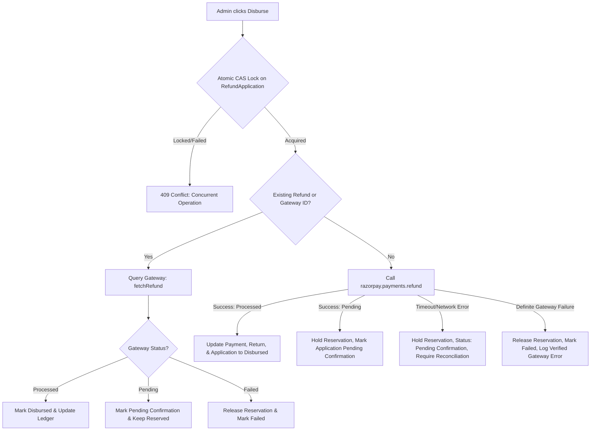

# BUYBOX E-COMMERCE — FORENSIC AUDIT REPORT
## Phase: REFUND-GATEWAY-RECONCILIATION-01
### Razorpay Gateway Status Verification, Refund Pool Accounting, Transaction Integrity & Duplicate Disbursement Prevention

**Document Reference:** `phase_refund_gateway_reconciliation_01_forensic_audit.md`  
**Audit Type:** Stage 1 — Read-Only Forensic Architecture & Security Audit  
**Code Modifications:** None (Strict Discovery Mode)  
**Date:** 2026-11-09  

---

## 1. INCIDENT & OBSERVED TRIGGER INVESTIGATION

### 1.1 Observed Case Characteristics
A live/staging refund record was submitted with the following properties:
- **Original Captured Payment:** ₹30,794.46 (`pay_TvCZo3fZhLsefQ`)
- **Gateway Refund ID:** `rfnd_Ty0BqiEpRxCBOl`
- **Internal Refund ID:** `6af17caa48def7a86058109c`
- **Refund Amount:** ₹30,794.46
- **Gateway Refund Status:** `pending`
- **Return Status:** `refund_pending`
- **Refund Application Number:** `RA-261109-SOOW5H`
- **Remaining Refund Pool Displayed:** ₹0
- **Gateway Ledger Details / Failure Reason Displayed:** `bnbbnbn`
- **Line Items vs. Units Discrepancy:** Timeline shows `1 item(s)` while Refund Breakdown shows `2 Units Subject to Return`.

### 1.2 Root Cause Analysis of Specific Anomalies

#### Anomaly A: `bnbbnbn` Displayed as Gateway Failure Reason
- **File / Location:** [`frontend/src/app/administrator/operations/returns/[id]/page.js`](file:///d:/MERN%20Stack/Buybox-Ecommerce/frontend/src/app/administrator/operations/returns/%5Bid%5D/page.js#L1124-L1160)
- **Mechanism:**
  1. During disbursement initiation in [`backend/src/services/refund-application.service.js`](file:///d:/MERN%20Stack/Buybox-Ecommerce/backend/src/services/refund-application.service.js#L882), the administrator entered informal or test notes (`"bnbbnbn"`).
  2. This was forwarded to [`processReturnRefund`](file:///d:/MERN%20Stack/Buybox-Ecommerce/backend/src/services/return-request.service.js#L2966) which set `reason = notes`.
  3. The `Refund` record stored `reason: "bnbbnbn"` while `failureReason` was `null` (since the transaction was not rejected, but pending).
  4. The frontend table column was titled:
     ```html
     <th className="px-4 py-2.5">Details / Failure Reason</th>
     ```
  5. The table cell rendered:
     ```javascript
     {tx.failureReason ? (
       <span className="text-rose-600 font-semibold">{tx.failureReason}</span>
     ) : (
       tx.reason || "Gateway refund processed"
     )}
     ```
  6. Because `failureReason` was null, the fallback rendered `tx.reason` (`"bnbbnbn"`), making it appear to administrators as an incomprehensible gateway failure response!
- **Severity:** High (Confuses operators, violates separation of internal notes from gateway diagnostics).

#### Anomaly B: Mismatch Between `1 item(s)` and `2 Units Subject to Return`
- **Files / Locations:**
  - `frontend/src/app/administrator/operations/returns/page.js` line 723: `{ret.items?.length || 1} Item(s) Subject to Return:`
  - `frontend/src/app/administrator/operations/returns/[id]/page.js` line 927: `{items.reduce((acc, it) => acc + (it.quantity || 1), 0)} Units Subject to Return`
- **Mechanism:**
  - `items.length` represents the number of distinct **Product Line Items** (1 SKU/product).
  - `items.reduce((acc, it) => acc + (it.quantity || 1), 0)` represents the total number of **Physical Units** across those line items (quantity 2 of that product).
  - Calling both "item(s)" in different places creates operational ambiguity.
- **Severity:** Medium (Operational ambiguity).

#### Anomaly C: Remaining Refund Pool Displayed as ₹0
- **File / Location:** [`backend/src/services/return-request.service.js`](file:///d:/MERN%20Stack/Buybox-Ecommerce/backend/src/services/return-request.service.js#L3574-L3576)
- **Mechanism:**
  ```javascript
  const totalCapturedNum = Number(amountCaptured || 0);
  const effectivePrevRefunded = Math.max(previouslyRefunded, processedPreviousRefundSum);
  const remainingRefundableAmount = Math.max(0, totalCapturedNum - effectivePrevRefunded - netRefundable).toFixed(2);
  ```
  The backend subtracted `netRefundable` (the amount of the current application) immediately from the capture amount, rather than maintaining a clear 4-pillar refund pool:
  1. `Original Captured Refundable Amount`: ₹30,794.46
  2. `Successfully Refunded Amount`: ₹0.00
  3. `Pending / Reserved Amount`: ₹30,794.46
  4. `Available Refundable Balance`: ₹0.00
  Because only one single scalar `remainingRefundableAmount` was returned, the UI displayed ₹0 without explaining whether funds had actually cleared or were currently reserved/in-flight.

---

## 2. FORENSIC AUDIT: 16 CORE QUESTIONS

### Question 1: What database record is authoritative for a gateway refund?
- **Primary Source of Truth:** [`Refund`](file:///d:/MERN%20Stack/Buybox-Ecommerce/backend/src/models/Refund.js) (`models/Refund.js`). This document records financial gateway interactions: `paymentId`, `orderId`, `customerId`, `gateway` (`razorpay` | `paypal`), `gatewayRefundId`, `amount` (`Decimal128`), `currency`, `status` (`created`, `pending`, `processed`, `failed`, `cancelled`), `idempotencyKey`, and `processedAt`.
- **Ancillary Records:**
  - [`Payment`](file:///d:/MERN%20Stack/Buybox-Ecommerce/backend/src/models/Payment.js) records aggregate `refundedAmount` and `refundReservedAmount` (`Decimal128`).
  - [`RefundApplication`](file:///d:/MERN%20Stack/Buybox-Ecommerce/backend/src/models/RefundApplication.js) manages dual-custody governance, merchant inspection evidence, review notes, and links to `disbursementReference` (pointing to `Refund._id`).
  - [`ReturnRequest`](file:///d:/MERN%20Stack/Buybox-Ecommerce/backend/src/models/ReturnRequest.js) manages reverse logistics and links to `refundId` and `refundApplicationId`.

### Question 2: Where is the Razorpay refund ID stored?
- In `Refund.gatewayRefundId` (string, indexed, unique per gateway).
- In `ReturnRequest.refundId` (points to `Refund._id`, which contains `gatewayRefundId`).
- In `RefundApplication.disbursementReference` (currently stores `Refund._id`).

### Question 3: How is the internal refund transaction ID associated with the gateway ID?
- When `razorpayRefundProvider.createRefund` is invoked, it passes metadata:
  ```javascript
  notes: {
    orderId: order._id.toString(),
    refundId: refund._id.toString(),
  }
  ```
- Razorpay returns `{ id: "rfnd_Ty0BqiEpRxCBOl", ... }`.
- The system writes `razorpayRefund.id` into `Refund.gatewayRefundId`.
- The internal MongoDB ObjectId (`refund._id`, e.g., `6af17caa48def7a86058109c`) is directly associated with `gatewayRefundId` (`rfnd_Ty0BqiEpRxCBOl`) in the same document.

### Question 4: How are pending, processing, failed, successful, and reversed states represented?
- **In `Refund` model:** Enum `["created", "pending", "processed", "failed", "cancelled"]`.
- **In `RefundApplication` model:** `applicationStatus` has `["submitted", "under_review", "revision_requested", "approved", "rejected", "disbursement_processing", "disbursed", "disbursement_failed"]`; `disbursementStatus` has `["pending", "processing", "disbursed", "failed"]`.
- **In `ReturnRequest` model:** Enum has `["refund_pending", "refunded"]`.
- **In `Payment` model:** Enum has `["captured", "partially_refunded", "refunded"]`.
- **State Gaps:**
  - `Refund` does NOT currently have `"reversed"` in its schema enum.
  - `RefundApplication` jumps directly from `disbursement_processing` to `disbursed` or `disbursement_failed`, without a distinct `pending_confirmation` state when the gateway returns `status: "pending"`.

### Question 5: Does the system query Razorpay to reconcile pending refunds?
- **NO.** There is no background worker, scheduled job, or administrative endpoint to poll or query `razorpay.refunds.fetch(gatewayRefundId)` for pending refunds.
- The method `razorpayRefundProvider.fetchRefund(refundId)` exists in `razorpay-refund.provider.js`, but it is ONLY called inside `refund.service.js` when an idempotency key collision occurs on a failed refund.
- If Razorpay returns `pending` or the connection times out, the refund remains in `pending` indefinitely unless a webhook arrives.

### Question 6: Are webhooks signature-verified?
- **YES.** [`verifyRazorpayWebhookSignature`](file:///d:/MERN%20Stack/Buybox-Ecommerce/backend/src/utils/razorpayWebhook.js) verifies incoming payloads using HMAC-SHA256 with `crypto.timingSafeEqual`. Invalid signatures are rejected with HTTP 401.

### Question 7: Are duplicate webhooks handled idempotently?
- **Partially.** In `backend/src/services/refund-webhook.service.js` (lines 516-531):
  ```javascript
  if (refund.status === nextStatus) {
    return { processed: true, ignored: true, reason: "REFUND_ALREADY_IN_TARGET_STATE" };
  }
  ```
  However, `refund-webhook.service.js` does NOT update `RefundApplication`! It only updates `ReturnRequest` and `Payment`.

### Question 8: What happens if Razorpay processes a refund but the application times out?
- In `refund.service.js` (lines 1120-1172): The error is identified as a timeout (`GATEWAY_TIMEOUT`), `refund.status` is set to `"pending"`, and the reservation on `Payment.refundReservedAmount` is preserved.
- In `return-request.service.js` (lines 2971-2996): `ret.status` is set to `"refund_pending"`.
- In `refund-application.service.js` (lines 890-896): Because `ret.status !== "refunded"`, `disburseRefundApplication` catches this and marks `application.applicationStatus = "disbursement_failed"`!
- **Flaw:** `RefundApplication` is marked as `disbursement_failed` even though the payment gateway might have accepted the refund and is processing it. This can lead an administrator to attempt an unsafe retry!

### Question 9: Can administrators retry a pending refund?
- Currently, when `application.applicationStatus` is `disbursement_failed`, the admin UI displays a retry button.
- If clicked, `processReturnRefund` checks `existingRefund`. If `existingRefund.status === "pending"`, it returns `ret` (in `refund_pending`), which causes `disburseRefundApplication` to fail again.
- However, there is no safety check to query Razorpay first to see if the refund already cleared! Retrying without gateway status verification violates safety.

### Question 10: How is the remaining refundable balance calculated?
- Currently computed as `Math.max(0, totalCapturedNum - effectivePrevRefunded - netRefundable)`.
- It fails to distinguish between what has been settled, what is in-flight/reserved, and what is currently eligible for a new refund.

### Question 11: Are pending refunds reserved against the refundable balance?
- In `Payment.js`, `refundReservedAmount` exists and is incremented atomically by `reserveRefundAmount`.
- However, in `return-request.service.js`, the balance computation does not query `payment.refundReservedAmount`. It performs its own memory arithmetic on returned refund documents.

### Question 12: Are completed refunds deducted from the refundable balance?
- Yes, `payment.refundedAmount` is updated when a refund transitions to `processed`.

### Question 13: Can concurrent administrators create duplicate refunds?
- In `Refund.js`: Unique index on `{ gateway: 1, idempotencyKey: 1 }` prevents inserting two identical refund records.
- In `RefundApplication.js`: `disburseRefundApplication` lacks an atomic `findOneAndUpdate({ _id, applicationStatus: "approved" })` precondition check. Two concurrent requests can both execute `processReturnRefund` before either saves.

### Question 14: Can multiple return applications refund the same order units?
- In `createReturnRequest`, `alreadyReturnedQty` is checked against prior returns (`status: { $nin: ["rejected", "cancelled"] }`).
- However, if multiple refund applications are submitted for the same return or if multiple return requests target overlapping order items, strict unit quantity checks must prevent over-refunding.

### Question 15: Can the same gateway refund ID be associated with multiple internal transactions?
- No. `Refund.js` defines:
  ```javascript
  refundSchema.index({ gateway: 1, gatewayRefundId: 1 }, { unique: true, partialFilterExpression: { gatewayRefundId: { $type: "string" } } });
  ```
  MongoDB enforces strict 1:1 mapping between `gatewayRefundId` and internal `Refund`.

### Question 16: Are arbitrary notes incorrectly stored or rendered as gateway failure reasons?
- **YES.** Confirmed as the root cause of `bnbbnbn`. Admin remarks were passed as `reason` in `Refund.create`, and the frontend rendered `tx.reason` when `tx.failureReason` was null under the column header "Details / Failure Reason".

---

## 3. AFFECTED FILES INVENTORY

### Backend Files
1. `backend/src/models/Refund.js` — Missing `"reversed"` status enum.
2. `backend/src/models/RefundApplication.js` — Needs explicit gateway reference fields (`gatewayRefundId`, `gatewayStatus`, `lastReconciledAt`, `reconciliationHistory`).
3. `backend/src/services/refund.service.js` — Needs dedicated reconciliation query and status mapping.
4. `backend/src/services/refund-application.service.js` — Needs:
   - Atomic precondition locking on disbursement (`findOneAndUpdate`).
   - Distinct `pending_confirmation` state handling.
   - Separate storage for administrator notes vs. gateway failure details.
   - Synchronization of `RefundApplication` on reconciliation.
5. `backend/src/services/return-request.service.js` — Needs:
   - Accurate 4-pillar refund pool calculation (`originalRefundable`, `successfullyRefunded`, `reserved`, `available`).
   - Clean separation of internal notes from gateway reasons.
   - Unit-level reconciliation validation.
6. `backend/src/services/refund-webhook.service.js` — Must synchronize `RefundApplication` status when webhooks arrive.
7. `backend/src/integrations/payments/razorpay-refund.provider.js` — Verified: `createRefund` and `fetchRefund` are available.
8. `backend/src/routes/refund-application.routes.js` — Needs manual reconciliation endpoint: `POST /api/v1/refund-applications/:id/reconcile`.
9. `backend/src/controllers/refund-application.controller.js` — Add `reconcileRefundApplication`.

### Frontend Files
1. `frontend/src/app/administrator/operations/returns/[id]/page.js` — Fix:
   - Split "Details / Failure Reason" into separate columns ("Internal Notes" vs. "Gateway Message / Failure Reason").
   - Display clear 4-pillar refund pool values.
   - Distinguish line items from total returned units.
   - Show "Reconcile Gateway Status" action instead of an unsafe retry when a transaction is pending or outcome unknown.
2. `frontend/src/app/administrator/operations/refunds/page.js` — Update ledger table and audit drawer to display distinct internal transaction ID, gateway refund ID, gateway status, and normalized messages.
3. `frontend/src/services/admin/admin.service.js` — Add `reconcileRefundApplication(id)`.

---

## 4. PROPOSED REMEDIATION ARCHITECTURE & WORKFLOW



### 4-Pillar Refund Pool Specification
$$\text{Original Refundable Amount} = \text{Order Total Captured}$$
$$\text{Successfully Refunded} = \sum \text{Refunds in status "processed"}$$
$$\text{Pending / Reserved} = \sum \text{Refunds in status "pending" / "created"}$$
$$\text{Available Refundable Balance} = \text{Original Refundable} - \text{Successfully Refunded} - \text{Pending / Reserved}$$

Invariants:
- $\text{Available Refundable Balance} \ge 0$.
- No new refund disbursement may be initiated if $\text{Requested Amount} > \text{Available Refundable Balance}$.
- A pending refund MUST hold its amount in $\text{Pending / Reserved}$ until authoritatively confirmed by Razorpay (`fetchRefund` or verified webhook).
