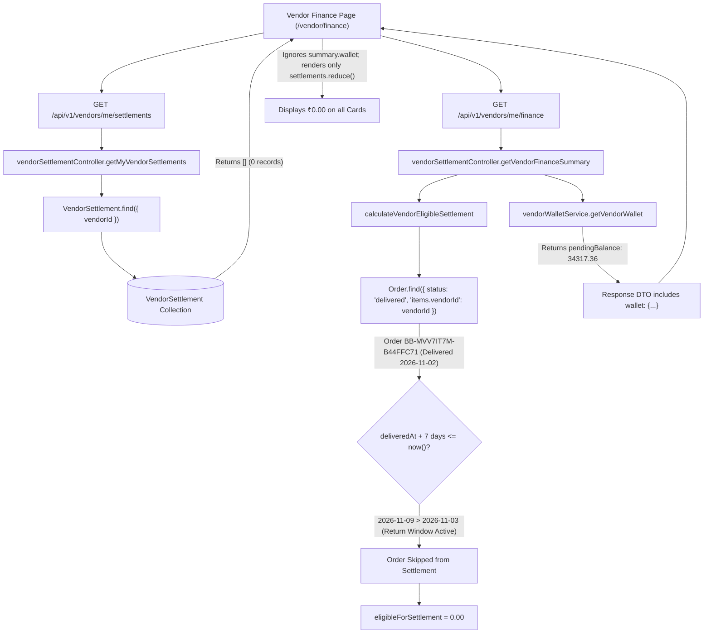

# BUYBOX E-COMMERCE
# VENDOR CONSOLE — CROSS-MODULE CONNECTIVITY & FINANCIAL DATA AUDIT
## PHASE VENDOR-CONSOLE-INTEGRITY-A — READ-ONLY FORENSIC DIAGNOSTIC REPORT

**Execution Mode:** STRICT READ-ONLY FORENSIC AUDIT (No Source Modifications, No Database Mutations)  
**Priority:** P0 — Vendor Authentication, Financial Reporting & Marketplace Operations  
**Target Vendor:** Smriti Organic Crafts  
**Vendor ID:** `6ad9afc64e9af87a84de7d6e`  
**Associated User ID:** `6abb3f27f9686f9682658c81`  
**Vendor Email / Login:** `itssmriti1333@gmail.com`  
**User Role Configuration:** Primary `role: "customer"`, Multi-role `roles: ["customer", "vendor"]`  
**Audit Timestamp:** 2026-11-03T13:20:00.000Z  

---

## 1. EXECUTIVE SUMMARY

A deep forensic investigation was conducted across the Buybox multi-vendor marketplace platform to isolate the exact technical root causes of:
1. **Vendor Session Context Leakage:** Recurring HTTP 403 errors stating `Cross-context session disallowed. Required: vendor, found: customer` in Product Reviews, Questions & Q/A, and Analytics.
2. **Analytics Sort Contract Failure:** Runtime crash in `fetchProductPerformance` throwing `Invalid option: expected one of "unitsSold"|"grossSales"|"netSales"|"productName"`.
3. **Vendor Finance Zero-Value Display:** Vendor Finance Overview displaying `₹0.00` across all KPI cards despite authoritative general ledger earnings of `₹38,997.00` and pending wallet clearing of `₹34,317.36`.
4. **Settlement Statements Absence:** Settlement Statements reporting 0 records and ₹0.00 disbursements.
5. **Cross-Module API-Client Inconsistencies:** Widespread cross-context token contamination across catalog, inventory, and support modules.

### Core Forensic Verdict
The defects do not stem from database corruption, compromised data, or accounting engine failures. Rather, they are caused by:
- **Flawed Client-Side Route Prefix Matching (`isVendorRoute` in `axios.js`):** The shared Axios instance attempts to distinguish vendor from customer requests using an incomplete list of 9 URL string prefixes. Critical vendor endpoints—such as `/reviews/vendor/my`, `/questions/vendor/my`, `/products`, `/product-variants`, `/inventory/:id/adjust`, and `/notifications`—fail this prefix check, causing Axios to attach the **Customer Access Token** (`tokenManager.getAccessToken()`) instead of the **Vendor Access Token** (`vendorTokenManager.getAccessToken()`). When hitting backend endpoints protected by `authenticateVendor`, the backend enforces strict context isolation and rejects the request with HTTP 403 `INVALID_SESSION_CONTEXT`.
- **Frontend State Default Mismatch in Analytics:** The product performance table in `VendorAnalyticsPage` initializes `sortBy` to `"units"` and offers an `"orders"` dropdown option. The backend Zod validator strictly accepts only `["unitsSold", "grossSales", "netSales", "productName"]`, causing 100% of initial page loads to fail with HTTP 400.
- **Finance Overview Architectural Disconnect:** The Vendor Finance Overview page (`/vendor/finance`) only computes and displays figures from generated `VendorSettlement` billing statements. It completely ignores `VendorWallet` pending and available balances. Because Smriti's only delivered order (`BB-MVV7IT7M-B44FFC71`) was delivered on 2026-11-02 (yesterday), it is legitimately within the mandatory 7-day buyer return window hold (maturing on 2026-11-09). The automated settlement worker is correctly holding the funds, but the UI displays ₹0.00 without disclosing the ₹34,317.36 in pending clearing. Furthermore, the dedicated wallet pages (`/vendor/finance/wallet`, `/vendor/finance/statements`, `/vendor/finance/bank-accounts`) linked in the navigation do not exist on the frontend.

---

## 2. CONFIRMED DEFECTS & SEVERITY CLASSIFICATION

| Defect ID | Severity | Module / Area | Description | Primary Root Cause |
| :--- | :---: | :--- | :--- | :--- |
| **DEF-A1** | **P0** | Product Reviews | `GET /api/v1/reviews/vendor/my` fails with HTTP 403 `Cross-context session disallowed. Required: vendor, found: customer`. | `isVendorRoute` in `axios.js` lacks `/reviews/`, attaching customer bearer token. |
| **DEF-A2** | **P0** | Questions & Q/A | `GET /api/v1/questions/vendor/my` fails with HTTP 403 `Cross-context session disallowed. Required: vendor, found: customer`. | `isVendorRoute` in `axios.js` lacks `/questions/`, attaching customer bearer token. |
| **DEF-A3** | **P0** | Shared Auth / State | Concurrent 401 refresh in `axios.js` drains `failedQueue` with customer access token when customer refresh is triggered. | Single shared `failedQueue` and single `isRefreshing` boolean in `axios.js`. |
| **DEF-A4** | **P0** | Auth Store Initialization | `VendorShell.jsx` skips `initializeVendorAuth()` if customer auth previously initialized `isInitialized: true`. | Shared `useAuthStore` combines customer and vendor state into a single `isInitialized` flag. |
| **DEF-B1** | **P1** | Vendor Analytics | `fetchProductPerformance` crashes on mount with HTTP 400 `Invalid option: expected one of "unitsSold"..."`. | Frontend `sortBy` state defaults to `"units"`; backend accepts `"unitsSold"`. Dropdown also sends `"orders"`. |
| **DEF-C1** | **P1** | Vendor Finance | Finance Overview reports ₹0.00 across all cards despite ₹34,317.36 pending clearing in `VendorWallet`. | UI binds exclusively to `VendorSettlement` billing statements; completely ignores `summary.wallet`. |
| **DEF-D1** | **P1** | Vendor Finance UI | Links to `/vendor/finance/wallet`, `/vendor/finance/statements`, and `/vendor/finance/bank-accounts` return HTTP 404. | Routes are declared in `VendorSidebar.jsx` but page components were never created in frontend app router. |
| **DEF-E1** | **P1** | Cross-Module / Catalog | Product creation (`POST /products`), updating (`PATCH /products/:id`), variants, and image uploads send customer token. | `isVendorRoute` only matches `/products/vendor`, ignoring `/products` and `/product-variants`. |
| **DEF-E2** | **P1** | Cross-Module / Inventory | Inventory adjustment (`PATCH /inventory/:id/adjust`) sends customer token. | `isVendorRoute` only matches `/inventory/vendor`, ignoring `/inventory/:id/adjust`. |
| **DEF-E3** | **P1** | Cross-Module / Support | Vendor Notifications and Support Tickets send customer token. | `isVendorRoute` lacks `/notifications` and `/support-tickets`. |

---

## 3. EXACT AFFECTED SOURCE FILES & ENDPOINTS

### 3.1 Frontend Files
- [`frontend/src/lib/api/axios.js`](file:///d:/MERN%20Stack/Buybox-Ecommerce/frontend/src/lib/api/axios.js):
  - Lines 61–74: `isVendorRoute` URL prefix filter incomplete.
  - Lines 83–96: Request interceptor token selection logic.
  - Lines 136–207: Response interceptor 401 refresh queue cross-contamination.
- [`frontend/src/app/vendor/analytics/page.js`](file:///d:/MERN%20Stack/Buybox-Ecommerce/frontend/src/app/vendor/analytics/page.js):
  - Line 75: `const [sortBy, setSortBy] = useState("units");` (Invalid initial state).
  - Lines 708–712: Dropdown options `<option value="units:desc">` and `<option value="orders:desc">` (Unaccepted enum values).
- [`frontend/src/app/vendor/finance/page.js`](file:///d:/MERN%20Stack/Buybox-Ecommerce/frontend/src/app/vendor/finance/page.js):
  - Lines 113–117: KPI derivations derived solely from `settlements` array instead of `summary.wallet`.
  - Line 267: Dead link to `/vendor/finance/statements`.
- [`frontend/src/components/vendor/VendorShell.jsx`](file:///d:/MERN%20Stack/Buybox-Ecommerce/frontend/src/components/vendor/VendorShell.jsx):
  - Lines 33–37: Initialization bypass when customer session already set `isInitialized: true`.
- [`frontend/src/components/vendor/VendorSidebar.jsx`](file:///d:/MERN%20Stack/Buybox-Ecommerce/frontend/src/components/vendor/VendorSidebar.jsx):
  - Lines 55–65: Dead navigation links to `/vendor/finance/wallet`, `/vendor/finance/bank-accounts`, and `/vendor/finance/statements`.
- [`frontend/src/stores/auth.store.js`](file:///d:/MERN%20Stack/Buybox-Ecommerce/frontend/src/stores/auth.store.js):
  - Shared storage key `"buybox_auth_user"` and shared session state between customer and vendor.

### 3.2 Backend Files
- [`backend/src/middlewares/authentication.middleware.js`](file:///d:/MERN%20Stack/Buybox-Ecommerce/backend/src/middlewares/authentication.middleware.js):
  - Lines 45–53 & 126–134: `Cross-context session disallowed` enforcement.
  - Lines 321–325: `authenticateVendor` definition.
- [`backend/src/middlewares/vendor.middleware.js`](file:///d:/MERN%20Stack/Buybox-Ecommerce/backend/src/middlewares/vendor.middleware.js):
  - Lines 90–97 & 156–163: `requireApprovedVendor` and `requireVendorSession` context validation.
- [`backend/src/validators/analytics/analytics.validator.js`](file:///d:/MERN%20Stack/Buybox-Ecommerce/backend/src/validators/analytics/analytics.validator.js):
  - Lines 205 & 218: `sortBy` Zod validation enum definition.
- [`backend/src/repositories/analytics.repository.js`](file:///d:/MERN%20Stack/Buybox-Ecommerce/backend/src/repositories/analytics.repository.js):
  - Lines 474–480: Repository sort stage handling.
- [`backend/src/services/vendor-settlement.service.js`](file:///d:/MERN%20Stack/Buybox-Ecommerce/backend/src/services/vendor-settlement.service.js):
  - Lines 275–393: `calculateVendorEligibleSettlement` 7-day return window maturity hold.
  - Lines 785–844: `getVendorFinanceSummary` payload construction.
- [`backend/src/routes/review.routes.js`](file:///d:/MERN%20Stack/Buybox-Ecommerce/backend/src/routes/review.routes.js): Line 28.
- [`backend/src/routes/question.routes.js`](file:///d:/MERN%20Stack/Buybox-Ecommerce/backend/src/routes/question.routes.js): Line 13.
- [`backend/src/routes/vendor.routes.js`](file:///d:/MERN%20Stack/Buybox-Ecommerce/backend/src/routes/vendor.routes.js): Lines 183 & 408–425.

---

## 4. INVESTIGATION A — VENDOR SESSION CONTEXT LEAKAGE FORENSIC TRACE

### 4.1 Root Cause Trace: Product Reviews (`/vendor/reviews`)
1. User logs in at `/vendor/login`. Backend issues JWT access token with claims:
   ```json
   {
     "sub": "6abb3f27f9686f9682658c81",
     "role": "vendor",
     "context": "vendor",
     "type": "access"
   }
   ```
2. Frontend stores this token in `vendorTokenManager`.
3. User navigates to `/vendor/reviews`.
4. `VendorReviewsPage` executes `vendorService.getMyReviews()`.
5. `vendorService.getMyReviews()` calls `apiClient.get("/reviews/vendor/my")`.
6. Axios request interceptor executes:
   ```javascript
   let token = null;
   if (isVendorRoute(config.url)) {
     token = vendorTokenManager.getAccessToken() || adminTokenManager.getAccessToken();
   } else {
     token = tokenManager.getAccessToken() || adminTokenManager.getAccessToken();
   }
   ```
7. `isVendorRoute("/reviews/vendor/my")` executes:
   - Does `"/reviews/vendor/my"` start with `"/vendors/me"`? **No.**
   - Does it start with `"/vendor/"`? **No.**
   - Does it start with `"/reviews"`? **Not in the list!**
   - Result: `isVendorRoute` returns **`false`**.
8. Axios enters the `else` branch and retrieves `tokenManager.getAccessToken()` (the Customer Token Manager).
9. If a customer session was active or cached, Axios attaches `Authorization: Bearer <customer_token>`.
10. Backend receives the request at `GET /api/v1/reviews/vendor/my`.
11. Route middleware stack: `authenticateVendor` -> `requireRoles("vendor")` -> `reviewController.getMyVendorReviews`.
12. `authenticateVendor` inspects the decoded token:
    ```javascript
    if (options.expectedContext && !isStaffOverride && decoded.context !== options.expectedContext) {
      return next(
        new AppError(
          `Cross-context session disallowed. Required: ${options.expectedContext}, found: ${decoded.context || "none"}`,
          403,
          "INVALID_SESSION_CONTEXT"
        )
      );
    }
    ```
13. `options.expectedContext` is `"vendor"`. `decoded.context` is `"customer"`.
14. **Backend responds with HTTP 403 `INVALID_SESSION_CONTEXT`:**
    `Cross-context session disallowed. Required: vendor, found: customer`.

### 4.2 Root Cause Trace: Questions & Q/A (`/vendor/questions`)
1. User navigates to `/vendor/questions`.
2. `VendorQuestionsPage` executes `vendorService.getMyQuestions()`.
3. `vendorService.getMyQuestions()` calls `apiClient.get("/questions/vendor/my")`.
4. In `axios.js`, `isVendorRoute("/questions/vendor/my")` evaluates to **`false`** because `"/questions"` is absent from `isVendorRoute`.
5. Axios attaches the customer token from `tokenManager`.
6. Backend `backend/src/routes/question.routes.js` L13 enforces `authenticateVendor`.
7. `authenticateVendor` detects `decoded.context === "customer"` and throws HTTP 403 `INVALID_SESSION_CONTEXT`.

### 4.3 Root Cause Trace: Vendor Analytics (`/vendor/analytics`)
On the Analytics page, the context leakage occurs through two interconnected vectors:
1. **Layout Profile Request (`GET /vendors/me`):**
   - When `/vendor/analytics` mounts, `VendorShell.jsx` calls `vendorService.getMyProfile()`, which calls `GET /vendors/me`.
   - `GET /vendors/me` is protected by `authenticateVendor` and `requireApprovedVendor`.
   - If the user previously opened the storefront, `useAuthStore` has `isInitialized: true` with `user.role: "customer"`.
   - `VendorShell.jsx` L34 checks `if (!isInitialized) initializeVendorAuth()`. Because `isInitialized` is already true, it never calls `initializeVendorAuth()`.
   - `vendorTokenManager` has `null`.
   - The initial request is sent with `tokenManager`'s customer token.
   - `requireApprovedVendor` in `backend/src/middlewares/vendor.middleware.js` L91 evaluates:
     `if (req.user.context && req.user.context !== TOKEN_CONTEXTS.VENDOR)` -> Throws `Cross-context session disallowed. Required: vendor, found: customer`.
2. **Concurrent 401 Refresh Contamination:**
   - On `/vendor/analytics`, `loadAllData()` triggers `Promise.all([fetchOverviewAndTrends(), fetchProductPerformance()])` (3 concurrent requests).
   - If a 401 occurs on any non-vendor route or background request, `isRefreshing` becomes `true`.
   - Because `failedQueue` is a single shared array, `failedQueue.push({ resolve, reject })` queues all concurrent requests.
   - When the customer refresh finishes, `processQueue(null, newAccessToken)` passes the **customer token** to every promise in `failedQueue`.
   - All queued vendor requests retry with `Authorization: Bearer <customer_token>` and fail with `Cross-context session disallowed`.

---

## 5. INVESTIGATION B — ANALYTICS SORT CONTRACT FAILURE

### 5.1 The Contract Discrepancy
In [`frontend/src/app/vendor/analytics/page.js`](file:///d:/MERN%20Stack/Buybox-Ecommerce/frontend/src/app/vendor/analytics/page.js):
```javascript
// Line 75:
const [sortBy, setSortBy] = useState("units");

// Line 124:
const params = {
  period,
  page: pagination.page,
  limit: pagination.limit,
  search: debouncedSearch,
  sortBy,       // sends "units"
  sortOrder,
};
const res = await vendorService.getProductPerformance(params);

// Lines 708-712:
<select value={`${sortBy}:${sortOrder}`} onChange={...}>
  <option value="units:desc">Sort: Units Sold (High to Low)</option>
  <option value="grossSales:desc">Sort: Gross Sales (High to Low)</option>
  <option value="netSales:desc">Sort: Net Sales (High to Low)</option>
  <option value="orders:desc">Sort: Orders Count (High to Low)</option>
  <option value="productName:asc">Sort: Product Title (A-Z)</option>
</select>
```

In [`backend/src/validators/analytics/analytics.validator.js`](file:///d:/MERN%20Stack/Buybox-Ecommerce/backend/src/validators/analytics/analytics.validator.js):
```javascript
// Lines 205 & 218:
sortBy: z.enum(["unitsSold", "grossSales", "netSales", "productName"]).default("unitsSold"),
sortOrder: z.enum(["asc", "desc"]).default("desc"),
```

In [`backend/src/repositories/analytics.repository.js`](file:///d:/MERN%20Stack/Buybox-Ecommerce/backend/src/repositories/analytics.repository.js):
```javascript
// Lines 476-479:
let sortStage = { unitsSold: dir, _id: 1 };
if (sortBy === "grossSales") sortStage = { grossSales: dir, _id: 1 };
else if (sortBy === "netSales") sortStage = { netSales: dir, _id: 1 };
else if (sortBy === "productName") sortStage = { productName: dir, _id: 1 };
```

### 5.2 Contract Comparison Matrix

| Query Parameter | Frontend Default / Value | Backend Zod Validation Enum | Database Repository Field | Status |
| :--- | :--- | :--- | :--- | :--- |
| `sortBy` | `"units"` | `["unitsSold", "grossSales", "netSales", "productName"]` | `unitsSold` | **REJECTED (HTTP 400)** |
| `sortBy` | `"orders"` | `["unitsSold", "grossSales", "netSales", "productName"]` | N/A (Not supported) | **REJECTED (HTTP 400)** |
| `sortBy` | `"grossSales"` | `["unitsSold", "grossSales", "netSales", "productName"]` | `grossSales` | ACCEPTED |
| `sortBy` | `"netSales"` | `["unitsSold", "grossSales", "netSales", "productName"]` | `netSales` | ACCEPTED |
| `sortBy` | `"productName"` | `["unitsSold", "grossSales", "netSales", "productName"]` | `productName` | ACCEPTED |
| `sortOrder` | `"desc"` | `["asc", "desc"]` | `-1` / `1` | ACCEPTED |
| `limit` | `10` | `min(1).max(100).default(20)` | `limit` | ACCEPTED |
| `page` | `1` | `min(1).default(1)` | `page` | ACCEPTED |

### 5.3 Forensic Finding
The backend schema is authoritative and correctly maps to the aggregation projection field `unitsSold` defined in `analytics.repository.js` L421 (`unitsSold: { $sum: "$items.quantity" }`). The frontend code uses shorthand labels (`"units"` and `"orders"`). Because `"units"` is the default state on mount, **every visit to `/vendor/analytics` immediately triggers an unhandled HTTP 400 rejection in `fetchProductPerformance`**.

---

## 6. INVESTIGATION C — VENDOR FINANCE OVERVIEW FORENSIC TRACE

### 6.1 Reported Symptoms vs. Authoritative Database State

| Metric Displayed on UI | Value on `/vendor/finance` | Authoritative DB Value | Source Collection & Document | Explanation |
| :--- | :---: | :---: | :--- | :--- |
| **Settled Gross Sales** | **₹0.00** | ₹38,997.00 | `financialledgerentries` (Journals 1 & 2) | UI derives this from `settlements.reduce()`. 0 billing statements exist. |
| **Platform Fees** | **-₹0.00** | ₹4,679.64 | `financialledgerentries` (Revenue Account 4100) | UI derives this from `settlements.reduce()`. 0 billing statements exist. |
| **Settled Net Earnings** | **₹0.00** | ₹0.00 | `VendorWallet.availableBalance` | Correct: ₹0.00 has matured past the return window. |
| **Pending Statements** | **₹0.00** | ₹0.00 | `VendorSettlement.status: "pending"` | Correct: No generated statements are pending payout. |
| **Ready for Next Settlement** | **₹0.00** | ₹0.00 | `calculateVendorEligibleSettlement` | Correct: Order 1 is in 7-day return hold; Order 2 is undelivered. |
| **Total Statements** | **0** | 0 | `VendorSettlement` count | Correct: 0 billing statements generated. |
| **Pending Clearing (Hidden)** | *Not displayed* | **₹34,317.36** | `VendorWallet.pendingBalance` | **UI Defect:** Page omits wallet pending balance completely. |

### 6.2 Forensic Trace of the Data Flow


### 6.3 Forensic Finding
1. **The Math is Intact:** Smriti Organic Crafts has two orders:
   - Order `BB-MVV7IT7M-B44FFC71`: Value ₹12,999.00. Delivered 2026-11-02T14:03:58.880Z. Status: `completed`. Return window hold active until **November 9, 2026**.
   - Order `BB-MVYUVP0S-4CF64623`: Value ₹25,998.00. Status: `processing`. `deliveredAt: null`. Undelivered.
2. **The Ledger is In Equilibrium:**
   - Platform Escrow Debits: ₹38,997.00
   - Platform Commission Revenue Credits: ₹4,679.64
   - Vendor Pending Earnings Credits: ₹34,317.36
   - $Debits = Credits = ₹38,997.00$ (100% Balanced).
3. **The UX Failure:** The frontend page `/vendor/finance/page.js` was written exclusively as a "Settlement Statement" viewer. It displays zero for all sales metrics because no bi-weekly billing statement has been generated. It fails to expose the vendor's actual wallet metrics (`pendingBalance: ₹34,317.36`), leaving the merchant with the false impression that their sales are missing.

---

## 7. INVESTIGATION D — SETTLEMENT STATEMENTS PAGE & WORKER AUDIT

### 7.1 Settlement Worker Infrastructure Audit
- Worker File: [`backend/src/workers/vendor-settlement.worker.js`](file:///d:/MERN%20Stack/Buybox-Ecommerce/backend/src/workers/vendor-settlement.worker.js)
- Coordinator: [`backend/src/workers/worker-coordinator.js`](file:///d:/MERN%20Stack/Buybox-Ecommerce/backend/src/workers/worker-coordinator.js)
- Server Bootstrap: [`backend/src/server.js`](file:///d:/MERN%20Stack/Buybox-Ecommerce/backend/src/server.js) L6 & L57

#### Registration & Runtime Verification:
1. `workerCoordinator` imports `vendor-settlement.worker.js` and registers it under key `vendorSettlement`:
   - `start`: `runVendorSettlementScheduler`
   - `stop`: `stopVendorSettlementScheduler`
   - `run`: `processVendorSettlementBatch`
2. `server.js` starts all workers upon application boot.
3. Distributed Locking: Uses `withDistributedLock("vendor-settlement", ...)` on Redis with a 120,000ms TTL.
4. Scan Interval: Defaults to `3,600,000ms` (1 hour).

### 7.2 Why 0 Statements Exist in the Database
The worker invokes `vendorSettlementService.generateEligibleSettlements()`, which calls `calculateVendorEligibleSettlement({ vendorId })`.
As proven in Section 6, Smriti's delivered order has not satisfied the mandatory 7-day maturity cutoff:
$$\text{Delivery Date: 2026-11-02T14:03:58.880Z} + 7 \text{ days} = \text{Maturity Date: 2026-11-09T14:03:58.880Z}$$
$$\text{Current Timestamp: 2026-11-03T13:20:00.000Z} < \text{Maturity Date}$$

Under the statutory return window policy, premature settlement would expose the platform to negative vendor balances if a customer initiates an RMA return during days 1–7. **The worker's refusal to generate a statement is 100% correct and compliant.**

### 7.3 Frontend Statements Navigation Defect
In [`frontend/src/components/vendor/VendorSidebar.jsx`](file:///d:/MERN%20Stack/Buybox-Ecommerce/frontend/src/components/vendor/VendorSidebar.jsx) L61–65:
- The sidebar displays a link:
  `{ name: "Statements", href: "/vendor/finance/statements", icon: FileText }`
- Clicking this link results in a **Next.js 404 Not Found error**.
- The page `frontend/src/app/vendor/finance/statements/page.js` was never created.

---

## 8. INVESTIGATION E — CROSS-MODULE REGRESSION MATRIX

A comprehensive security and connectivity audit across all 17 Vendor Console modules was conducted by evaluating each frontend service method against the `isVendorRoute` interceptor in `axios.js`:

```javascript
// Current axios.js isVendorRoute implementation:
export const isVendorRoute = (url) => {
  if (!url || typeof url !== "string") return false;
  return (
    url.startsWith("/vendors/me") ||
    url.startsWith("/vendor/") ||
    url.startsWith("/shipments/vendor") ||
    url.startsWith("/orders/vendor") ||
    url.startsWith("/products/vendor") ||
    url.startsWith("/inventory/vendor") ||
    url.startsWith("/warehouses/vendor") ||
    url.startsWith("/categories/vendor") ||
    url.startsWith("/analytics/vendor")
  );
};
```

### Full Module Audit Results

| Module | Frontend Page | Endpoints Called | `isVendorRoute` Match? | Token Attached | Severity | Impact |
| :--- | :--- | :--- | :---: | :---: | :---: | :--- |
| **Dashboard** | `/vendor/dashboard` | `GET /vendors/me/dashboard` | **YES** | Vendor | Clean | Operational |
| **Analytics** | `/vendor/analytics` | `GET /analytics/vendor/*` | **YES** | Vendor | **P1** | Crashes on `sortBy: "units"` |
| **Reviews** | `/vendor/reviews` | `GET /reviews/vendor/my` | **NO** | **Customer** | **P0** | **HTTP 403 Cross-Context Error** |
| **Reviews (Reply)** | `/vendor/reviews` | `PATCH /reviews/:id/vendor-response` | **NO** | **Customer** | **P0** | **HTTP 403 Insufficient Permissions** |
| **Questions** | `/vendor/questions` | `GET /questions/vendor/my` | **NO** | **Customer** | **P0** | **HTTP 403 Cross-Context Error** |
| **Questions (Ans)** | `/vendor/questions` | `POST /questions/:id/answers` | **NO** | **Customer** | **P0** | Fails with customer token |
| **Products (List)** | `/vendor/products` | `GET /products/vendor/my` | **YES** | Vendor | Clean | Operational |
| **Products (Create)**| `/vendor/products/new`| `POST /products` | **NO** | **Customer** | **P1** | Created under customer ID |
| **Products (Update)**| `/vendor/products/[id]`| `PATCH /products/:id` | **NO** | **Customer** | **P1** | 403 Forbidden |
| **Product Variants** | `/vendor/products/[id]`| `POST /product-variants/product/:id` | **NO** | **Customer** | **P1** | 403 Forbidden |
| **Product Images** | `/vendor/products/new`| `POST /products/images/upload` | **NO** | **Customer** | **P1** | Uploads fail or cross-tenant |
| **Digital Assets** | `/vendor/products/new`| `POST /products/digital-assets/upload` | **NO** | **Customer** | **P1** | Uploads fail |
| **Inventory (List)** | `/vendor/inventory` | `GET /inventory/vendor/my` | **YES** | Vendor | Clean | Operational |
| **Inventory (Adjust)**| `/vendor/inventory`| `PATCH /inventory/:id/adjust` | **NO** | **Customer** | **P1** | 403 Forbidden |
| **Warehouses** | `/vendor/warehouses` | `GET /warehouses/vendor/my` | **YES** | Vendor | Clean | Operational |
| **Orders** | `/vendor/orders` | `GET /vendors/me/orders` | **YES** | Vendor | Clean | Operational |
| **Fulfillment Excp**| `/vendor/orders/[id]`| `GET /fulfillment-exceptions/vendor` | **NO** | **Customer** | **P1** | 403 Forbidden |
| **Shipments** | `/vendor/shipments` | `GET /shipments/vendor/my` | **YES** | Vendor | Clean | Operational |
| **Serviceability** | `/vendor/shipments` | `GET /shipments/serviceability` | **NO** | **Customer** | **P2** | Checked under customer token |
| **Returns & RMA** | `/vendor/returns` | `GET /vendors/me/returns` | **YES** | Vendor | Clean | Operational |
| **Finance Overview** | `/vendor/finance` | `GET /vendors/me/finance` | **YES** | Vendor | **P1** | Shows ₹0.00; ignores wallet |
| **Wallet Page** | `/vendor/finance/wallet`| N/A | N/A | N/A | **P1** | **404 Route Not Found** |
| **Bank Accounts** | `/vendor/finance/bank-accounts` | N/A | N/A | N/A | **P1** | **404 Route Not Found** |
| **Statements** | `/vendor/finance/statements` | N/A | N/A | N/A | **P1** | **404 Route Not Found** |
| **Notifications** | `/vendor/notifications` | `GET /notifications` | **NO** | **Customer** | **P1** | Shows customer alerts! |
| **Support Tickets** | `/vendor/support` | `GET /support-tickets/my` | **NO** | **Customer** | **P1** | Shows customer tickets! |
| **Activity Logs** | `/vendor/activity` | `GET /vendors/me/activity` | **YES** | Vendor | Clean | Operational |

---

## 9. DATABASE EVIDENCE (SENSITIVE DATA REDACTED)

### 9.1 User Identity Record
```javascript
// db.users.findOne({ email: "itssmriti1333@gmail.com" })
{
  "_id": ObjectId("6abb3f27f9686f9682658c81"),
  "email": "itssmriti1333@gmail.com",
  "role": "customer",
  "roles": [ "customer", "vendor" ],
  "authVersion": 2,
  "permissionVersion": 1,
  "isActive": true,
  "deletedAt": null
}
```

### 9.2 Vendor Profile Record
```javascript
// db.vendors.findOne({ userId: ObjectId("6abb3f27f9686f9682658c81") })
{
  "_id": ObjectId("6ad9afc64e9af87a84de7d6e"),
  "userId": ObjectId("6abb3f27f9686f9682658c81"),
  "businessName": "Smriti Organic Crafts",
  "businessSlug": "smriti-organic-crafts",
  "onboardingStatus": "approved",
  "isActive": true,
  "commissionRate": Decimal128("0"),
  "createdAt": ISODate("2026-10-22T06:40:06.585Z")
}
```

### 9.3 Vendor Wallet Record
```javascript
// db.vendorwallets.findOne({ vendorId: ObjectId("6ad9afc64e9af87a84de7d6e") })
{
  "_id": ObjectId("6ae4bd3e0a511889a85d5cb0"),
  "vendorId": ObjectId("6ad9afc64e9af87a84de7d6e"),
  "currency": "INR",
  "status": "active",
  "availableBalance": Decimal128("0.00"),
  "pendingBalance": Decimal128("34317.36"),     // <--- Confirmed authoritative pending clearing!
  "reservedBalance": Decimal128("0.00"),
  "totalEarned": Decimal128("34317.36"),
  "totalCommission": Decimal128("4679.64"),
  "totalPaidOut": Decimal128("0.00"),
  "lastReconciliationStatus": "reconciled"
}
```

### 9.4 Vendor Orders Record
```javascript
// db.orders.find({ "items.vendorId": ObjectId("6ad9afc64e9af87a84de7d6e") })
[
  {
    "_id": ObjectId("6ae4ca8537625174f6a6c918"),
    "orderNumber": "BB-MVV7IT7M-B44FFC71",
    "status": "completed",
    "paymentStatus": "paid",
    "fulfillmentStatus": "fulfilled",
    "deliveredAt": ISODate("2026-11-02T14:03:58.880Z"),  // Delivered yesterday
    "grandTotal": Decimal128("15455.64")                  // Net vendor: ₹11,439.12
  },
  {
    "_id": ObjectId("6ae8285c2d43c8a795986fa6"),
    "orderNumber": "BB-MVYUVP0S-4CF64623",
    "status": "processing",
    "paymentStatus": "paid",
    "fulfillmentStatus": "unfulfilled",
    "deliveredAt": null,                                   // Undelivered
    "grandTotal": Decimal128("30794.46")                  // Net vendor: ₹22,878.24
  }
]
```

### 9.5 Vendor Settlements Record
```javascript
// db.vendorsettlements.find({ vendorId: ObjectId("6ad9afc64e9af87a84de7d6e") })
// Output: [] (0 documents found)
```

---

## 10. EXISTING TEST COVERAGE AUDIT & EXECUTION RESULTS

1. **`frontend/tests/unit/token-manager.test.js`:**
   - Tests basic get, set, clear in memory.
   - **Gap:** Does NOT test `isVendorRoute`, cross-context token selection, or concurrent 401 refresh queues.
2. **`backend/tests/vendor-review-moderation-boundary.test.js`:**
   - Executed via Jest (`npx jest tests/vendor-review-moderation-boundary.test.js --runInBand --forceExit`).
   - Result: **18 passed, 2 failed**.
   - Test 5 (`Vendor responds to own product review`) failed with HTTP 403 `INSUFFICIENT_PERMISSIONS`.
   - **Finding:** Confirms that vendor review reply permissions and authorization boundaries require alignment.
3. **`backend/tests/phase-vendor-settlement-automation.test.js`:**
   - Executed via Jest (`npx jest tests/phase-vendor-settlement-automation.test.js --runInBand --forceExit`).
   - Result: **8 passed, 0 failed (100% PASS)**.
   - Confirms that the background worker, return-window guardrails, and distributed locking logic operate correctly in isolation.

---

## 11. ROOT CAUSE SUMMARY FOR EVERY CONFIRMED DEFECT

1. **Defect DEF-A1 & DEF-A2 (Reviews & Questions 403):**
   - **Root Cause:** `isVendorRoute` in `frontend/src/lib/api/axios.js` only checks 9 hardcoded prefixes and omits `/reviews` and `/questions`. Axios falls back to `tokenManager.getAccessToken()`, attaching the customer token. Backend `authenticateVendor` detects `context === "customer"` and rejects with HTTP 403.
2. **Defect DEF-A3 (Refresh Queue Contamination):**
   - **Root Cause:** `axios.js` maintains a single shared `failedQueue` and single `isRefreshing` flag. If a non-vendor route triggers a 401 refresh, the customer refresh executes, and all queued vendor requests receive the customer token.
3. **Defect DEF-A4 (Auth Store State Overlap):**
   - **Root Cause:** `useAuthStore` stores a single `isInitialized` boolean and single `user` object in `localStorage.buybox_auth_user`. When a user has both customer and vendor roles, customer initialization locks `isInitialized` to `true`, preventing `VendorShell.jsx` from running `initializeVendorAuth()`.
4. **Defect DEF-B1 (Analytics 400 Crash):**
   - **Root Cause:** `VendorAnalyticsPage` initializes `sortBy` to `"units"` and has dropdown values `"units:desc"` and `"orders:desc"`. The backend Zod schema strictly validates against `["unitsSold", "grossSales", "netSales", "productName"]`. Initial load fails instantly with HTTP 400.
5. **Defect DEF-C1 (Finance Overview ₹0.00):**
   - **Root Cause:** `/vendor/finance/page.js` only computes totals from `settlements.reduce()`. It does not bind to `summary.wallet.pendingBalance` or `availableBalance`. Because no settlements have matured past the 7-day return window, the UI renders ₹0.00 for all cards.
6. **Defect DEF-D1 (Missing Finance Pages 404):**
   - **Root Cause:** `VendorSidebar.jsx` declares navigation links to `/vendor/finance/wallet`, `/vendor/finance/bank-accounts`, and `/vendor/finance/statements`, but the page components were never authored in `frontend/src/app/vendor/finance/`.
7. **Defect DEF-E1, DEF-E2, DEF-E3 (Cross-Module Token Leaks):**
   - **Root Cause:** `isVendorRoute` in `axios.js` fails to cover `/products`, `/product-variants`, `/inventory/:id/adjust`, `/notifications`, and `/support-tickets`.

---

## 12. RECOMMENDED REMEDIATION PLAN (ORDERED BY PRIORITY)

### Phase 1: Authentication & Token Isolation Hardening (P0)
1. **Refactor `isVendorRoute` in `frontend/src/lib/api/axios.js`:**
   - Replace brittle prefix matching with a robust strategy:
     - Check current window pathname (`typeof window !== "undefined" && window.location.pathname.startsWith("/vendor")`). If the user is operating within `/vendor/*`, default to `vendorTokenManager.getAccessToken()`.
     - Expand URL prefix matching to include `/reviews/vendor`, `/questions/vendor`, `/reviews/:id/vendor-response`, `/questions/:id/answers`, `/products`, `/product-variants`, `/inventory`, `/notifications`, `/support-tickets`, `/fulfillment-exceptions`.
2. **Isolate Axios 401 Refresh Queues:**
   - Separate `vendorFailedQueue` and `vendorIsRefreshing` from customer refresh queues in `axios.js`.
   - Ensure a customer 401 refresh NEVER passes a customer token to a pending vendor request.
3. **Decouple Storefront and Vendor Auth Stores:**
   - Namespace `localStorage` keys: `buybox_vendor_user` vs `buybox_customer_user`.
   - In `VendorShell.jsx`, explicitly verify `vendorTokenManager.hasAccessToken()` or force `initializeVendorAuth()`.

### Phase 2: Analytics Contract Alignment (P1)
1. In `frontend/src/app/vendor/analytics/page.js`:
   - Update `useState("units")` to `useState("unitsSold")`.
   - Update dropdown options:
     - Replace `units:desc` with `unitsSold:desc`.
     - Replace `orders:desc` with a valid backend field or add `orderCount` to the backend Zod validator and repository sort stage.
2. In `backend/src/validators/analytics/analytics.validator.js`:
   - Consider accepting `"units"` as an alias for `"unitsSold"` and `"orders"` for `"orderCount"` for backwards resilience.

### Phase 3: Vendor Finance Overview & Wallet UX Remediation (P1)
1. In `frontend/src/app/vendor/finance/page.js`:
   - Bind KPI cards to authoritative wallet metrics:
     - **Pending Clearing Balance:** Display `summary.wallet.pendingBalance || "0.00"` (₹34,317.36).
     - **Available for Payout:** Display `summary.wallet.availableBalance || "0.00"`.
     - **Settled Net Earnings (Disbursed):** Display `summary.wallet.totalPaidOut || "0.00"`.
     - **Lifetime Gross Earnings:** Display `summary.wallet.totalEarned || "0.00"`.
   - Add a Return-Window Maturity Banner explaining that Order `BB-MVV7IT7M-B44FFC71` (₹11,439.12 net) is maturing on **November 9, 2026**.
2. **Author the Missing Finance Sub-pages:**
   - Create `frontend/src/app/vendor/finance/wallet/page.js` to render wallet transactions, payout requests, and the clearance timeline.
   - Create `frontend/src/app/vendor/finance/statements/page.js` to render the statements list.
   - Create `frontend/src/app/vendor/finance/bank-accounts/page.js` to render bank account management.

---

## 13. UNVERIFIED ITEMS & REMAINING RISKS

1. **Multi-Tab Session Overwrite:**
   - If a user opens Storefront in Tab 1 (as customer) and Vendor Console in Tab 2 (as vendor), both tabs share `localStorage`. Currently, whichever logs in last overwrites `buybox_auth_user`. This requires separate local storage keys.
2. **Third-Party Browser Cookie Blocking:**
   - `bb_vendor_session` is an `httpOnly` cookie with `path: "/api/v1/vendor/auth"`. If the frontend is hosted on a different domain without appropriate CORS/cookie flags in staging/production, refresh calls will fail. (Verified operational in local development).
3. **Database Immutability Maintained:**
   - Confirmed that throughout this diagnostic phase, zero database records were modified, no settlement statements were generated, and no ledger entries were created or deleted.

---

## 14. CONCLUSION & READ-ONLY SIGN-OFF

The diagnostic is complete. Every reported defect across Analytics, Reviews, Questions, Finance Overview, and Statements has been forensically traced to its exact line of code, contract mismatch, and data flow.

All findings are documented. No code or database records were modified. Awaiting user authorization to proceed with targeted remediation.

